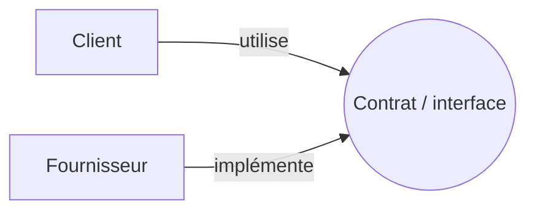
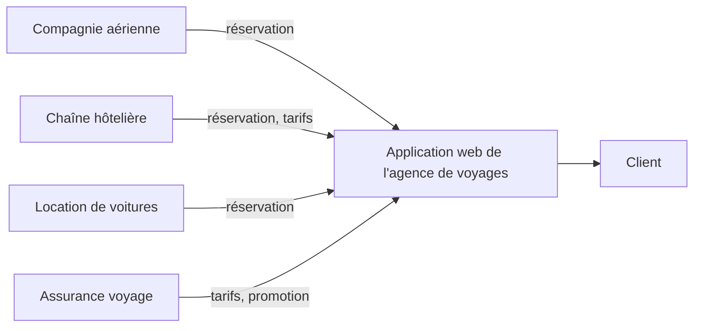

# Résumé — Séance 1 : Introduction

Support : [[Séance 1 - Introduction.pdf]] · séance du 24/09/2026 · suite : [[Résumé - Séance 2 - Sockets (1)]]

## 1. Système réparti

> [!definition] Système réparti
> Un ensemble d'ordinateurs **indépendants** qui apparaît à l'utilisateur comme un **système unique et cohérent**.
>
> Plus précisément : un ensemble d'**entités autonomes de calcul** (ordinateurs, processeurs, processus…) **interconnectées**, qui communiquent par un **réseau de communication**, au moyen d'**envoi de messages**.

Deux idées à retenir :

- les machines sont **autonomes** ;
- l'utilisateur a l'impression d'utiliser un seul système : c'est la **notion de transparence**.

## 2. Pourquoi des systèmes répartis ?

| Motivation | Ce que ça veut dire |
|---|---|
| Aspects économiques | un meilleur rapport prix / performance |
| Adaptation | la structure du système suit celle des applications (géographique ou fonctionnelle) |
| Intégration | relier des applications existantes, au départ séparées |
| Communication | échanger et partager de l'information |
| Partage de ressources | programmes, données, services |
| Haute disponibilité | construire des systèmes qui restent disponibles |
| Évolutivité | construire des systèmes à grande capacité d'évolution |

## 3. Application répartie

Une application **découpée en plusieurs unités** :

- chaque unité peut être placée sur une **machine différente** ;
- chaque unité peut s'exécuter sur un **système différent** ;
- chaque unité peut être programmée dans un **langage différent**.

Beaucoup d'applications ne s'exécutent pas entièrement sur un seul nœud de calcul : ce sont des **applications réparties**.

> [!abstract] La formule à retenir
> **Application répartie = traitements coopérants sur des données réparties.**

## 4. Système ou application ?

| | Système | Application |
|---|---|---|
| Rôle | gère les **ressources communes** et l'**infrastructure** | répond à un **problème spécifique** |
| Lien avec le matériel | étroit | indirect |
| Exemples | le **système d'exploitation** (gère chaque élément) ; le **système de communication** (échange d'information entre les éléments) | fournit des **services** à ses utilisateurs, qui peuvent être d'autres applications |
| Relation | fournit des services généraux | **utilise** les services généraux du système |

## 5. Services et interfaces

> [!definition] Service
> Un comportement **défini par un contrat**, qui peut être implémenté et fourni par un composant pour être utilisé par un autre composant, **sur la base exclusive du contrat**.

Mise en œuvre :

- un service est **accessible** via une ou plusieurs **interfaces** ;
- une **interface** décrit l'interaction entre le **demandeur** (client) et le **fournisseur** du service, selon deux points de vue :
  - **opérationnel** : les opérations et les structures de données qui réalisent le service ;
  - **contractuel** : le contrat entre le client et le fournisseur.

### Exemple : l'agence de voyages

Un produit « voyage » combine plusieurs produits : réservation de billets de transport, d'hôtels, de voitures de location… Les informations viennent de **fournisseurs différents**, chacun sur sa propre **plateforme technique** :

L'agence assemble ces services dans une application web : les traitements et les données sont répartis chez plusieurs acteurs.

## 6. Domaines d'application

- **Coordination d'activités et collaboration** : Google Docs, Canva, Jira, Trello ; jeux vidéo et échecs en ligne.
- **Communication et partage d'information** : commerce électronique ; réseaux sociaux (TikTok, Facebook, Instagram) ; WhatsApp, Messenger ; Netflix, YouTube.
- **Applications temps réel** : contrôle de procédés industriels, télémédecine.
- Et plus généralement **toutes les applications qui ont des utilisateurs ou des données répartis**.

## 7. Programmation classique ou répartie

La plupart des applications réparties sont de type **client/serveur** : le client demande des services à un serveur.

- En **programmation classique**, un programme qui a besoin d'un service appelle **localement** une fonction / procédure / méthode (d'une bibliothèque, d'un objet…).
- En **programmation répartie**, cet appel peut se faire **à distance**.

| Programmation classique | Programmation répartie |
|---|---|
| L'utilisateur et le fournisseur du service sont sur la **même machine** | Ils sont sur **deux machines différentes** (sans compter celles traversées), mais l'utilisateur a l'impression d'une seule : la **transparence** |
| Même OS | OS différents |
| Même espace mémoire | Mémoires individuelles |
| Pas de problème de transport | Problèmes de transport : pare-feu (*firewall*), réseau… |
| Service disponible localement (tant qu'on a la bibliothèque) | Il faut **retrouver le service** : où se trouve-t-il ? qui le propose ? |
| Un seul langage de programmation | Langages différents : paradigmes, passage de paramètres… |

> [!tip] Le but du cours
> Proposer des **méthodes, concepts et outils** qui simplifient le développement d'applications réseau client/serveur, en **faisant abstraction de l'aspect distant**.

## 8. Plan du cours

| Chapitre | Contenu |
|---|---|
| **I — Sockets** | introduction aux sockets · sockets en mode connecté (TCP) · sockets en mode paquet (UDP) · API Java `java.net` |
| **II — Architectures client/serveur** | problèmes d'intégration d'applications · fondements des architectures client/serveur · système RMI · API Java JNDI |
| **III — Intergiciels orientés objets (CORBA)** | introduction aux intergiciels · architecture CORBA · composants et services CORBA · langage IDL et projection en Java |
| **IV — Intergiciels orientés messages** | intergiciels orientés messages · API Java JMS · création, manipulation et échange de messages · fiabilité de la communication |

## Questions de révision

1. Donner la définition d'un système réparti. Quelle notion décrit le fait que l'utilisateur voit un seul système ?
2. Compléter : « Application répartie = … ».
3. Quelle est la différence entre un système et une application ?
4. Qu'est-ce qu'un service ? Quels sont les deux points de vue d'une interface ?
5. Citer quatre différences entre programmation classique et programmation répartie.

> [!question]- Réponses
> 1. Un ensemble d'entités autonomes de calcul interconnectées, qui communiquent par un réseau au moyen de messages, et qui apparaît comme un système unique et cohérent. C'est la **transparence**.
> 2. « … traitements coopérants sur des données réparties. »
> 3. Le système gère les ressources communes et l'infrastructure (OS, communication) ; l'application répond à un problème précis et utilise les services du système.
> 4. Un comportement défini par un contrat, fourni par un composant et utilisé par un autre sur la seule base de ce contrat. Points de vue **opérationnel** (opérations, structures de données) et **contractuel** (contrat client / fournisseur).
> 5. Au choix : OS différents, mémoires séparées, problèmes de transport (réseau, pare-feu), service à localiser, langages différents.

Voir aussi : les notions de service et de contrat sont reprises en SOA et services Web.
