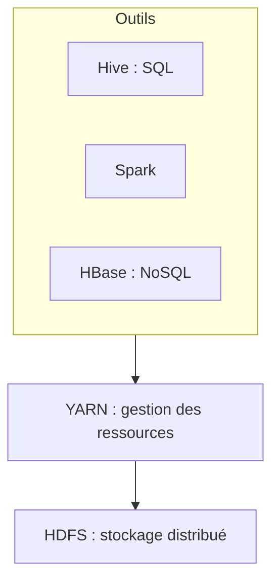

# Hadoop, MapReduce et Spark

## Qu'est-ce que le Big Data ?

Des données trop **volumineuses**, trop **rapides** ou trop **variées** pour une seule machine et une base de données classique.

> [!definition] Les 5 V
> - **Volume** : des téraoctets à des pétaoctets.
> - **Vélocité** : des données qui arrivent en continu (capteurs, clics, transactions).
> - **Variété** : structurées (tables), semi-structurées (JSON, logs), non structurées (texte, images).
> - **Véracité** : la qualité et la fiabilité des données.
> - **Valeur** : ce qu'on en tire réellement.

L'idée clé : au lieu d'acheter une machine plus puissante (*scale up*), on répartit le travail sur **beaucoup de machines ordinaires** (*scale out*) et on **amène le calcul aux données**, pas l'inverse.

## L'écosystème Hadoop



### HDFS

Le système de fichiers distribué de Hadoop.

- Les fichiers sont découpés en **blocs** de 128 Mo.
- Chaque bloc est **répliqué** sur 3 machines par défaut → une panne ne fait rien perdre.
- Le **NameNode** garde les métadonnées (quel bloc est où) ; les **DataNodes** stockent les blocs.
- Pensé pour écrire une fois et **lire beaucoup**, en gros fichiers.

```sh
hdfs dfs -mkdir -p /user/etudiant
hdfs dfs -put livres.txt /user/etudiant/
hdfs dfs -ls /user/etudiant
hdfs dfs -cat /user/etudiant/livres.txt | head
```

### YARN

Le gestionnaire de ressources : il distribue le CPU et la mémoire du cluster entre les applications (MapReduce, Spark…).

## MapReduce

Un modèle de programmation en deux phases, exécutées en parallèle sur tout le cluster.

1. **Map** : chaque morceau de données est transformé en paires `(clé, valeur)`.
2. **Shuffle & sort** : le framework regroupe toutes les valeurs d'une même clé.
3. **Reduce** : pour chaque clé, on combine les valeurs.

> [!exemple] Compter les mots
> Entrée : « le chat le chien »
> - Map → `(le, 1) (chat, 1) (le, 1) (chien, 1)`
> - Shuffle → `le: [1, 1]` · `chat: [1]` · `chien: [1]`
> - Reduce → `(le, 2) (chat, 1) (chien, 1)`

> [!remarque] La limite de MapReduce
> Entre chaque étape, les résultats sont **écrits sur disque**. Les algorithmes itératifs (machine learning, graphes) deviennent très lents.

## Apache Spark

Spark garde les données **en mémoire** entre les étapes : il est bien plus rapide que MapReduce pour les traitements itératifs. Il propose des API en Python (**PySpark**), Scala, Java, R et SQL.

| Brique | Rôle |
|---|---|
| Spark Core / RDD | collections distribuées de bas niveau |
| Spark SQL / DataFrame | tables distribuées, requêtes SQL |
| Structured Streaming | flux en temps réel |
| MLlib | machine learning distribué (voir le cours de ML) |
| GraphX | graphes |

### Transformations et actions

- Les **transformations** (`map`, `filter`, `groupBy`, `join`…) sont **paresseuses** : elles ne font que construire un plan d'exécution.
- Les **actions** (`count`, `collect`, `show`, `write`…) déclenchent réellement le calcul.

```python
from pyspark.sql import SparkSession, functions as F

spark = SparkSession.builder.appName("ventes").getOrCreate()
df = spark.read.csv("ventes.csv", header=True, inferSchema=True)

(df.filter(F.col("montant") > 0)
   .groupBy("ville")
   .agg(F.sum("montant").alias("total"), F.count("*").alias("nb"))
   .orderBy(F.desc("total"))
   .show(10))
```

Le même calcul en SQL : `df.createOrReplaceTempView("ventes")`, puis `spark.sql("SELECT ville, SUM(montant) AS total FROM ventes GROUP BY ville")`.

## Les bases NoSQL

| Famille | Modèle | Exemples |
|---|---|---|
| Clé-valeur | un dictionnaire géant | Redis, DynamoDB |
| Documents | des documents JSON | MongoDB, CouchDB |
| Colonnes | des tables très larges et distribuées | Cassandra, HBase |
| Graphes | des nœuds et des relations | Neo4j |

Le choix dépend du théorème CAP : pendant une coupure réseau, un système réparti garde la cohérence ou la disponibilité, pas les deux.

> [!abstract] À retenir
> HDFS stocke (blocs répliqués), YARN répartit les ressources, MapReduce calcule sur disque, Spark calcule en mémoire. Transformations paresseuses, actions qui déclenchent le calcul. Fiche : [[Résumé - Big Data]].
