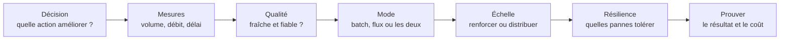
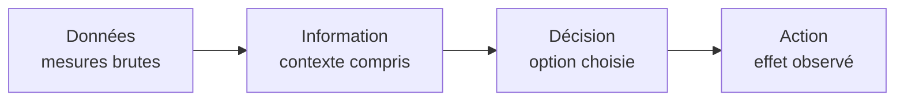
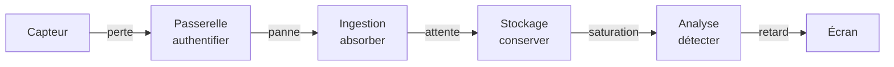
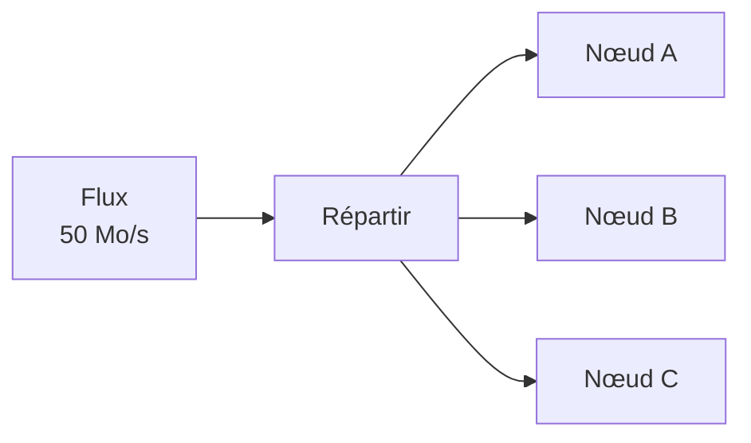
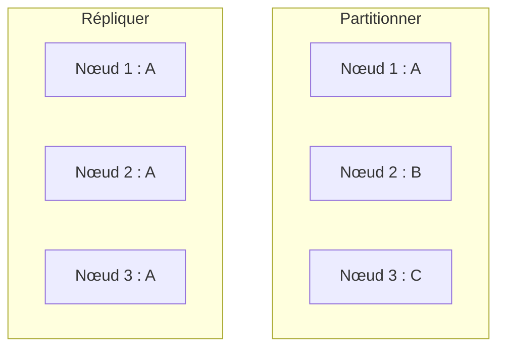
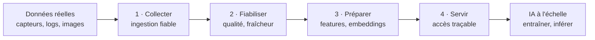
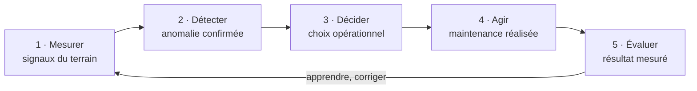

# Résumé — Chapitre 1 : Introduction au Big Data

Support : [[Chapitre 1 - Introduction au Big Data.pdf]] (28 diapositives ; la diapositive N est la page N + 1 du PDF) · Dr. Ing. Takwa Ben Aïcha Gader · ISIMa, 2026-2027 · suite : [[Résumé - Chapitre 2 - Hadoop et HDFS]]

Le chapitre ne commence pas par une définition. Il suit un cas réel, une machine industrielle (**M42**) qui chauffe à 2 h du matin, et pose à chaque étape la même question : **qu'est-ce qu'il faut garantir pour que la donnée serve à décider ?** Le Big Data y apparaît comme une **architecture qu'on défend avec des mesures** (volume, débit, délai, qualité, pannes, coût), jamais comme un réflexe ou un mot à la mode.

> [!abstract] L'idée du chapitre en une phrase
> Partir du besoin, mesurer, choisir le moyen le plus simple, puis prouver qu'il tient (diapositive 27).

## Le chapitre en un coup d'œil

| Diapositives | Thème |
|---|---|
| 1 à 4 | de la donnée à l'action, les métiers de la donnée |
| 5 à 9 | le fil rouge M42 : alerte, décision, chemin d'une mesure |
| 10 à 14 | dimensionner : débit, stockage, latence, verdict |
| 15 à 18 | les 5 V, autres domaines, qualité de la donnée |
| 19 à 22 | scale-up ou scale-out, partitionner ou répliquer, batch ou streaming |
| 23 à 28 | outils et problèmes durables, IA, boucle de décision, carte de décision, vers Hadoop |

## 1. Une donnée n'a de valeur que si elle éclaire une action

*Diapositives 2 à 4*

La question posée par la diapositive 2 : **que vaut une donnée correcte si elle arrive trop tard ?** Rien, si la décision devait être prise avant.

Les applications se voient (industrie : machines connectées ; finance : paiements et fraude ; santé : signaux et alertes ; mobilité : véhicules connectés), mais derrière chacune il y a la même **chaîne de responsabilités**, souvent invisible :

> **Collecter → Transporter → Stocker → Traiter → Fiabiliser → Servir**

C'est le travail du **data engineer** et du **data architect**. L'objectif du chapitre (diapositive 4) : savoir **défendre ou rejeter une architecture à partir de contraintes mesurées**, en raisonnant comme un data engineer junior : **mesurer, comparer, choisir, tester, justifier**, et mesurer *avant* de nommer une technologie.

## 2. Le fil rouge : la machine M42

*Diapositives 5 à 8*

> [!exemple] 02 h 17, M42 chauffe
> Dans un parc industriel IoT, la machine M42 monte à **87 °C**, avec une **vibration en hausse de 18 %**. Il faut produire une alerte utile en **5 secondes**. Le problème n'est pas d'*avoir* des données : c'est **décider assez vite, avec assez de confiance**.

**Ce qu'il faut garantir** (diapositive 6) : une mesure ne devient décisionnelle que si **toutes** ces conditions tiennent ensemble. Une seule condition critique défaillante peut rendre la donnée inutilisable.

| Condition | Question à se poser |
|---|---|
| **Correcte** | la valeur est-elle juste ? |
| **Fraîche** | est-elle encore actuelle ? |
| **Disponible** | peut-on y accéder quand on en a besoin ? |
| **Rapide** | arrive-t-elle dans le délai de la décision ? |
| **Interprétable** | sait-on ce qu'elle veut dire (unité, contexte) ? |
| **Exploitable** | permet-elle d'agir ? |

**Anomalie, alerte, panne : trois événements différents** (diapositive 7). Une valeur inhabituelle ne signifie ni panne certaine, ni arrêt automatique.

| Événement | Moment pour M42 | Définition |
|---|---|---|
| **Anomalie** | 02:17:00 | écart au comportement attendu |
| **Alerte** | 02:17:03 | demande de vérification |
| **Panne possible** | plus tard | la fonction n'est plus assurée |

> [!important] Détecter n'est pas décider
> L'alerte demande une **vérification**, pas un arrêt automatique.

**Ce que décide l'opératrice** (diapositive 8), avec le contexte (tendance, vibration, charge, maintenance, fraîcheur des données) :

| Option | Quand |
|---|---|
| **Arrêter** | risque élevé confirmé : sécuriser la machine |
| **Surveiller** | il reste de l'incertitude : augmenter les contrôles |
| **Poursuivre** | le signal est expliqué : fonctionnement jugé acceptable |

La valeur d'une donnée dépend de **la décision qu'elle améliore**.

## 3. Le chemin d'une mesure, du capteur à l'écran

*Diapositive 9*

Chaque maillon peut **ralentir, perdre ou déformer** l'information. La **latence de bout en bout** additionne collecte, transport, attente, calcul et affichage : c'est elle qui compte pour les 5 secondes de M42, pas la vitesse d'un seul composant.

## 4. Dimensionner avec des unités

*Diapositives 10 et 11*

On dimensionne avec des **unités**, pas avec l'impression que « cela fait beaucoup ».

**Combien de données arrivent ?**

$$10\,000 \text{ capteurs} \times 10 \text{ messages/s} \times 500 \text{ octets} = 50\,000\,000 \text{ o/s} = 50 \text{ Mo/s}$$

soit **100 000 événements par seconde**. Ce nombre décrit une contrainte, mais ne suffit pas, seul, à dire qu'on est dans le Big Data.

**Combien faut-il réellement stocker ?** La rétention brute n'est que le début :

| Étape | Calcul | Résultat |
|---|---|---|
| 1 · un jour | $50 \text{ Mo/s} \times 86\,400 \text{ s}$ | **4,32 To/jour** |
| 2 · rétention de 30 jours | $4{,}32 \times 30$ | **129,6 To** |
| 3 · réplication (3 copies) | $129{,}6 \times 3$ | **388,8 To répliqués** |
| 4 · marge de 25 % | $388{,}8 \times 1{,}25$ | **486 To planifiés** |

L'échelle apparaît quand **débit × temps × résilience × marge** s'accumulent.

> [!tip] Les unités du cours sont décimales
> 1 Mo = $10^6$ octets, 1 To = $10^{12}$ octets : c'est ce qui donne exactement 50 Mo/s et 4,32 To/jour. *Recalculé en Python (complément, hors diapositives) : mêmes valeurs à chaque étape.*

## 5. Débit et latence : deux questions différentes

*Diapositive 12*

| | Débit | Latence |
|---|---|---|
| Question | **combien par seconde ?** | **en combien de temps ?** |
| Exemple M42 | 50 Mo/s | p95 = 3,8 s |
| Sens | quantité traitée pendant une durée | 95 % des alertes arrivent avant 3,8 s |

Transporter beaucoup par seconde ne garantit pas qu'un événement arrive vite : **un système peut avoir un excellent débit et une mauvaise latence** (une grosse file d'attente bien remplie, par exemple).

> [!definition] Le percentile p95
> Le **p95** est la durée sous laquelle se trouvent 95 % des mesures. On l'utilise plutôt que la moyenne parce que c'est le **temps vécu par les cas lents** qui compte pour une alerte.

> [!exemple]- Complément, hors diapositives : calculer un p95
> 20 latences d'alertes, triées (en secondes) : 0,6 · 0,7 · 0,8 · 0,8 · 0,9 · 0,9 · 1,0 · 1,0 · 1,1 · 1,2 · 1,2 · 1,3 · 1,4 · 1,5 · 1,7 · 2,0 · 2,4 · 3,1 · **3,8** · 6,5
>
> - rang du p95 : $\lceil 0{,}95 \times 20 \rceil = 19$, donc **p95 = 3,8 s** (la 19e valeur) ;
> - la moyenne n'est que de **1,69 s** et cache le cas lent ;
> - l'objectif « p95 ≤ 5 s » est tenu, même si **une** alerte a mis 6,5 s : un p95 tolère 5 % de cas plus lents. Si ces 5 % sont inacceptables, il faut viser un p99 ou un maximum.
>
> *Calcul vérifié en Python (méthode du rang le plus proche).*

## 6. Défendre une architecture : le verdict

*Diapositives 13 et 14*

> [!question] Activité de la diapositive 13
> Serveur candidat : **20 To, 70 Mo/s mesurés, un seul nœud**. Quel risque testez-vous en premier : la capacité, le débit, la latence ou la panne ?

Le verdict de la diapositive 14 : on compare **chaque besoin à une mesure ou à un test reproductible**.

| Contrainte | Besoin | Candidat | Verdict |
|---|---|---|---|
| Stockage | 486 To planifiés | 20 To | **NON** |
| Débit | 65 Mo/s avec marge | 70 Mo/s | OUI |
| Latence | p95 ≤ 5 s | non testée | À TESTER |
| Disponibilité | supporter la perte d'un nœud | nœud unique | **NON** |

> [!important] Une contrainte critique suffit à dire non
> Ici, deux contraintes échouent (stockage et disponibilité) : le serveur est rejeté, même si son débit suffit. Une architecture se défend par des **preuves** : capacité, charge, délai, panne et coût.

> [!remarque] Deux marges différentes
> Les 65 Mo/s du besoin en débit correspondent à 50 Mo/s **+ 30 %** de marge, alors que le stockage prenait **+ 25 %**. Ce n'est pas une erreur : chaque contrainte peut avoir sa propre marge, mais il faut savoir d'où vient le chiffre.

## 7. Les 5 V, tirés du cas M42

*Diapositive 15*

Les « V » **nomment des difficultés observables**. Ils ne remplacent pas le dimensionnement.

| V | Ce que c'est | Dans le cas M42 |
|---|---|---|
| **Volume** | la quantité à stocker | 486 To |
| **Vélocité** | la vitesse d'arrivée et de réponse | 50 Mo/s, p95 < 5 s |
| **Variété** | des sources et formats différents | mesures, logs, maintenance, ordres |
| **Véracité** | la fiabilité de la donnée | absence, retard, dérive |
| **Valeur** | ce qu'on en tire | une décision, un effet mesuré |

## 8. Même raisonnement, décisions différentes

*Diapositive 16*

Le domaine change, mais on part toujours de **l'action, du délai et du coût de l'erreur**. Une architecture n'est jamais rapide ou fiable dans l'absolu : elle répond à un besoin.

| Domaine | Décision | Délai | Risque |
|---|---|---|---|
| Santé | prioriser un examen | minutes | alerte manquée |
| Énergie | inspecter une turbine | heures | arrêt inutile |
| Paiement | bloquer ou vérifier | secondes | client ou fraudeur lésé |

## 9. Qualité : absente, zéro et retardée ne disent pas la même chose

*Diapositives 17 et 18*

Transformer une valeur sans préserver son sens peut **fabriquer une fausse panne**.

| Cas | Exemple | Ce que ça veut dire | Que faire |
|---|---|---|---|
| **Absente** | « — » | le capteur est muet | **diagnostiquer** le capteur |
| **Zéro** | 0 °C | une mesure possible | **valider** la valeur |
| **Retardée** | 6 °C reçue avec l'heure 01:32 | une information périmée | **l'écarter du temps réel** |

> [!important] Absence ≠ zéro ≠ donnée ancienne
> Une mesure correcte mais périmée peut être inutile. Ne jamais remplacer une valeur manquante par 0 sans réfléchir.

> [!question]- Activité de la diapositive 18 : trouvez la fausse alerte (réponse proposée, hors diapositives)
> Règle naïve : « température < 10 °C ou > 80 °C ⇒ arrêter M42 ».
>
> | Mesure | Heure | Qualité | Ce que dirait la règle | Ce qu'il faut faire |
> |---|---|---|---|---|
> | A : — | 02:17:01 | capteur silencieux | arrêt, si l'absence est lue comme 0 °C | **fausse alerte** : diagnostiquer le capteur |
> | B : 87 °C | 02:17:02 | fraîche et complète | arrêt | **vraie alerte**, mais elle demande une vérification avant d'arrêter (section 2) |
> | C : 6 °C | 01:32:00 | 45 min de retard | arrêt | **fausse alerte** : donnée périmée, à écarter du temps réel |
>
> Raisonnement tiré des diapositives 7 et 17 : on juge chaque mesure par son **sens**, sa **complétude** et sa **fraîcheur**.

## 10. Premier levier : renforcer la machine (scale-up)

*Diapositive 19*

Le **scale-up** (mise à l'échelle verticale) ajoute CPU, mémoire ou disques **au même serveur**.

| | Avant | Après |
|---|---|---|
| CPU | 32 cœurs | 64 cœurs |
| Mémoire | 256 Go | 512 Go |
| Stockage | 20 To | 80 To |

- **Atout** : l'exploitation reste simple (une seule machine).
- **Limites** : un **plafond matériel**, et un **point de panne unique**.

Règle : toujours tester d'abord **la solution la plus simple** qui satisfait réellement les contraintes.

> [!tip] Complément, hors diapositives : le scale-up suffit-il pour M42 ?
> 80 To couvrent **16 %** des 486 To planifiés. Il faudrait au moins $\lceil 486 / 80 \rceil = 7$ machines de 80 To, ce qui est déjà du scale-out. Et une seule machine ne survit pas à sa propre panne.

## 11. Deuxième levier : répartir la charge (scale-out)

*Diapositive 20*

Le **scale-out** (mise à l'échelle horizontale) **ajoute des nœuds** et répartit les données ou les calculs entre eux.

Ce qui apparaît avec la distribution : le **réseau et les files d'attente**, la **coordination et la synchronisation**, les **pannes partielles** (un nœud tombe, les autres continuent). Distribuer augmente la capacité, **mais aussi la complexité**.

## 12. Partitionner n'est pas répliquer

*Diapositive 21*

| | Partitionner | Répliquer |
|---|---|---|
| Principe | A, B et C sont des **parties différentes**, réparties entre les nœuds | la **même** donnée A existe sur **plusieurs nœuds distincts** |
| Sert à | partager le **volume** (et le travail) | **résister** à certaines pannes |

> [!warning] La réplication n'est pas une sauvegarde
> Elle améliore la redondance, mais **ne remplace ni la sauvegarde ni un historique protégé** : une suppression ou une corruption est répliquée elle aussi.

HDFS fait les deux : il **partitionne** un fichier en blocs et **réplique** chaque bloc (3 copies par défaut ; voir le [[Résumé - Chapitre 2 - Hadoop et HDFS#7. Distribution et réplication : deux idées différentes|résumé HDFS]]).

## 13. Deux horloges : batch et streaming

*Diapositive 22*

| | Batch | Streaming |
|---|---|---|
| Exemple M42 | le bilan quotidien | l'alerte |
| Délai | **24 h** | **moins de 5 s** |
| Principe | relire un **lot complet** pour recalculer tendances et bilans | traiter les **événements en continu** |
| Points de vigilance | | contrôler **retard, doublons et reprise** après panne |

Le mode dépend du **délai acceptable**. Un même système peut combiner les deux (le bilan du jour en batch, les alertes en streaming).

## 14. Les outils changent, les problèmes restent

*Diapositive 23*

| Problème durable | Exemples de solutions |
|---|---|
| Stockage distribué | HDFS, object storage |
| Calcul distribué | MapReduce, Spark |
| Traitement continu | stream processing |
| Gestion des ressources | ordonnanceurs, orchestration |
| Accès et service | NoSQL, services cloud |

Les questions fondamentales restent : **volume, débit, latence, disponibilité, qualité et coût**.

## 15. L'IA à l'échelle dépend des données

*Diapositive 24*

Le **monitoring** suit tout le pipeline : qualité des données, **dérive du modèle**, latence et effet réel. À grande échelle, la performance d'un modèle dépend **autant de la plateforme de données que du calcul**.

## 16. Activité : quelle architecture défendez-vous ?

*Diapositive 25*

Besoin : **486 To planifiés, 50 Mo/s, p95 < 5 s, perte d'un nœud tolérée**. Options : A, le serveur actuel (20 To, nœud unique) ; B, le scale-up (une machine plus grande) ; C, le scale-out (plusieurs nœuds). Il faut défendre une option **et nommer le test qui pourrait vous donner tort**.

> [!question]- Réponse proposée (hors diapositives, tirée des diapositives 14, 19 et 20)
> - **A, non** : stockage (20 To contre 486) et disponibilité (nœud unique) échouent déjà au verdict de la diapositive 14.
> - **B, non** : la machine de la diapositive 19 plafonne à 80 To, et reste un point de panne unique, alors que le besoin demande de tolérer la perte d'un nœud.
> - **C, à défendre** : c'est la seule option qui peut tenir le volume et la panne. Les tests qui pourraient l'invalider : un **test de charge** (65 Mo/s avec un p95 mesuré sous 5 s), un **test de panne** (couper un nœud pendant la charge) et un **calcul de coût**.
>
> Tant que ces tests ne sont pas faits, l'option C reste une **hypothèse**.

## 17. Fermer la boucle : mesurer pour mieux décider

*Diapositive 26*

Indicateurs suivis : **latence p95 de 3,8 s**, **82 % d'alertes pertinentes**, **6 faux positifs par jour**. Être **data-driven**, c'est mesurer l'effet de chaque action pour améliorer la décision suivante.

## 18. La carte de décision Big Data

*Diapositive 27 : le référentiel du cours, sept questions pour raconter et défendre une architecture*

| # | Thème | Question |
|---|---|---|
| 1 | Décision | quelle action améliorer ? |
| 2 | Mesures | quel volume, quel débit, quel délai ? |
| 3 | Qualité | la donnée est-elle fraîche et fiable ? |
| 4 | Mode | batch, flux ou les deux ? |
| 5 | Échelle | renforcer ou distribuer ? |
| 6 | Résilience | quelles pannes tolérer ? |
| 7 | Preuve | prouver le résultat et le coût |

## 19. Étape suivante : répartir les responsabilités

*Diapositive 28*

Si la distribution est justifiée, il faut répondre à trois questions, et Hadoop y répond avec trois composants :

| Composant | Rôle | Question |
|---|---|---|
| **HDFS** | **stocker** | où placer les blocs et leurs copies ? |
| **YARN** | **arbitrer** | qui reçoit CPU et mémoire ? |
| **MapReduce** | **calculer** | comment distribuer un calcul batch ? |

Hadoop devient une architecture **candidate** parce que le besoin a été mesuré, **jamais par réflexe**. Suite : [[Résumé - Chapitre 2 - Hadoop et HDFS]] (HDFS), puis [[Résumé - Chapitre 2 - MapReduce et YARN]] (MapReduce et YARN).

## À retenir

- Le Big Data n'est pas une taille : c'est un ensemble de **contraintes mesurées** (volume, débit, latence, qualité, pannes, coût) qu'une architecture doit tenir.
- On part de la **décision** à améliorer et de son **délai**, puis on dimensionne **avec des unités** : 50 Mo/s deviennent 486 To planifiés avec 30 jours, 3 copies et 25 % de marge.
- **Débit ≠ latence** ; on mesure la latence en **p95**.
- Une seule contrainte critique non tenue suffit à **rejeter** une architecture.
- Une donnée **absente**, **nulle** ou **retardée** n'a pas le même sens. **Détecter n'est pas décider.**
- **Scale-up** : simple mais plafonné, et point de panne unique. **Scale-out** : plus de capacité, mais réseau, coordination et pannes partielles.
- **Partitionner** partage le volume, **répliquer** protège des pannes, et aucun des deux n'est une sauvegarde.
- **Batch** (heures) et **streaming** (secondes) répondent à des délais différents et se combinent.

## Questions de révision

1. Pourquoi « une donnée correcte qui arrive trop tard » peut-elle ne rien valoir ?
2. Citer les six conditions qui rendent une mesure décisionnelle.
3. Quelle différence entre une anomalie, une alerte et une panne ?
4. 5 000 capteurs envoient 20 messages par seconde de 400 octets. Quel débit ? Quel stockage planifié pour 7 jours, 3 copies et 25 % de marge ?
5. Un système traite 200 Mo/s mais son p95 est de 12 s. Est-il adapté aux alertes de M42 ? Pourquoi ?
6. Pourquoi un serveur à 70 Mo/s est-il rejeté alors que le besoin n'est que de 65 Mo/s ?
7. Une température est absente, une autre vaut 0 °C, une troisième a 45 minutes de retard. Que faire de chacune ?
8. Donner un atout et deux limites du scale-up, puis ce qui apparaît avec le scale-out.
9. Quelle est la différence entre partitionner et répliquer ? Pourquoi la réplication n'est-elle pas une sauvegarde ?
10. Batch ou streaming pour : le bilan mensuel de production ; le blocage d'un paiement suspect ?
11. Quels rôles jouent HDFS, YARN et MapReduce ?

> [!question]- Réponses
> 1. Parce que sa valeur vient de la **décision** qu'elle améliore : si la décision devait être prise avant (les 5 secondes de M42), la donnée arrive quand il n'y a plus rien à décider.
> 2. **Correcte, fraîche, disponible, rapide, interprétable, exploitable**, et toutes en même temps.
> 3. **Anomalie** : un écart au comportement attendu. **Alerte** : une demande de vérification. **Panne** : la fonction n'est plus assurée. Une anomalie ne prouve pas une panne, et une alerte ne commande pas un arrêt automatique.
> 4. $5\,000 \times 20 \times 400 = 40\,000\,000$ o/s = **40 Mo/s** (100 000 événements/s). Un jour : $40 \times 86\,400 = 3{,}456$ To ; 7 jours : 24,192 To ; ×3 : 72,576 To ; ×1,25 : **90,72 To planifiés**.
> 5. **Non** : son débit est excellent, mais 5 % de ses alertes mettent plus de 12 s, bien au-delà des 5 s. Débit et latence sont deux questions différentes.
> 6. À cause des **autres** contraintes : 20 To pour 486 To planifiés, et un nœud unique qui ne tolère pas de panne. Une seule contrainte critique non tenue suffit à dire non.
> 7. **Absente** : diagnostiquer le capteur (ne pas la lire comme 0). **0 °C** : valider la valeur, elle est peut-être vraie. **45 min de retard** : l'écarter du temps réel, elle est périmée.
> 8. Atout : une exploitation simple. Limites : le **plafond matériel** et le **point de panne unique**. Avec le scale-out apparaissent le réseau et les files, la coordination et les pannes partielles.
> 9. **Partitionner** répartit des morceaux différents sur les nœuds (le volume est partagé) ; **répliquer** copie la même donnée sur plusieurs nœuds (on survit à une panne). Une suppression ou une corruption est répliquée elle aussi : il faut une sauvegarde ou un historique protégé à part.
> 10. Bilan mensuel : **batch**. Paiement suspect : **streaming** (délai de quelques secondes).
> 11. **HDFS stocke** (blocs et copies), **YARN arbitre** (CPU et mémoire), **MapReduce calcule** (traitement batch distribué).
