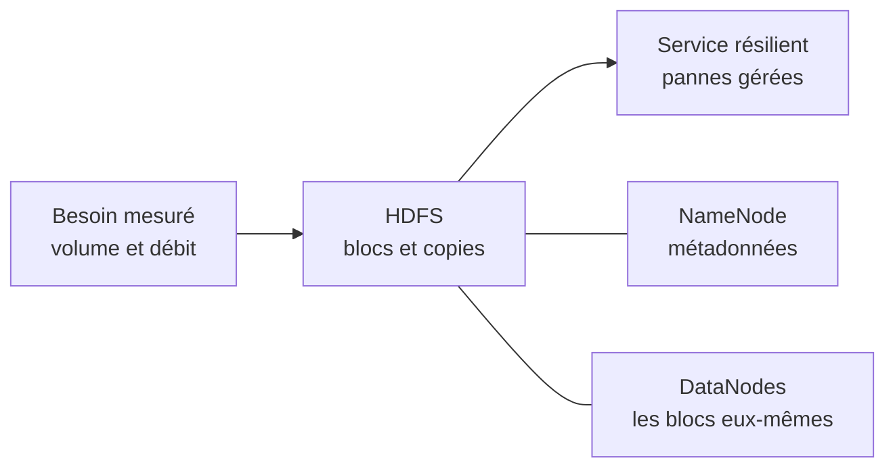
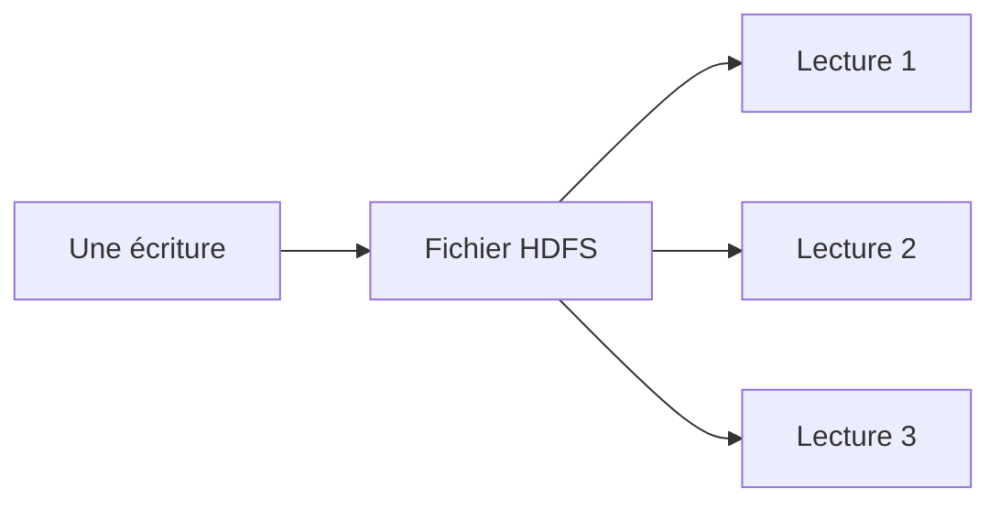
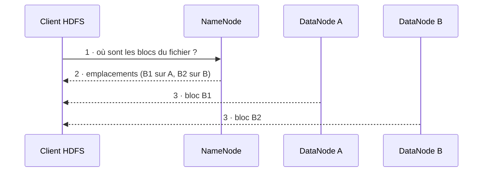
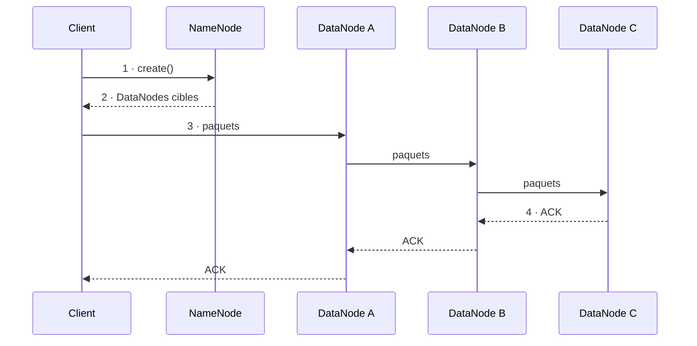

# Résumé — Chapitre 2 (partie 1) : Hadoop et HDFS

Support : [[Chapitre 2 - Hadoop et HDFS (partie 1).pdf]] (22 diapositives, plus le quiz et la synthèse ; la diapositive N est la page N + 1 du PDF) · Dr. Ing. Takwa Ben Aïcha Gader · ISIMa, 2026-2027 · précédent : [[Résumé - Chapitre 1 - Introduction au Big Data]] · suite : [[Résumé - Chapitre 2 - MapReduce et YARN]]

Le chapitre 1 a montré, mesures à l'appui, qu'une seule machine ne suffit pas pour le cas M42. Cette partie répond à la première des trois questions qui restaient : **qui stocke ?** La réponse de Hadoop est **HDFS**, un système de fichiers qui découpe chaque fichier en **gros blocs**, les **répartit** sur plusieurs machines et en garde **plusieurs copies**, pour que le stockage reste disponible quand une partie de l'infrastructure tombe en panne.

> [!tip] Les diapositives 1 à 5 reprennent le chapitre 1
> Ce support commence par un rappel du [[Résumé - Chapitre 1 - Introduction au Big Data|chapitre 1]], résumé là-bas en détail :
>
> | Diapositive | Thème | Dans le résumé du chapitre 1 |
> |---|---|---|
> | 1 | des données à la décision | section 1 |
> | 2 | 02 h 17, M42 chauffe | section 2 |
> | 3 | combien de données arrivent ? (50 Mo/s) | section 4 |
> | 4 | combien faut-il stocker ? (486 To) | section 4 |
> | 5 | les 5 V tirés du cas M42 | section 7 |

## La partie en un coup d'œil



| Diapositives | Thème |
|---|---|
| 6 à 8 | scale-up ou scale-out, pourquoi Hadoop, la carte mentale HDFS, YARN, MapReduce |
| 9 à 12 | pourquoi HDFS, *write once, read many*, les blocs, distribution et réplication |
| 13 à 16 | NameNode et DataNodes, heartbeats, block reports, panne d'un DataNode |
| 17 à 20 | lire et écrire un fichier, panne pendant l'écriture, data locality |
| 21 et 22 | les commandes `hdfs dfs` |
| fin | quiz en ligne et synthèse |

## 1. Pourquoi ne pas acheter un serveur plus puissant ?

*Diapositive 6*

| | Scale-up (renforcer une machine) | Scale-out (ajouter des machines) |
|---|---|---|
| Comment | plus de CPU, plus de RAM, un stockage plus rapide | ajouter des machines, répartir données et calculs |
| Coût | une machine **de plus en plus coûteuse** | on **augmente la capacité progressivement** |
| Limites | une **limite physique** et un **point de panne important** | il faut **concevoir la tolérance aux pannes** |

C'est le raisonnement des diapositives 19 et 20 du chapitre 1 (voir les sections 10 et 11 de son [[Résumé - Chapitre 1 - Introduction au Big Data|résumé]]) : pour M42, 486 To et la perte d'un nœud tolérée imposent le scale-out.

## 2. Pourquoi Hadoop ?

*Diapositive 7*

- Hadoop est un **ensemble de technologies open source** pour **stocker** et **traiter** de gros volumes **sur un cluster** (un groupe de machines reliées en réseau).
- Il a popularisé une architecture fondée sur des **machines standards**, la **distribution des données** et le **calcul près des données**.
- Aujourd'hui, il reste surtout important pour comprendre **les principes fondateurs du Data Engineering distribué** : on les retrouve dans les outils plus récents (Spark, stockage objet du cloud…).

> [!quote] Diapositive 7
> Ce chapitre n'est pas une collection de noms : c'est une façon de penser l'échelle.

## 3. La carte mentale : HDFS, YARN, MapReduce

*Diapositive 8*

| Composant | Rôle | Question à laquelle il répond |
|---|---|---|
| **HDFS** | **stocker** (stockage distribué) | où placer les blocs et leurs copies ? |
| **YARN** | **arbitrer** (gestion des ressources) | qui reçoit le CPU et la mémoire ? |
| **MapReduce** | **calculer** (traitement batch) | comment distribuer un calcul batch ? |

Hadoop devient une architecture **candidate** parce que le besoin a été mesuré, **jamais par réflexe**. Cette partie traite HDFS ; YARN et MapReduce sont dans la [[Résumé - Chapitre 2 - MapReduce et YARN|partie 2]].

## 4. Pourquoi HDFS ?

*Diapositive 9*

HDFS (*Hadoop Distributed File System*) :

- vise les **grands fichiers** et les grands jeux de données ;
- privilégie le **débit global** plutôt que la faible latence interactive ;
- **suppose que les pannes arrivent** : disques, nœuds ou liens réseau peuvent tomber ;
- convient particulièrement aux traitements **batch** et aux **lectures séquentielles massives**.

> [!important] Le principe
> Le stockage doit rester **disponible même si une partie de l'infrastructure échoue**.

## 5. Le modèle d'accès : write once, read many

*Diapositive 10*



Un gros fichier est **écrit une fois, puis relu de nombreuses fois**. L'**ajout en fin** de fichier est possible ; les **petites mises à jour aléatoires** (modifier quelques octets au milieu) ne sont **pas privilégiées**. L'objectif est un **accès séquentiel à haut débit**, pas la latence interactive : HDFS n'est pas une base de données.

## 6. Un fichier HDFS devient une suite de blocs

*Diapositive 11*

- Un fichier est découpé en **blocs**.
- Une taille courante est **128 MiB**, mais elle est **configurable** (c'est la valeur par défaut, `dfs.blocksize`).
- Les blocs permettent de **répartir un fichier sur plusieurs DataNodes**.
- **Le dernier bloc n'occupe que l'espace réellement utilisé** : un bloc n'est pas complété avec du vide.

**Pourquoi des blocs aussi grands ?** Pour **réduire l'overhead de métadonnées** (le NameNode a moins de blocs à suivre) et **favoriser les lectures séquentielles**.

> [!exemple] Complément, hors diapositives : un fichier de 300 MiB, testé sur un vrai HDFS
> Sur un HDFS de test (Hadoop 3.4.3, 3 DataNodes, réglages par défaut), `hdfs fsck` décrit le fichier ainsi :
>
> ```text
> /data/gros.bin 314572800 bytes, replicated: replication=3, 3 block(s):  OK
> 0. BP:blk_1073741826_1002 len=134217728 Live_repl=3  [127.0.0.1:38051, 127.0.0.1:34295, 127.0.0.1:44077]
> 1. BP:blk_1073741827_1003 len=134217728 Live_repl=3  [127.0.0.1:38051, 127.0.0.1:34295, 127.0.0.1:44077]
> 2. BP:blk_1073741828_1004 len=46137344 Live_repl=3  [127.0.0.1:34295, 127.0.0.1:44077, 127.0.0.1:38051]
> ```
>
> - **3 blocs** : 128 MiB, 128 MiB et **44 MiB** ($300 = 128 + 128 + 44$) ;
> - chaque bloc a **3 copies vivantes** (`Live_repl=3`), sur 3 DataNodes différents ;
> - `hdfs dfs -du -h` affiche `300 M  900 M` : 300 MiB de données, 900 MiB sur les disques avec les 3 copies. Si le dernier bloc occupait 128 MiB, ce serait $3 \times 3 \times 128 = 1\,152$ MiB.

## 7. Distribution et réplication : deux idées différentes

*Diapositive 12*

| | Distribution | Réplication |
|---|---|---|
| Principe | des blocs **différents** répartis sur plusieurs nœuds | plusieurs **copies du même bloc** sur des nœuds **distincts** |
| Objectif | **capacité** et **parallélisme** | **disponibilité** et **tolérance aux pannes** |

C'est le « partitionner n'est pas répliquer » du chapitre 1 (diapositive 21), appliqué aux blocs. HDFS fait les deux à la fois : chaque fichier est distribué en blocs, et chaque bloc est répliqué (3 copies par défaut, réglage `dfs.replication`).

## 8. NameNode et DataNodes : qui fait quoi ?

*Diapositive 13*

| NameNode (un seul, le « chef ») | DataNodes (les machines de stockage) |
|---|---|
| gère l'**espace de noms** (dossiers, fichiers) et les **métadonnées** | **stockent réellement** les blocs |
| connaît la correspondance **fichier → blocs → DataNodes** | **servent les lectures et les écritures** |
| **coordonne** les opérations de réplication | **créent, suppriment et répliquent** les blocs **sur instruction** du NameNode |

## 9. Le NameNode ne transporte pas les données

*Diapositives 14 et 17*

1. le client demande au NameNode **où sont les blocs** ;
2. le NameNode répond avec les **métadonnées utiles** (les emplacements) ;
3. le client lit ensuite **directement auprès des DataNodes**.



> [!important] À retenir (diapositive 17)
> Le NameNode reste **hors du transfert des blocs**. S'il voyait passer toutes les données, il deviendrait un **goulot d'étranglement** : chaque lecture du cluster passerait par une seule machine.

## 10. Heartbeats, block reports et panne d'un DataNode

*Diapositives 15 et 16*

Pour savoir **qui est vivant** :

- les DataNodes envoient **périodiquement** des **heartbeats** (« je suis là ») au NameNode ;
- ils envoient aussi des **block reports**, la liste des blocs qu'ils hébergent ;
- si un DataNode devient indisponible, le NameNode **arrête de lui confier de nouvelles E/S** ;
- si la réplication d'un bloc tombe **sous la cible**, HDFS déclenche la **re-réplication**.


> [!important] Diapositive 16
> **La panne devient un événement géré par le logiciel.**

> [!tip] Complément, hors diapositives : les valeurs par défaut (lues dans Hadoop 3.4.3)
> | Réglage | Valeur par défaut |
> |---|---|
> | heartbeat (`dfs.heartbeat.interval`) | toutes les **3 secondes** |
> | block report complet (`dfs.blockreport.intervalMsec`) | toutes les **6 heures** |
> | vérification des nœuds (`dfs.namenode.heartbeat.recheck-interval`) | 5 minutes |
>
> Un DataNode silencieux n'est déclaré **mort** qu'après $2 \times 5 \text{ min} + 10 \times 3 \text{ s} =$ **10 min 30 s**. Ce délai évite de lancer des re-réplications coûteuses pour une simple coupure réseau de quelques secondes.

## 11. Écrire dans HDFS : pipeline et confirmations

*Diapositives 18 et 19*



Le client crée le fichier auprès du NameNode, qui choisit les DataNodes cibles. Les données partent ensuite **en pipeline** : le client envoie les paquets au DataNode A, qui les transmet à B, qui les transmet à C. Les **accusés de réception (ACK)** remontent en sens inverse : **C → B → A → client**. Le NameNode **coordonne**, mais **les données passent par les DataNodes**.

**Et si un DataNode tombe pendant l'écriture ?** (diapositive 19)

- les paquets **non acquittés restent connus du client** (il peut les renvoyer) ;
- le **pipeline est reconfiguré** sans le DataNode en panne ;
- la **réplication cible est restaurée ensuite** ;
- le NameNode coordonne les métadonnées, et les données continuent de circuler **entre le client et les DataNodes**.

> [!important] Diapositive 19
> **Fiabilité = protocole + réplication**, pas un matériel supposé infaillible.

## 12. Data locality : où exécuter le calcul ?

*Diapositive 20*

> [!question]- Le bloc de 4 Go est sur N3, le programme de filtrage fait 200 Ko : quelle option limite le transfert réseau ?
> - Option A : déplacer les **4 Go** de données vers le programme.
> - Option B : déplacer les **200 Ko** de code vers N3.
>
> **Option B** : on rapproche le calcul du bloc de données, ce qui fait passer 20 000 fois moins d'octets sur le réseau. C'est la **data locality**, au cœur de MapReduce : voir la section 2 du [[Résumé - Chapitre 2 - MapReduce et YARN|résumé de la partie 2]].

## 13. Les commandes HDFS

*Diapositives 21 et 22*

> [!important] Les chemins HDFS ne désignent pas le disque local
> `/data/logs` dans HDFS et `/data/logs` sur votre machine sont deux endroits différents. On passe toujours par `hdfs dfs` pour HDFS.

| # | Action | Commande |
|---|---|---|
| 1 | lister le contenu de HDFS | `hdfs dfs -ls /` |
| 2 | créer le dossier `/data/logs` (et ses parents) | `hdfs dfs -mkdir -p /data/logs` |
| 3 | envoyer le fichier local `logs.txt` vers HDFS | `hdfs dfs -put logs.txt /data/logs/` |
| 4 | lire le contenu | `hdfs dfs -cat /data/logs/logs.txt` |
| 5 | récupérer le fichier sur le poste local | `hdfs dfs -get /data/logs/logs.txt ./` |
| 6 | supprimer le fichier dans HDFS | `hdfs dfs -rm /data/logs/logs.txt` |

### Ce que ça donne vraiment

*Complément, hors diapositives : exécuté sur un HDFS de test (Hadoop 3.4.3, 3 DataNodes), avec un petit `logs.txt` de 4 lignes sur M42.*

```text
$ hdfs dfs -mkdir -p /data/logs
$ hdfs dfs -put logs.txt /data/logs/
$ hdfs dfs -ls /data/logs
Found 1 items
-rw-r--r--   3 rayen supergroup        186 2026-11-08 00:31 /data/logs/logs.txt

$ hdfs dfs -cat /data/logs/logs.txt
2026-11-08 08:00:01 INFO  M42 temperature=71.2
2026-11-08 08:00:02 INFO  M42 temperature=71.4
2026-11-08 08:00:03 WARN  M42 vibration=+18%
2026-11-08 08:00:04 ALERT M42 temperature=87.0

$ hdfs dfs -rm /data/logs/logs.txt
Deleted /data/logs/logs.txt
```

Dans `-ls`, le **3** de la deuxième colonne est le **facteur de réplication** du fichier, et 186 sa taille en octets. Sur un HDFS vide, `hdfs dfs -ls /` n'affiche rien.

> [!warning] Pièges vérifiés
> - **`-get` refuse d'écraser un fichier local** : lancée dans le dossier qui contient déjà `logs.txt`, la commande 5 répond `` get: `./logs.txt': File exists ``. Il faut la lancer ailleurs (ou supprimer la copie locale avant).
> - **`-put` refuse aussi d'écraser** : un deuxième envoi répond `` put: `/data/logs/logs.txt': File exists ``. L'option `-f` force le remplacement.
> - **`-rm` supprime pour de bon** : avec les réglages par défaut, la corbeille HDFS est désactivée (`fs.trash.interval = 0`).
> - **HDFS n'est pas le disque local** : après la commande 2, `ls /data/logs` sur la machine répond `No such file or directory`, alors que `hdfs dfs -ls /data` montre bien le dossier.

## 14. Évaluation des compétences

*Page 24 du PDF*

En classe, des questions rapides ; après la séance, deux quiz complets en ligne :

- partie introductive : [takwabenaichagader.github.io/bigdata-session1-quiz](https://takwabenaichagader.github.io/bigdata-session1-quiz/) ;
- partie HDFS : [takwabenaichagader.github.io/bigdata-ch2-HDFS-quiz](https://takwabenaichagader.github.io/bigdata-ch2-HDFS-quiz/).

## 15. Synthèse : ce qu'il faut retenir

*Page 25 du PDF*

> [!abstract] Besoin mesuré (volume et débit) → HDFS (blocs et copies) → service résilient (pannes gérées)
> - **NameNode** : les métadonnées et les emplacements des blocs.
> - **DataNodes** : le stockage et le transfert effectif des blocs.
> - **Réplication** : plusieurs copies pour tolérer des défaillances.
> - **Lire et écrire** : le client échange les données **avec les DataNodes**, pas avec le NameNode.

## Questions de révision

1. Donner deux limites du scale-up et deux exigences du scale-out.
2. Que veut dire *write once, read many* ? Quel type d'accès HDFS ne privilégie-t-il pas ?
3. Pourquoi les blocs HDFS sont-ils si grands (128 MiB) ?
4. Un fichier de 1 000 MiB est stocké en blocs de 128 MiB avec une réplication de 3. Combien de blocs, de quelle taille ? Combien d'espace disque au total ?
5. Quelle différence entre distribution et réplication ? Quel est l'objectif de chacune ?
6. Quels sont les rôles du NameNode et des DataNodes ?
7. Décrire la lecture d'un fichier en trois étapes. Pourquoi le NameNode ne transporte-t-il pas les données ?
8. Décrire l'écriture d'un bloc répliqué 3 fois. Dans quel ordre reviennent les ACK ?
9. Un DataNode s'arrête. Que se passe-t-il, étape par étape ?
10. Écrire les commandes pour : créer `/tp/notes` dans HDFS, y envoyer `notes.txt`, l'afficher, le récupérer, puis le supprimer.
11. La commande `hdfs dfs -get /tp/notes/notes.txt ./` répond `File exists`. Pourquoi, et que faire ?

> [!question]- Réponses
> 1. Scale-up : une machine de plus en plus coûteuse, une limite physique, et un point de panne important. Scale-out : il faut répartir données et calculs entre les machines, et concevoir la tolérance aux pannes.
> 2. Un fichier est écrit une fois puis relu de nombreuses fois ; on peut ajouter à la fin. HDFS ne privilégie pas les **petites mises à jour aléatoires**, ni la faible latence interactive.
> 3. Pour réduire l'overhead de métadonnées (moins de blocs à suivre pour le NameNode) et favoriser les lectures séquentielles.
> 4. $1\,000 = 7 \times 128 + 104$ : **8 blocs**, 7 de 128 MiB et un de **104 MiB**. Avec 3 copies : $8 \times 3 = 24$ réplicas et $3 \times 1\,000 =$ **3 000 MiB** sur les disques (le dernier bloc n'occupe que ses 104 MiB).
> 5. **Distribution** : des blocs différents sur des nœuds différents, pour la capacité et le parallélisme. **Réplication** : des copies du même bloc sur des nœuds distincts, pour la disponibilité et la tolérance aux pannes.
> 6. **NameNode** : espace de noms, métadonnées, correspondance fichier → blocs → DataNodes, coordination de la réplication. **DataNodes** : stockent les blocs, servent les lectures et écritures, créent, suppriment et répliquent les blocs sur instruction.
> 7. Le client demande les emplacements au NameNode ; le NameNode répond avec les métadonnées ; le client lit les blocs directement sur les DataNodes. Si toutes les données passaient par le NameNode, il deviendrait un goulot d'étranglement.
> 8. Le client appelle `create()` sur le NameNode, qui lui donne les DataNodes cibles ; le client envoie les paquets à A, qui les transmet à B, qui les transmet à C. Les ACK remontent **C → B → A → client**.
> 9. Son heartbeat s'arrête ; le NameNode le marque indisponible (après 10 min 30 s par défaut) et ne lui confie plus d'E/S ; ses réplicas ne sont plus comptés ; les blocs passés sous la réplication cible sont recopiés sur d'autres DataNodes.
> 10. `hdfs dfs -mkdir -p /tp/notes` · `hdfs dfs -put notes.txt /tp/notes/` · `hdfs dfs -cat /tp/notes/notes.txt` · `hdfs dfs -get /tp/notes/notes.txt ./` · `hdfs dfs -rm /tp/notes/notes.txt`
> 11. Un fichier `notes.txt` existe déjà dans le dossier local courant, et `-get` refuse de l'écraser. Lancer la commande dans un autre dossier, ou supprimer (renommer) la copie locale d'abord.
