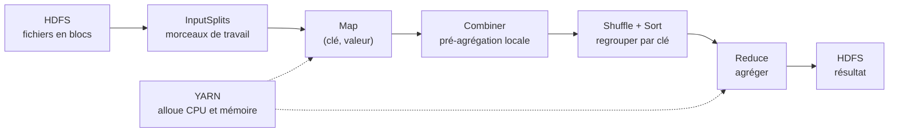
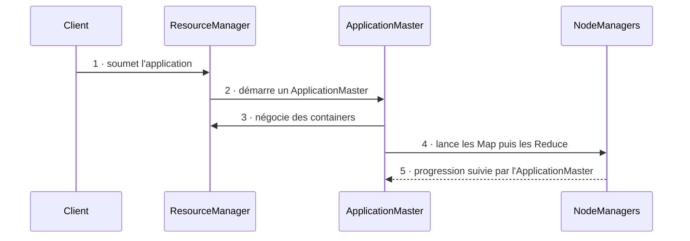
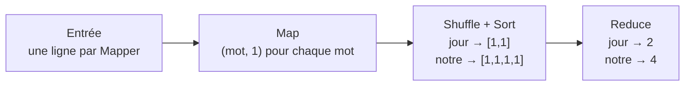
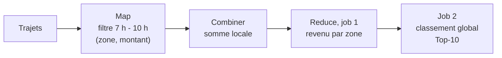

# Résumé — Chapitre 2 (partie 2) : MapReduce, distribuer le calcul

Support : [[Chapitre 2 - Hadoop, HDFS et MapReduce (partie 2).pdf]] (diapositives 99 à 168) · Dr. Ing. Takwa Ben Aïcha Gader · ISIMa, 2026-2027 · précédent : [[Résumé - Chapitre 2 - Hadoop et HDFS]]

Le chapitre 1 s'arrêtait sur une question : si la distribution est justifiée, **qui stocke, qui arbitre et qui calcule ?** Cette partie répond pour le calcul. **MapReduce** découpe un gros traitement batch en tâches indépendantes exécutées en parallèle près des données, regroupe les résultats intermédiaires par **clé**, puis les agrège. **YARN** attribue à ces tâches le CPU et la mémoire du cluster. Le fil rouge est un vrai jeu de données : **les trajets des taxis de New York**.

> [!tip] Ce PDF est la partie 2 du chapitre
> Il commence à la diapositive 99. La partie 1, **Hadoop et HDFS** (NameNode, DataNodes, blocs, réplication, lecture et écriture, commandes `hdfs dfs`), a son propre support et son résumé : [[Résumé - Chapitre 2 - Hadoop et HDFS]]. Le QCM de la fin (diapositives 139 à 148) révise aussi ces notions HDFS : voir la section 21.

## Le chapitre en un coup d'œil



| Diapositives | Thème |
|---|---|
| 99 à 103 | pourquoi répartir le calcul, data locality, le cas des taxis |
| 104 à 114 | le pipeline : clé et valeur, Block et InputSplit, Map, Shuffle + Sort, Reduce |
| 115 à 120 | optimiser : Combiner, moyenne distribuée, data locality, data skew et salting |
| 121 à 125 | de MRv1 à YARN, exécution d'un job, container YARN et container Docker |
| 126 à 136 | WordCount, cas taxis, concevoir un traitement (Top-10), limites, méthode |
| 137 à 168 | QCM de 14 questions, à retenir, références |

## 1. Pourquoi répartir le calcul ?

*Diapositive 100*

| Le problème | La réponse |
|---|---|
| un seul serveur finit par saturer en **temps**, en **mémoire** ou en **E/S** | découper le traitement en **tâches indépendantes** |
| beaucoup de traitements se découpent en **sous-problèmes indépendants** | les exécuter **en parallèle** |
| déplacer de gros volumes sur le réseau **coûte cher** | calculer **là où sont les données** |
| quand le cluster grandit, **les pannes deviennent normales** | relancer automatiquement les tâches échouées |

Le besoin n'est pas « plus de CPU », mais une **façon structurée de répartir le calcul**.

## 2. Data locality : déplacer le code, pas les données

*Diapositives 101 et 118*

> [!exemple] Le bloc de 4 Go et le programme de 200 Ko
> Le bloc de 4 Go est déjà sur le nœud N3, le programme ne pèse que 200 Ko. Hadoop exécute donc la tâche **sur N3**, ou à défaut sur un nœud **proche dans la topologie** (même rack). On évite de faire passer plusieurs gigaoctets sur le réseau. *(Complément : le programme est 20 000 fois plus petit que le bloc.)*

C'est la **data locality**, déjà posée à la diapositive 20 de la [[Résumé - Chapitre 2 - Hadoop et HDFS#12. Data locality : où exécuter le calcul ?|partie 1]] : déplacer le petit calcul plutôt que les grosses données, et garder le réseau pour les échanges réellement nécessaires. Les sorties Map restent **locales** (sur le disque du nœud) jusqu'au Shuffle.

## 3. Le fil rouge : les taxis de New York

*Diapositives 102 et 103*

Chaque trajet contient notamment la **zone et l'heure de départ**, la **zone d'arrivée**, la **distance**, le **montant total** et le **mode de paiement**. Avec un seul dataset, plusieurs questions métier : quelles zones concentrent le plus de trajets ? Lesquelles rapportent le plus ? À quelles heures la demande est-elle maximale ? Le défi : y répondre **sans charger des dizaines de millions de lignes sur une seule machine**.

« Combien de trajets partent de chaque zone ? » devient une suite d'étapes parallèles :

1. lire les trajets ;
2. extraire la zone de départ ;
3. compter localement ;
4. regrouper les mêmes zones ;
5. agréger les comptes.

MapReduce transforme une question analytique en **transformations parallèles** et **agrégations par clé**.

## 4. Diviser, distribuer, agréger

*Diapositives 104 et 107*

| Étape | Ce qui se passe | Qui s'en occupe |
|---|---|---|
| **HDFS** | les données sont stockées en blocs répliqués | Hadoop |
| **InputSplits** | le travail est **divisé** en morceaux indépendants | Hadoop |
| **Map** | chaque morceau est transformé **en parallèle** en couples (clé, valeur) | **vous** |
| **Shuffle / Sort** | les couples sont **regroupés par clé** et triés | Hadoop |
| **Reduce** | chaque clé est **agrégée**, le résultat écrit dans HDFS | **vous** |

> [!important] Le partage des rôles
> Vous concevez **Map** et **Reduce**. Hadoop automatise le **placement**, les **échanges réseau**, le **tri**, la **relance** des tâches échouées et l'**écriture** du résultat.

## 5. Tout passe par des paires (clé, valeur)

*Diapositives 105, 106 et 130*

- la **clé** décide **quels enregistrements seront regroupés** : c'est l'axe d'agrégation ;
- la **valeur** transporte **l'information à compter ou à agréger**.

Le couple `(PULocationID, 1)` produit un comptage des trajets par zone de départ (`PULocationID` est l'identifiant de la zone de prise en charge, *pick-up location*).

| Question | Clé Map | Valeur | Interprétation |
|---|---|---|---|
| Nombre de trajets par zone | `PULocationID` | 1 | demande géographique |
| Activité par heure | heure du départ | 1 | profil temporel |
| Usage par mode de paiement | `payment_type` | 1 | comportement de paiement |
| Revenu par zone | `PULocationID` | montant | montant agrégé par zone |
| Distance moyenne par zone | `PULocationID` | (distance, 1) | typologie de trajet |

*(La colonne Valeur est un complément : la diapositive 130 ne donne que la clé.)*

> [!important] Une bonne conception MapReduce commence par une bonne clé
> Le choix de la clé n'est pas un détail de programmation : **il traduit la question métier**. La clé encode la question, la valeur encode la mesure.

## 6. HDFS Block et InputSplit : ne pas confondre

*Diapositive 108*

| | HDFS Block | InputSplit |
|---|---|---|
| Nature | unité logique de **stockage** | unité logique de **traitement** |
| Répond à | où les données sont-elles stockées ? | quel morceau de travail confier à un Mapper ? |
| Propriétés | **répliqué** pour tolérer les pannes, taille configurable | alimente généralement **une tâche Map** |
| Dépend de | la configuration HDFS | l'**InputFormat** et du fait que le fichier soit **splittable** (découpable) |

Ils ont souvent une taille proche, mais ce ne sont pas les mêmes objets : la section 21 (question 11) montre un cas où ils diffèrent.

## 7. La phase Map

*Diapositives 109 et 110*

Chaque **Mapper** traite **son fragment indépendamment**, transforme les enregistrements **un par un** et émet des couples (clé, valeur). Plusieurs Mappers tournent en parallèle : `trip -> (PULocationID, 1)`.

> [!question]- Mini-activité de la diapositive 110 : choisir la bonne clé
> But : compter les trajets par zone de départ.
>
> | Trajet | PULocationID | Distance | Total |
> |---|---|---|---|
> | T1 | 132 | 17,4 | 52,50 |
> | T2 | 161 | 2,8 | 16,80 |
> | T3 | 132 | 9,2 | 31,20 |
> | T4 | 237 | 1,9 | 12,40 |
>
> - Q1, la clé : **PULocationID**.
> - Q2, la valeur minimale pour un comptage : **1**.
> - Couples émis : (132, 1), (161, 1), (132, 1), (237, 1) ; après Reduce : **132 → 2**, 161 → 1, 237 → 1.

## 8. Shuffle + Sort : la phase qui fait bouger les données

*Diapositives 111 à 113*

| Sous-étape | Rôle |
|---|---|
| 1 · **Partition** | choisit le Reducer de chaque clé (par défaut, selon un hachage de la clé) |
| 2 · **Shuffle** | transfère les sorties Map vers les Reducers, **sur le réseau** |
| 3 · **Sort / Group** | trie les clés et rassemble toutes les valeurs d'une même clé |

Cette phase cumule **réseau + sérialisation + E/S disque + tri** : c'est souvent **l'un des coûts dominants** d'un job.

> [!exemple] Le Shuffle en chiffres (diapositive 112)
> 100 millions d'événements × 20 octets de sortie Map = **2 Go** à faire passer par le réseau, avant compression et surcoûts. Réduire les sorties Map **avant** le réseau change radicalement le coût du job (section 10).

> [!question]- Mini-activité de la diapositive 113 : que reçoit le Reducer de la clé A ?
>
> | Mapper 1 | Mapper 2 | Mapper 3 |
> |---|---|---|
> | (A,1) | (A,1) | (B,1) |
> | (B,1) | (C,1) | (C,1) |
> | (C,1) | (A,1) | (C,1) |
>
> Le Reducer de A reçoit **A → [1, 1, 1]** : un couple vient du Mapper 1 et deux du Mapper 2. Le Shuffle achemine ces couples vers le Reducer associé à la clé, **parfois depuis un autre nœud**, donc par le réseau.

## 9. La phase Reduce

*Diapositive 114*

Un **Reducer** reçoit **une clé et toutes ses valeurs**, applique une agrégation et produit **un résultat final par clé**, en général écrit dans HDFS : `Zone 132 -> [12, 7, 5, 9] -> 33`.

## 10. Le Combiner : réduire le trafic avant le Shuffle

*Diapositives 115 et 116*

Le **Combiner** est une **pré-agrégation locale**, juste après le Mapper, avant le réseau.

- Hadoop peut l'appeler **zéro, une ou plusieurs fois** : on ne peut pas compter dessus ;
- il **ne doit jamais changer le résultat** ;
- il convient à la **somme**, au **comptage**, au **min**, au **max** ;
- il n'est **pas automatiquement sûr** pour toute opération (la moyenne, par exemple : section 11).

> [!important] Un Combiner n'est pas « un petit Reducer »
> Le résultat doit rester juste **quel que soit le nombre de fois** où il s'exécute, y compris zéro.

Sur les taxis (diapositive 116) : sans Combiner, quatre couples (132, 1) traversent le réseau ; avec, une seule valeur **(132, 4)**. Plus une clé se répète localement, plus le Combiner fait gagner.

> [!exemple] Complément, hors diapositives : mesuré avec Hadoop 3.4.3
> Le WordCount de la section 16, sur le poème de la diapositive 126 recopié 200 000 fois (16,2 Mo, 600 000 lignes), en mode local. Chiffres lus dans les compteurs du job :
>
> | | Couples émis par Map | Couples envoyés au Shuffle | Octets du Shuffle | Résultat |
> |---|---|---|---|---|
> | Sans Combiner | 2 600 000 | 2 600 000 | 31 800 006 | `notre 800000` |
> | Avec Combiner | 2 600 000 | **8** | **107** | `notre 800000` |
>
> Même résultat, et 300 000 fois moins d'octets à transférer : un seul Mapper traitait le fichier, il n'envoie plus qu'un couple par mot distinct.

## 11. La moyenne distribuée : pourquoi mean(mean(...)) est faux

*Diapositives 117 et 131*

> [!exemple] Deux machines, une zone
> Machine A : 10 trajets, distance moyenne **4 km**. Machine B : 100 trajets, distance moyenne **10 km**.
>
> - Moyenne des moyennes : $(4 + 10) / 2 = 7$ km, **faux** : elle donne autant de poids à 10 trajets qu'à 100.
> - Vraie moyenne *(complément)* : $\dfrac{10 \times 4 + 100 \times 10}{10 + 100} = \dfrac{1\,040}{110} \approx$ **9,45 km**.

La bonne représentation intermédiaire : garder **(somme, nombre)** et ne diviser qu'à la fin.

| Étape | Ce qu'on émet |
|---|---|
| Map | `(zone, (distance, 1))` |
| Combiner (possible) | `(zone, (somme_distances, nombre))` |
| Reduce | $\text{moyenne} = \dfrac{\sum \text{somme\_distances}}{\sum \text{nombre}}$ |

Pourquoi ? Parce que **les partitions n'ont pas forcément la même taille**. En distribué, une statistique juste dépend **autant de la représentation intermédiaire que de la formule finale**.

```python
# Diapositives 117 et 131 : la distance moyenne d'une zone, calculée sur deux machines.
machine_a = [4.0] * 10       # 10 trajets, 4 km de moyenne
machine_b = [10.0] * 100     # 100 trajets, 10 km de moyenne

# Faux : chaque machine envoie sa moyenne, puis on fait la moyenne des moyennes
moyennes = [sum(m) / len(m) for m in (machine_a, machine_b)]
print("moyenne des moyennes :", sum(moyennes) / len(moyennes), "km")

# Juste : chaque machine envoie (somme, nombre) ; c'est aussi ce que ferait le Combiner
partiels = [(sum(m), len(m)) for m in (machine_a, machine_b)]
somme = sum(s for s, _ in partiels)
nombre = sum(n for _, n in partiels)
print("partiels :", partiels, "->", somme, "/", nombre, "=", round(somme / nombre, 2), "km")
```

```text
moyenne des moyennes : 7.0 km
partiels : [(40.0, 10), (1000.0, 100)] -> 1040.0 / 110 = 9.45 km
```

*Complément, hors diapositives : exécuté avec Python 3.14.*

## 12. Data skew et salting : quand une clé est trop chaude

*Diapositives 119 et 120*

> [!exemple] Exemple mobilité
> La zone A concentre **65 %** des trajets, B 10 %, C 8 %, le reste est dispersé. Conséquence : un Reducer reçoit une charge disproportionnée, les autres finissent tôt, et **tout le job attend ce retardataire** (le *straggler*).

C'est le **data skew** (déséquilibre des clés). Une réponse : le **salting**, qui découpe temporairement la clé chaude, par exemple `Airport → Airport_1, Airport_2, Airport_3, Airport_4`, puis une **seconde agrégation** rassemble le résultat final.

| Salting | |
|---|---|
| Gain | une meilleure répartition de la charge |
| Coût | une étape de plus |
| Limite | la stratégie dépend de l'opération |

> [!tip]- Complément, hors diapositives : simulé sur 1 000 000 de trajets, 8 Mappers, 4 Reducers
> | Variante | Couples reçus par chaque Reducer | Le plus chargé |
> |---|---|---|
> | Sans salting | 39 774 · 140 597 · 39 892 · **779 737** | 779 737 |
> | Salting de A en 4 sous-clés | 364 632 · 140 597 · 364 749 · 130 022 | 364 749 |
> | Comptage avec Combiner, sans salting | 32 · 40 · 32 · 56 | 56 |
>
> - Le salting a divisé par deux la charge du Reducer le plus chargé, et la seconde agrégation retrouve bien le total de A (649 715 trajets). Les quatre sous-clés ne sont tombées que sur deux Reducers : où va chaque sous-clé dépend du hachage, on ne le choisit pas.
> - Pour un **simple comptage**, le Combiner suffit déjà : chaque Mapper n'envoie plus qu'un couple (A, n). Le salting sert quand les valeurs **ne peuvent pas être pré-agrégées** (jointures, listes complètes, médianes…).

## 13. De MRv1 à YARN

*Diapositives 121 à 123*

| | MRv1 (architecture historique) | YARN |
|---|---|---|
| Gestion des ressources | un **JobTracker** central fait tout : ressources, ordonnancement, suivi des tâches, erreurs | le **ResourceManager**, **séparé** de la logique des applications |
| Exécution sur chaque machine | des **TaskTrackers** | des **NodeManagers** |
| Suivi d'une application | le JobTracker | un **ApplicationMaster** propre à chaque application |
| Ressources | des **slots** Map et Reduce **rigides** | des **allocations dynamiques** (containers) |
| Moteurs | **MapReduce** seulement | **plusieurs** moteurs possibles |
| Tâche échouée | relancée ailleurs par le JobTracker | l'ApplicationMaster suit ses tâches et relance celles qui échouent *(complément, hors diapositives)* |

Le point faible de MRv1 : **un composant central concentre trop de responsabilités**. La scalabilité vient aussi de la **séparation des rôles**, pas seulement de l'ajout de machines.

| Composant YARN | Rôle |
|---|---|
| **ResourceManager** | l'**arbitre global** des ressources du cluster |
| **NodeManager** | l'**agent de chaque machine** : lance et surveille les allocations locales |
| **ApplicationMaster** | **propre à une application** : négocie les ressources et suit ses tâches |

## 14. Exécution d'un job MapReduce sur YARN

*Diapositive 124*



YARN **ne remplace pas** MapReduce : il **organise les ressources** utilisées par MapReduce et par d'autres moteurs.

## 15. Un container YARN n'est pas un container Docker

*Diapositive 125*

| | Container YARN | Container Docker |
|---|---|---|
| Ce que c'est | une **allocation de ressources** sur un nœud | un **environnement d'exécution isolé** |
| Contient | mémoire, CPU (vcores), ce qu'il faut pour exécuter un processus | l'application, ses dépendances, son système de fichiers, l'isolation |
| Répartition | un job utilise **plusieurs containers** sur **plusieurs nœuds** | |

Les deux sont distincts, même si YARN **peut utiliser Docker comme runtime** (diapositive 158).

## 16. WordCount : MapReduce sur un exemple simple

*Diapositives 126, 127 et 166*



Entrée de la diapositive 126 :

```text
jour leve notre grisaille
trottoir notre ruelle notre tour
jour leve notre envie
```

Le pseudo-code de la diapositive 166 :

```python
def mapper(text):
    for word in text.split():
        emit(word, 1)

def reducer(word, counts):
    emit(word, sum(counts))
```

La même structure résout d'autres problèmes en **changeant la clé** (diapositive 127) : l'URL pour compter les requêtes de logs web, le produit pour le chiffre d'affaires en e-commerce, la machine pour les alertes en IoT industriel.

### En Java, comme au TP 2

*Complément, hors diapositives : compilé et exécuté avec Hadoop 3.4.3 et Java 11, en mode local.*

```java
import java.io.IOException;
import org.apache.hadoop.conf.Configuration;
import org.apache.hadoop.fs.Path;
import org.apache.hadoop.io.IntWritable;
import org.apache.hadoop.io.Text;
import org.apache.hadoop.mapreduce.Job;
import org.apache.hadoop.mapreduce.Mapper;
import org.apache.hadoop.mapreduce.Reducer;
import org.apache.hadoop.mapreduce.lib.input.FileInputFormat;
import org.apache.hadoop.mapreduce.lib.output.FileOutputFormat;

public class WordCount {

  // Map : pour chaque mot de la ligne, émettre (mot, 1)
  public static class TokenizerMapper extends Mapper<Object, Text, Text, IntWritable> {
    private static final IntWritable ONE = new IntWritable(1);
    private final Text word = new Text();

    @Override
    protected void map(Object key, Text line, Context context) throws IOException, InterruptedException {
      for (String w : line.toString().split("\\s+")) {
        if (w.isEmpty()) continue;
        word.set(w);
        context.write(word, ONE);
      }
    }
  }

  // Reduce : additionner les 1 de chaque mot. Sert aussi de Combiner (la somme est associative).
  public static class IntSumReducer extends Reducer<Text, IntWritable, Text, IntWritable> {
    private final IntWritable total = new IntWritable();

    @Override
    protected void reduce(Text word, Iterable<IntWritable> counts, Context context) throws IOException, InterruptedException {
      int sum = 0;
      for (IntWritable c : counts) sum += c.get();
      total.set(sum);
      context.write(word, total);
    }
  }

  // hadoop jar wordcount.jar WordCount <entrée> <sortie> [combiner]
  public static void main(String[] args) throws Exception {
    Job job = Job.getInstance(new Configuration(), "word count");
    job.setJarByClass(WordCount.class);
    job.setMapperClass(TokenizerMapper.class);
    if (args.length > 2 && args[2].equals("combiner")) job.setCombinerClass(IntSumReducer.class);
    job.setReducerClass(IntSumReducer.class);
    job.setOutputKeyClass(Text.class);
    job.setOutputValueClass(IntWritable.class);
    FileInputFormat.addInputPath(job, new Path(args[0]));
    FileOutputFormat.setOutputPath(job, new Path(args[1]));
    System.exit(job.waitForCompletion(true) ? 0 : 1);
  }
}
```

```sh
javac -cp "$(hadoop classpath)" -d classes WordCount.java
jar cf wordcount.jar -C classes .
hadoop jar wordcount.jar WordCount poeme.txt sortie
cat sortie/part-r-00000
```

```text
envie	1
grisaille	1
jour	2
leve	2
notre	4
ruelle	1
tour	1
trottoir	1
```

Les compteurs affichés à la fin du job racontent le pipeline : `Map input records=3` (3 lignes), `Map output records=13` (13 mots, donc 13 couples), `Reduce input groups=8` (8 mots distincts), `Reduce output records=8`. Avec `combiner` en troisième argument, `Combine input records=13` et `Combine output records=8` : seuls 8 couples passent le Shuffle.

> [!warning] Pièges du TP
> - **Le dossier de sortie ne doit pas exister** : sinon le job s'arrête avant de démarrer avec `FileAlreadyExistsException: Output directory … already exists`. Supprimez-le ou changez de nom à chaque essai.
> - Le Combiner n'est correct ici que parce que **la somme est associative** ; il ne faut pas réutiliser le Reducer comme Combiner pour une moyenne (section 11).
> - Le résultat est dans `part-r-00000` (un fichier par Reducer) ; `_SUCCESS` indique seulement que le job a réussi.

## 17. Cas taxis : du résultat brut à une décision

*Diapositives 128 et 129*

| Étape | Exemple |
|---|---|
| Map | `trip -> (PULocationID, 1)` |
| Shuffle + Sort | `132 -> [1,1,1,...]` |
| Reduce | `132 -> 15482` trajets |

Sortie brute : `132 -> 15482`, `161 -> 12120`, `237 -> 10940`… Pour qu'elle serve, il faut l'**enrichir** : associer l'identifiant à une vraie zone, classer les zones, afficher une carte de la demande, puis guider une décision opérationnelle. MapReduce produit d'abord une **agrégation** ; sa valeur apparaît quand elle est replacée **dans le contexte métier**.

## 18. Concevoir un traitement : le Top-10 du revenu entre 7 h et 10 h

*Diapositives 132 et 133*

> [!question]- Mini-activité : questions et correction
> **Objectif** : trouver les 10 zones qui rapportent le plus entre 7 h et 10 h.
>
> | Question | Réponse de la correction |
> |---|---|
> | 1 · Quel filtre avant d'émettre ? | garder les trajets dont l'heure de départ est dans **[07:00, 10:00)** |
> | 2 · Quelle clé ? | **PULocationID** |
> | 3 · Quelle valeur ? | **total_amount** (le revenu = le montant total facturé, une définition à garder explicite) |
> | 4 · Un Combiner est-il possible ? | **oui** : une somme partielle par zone avant le Shuffle, correcte car **la somme est associative** |
> | 5 · Une seule étape suffit-elle ? | **non** : un premier job calcule le total par zone, un second sélectionne les 10 plus grands totaux |



> [!remarque] Précision sur les Top-10 locaux
> La correction dit que les Top-10 locaux des Reducers « ne suffisent pas à garantir le Top-10 global ». C'est vrai au sens où **le Top-10 d'un seul Reducer n'est pas la réponse**. Mais comme chaque zone est entièrement traitée par un seul Reducer, **la réunion des Top-10 locaux contient toujours le Top-10 global** : la seconde étape n'a qu'à classer ces quelques candidats (10 par Reducer). *Vérifié en simulation (complément, hors diapositives) sur 20 000 trajets fictifs, 6 Mappers et 4 Reducers : le Top-10 du Reducer 0 n'est pas le Top-10 global, celui de la réunion des 40 candidats l'est ; le Combiner a fait passer le Shuffle de 2 492 à 1 278 couples.*

## 19. Les limites de MapReduce : pourquoi Spark ensuite ?

*Diapositive 134*

| Très adapté | Moins adapté |
|---|---|
| batch massif | Shuffle très volumineux |
| scans séquentiels | nombreuses étapes **matérialisées sur disque** |
| agrégations par clé | calculs **itératifs** (machine learning, graphes) |
| ETL | faible latence **interactive** |
| traitements tolérants aux pannes | pipelines multi-étapes complexes |

Spark ne rend pas MapReduce « faux » : il optimise surtout les cas où **les écritures intermédiaires sur disque** deviennent pénalisantes.

## 20. La méthode : comment penser un problème MapReduce

*Diapositives 135 et 136*

1. Que veux-je calculer ?
2. Quelle **clé** représente ma question ?
3. Que doit émettre **Map** ?
4. Combien de données vont traverser le **Shuffle** ?
5. Que doit agréger **Reduce** ?

Concevoir MapReduce, c'est d'abord raisonner sur la donnée et sur **le coût du mouvement des données**.

> [!abstract] La carte mentale de la diapositive 136
> **HDFS** stocke et répartit ; **Map** transforme localement ; **Shuffle/Sort** regroupe par clé ; **Reduce** agrège ; **YARN** alloue les ressources. À ne pas oublier autour : **data locality**, **Combiner**, **Shuffle = réseau**, **data skew**.

## 21. Le QCM des diapositives 137 à 166

14 questions pour vérifier les notions HDFS et MapReduce. Le site d'évaluation de l'enseignante : [takwabenaichagader.github.io/mapreduce-part2-training](https://takwabenaichagader.github.io/mapreduce-part2-training/).

> [!question]- Les 14 questions et leurs réponses
>
> | # | Question | Réponse | Pourquoi |
> |---|---|---|---|
> | 1 | Ce qui décrit le mieux HDFS | **B** : un système de fichiers distribué optimisé pour de grands volumes et un fort débit | conçu pour la tolérance aux pannes et le débit, pas pour la faible latence interactive |
> | 2 | Le chemin des données à la lecture d'un fichier HDFS | **B** : DataNode → client directement, après avoir consulté les métadonnées du NameNode | le NameNode est sur le chemin des **métadonnées**, pas des données |
> | 3 | Qui remplace automatiquement le NameNode actif en HA | **B** : le **Standby NameNode** | le Secondary NameNode fait des checkpoints, ce n'est pas un serveur de secours |
> | 4 | Facteur de réplication 3 | **B** : chaque bloc vise normalement 3 réplicas | ce n'est ni un nombre de blocs, ni de Reducers |
> | 5 | Block et InputSplit | **B** : le Block concerne le stockage, l'InputSplit le travail | ils peuvent avoir la même taille sans être le même objet |
> | 6 | Qui regroupe les valeurs d'une même clé | **C** : Shuffle + Sort | avant de les présenter au Reducer |
> | 7 | À quoi sert un Combiner | **B** : pré-agréger localement les sorties Map pour réduire le trafic | à condition que l'opération reste juste |
> | 8 | Pourquoi rapprocher le calcul des données | **A** : économiser la bande passante et augmenter le débit | c'est la data locality |
> | 9 | L'agent YARN de chaque machine | **A** : le **NodeManager** | il lance et surveille les allocations locales |
> | 10 | Container YARN = container Docker ? | **B** : non | YARN alloue des ressources, Docker isole un environnement |
> | 11 | Deux fichiers de 513 et 515 MiB, blocs de 512 MiB : combien de Maps ? | **4** selon la correction (2 blocs par fichier) | voir la remarque ci-dessous |
> | 12 | Un fichier de 5 000 MiB, splits d'environ 512 MiB | **C** : $\lceil 5\,000 / 512 \rceil = 10$ Maps | si le fichier est splittable |
> | 13 | 1 036 MiB et 500 MiB, blocs de 512 MiB, réplication 4 : combien de réplicas ? | **C** : 16 | 3 blocs × 4 + 1 bloc × 4 = 12 + 4 |
> | 14 | Le couple émis par Map pour compter les mots | **B** : (mot, 1) | voir la section 16 |
>
> La capacité de 5 Maps en parallèle (question 11) **ne crée pas** de tâche supplémentaire : elle dit seulement combien de tâches peuvent tourner **en même temps**.

> [!remarque] Question 11 : Hadoop crée en réalité 2 Maps, pas 4
> Le nombre de **blocs** est juste : 513 MiB et 515 MiB occupent chacun **2 blocs** de 512 MiB, soit 4 blocs. Mais le nombre de **Maps** suit les **splits**, et le découpage par défaut de Hadoop (`FileInputFormat`) ne crée un nouveau split que s'il reste **plus de 1,1 fois** la taille du split. Avec 512 MiB, la coupure n'a lieu qu'au-delà de 563,2 MiB : un fichier de 513 MiB donne donc **un seul split de 513 MiB**.
>
> *Vérifié avec Hadoop 3.4.3 (complément, hors diapositives), en demandant à `TextInputFormat` les splits de fichiers de ces tailles, avec des blocs de 512 MiB :*
>
> | Fichier | Blocs de 512 MiB | Splits = Maps |
> |---|---|---|
> | 513 MiB | 2 | **1** |
> | 515 MiB | 2 | **1** |
> | 563 MiB | 2 | 1 |
> | 564 MiB | 2 | 2 (512 + 52 MiB) |
> | 1 036 MiB | 3 | 2 (512 + 524 MiB) |
> | 5 000 MiB | 10 | 10 |
>
> Pour l'examen, la réponse attendue par le cours est **4** (1 split par bloc) ; dans un vrai cluster, ce sont **2 Maps**. Les questions 12 et 13 ne changent pas : 5 000 MiB donne bien 10 Maps, et la question 13 compte des **blocs**, qui eux sont découpés strictement.

## 22. À retenir avant le TP

*Diapositives 167 et 168*

- **HDFS** découpe et distribue les fichiers, puis **réplique les blocs** pour résister aux pannes.
- Le **NameNode** gère les **métadonnées**, les **DataNodes** portent les **données**.
- **MapReduce** transforme un gros calcul en tâches **Map**, **Shuffle/Sort** et **Reduce**.
- La **data locality** vise à réduire le trafic réseau.
- **YARN** sépare la gestion des ressources de la logique du moteur de traitement.
- La **clé** encode la question, la **valeur** la mesure ; le **Shuffle** coûte cher, le **Combiner** le réduit quand l'opération le permet ; une **moyenne** se calcule avec (somme, nombre).

Références de la diapositive 168 : la documentation Apache Hadoop (HDFS Architecture, HDFS High Availability with QJM, MapReduce Tutorial, YARN Architecture, FileSystem Shell).

## Questions de révision

1. Qu'est-ce que la data locality, et pourquoi Hadoop déplace-t-il le code plutôt que les données ?
2. Quelle est la différence entre un HDFS Block et un InputSplit ?
3. Quelle clé et quelle valeur émettre pour : le nombre de trajets par heure ; le revenu par mode de paiement ?
4. Décrire les trois sous-étapes du Shuffle + Sort. Pourquoi est-ce souvent la phase la plus coûteuse ?
5. Trois Mappers émettent (X,1)(Y,1) · (X,1)(X,1) · (Y,1)(Z,1). Que reçoit le Reducer de X ? Et avec un Combiner ?
6. Pourquoi un Combiner peut-il être utilisé pour une somme mais pas tel quel pour une moyenne ?
7. Machine A : 30 trajets de 2 km en moyenne ; machine B : 10 trajets de 6 km. Calculer la moyenne des moyennes, puis la vraie moyenne.
8. Qu'est-ce que le data skew ? Comment le salting le corrige-t-il, et à quel prix ?
9. Quels rôles jouent le ResourceManager, le NodeManager et l'ApplicationMaster ? Que reprochait-on au JobTracker de MRv1 ?
10. Un fichier de 2 000 MiB est stocké en blocs de 256 MiB avec une réplication de 3. Combien de blocs, de réplicas, et de Maps avec le découpage par défaut ?
11. Pourquoi le Top-10 global demande-t-il une seconde étape ?
12. Citer trois situations où MapReduce est moins adapté que Spark.

> [!question]- Réponses
> 1. Exécuter chaque tâche Map **sur le nœud qui possède le bloc** (ou un nœud proche). Le programme pèse quelques Ko, le bloc des Go : déplacer le code économise la bande passante et augmente le débit du cluster.
> 2. Le **Block** est l'unité de **stockage** de HDFS (répliqué, taille configurable) ; l'**InputSplit** est l'unité de **travail** confiée à un Mapper (il dépend de l'InputFormat et du fait que le fichier soit découpable).
> 3. Trajets par heure : clé = **heure du départ**, valeur = **1**. Revenu par mode de paiement : clé = **payment_type**, valeur = **total_amount**.
> 4. **Partition** (choisir le Reducer de chaque clé), **Shuffle** (transférer les sorties Map sur le réseau), **Sort/Group** (trier et rassembler les valeurs d'une clé). Elle cumule réseau, sérialisation, disque et tri.
> 5. Sans Combiner : **X → [1, 1, 1]** (un couple du Mapper 1, deux du Mapper 2). Avec Combiner : X → [1, 2] (le Mapper 2 envoie (X, 2)), et le Reducer obtient toujours 3.
> 6. La somme est **associative** : sommer des sommes partielles donne la somme totale, quel que soit le nombre de passages. La moyenne ne l'est pas : il faut faire émettre (somme, nombre) au Combiner et ne diviser qu'à la fin.
> 7. Moyenne des moyennes : $(2 + 6) / 2 = 4$ km (faux). Vraie moyenne : $(30 \times 2 + 10 \times 6) / 40 = 120 / 40 =$ **3 km**.
> 8. Une clé concentre une grande part des données, donc un Reducer travaille bien plus que les autres et le job l'attend. Le salting découpe la clé chaude en sous-clés (A_1, A_2…) réparties sur plusieurs Reducers, puis **une seconde agrégation** les recombine : une étape de plus.
> 9. **ResourceManager** : arbitre global des ressources. **NodeManager** : agent de chaque machine, lance et surveille les containers. **ApplicationMaster** : propre à une application, négocie les ressources et suit ses tâches. Le JobTracker cumulait tout (ressources, ordonnancement, suivi, erreurs) et utilisait des slots Map/Reduce rigides.
> 10. $\lceil 2\,000 / 256 \rceil = 8$ blocs (7 pleins et un de 208 MiB), donc $8 \times 3 = 24$ réplicas, et **8 Maps** : Hadoop coupe des splits de 256 MiB tant qu'il reste plus de 1,1 × 256 = 281,6 MiB ; après 7 coupes il reste 208 MiB, qui forment le 8e split. (Un dernier morceau n'est rattaché au précédent que s'il reste entre 256 et 281,6 MiB, comme pour les 513 MiB de la question 11.) *Vérifié avec Hadoop 3.4.3 : 7 splits de 256 MiB et un de 208 MiB.*
> 11. Le premier job calcule le revenu **par zone** ; aucun Reducer ne voit toutes les zones, donc son Top-10 n'est pas la réponse. Une seconde étape classe tous les candidats (la réunion des Top-10 locaux suffit) pour obtenir le Top-10 global.
> 12. Les calculs **itératifs** (machine learning), les besoins de **faible latence interactive**, les pipelines **multi-étapes** avec beaucoup d'écritures intermédiaires sur disque (ou un Shuffle très volumineux).
