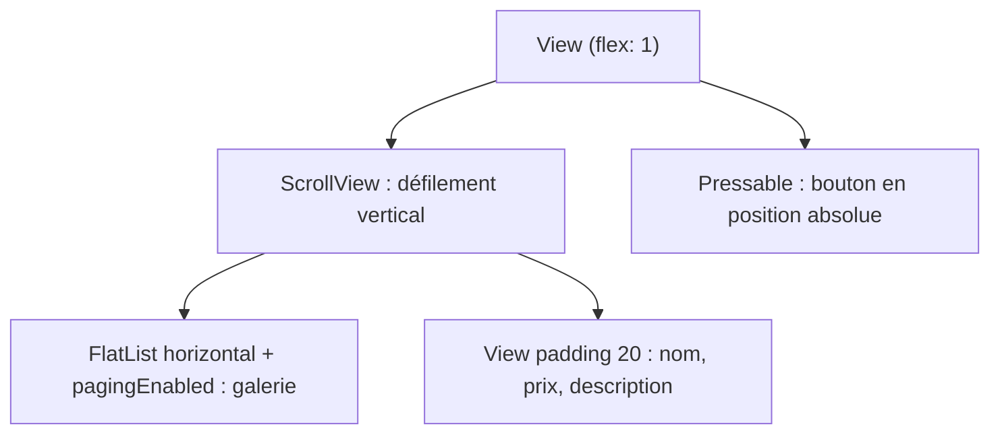

# Correction TP 4 — Écran de détails du produit

Énoncé : [[TP 4 - Écran de détails du produit.pdf]] · cours : [[Résumé - Chapitre 2 - Composants de base#10. ScrollView|ScrollView]] et [[Résumé - Chapitre 2 - Composants de base#11. Les listes : FlatList et SectionList|FlatList]] · avant : [[Correction TP 2 - Projet Expo et écran des produits]] · suite : [[Correction TP 5 - Panier (ShoppingCart)]]

> [!abstract] Ce qu'on construit
> L'écran d'**un** produit (`products[0]`) : une galerie d'images qui défile **horizontalement page par page**, le nom, le prix, la description qui défile **verticalement**, et un bouton noir « Ajouter au panier » **fixé en bas** de l'écran.

## Le code complet

`src/screens/ProductDetailsScreen.js` (vérifié avec Expo SDK 57) :

```jsx
import {
  StyleSheet,
  Text,
  View,
  Image,
  FlatList,
  useWindowDimensions,
  ScrollView,
  Pressable,
} from 'react-native';
import products from '../data/products';

const ProductDetailsScreen = () => {
  const product = products[0];
  const { width } = useWindowDimensions();

  return (
    <View style={{ flex: 1 }}>
      <ScrollView>
        <FlatList
          data={product.images}
          renderItem={({ item }) => (
            <Image source={{ uri: item }} style={{ width, aspectRatio: 1 }} />
          )}
          horizontal
          showsHorizontalScrollIndicator={false}
          pagingEnabled
        />

        <View style={{ padding: 20 }}>
          <Text style={styles.title}>{product.name}</Text>
          <Text style={styles.price}>${product.price}</Text>
          <Text style={styles.description}>{product.description}</Text>
        </View>
      </ScrollView>

      <Pressable style={styles.button}>
        <Text style={styles.buttonText}>Ajouter au panier</Text>
      </Pressable>
    </View>
  );
};

const styles = StyleSheet.create({
  title: { fontSize: 34, fontWeight: 'bold', marginVertical: 10 },
  price: { fontWeight: '500', fontSize: 16, letterSpacing: 1.5 },
  description: { marginVertical: 10, fontSize: 18, lineHeight: 30, fontWeight: '300' },
  button: {
    position: 'absolute',
    backgroundColor: 'black',
    bottom: 30,
    width: '90%',
    alignSelf: 'center',
    padding: 20,
    borderRadius: 100,
    alignItems: 'center',
  },
  buttonText: { color: 'white', fontWeight: '500', fontSize: 16 },
});

export default ProductDetailsScreen;
```

Pour l'afficher, `App.js` rend `<ProductDetailsScreen />` à la place de `<ProductScreen />` (la navigation entre les deux écrans arrive au [[Correction TP 6 - Totaux du panier et navigation|TP 6]]).

![[mobile-tp4-details.png|300]]

## Explications, étape par étape

### Structure de l'écran



Le bouton est **en dehors** du `ScrollView` : il ne défile pas avec le contenu, il reste posé en bas de l'écran.

### La galerie : FlatList horizontale

| Prop | Effet |
|---|---|
| `data={product.images}` | un tableau d'URL : `item` est **directement une chaîne**, d'où `source={{ uri: item }}` |
| `horizontal` | la liste défile de gauche à droite |
| `pagingEnabled` | le défilement s'arrête **image par image** (comme un carrousel) |
| `showsHorizontalScrollIndicator={false}` | masque la barre de défilement |

Chaque image fait **exactement la largeur de l'écran** (`width`) : c'est ce qui fait tomber chaque page pile sur une image.

### `useWindowDimensions`, un Hook

```jsx
const { width } = useWindowDimensions();   // largeur actuelle de l'écran
<Image style={{ width, aspectRatio: 1 }} />   // { width } = { width: width }
```

- un **Hook** est une fonction spéciale de React qu'on appelle **en haut** d'un composant fonctionnel ;
- `useWindowDimensions` renvoie `{ width, height, scale, fontScale }` et **se met à jour** quand l'écran change (rotation, fenêtre redimensionnée) : l'écran est **responsive** ;
- `{ width }` dans le style est le raccourci JavaScript de `{ width: width }`.

Autres Hooks courants : `useState` (état local), `useEffect` (effets : appel d'API, abonnement), `useContext` (partager une donnée sans la passer de prop en prop).

### Le bouton : Pressable en position absolue

`position: 'absolute'` sort le bouton du flux : `bottom: 30` le place à 30 points du bas de son parent, `alignSelf: 'center'` et `width: '90%'` le centrent, `borderRadius: 100` arrondit complètement les bords.

## Pièges

> [!warning] `<View>` sans `flex: 1`
> L'énoncé enveloppe l'écran dans `<View>` sans style. Cette `View` prend alors seulement la hauteur de son contenu : le bouton absolu se place par rapport à elle et peut se retrouver au mauvais endroit. Avec `<View style={{ flex: 1 }}>`, la `View` occupe tout l'écran et `bottom: 30` est mesuré depuis le bas de l'écran.

> [!warning] `fontSize: 8` dans le style `description`
> L'énoncé (étape 6) écrit `fontSize: 8` avec `lineHeight: 30` : le texte est minuscule et très espacé. La valeur voulue est **18**.

> [!warning] Première image vide
> Si la première page de la galerie reste blanche, vérifier `products.js` : le tableau `images` du produit 1 doit commencer par une URL (`".../nike/nike1.png"`), pas par une chaîne vide `""`. Une `source` avec `uri: ""` n'affiche rien et provoque un avertissement.

> [!note] Le bas de la description caché par le bouton
> Le bouton recouvre les dernières lignes. On peut ajouter `contentContainerStyle={{ paddingBottom: 100 }}` au `ScrollView` pour qu'on puisse faire défiler le texte au-dessus du bouton.

> [!note] FlatList dans un ScrollView
> React Native avertit quand une `FlatList` **verticale** est placée dans un `ScrollView` vertical (« VirtualizedLists should never be nested… »). Ici la `FlatList` est **horizontale** : les deux défilements sont dans des directions différentes, il n'y a pas d'avertissement.
