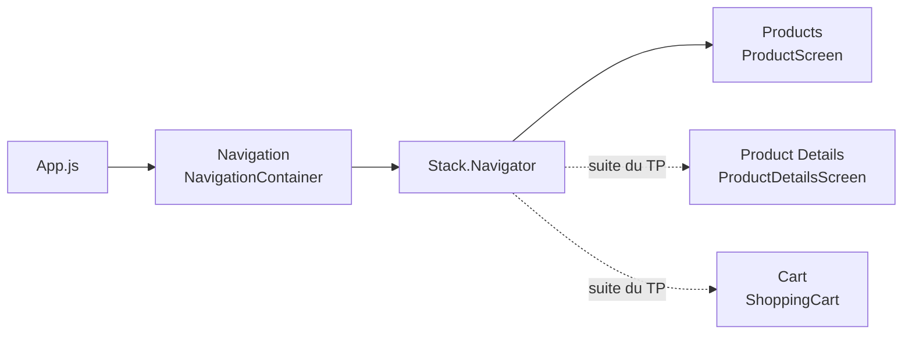

# Correction TP 6 — Totaux du panier et navigation

Énoncé : [[TP 6 - Totaux du panier et navigation.pdf]] · avant : [[Correction TP 5 - Panier (ShoppingCart)]] · fiche : [[Cheat sheet - React Native]]

> [!abstract] Ce qu'on construit
> 1. Sous la liste du panier, un bloc de **totaux** (sous-total, livraison, total) et un bouton **Checkout** fixé en bas.
> 2. L'installation de **React Navigation**.
> 3. Un fichier `src/navigation.js` qui déclare la **pile d'écrans** de l'application, avec un premier écran « Products ».

Tout le code a été testé avec Expo SDK 57 : le projet compile et s'affiche comme sur les captures.

## Étape 1 : les totaux et le bouton Checkout

`src/screens/ShoppingCart.js` :

```jsx
import { FlatList, View, StyleSheet, Text, Pressable } from 'react-native';
import cart from '../data/cart';
import CartListItem from '../components/CartListItem';

const ShoppingCartTotals = () => (
  <View style={styles.totalsContainer}>
    <View style={styles.row}>
      <Text style={styles.text}>Subtotal</Text>
      <Text style={styles.text}>410.00 US$</Text>
    </View>
    <View style={styles.row}>
      <Text style={styles.text}>Delivery</Text>
      <Text style={styles.text}>10.00 US$</Text>
    </View>
    <View style={styles.row}>
      <Text style={styles.textBold}>Total</Text>
      <Text style={styles.textBold}>420.00 US$</Text>
    </View>
  </View>
);

const ShoppingCart = () => {
  return (
    <>
      <FlatList
        data={cart}
        renderItem={({ item }) => <CartListItem cartItem={item} />}
        ListFooterComponent={ShoppingCartTotals}
      />
      <Pressable style={styles.button}>
        <Text style={styles.buttonText}>Checkout</Text>
      </Pressable>
    </>
  );
};

const styles = StyleSheet.create({
  totalsContainer: {
    margin: 20,
    paddingTop: 10,
    borderColor: 'gainsboro',
    borderTopWidth: 1,
  },
  row: {
    flexDirection: 'row',
    justifyContent: 'space-between',
    marginVertical: 2,
  },
  text: {
    fontSize: 16,
    color: 'gray',
  },
  textBold: {
    fontSize: 16,
    fontWeight: '500',
  },
  button: {
    position: 'absolute',
    backgroundColor: 'black',
    bottom: 30,
    width: '90%',
    alignSelf: 'center',
    padding: 20,
    borderRadius: 100,
    alignItems: 'center',
  },
  buttonText: {
    color: 'white',
    fontWeight: '500',
    fontSize: 16,
  },
});

export default ShoppingCart;
```

![[mobile-tp6-panier-totaux.png|300]]

| Élément | Explication |
|---|---|
| `ShoppingCartTotals` | un petit composant défini **dans le même fichier** ; `() => ( ... )` renvoie directement le JSX, sans `return` |
| `ListFooterComponent` | composant affiché **après le dernier élément** de la liste : les totaux défilent avec les articles |
| `<> ... </>` | un **fragment** : `ShoppingCart` renvoie deux éléments côte à côte (la liste et le bouton), il faut une balise englobante qui n'ajoute rien à l'écran |
| `justifyContent: 'space-between'` | libellé collé à gauche, montant collé à droite |
| `borderTopWidth: 1` + `borderColor: 'gainsboro'` | le trait gris clair au-dessus des totaux |
| bouton `position: 'absolute'`, `bottom: 30` | le même bouton noir qu'au TP 4, posé au-dessus de la liste |

> [!warning] Le style `textBold` de l'énoncé
> La capture de l'énoncé coupe le haut de `totalsContainer` (on lit `margin: 20`) et donne à `textBold` `color: 'gray'` en plus de `fontWeight: '500'`. Avec le gris, « Total » se distingue à peine des autres lignes ; sans `color`, le total ressort en noir, comme sur la capture ci-dessus. Les deux versions sont acceptées.

### Pour aller plus loin : des totaux calculés

Les montants de l'énoncé sont **écrits en dur** et ne correspondent pas au panier : 160 × 2 + 169 + 129 = **618 $**, pas 410. On peut les calculer à partir de `cart` :

```jsx
const subtotal = cart.reduce((sum, item) => sum + item.product.price * item.quantity, 0);
const deliveryFee = 10;
const total = subtotal + deliveryFee;

const ShoppingCartTotals = () => (
  <View style={styles.totalsContainer}>
    <View style={styles.row}>
      <Text style={styles.text}>Subtotal</Text>
      <Text style={styles.text}>{subtotal.toFixed(2)} US$</Text>
    </View>
    <View style={styles.row}>
      <Text style={styles.text}>Delivery</Text>
      <Text style={styles.text}>{deliveryFee.toFixed(2)} US$</Text>
    </View>
    <View style={styles.row}>
      <Text style={styles.textBold}>Total</Text>
      <Text style={styles.textBold}>{total.toFixed(2)} US$</Text>
    </View>
  </View>
);
```

`reduce` parcourt le tableau en accumulant une somme qui part de `0` ; `toFixed(2)` affiche deux décimales (`618.00`). Quand les quantités deviendront modifiables (Redux), ce calcul suivra automatiquement.

> [!note] Le dernier article caché par Checkout
> Le bouton absolu recouvre le bas de la liste. Ajouter `contentContainerStyle={{ paddingBottom: 100 }}` à la `FlatList` laisse assez de place pour faire défiler les totaux au-dessus du bouton.

## Étape 2 : installer React Navigation

```sh
npx expo install react-native-screens@4.0.0 react-native-safe-area-context @react-navigation/native @react-navigation/native-stack
```

| Paquet | Rôle |
|---|---|
| `@react-navigation/native` | le cœur : `NavigationContainer`, l'état de la navigation |
| `@react-navigation/native-stack` | le navigateur **en pile** qui utilise les transitions natives d'Android et d'iOS |
| `react-native-screens` | expose les écrans natifs à la pile |
| `react-native-safe-area-context` | évite l'encoche et la barre d'état (zones sûres) |

> [!warning] `react-native-screens@4.0.0` et Expo SDK 57
> Avec la version imposée par l'énoncé, `npx expo install --check` répond : `react-native-screens@4.0.0 - expected version: ~4.26.0`. Expo Go contient la version native attendue par le SDK ; une version JavaScript trop ancienne peut faire planter l'application au lancement. Si c'est le cas :
> ```sh
> npx expo install react-native-screens
> ```
> Sans numéro de version, Expo installe celle qui correspond au SDK du projet.

## Étape 3 : `src/navigation.js`

```jsx
import { NavigationContainer } from '@react-navigation/native';
import { createNativeStackNavigator } from '@react-navigation/native-stack';
import ProductScreen from './screens/ProductScreen';
import ProductDetailsScreen from './screens/ProductDetailsScreen';
import ShoppingCart from './screens/ShoppingCart';

const Stack = createNativeStackNavigator();

const Navigation = () => {
  return (
    <NavigationContainer>
      <Stack.Navigator>
        <Stack.Screen name="Products" component={ProductScreen} />
      </Stack.Navigator>
    </NavigationContainer>
  );
};

export default Navigation;
```

| Élément | Rôle |
|---|---|
| `NavigationContainer` | enveloppe **toute** l'application et garde l'état de la navigation ; il n'en faut qu'**un** |
| `createNativeStackNavigator()` | crée la pile ; `Stack.Navigator` et `Stack.Screen` en sont les composants |
| `<Stack.Screen name="Products" component={ProductScreen} />` | un écran de la pile : `name` sert à naviguer et s'affiche comme **titre** dans l'en-tête |
| le premier `Stack.Screen` | l'écran affiché au démarrage (sinon `initialRouteName`) |

> [!warning] `ProductsScreen` ou `ProductScreen` ?
> L'énoncé importe `./screens/ProductsScreen`, mais le fichier créé au [[Correction TP 2 - Projet Expo et écran des produits|TP 2]] s'appelle `ProductScreen.js` (sans « s »). L'import doit reprendre **exactement** le nom du fichier, sinon : `Unable to resolve module ./screens/ProductsScreen`. Le chemin part de `src/`, là où se trouve `navigation.js` : `./screens/...` et non `../screens/...`.

`ProductDetailsScreen` et `ShoppingCart` sont importés mais pas encore utilisés : la suite du TP les ajoute à la pile, sur le même modèle :

```jsx
<Stack.Navigator>
  <Stack.Screen name="Products" component={ProductScreen} />
  <Stack.Screen name="Product Details" component={ProductDetailsScreen} />
  <Stack.Screen name="Cart" component={ShoppingCart} />
</Stack.Navigator>
```

### Brancher la navigation dans `App.js`

Créer `navigation.js` ne suffit pas : `App.js` doit afficher `<Navigation />` à la place de l'écran affiché jusqu'ici.

```jsx
import { StatusBar } from 'expo-status-bar';
import Navigation from './src/navigation';

export default function App() {
  return (
    <>
      <Navigation />
      <StatusBar style="auto" />
    </>
  );
}
```

![[mobile-tp6-navigation.png|300]]

L'en-tête « Products » vient de la pile : chaque écran de la pile a un en-tête dont le titre est son `name` (modifiable avec `options={{ title: '...' }}`).


