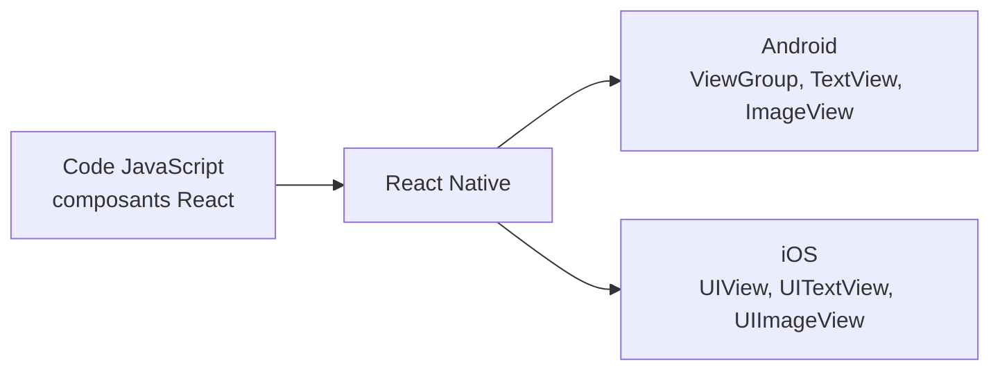

# Résumé — Chapitre 2 : composants de base (View, Text, Button, Image)

Support : [[Chapitre 2 - Composants de base (View, Text, Button, Image).pdf]] (25 diapositives) · Mme Waderni Sajida · ISIMa · fiche : [[Cheat sheet - React Native]] · TP liés : [[TP 2 - Projet Expo et écran des produits.pdf|TP 2]], [[TP 4 - Écran de détails du produit.pdf|TP 4]], [[TP 5 - Panier (ShoppingCart).pdf|TP 5]]

React Native permet d'écrire une application Android et iOS **en JavaScript, avec React**. On décrit l'interface avec des **composants** ; au moment de l'exécution, React Native les traduit en **vraies vues natives** de chaque plateforme. Ce chapitre présente les composants de base, puis les quatre idées de React qu'on retrouve dans tous les TP : **composants, JSX, props et state**. Il finit par les trois façons d'afficher du contenu qui défile : `ScrollView`, `FlatList` et `SectionList`.

## Le chapitre en un coup d'œil



| Diapositives | Thème |
|---|---|
| 1 à 6 | vues, composants natifs, composants de base (*Core Components*) |
| 7 à 19 | principes de React : composant, JSX, composants personnalisés, props, state |
| 20 | gérer la saisie de texte (`TextInput`) |
| 21 et 22 | `ScrollView` |
| 23 à 25 | listes : `FlatList` et `SectionList` |

## 1. Vues et composants natifs

*Diapositives 2 à 4*

> [!definition] Vue
> Dans le développement Android et iOS, une **vue** est l'élément de base de l'interface : un petit rectangle à l'écran qui affiche du texte, une image, ou répond à une action de l'utilisateur. Une ligne de texte, un bouton sont des vues ; certaines vues en contiennent d'autres.

- Android : on écrit les vues en **Kotlin ou Java** ; iOS : en **Swift ou Objective-C** ;
- React Native : on écrit des **composants React en JavaScript**, et le framework **crée les vues Android et iOS correspondantes** à l'exécution. Ces composants adossés à des vues natives s'appellent des **composants natifs** (*Native Components*) ;
- résultat : une application React Native a **la même apparence et la même convivialité** qu'une application native.

React Native fournit des composants natifs prêts à l'emploi, les **composants de base** (*Core Components*). On peut aussi écrire ses propres composants natifs, ou en prendre dans l'écosystème de la communauté (*Native Directory*).

## 2. Les composants de base

*Diapositive 4*

| Composant React Native | Android | iOS | Équivalent web | Rôle |
|---|---|---|---|---|
| `<View>` | `<ViewGroup>` | `<UIView>` | `<div>` non défilant | conteneur : mise en page **flexbox**, style, gestion du toucher |
| `<Text>` | `<TextView>` | `<UITextView>` | `<p>` | afficher, styler et imbriquer du texte, gérer le toucher |
| `<Image>` | `<ImageView>` | `<UIImageView>` | `` | afficher une image |
| `<ScrollView>` | `<ScrollView>` | `<UIScrollView>` | `<div>` | conteneur **défilant** qui peut contenir plusieurs composants |
| `<TextInput>` | `<EditText>` | `<UITextField>` | `<input type="text">` | saisie de texte |

> [!important] Texte uniquement dans `<Text>`
> Contrairement au web, une chaîne de caractères ne peut pas être posée directement dans une `<View>` : tout texte affiché doit être dans un composant `<Text>`.

Exemple de la diapositive 5 : un `ScrollView` qui contient du texte, une `View` avec une `Image` de 200 × 200 et un `TextInput` bordé de gris.

**Les familles de composants** (diapositive 6) : les composants React englobent les composants React Native, qui comprennent les **composants de base**, les **composants de la communauté** et **vos propres composants natifs**.

## 3. Principes de React

*Diapositive 7*

React Native s'exécute sur **React**, une bibliothèque open source de création d'interfaces. Quatre notions suffisent pour démarrer :

| Notion | En une phrase |
|---|---|
| **composant** | une fonction qui renvoie ce qu'il faut afficher |
| **JSX** | la syntaxe qui écrit des éléments à l'intérieur du JavaScript |
| **props** (accessoires) | les paramètres passés à un composant pour le personnaliser |
| **state** (état) | la mémoire d'un composant, pour les données qui changent |

## 4. Le premier composant

*Diapositives 7 à 9*

```jsx
import React from 'react';
import { Text } from 'react-native';

const Cat = () => {
  return <Text>Hello, I am your cat!</Text>;
};

export default Cat;
```

1. `import` de React et du composant de base `Text` ;
2. le composant **est une fonction** : `const Cat = () => {}` ;
3. tout ce que la fonction **renvoie** est rendu sous forme d'**élément React** : les composants sont des **plans**, les éléments décrivent ce qu'on veut voir à l'écran ;
4. `export default Cat` rend le composant utilisable dans le reste de l'application.

## 5. JSX

*Diapositives 9 à 11*

> [!definition] JSX
> Syntaxe qui permet d'écrire des éléments dans le JavaScript : `<Text>Hello, I am your cat!</Text>`. Comme JSX **est** du JavaScript, on peut y insérer **n'importe quelle expression JavaScript entre accolades** `{ }`.

```jsx
const Cat = () => {
  const name = 'Maru';
  return <Text>Hello, I am {name}!</Text>;          // Hello, I am Maru!
};
```

```jsx
const getFullName = (firstName, secondName, thirdName) =>
  firstName + ' ' + secondName + ' ' + thirdName;

const Cat = () => (
  <Text>Hello, I am {getFullName('Rum', 'Tum', 'Tugger')}!</Text>   // appel de fonction
);
```

Les accolades sont un **portail** vers le JavaScript à l'intérieur du JSX. JSX fait partie de la bibliothèque React : sans `import React from 'react'` en haut du fichier, il ne fonctionne pas *(complément : depuis React 17, la nouvelle transformation JSX rend cet import facultatif ; les projets Expo récents s'en passent)*.

## 6. Composants personnalisés

*Diapositives 11 à 13*

On **imbrique** les composants de base pour en construire de nouveaux : c'est le cœur de React.

```jsx
const Cat = () => (
  <View>
    <Text>I am also a cat!</Text>
  </View>
);

const Cafe = () => (
  <View>
    <Text>Welcome!</Text>
    <Cat />
    <Cat />
    <Cat />
  </View>
);
```

- on réutilise `<Cat />` autant de fois qu'on veut **sans répéter le code** ;
- `Cafe` est le **composant parent**, chaque `Cat` un **composant enfant** ;
- pour un développeur web : `<View>` et `<Text>` rappellent `<div>` et `<p>`.

## 7. Props

*Diapositives 14 et 15*

> [!definition] Props
> **Props** abrège *properties* (propriétés). Elles permettent de **personnaliser** un composant : le parent les passe comme des attributs, l'enfant les reçoit dans un objet.

```jsx
const Cat = (props) => (
  <View>
    <Text>Hello, I am {props.name}!</Text>
  </View>
);

const Cafe = () => (
  <View>
    <Cat name="Maru" />
    <Cat name="Jellylorum" />
    <Cat name="Spot" />
  </View>
);
```

La plupart des composants de base se personnalisent aussi avec des props : `Image` reçoit `source` (l'image à afficher) et `style`.

```jsx
<Image
  source={{ uri: 'https://reactnative.dev/docs/assets/p_cat1.png' }}
  style={{ width: 200, height: 200 }}
/>
```

> [!tip] Les doubles accolades `{{ }}`
> - les accolades **extérieures** passent une valeur JavaScript à la prop : `{...}` ;
> - les accolades **intérieures** sont celles d'un **objet** JavaScript : `{ width: 200, height: 200 }`.
>
> Toute valeur autre qu'une chaîne passe entre accolades : un tableau `food={["fish", "kibble"]}`, un nombre `age={2}`.

## 8. State

*Diapositives 16 à 19*

> [!definition] State (état)
> Les props **configurent** le rendu d'un composant (comme des arguments) ; le **state** est le **stockage de données personnel** du composant. Il sert aux données qui **changent au fil du temps** ou avec les **actions de l'utilisateur** : c'est la **mémoire** du composant.

> [!important] Règle générale
> **Props** pour configurer un composant lors de son rendu, **state** pour suivre les données susceptibles de changer.

On ajoute un état avec le **Hook** `useState`. Un Hook est une fonction qui permet de « s'accrocher » aux fonctionnalités de React.

```jsx
import React, { useState } from 'react';
import { Button, Text, View } from 'react-native';

const Cat = (props) => {
  const [isHungry, setIsHungry] = useState(true);   // valeur initiale : true

  return (
    <View>
      <Text>I am {props.name}, and I am {isHungry ? 'hungry' : 'full'}!</Text>
      <Button
        onPress={() => setIsHungry(false)}
        disabled={!isHungry}
        title={isHungry ? 'Give me some food, please!' : 'Thank you!'}
      />
    </View>
  );
};

const Cafe = () => (
  <>
    <Cat name="Munkustrap" />
    <Cat name="Spot" />
  </>
);
```

`useState(true)` fait **deux choses** :

1. il crée une **variable d'état** avec une valeur initiale : `isHungry` vaut `true` ;
2. il crée la **fonction qui modifie** cette variable : `setIsHungry`.

Modèle à retenir : `const [<getter>, <setter>] = useState(<valeur initiale>)`. Les noms sont libres ; `useState` suit tout type de donnée (chaîne, nombre, booléen, tableau, objet), par exemple `const [timesPetted, setTimesPetted] = useState(0)`.

Quand on appuie sur le bouton, `onPress` appelle `setIsHungry(false)` : `isHungry` passe à `false`, le bouton se désactive (`disabled`) et son titre devient « Thank you! ».

> [!note] `isHungry` est une `const`, pourtant il change ?
> Appeler `setIsHungry` déclenche un **nouveau rendu** : la fonction `Cat` s'exécute à nouveau et, cette fois, `useState` renvoie la nouvelle valeur. La constante n'est pas réaffectée, elle est recréée.

> [!definition] Fragments `<>` et `</>`
> Des éléments JSX adjacents doivent être enveloppés dans une **balise englobante**. Les **fragments** le font sans ajouter d'élément inutile comme une `View`.

## 9. Gérer la saisie de texte

*Diapositive 20*

```jsx
const PizzaTranslator = () => {
  const [text, setText] = useState('');
  return (
    <View style={{ padding: 10 }}>
      <TextInput
        style={{ height: 40 }}
        placeholder="Type here to translate!"
        onChangeText={(newText) => setText(newText)}
        defaultValue={text}
      />
      <Text style={{ padding: 10, fontSize: 42 }}>
        {text.split(' ').map((word) => word && '🍕').join(' ')}
      </Text>
    </View>
  );
};
```

- `onChangeText` reçoit le texte **à chaque frappe** ; on le range dans l'état ;
- le texte est dans l'**état** parce qu'il **change au fil du temps** ;
- chaque mot tapé est remplacé par une part de pizza : `split(' ')` découpe en mots, `map` transforme chaque mot non vide, `join(' ')` recolle.

D'autres usages : valider le texte pendant la frappe (voir les *composants contrôlés* de React et la référence de `TextInput`).

## 10. ScrollView

*Diapositives 21 et 22*

> [!definition] ScrollView
> Conteneur de défilement générique qui peut contenir **plusieurs composants et vues, éventuellement hétérogènes**. Il défile verticalement par défaut, horizontalement avec la prop `horizontal`.

- `pagingEnabled` : défilement **page par page** par balayage (Android peut aussi utiliser `ViewPager`) ; c'est ce que fait la galerie d'images du [[TP 4 - Écran de détails du produit.pdf|TP 4]] ;
- iOS : avec un seul enfant, `maximumZoomScale` et `minimumZoomScale` permettent le **zoom** par pincement ;
- un `ScrollView` **rend tous ses enfants d'un coup**, même ceux qui ne sont pas à l'écran.

> [!important] ScrollView ou FlatList ?
> `ScrollView` convient à un **petit nombre d'éléments de taille limitée**. Pour une **longue liste**, ou une liste dont la taille peut changer, on utilise `FlatList`.

## 11. Les listes : FlatList et SectionList

*Diapositives 23 à 25*

> [!definition] FlatList
> Affiche une liste **déroulante** de données **changeantes mais structurées de la même manière**. Contrairement à `ScrollView`, elle ne rend que les **éléments actuellement affichés** à l'écran.

Deux props obligatoires :

| Prop | Rôle |
|---|---|
| `data` | la **source** d'information : un tableau |
| `renderItem` | une fonction qui prend **un élément** de la source et renvoie le **composant à afficher** |

```jsx
<FlatList
  data={[{ key: 'Devin' }, { key: 'Dan' }, { key: 'Dominic' }]}
  renderItem={({ item }) => <Text style={styles.item}>{item.key}</Text>}
/>
```

> [!definition] SectionList
> Pour des données découpées en **sections logiques**, avec des en-têtes de section (comme `UITableView` sur iOS).

```jsx
<SectionList
  sections={[
    { title: 'D', data: ['Devin', 'Dan', 'Dominic'] },
    { title: 'J', data: ['Jackson', 'James', 'Jillian', 'Jimmy', 'Joel', 'John', 'Julie'] },
  ]}
  renderItem={({ item }) => <Text style={styles.item}>{item}</Text>}
  renderSectionHeader={({ section }) => <Text style={styles.sectionHeader}>{section.title}</Text>}
  keyExtractor={(item) => item}
/>
```

Un usage très courant des listes : afficher des **données récupérées sur un serveur** (la mise en réseau est l'étape suivante).

| | ScrollView | FlatList | SectionList |
|---|---|---|---|
| Rendu | **tous** les enfants | seulement les éléments **visibles** | seulement les éléments visibles |
| Contenu | hétérogène, peu d'éléments | liste longue d'éléments **de même forme** | liste **groupée en sections** |
| Props clés | `horizontal`, `pagingEnabled` | `data`, `renderItem`, `keyExtractor`, `numColumns`, `horizontal` | `sections`, `renderItem`, `renderSectionHeader` |

## 12. Dans les TP

| Notion du chapitre | Où on la retrouve |
|---|---|
| `Image` + `source={{ uri }}` + `style` | [[TP 2 - Projet Expo et écran des produits.pdf|TP 2]] : première image de chaussure |
| `FlatList` avec `numColumns={2}` | TP 2 : grille des produits |
| `FlatList` `horizontal` + `pagingEnabled` dans un `ScrollView` | [[TP 4 - Écran de détails du produit.pdf|TP 4]] : galerie du produit |
| Hook (`useWindowDimensions`) | TP 4 : images à la largeur de l'écran |
| `Pressable` + `onPress` | TP 4 et [[TP 5 - Panier (ShoppingCart).pdf|TP 5]] : « Add to cart » |
| composant réutilisable + props (`cartItem`) | TP 5 : `CartListItem` |
| `FlatList` + `ListFooterComponent`, fragments `<>` | [[TP 6 - Totaux du panier et navigation.pdf|TP 6]] : totaux du panier |

## À retenir

> [!abstract] Résumé
> - React Native transforme des **composants React écrits en JavaScript** en **vues natives** Android et iOS.
> - Composants de base : `View` (conteneur flexbox), `Text` (tout le texte), `Image`, `ScrollView`, `TextInput`.
> - Un **composant** est une fonction qui renvoie du **JSX** ; `{ }` insère du JavaScript dans le JSX.
> - **Props** : configuration passée par le parent (`<Cat name="Maru" />`, `props.name`) ; `{{ }}` = un objet passé en prop.
> - **State** : mémoire du composant, `const [valeur, setValeur] = useState(initiale)` ; appeler le setter relance le rendu.
> - **Fragments** `<>…</>` : envelopper des éléments adjacents sans `View` inutile.
> - `ScrollView` rend tout (peu d'éléments) ; `FlatList` (`data` + `renderItem`) ne rend que le visible (longues listes) ; `SectionList` pour des sections.
