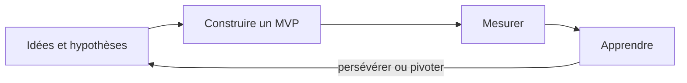

# De l'idée au projet d'entreprise

## Entreprendre

> [!definition] Entrepreneuriat
> Repérer une **opportunité**, réunir des ressources (personnes, argent, compétences) et créer une organisation qui apporte de la **valeur** à des clients.

On parle d'**intrapreneuriat** quand on porte un projet innovant à l'intérieur d'une entreprise existante.

Une **startup** est une jeune entreprise qui cherche un modèle économique **reproductible et capable de grandir vite**, souvent grâce à la technologie. Beaucoup de projets de PFE peuvent devenir le point de départ d'une startup.

## Une idée n'est pas une opportunité

Une idée devient une opportunité quand :

- elle répond à un **problème réel**, fréquent et pénible pour une cible précise ;
- des clients sont **prêts à payer**, ou un autre modèle de revenus existe ;
- l'équipe est capable de la réaliser ;
- le moment est le bon (technologie, réglementation, habitudes).

> [!tip] Tomber amoureux du problème, pas de la solution
> Commencer par interroger 10 à 20 personnes de la cible sur leur problème, **sans** leur présenter son idée.

## Le Business Model Canvas

Créé par Alexander Osterwalder, il résume un modèle économique sur une seule page, en 9 blocs.

| Bloc | Question |
|---|---|
| Segments de clients | Pour qui crée-t-on de la valeur ? |
| Proposition de valeur | Quel problème résout-on, quel bénéfice apporte-t-on ? |
| Canaux | Comment atteint-on les clients et comment leur livre-t-on le produit ? |
| Relation client | Quel type de relation : libre-service, communauté, assistance ? |
| Sources de revenus | Pour quoi les clients paient-ils, et comment ? |
| Ressources clés | Qu'est-ce qui est indispensable : équipe, technologie, données ? |
| Activités clés | Que doit-on faire mieux que tout le monde ? |
| Partenaires clés | Sur qui s'appuie-t-on ? |
| Structure de coûts | Quels sont les principaux coûts ? |

La partie **droite** du canevas (clients, valeur, canaux, relation, revenus) décrit le marché ; la partie **gauche** (ressources, activités, partenaires, coûts) décrit l'organisation.

## La méthode Lean Startup

Popularisée par Eric Ries : au lieu de passer un an à construire un produit parfait, on **teste vite** ses hypothèses.

> [!definition] MVP (*Minimum Viable Product*)
> La plus petite version du produit qui permet d'**apprendre** quelque chose des vrais clients : une page d'inscription, une maquette cliquable, un service rendu à la main en coulisses.

**Pivoter**, c'est changer un élément du modèle (cible, fonctionnalité, prix) quand les mesures montrent qu'une hypothèse est fausse.

## Étudier le marché

- **Taille du marché** : TAM (marché total), SAM (marché adressable), SOM (la part qu'on peut réellement gagner).
- **Concurrence** : directe, indirecte, et la solution actuelle des clients (« ils se débrouillent avec Excel »).
- **Analyse SWOT** : forces et faiblesses (internes) ; opportunités et menaces (externes).

## Financer le projet

| Étape | Sources habituelles |
|---|---|
| Idée, prototype | fonds propres, famille et amis (*love money*), concours, incubateurs |
| Premiers clients | business angels, subventions, prêts d'honneur |
| Croissance | capital-risque (*venture capital*), prêts bancaires |
| En parallèle | financement participatif (*crowdfunding*) |

Les **incubateurs** et **accélérateurs** offrent des locaux, un accompagnement, un réseau et parfois un financement.

## Le business plan

Le document qui présente le projet aux partenaires et aux financeurs : résumé, équipe, problème et solution, marché, concurrence, modèle économique, stratégie commerciale, plan d'action et **prévisions financières** sur 3 ans.

## Les indicateurs à connaître

- **Seuil de rentabilité** : le chiffre d'affaires à partir duquel on couvre tous les coûts.
- **CAC** (coût d'acquisition d'un client) et **LTV** (ce qu'un client rapporte sur toute sa durée de vie) : un modèle sain a une LTV nettement supérieure au CAC.
- **Burn rate** : l'argent dépensé chaque mois ; **runway** : le nombre de mois avant d'être à court de trésorerie.

> [!abstract] À retenir
> Un problème réel → une proposition de valeur → le Business Model Canvas → un MVP et des mesures (Lean Startup) → un financement adapté à l'étape. Fiche : [[Résumé - Entreprenariat]].
