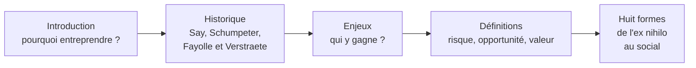
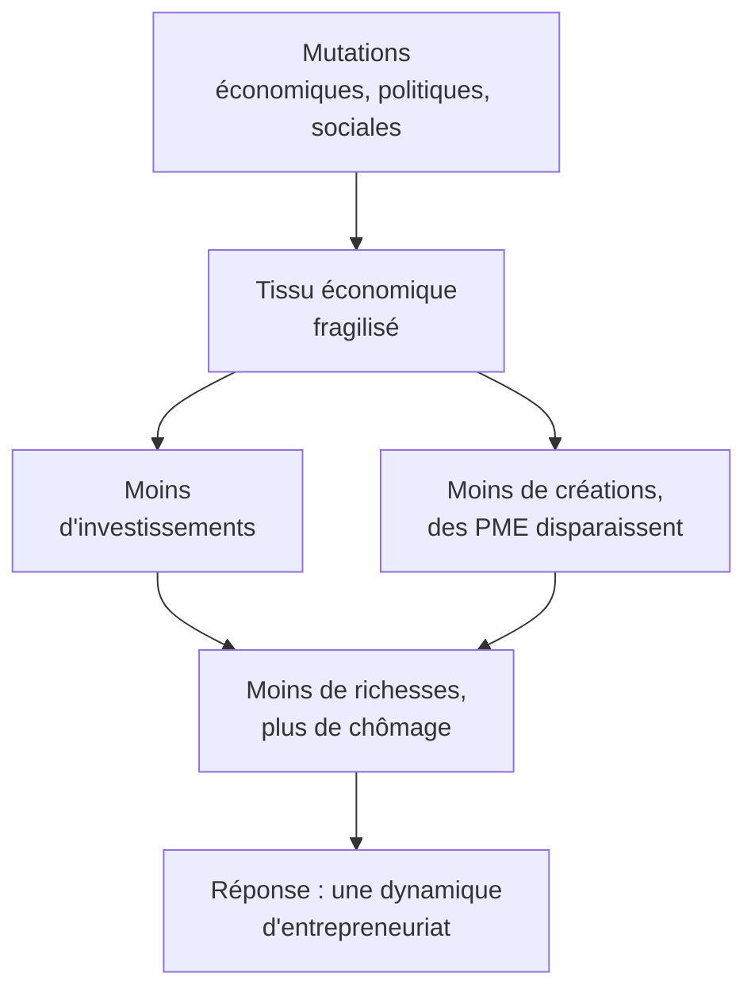
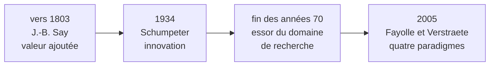
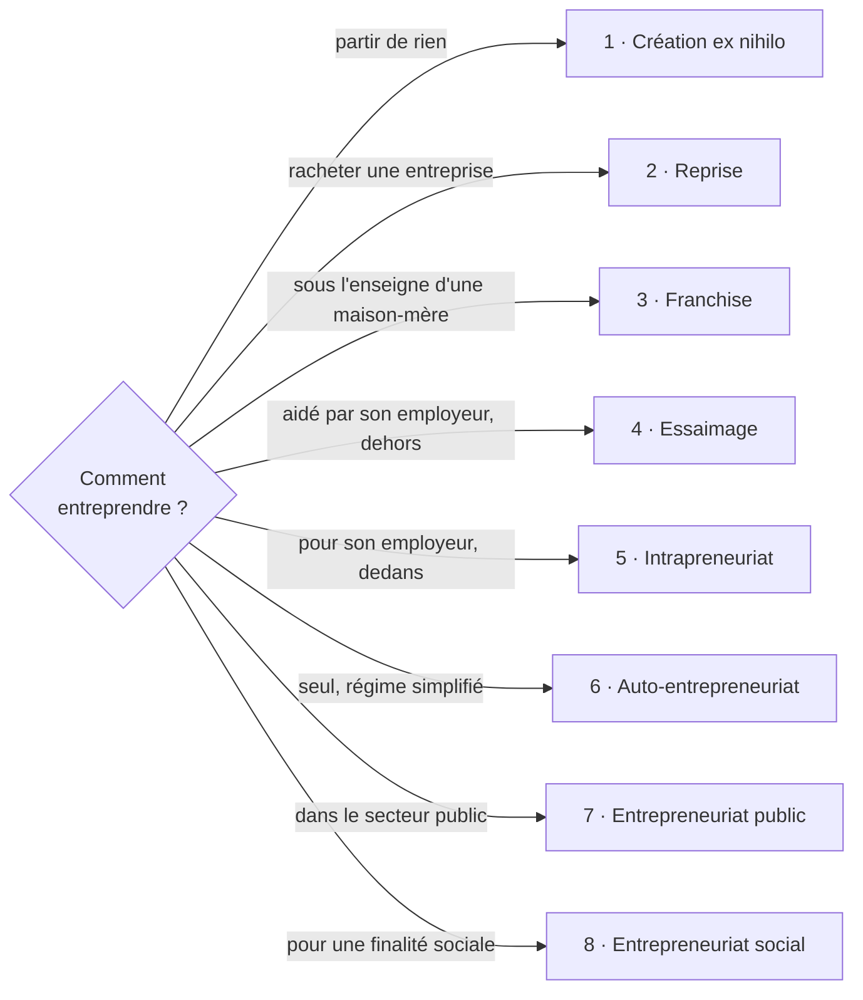
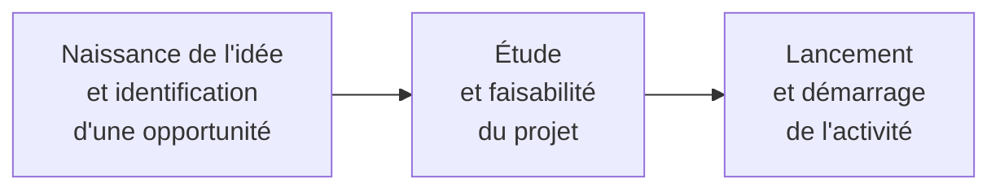
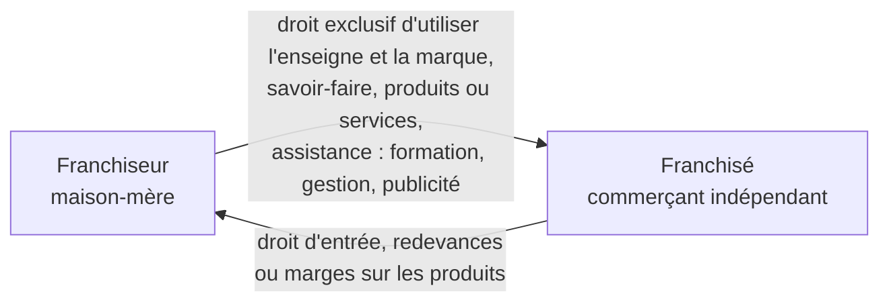

# Résumé — Chapitre 1 : Aperçu sur l'entrepreneuriat

Support : [[Chapitre 1 - Aperçu sur l'entrepreneuriat.pdf]] (partie I du cours, 12 pages ; les « p. » renvoient aux pages du PDF) · Amel ZIDI · 3LCE / 3LCS, groupes IoT3-IRS3 et GLSI3 · semestre 1, 2026

Le chapitre répond à trois questions : **d'où vient** la notion d'entrepreneuriat, **à qui elle profite** (en particulier en Tunisie), et **sous quelles formes** on peut entreprendre. Le message central : entreprendre ne veut pas seulement dire créer une entreprise à partir de rien. On peut aussi reprendre une entreprise, ouvrir une franchise, être aidé par son employeur, innover de l'intérieur ou entreprendre pour une cause sociale.

> [!abstract] L'idée du chapitre en une phrase
> L'entrepreneuriat recouvre les activités qui mènent à la formation et à la croissance d'une entreprise, avec pour conséquence première la **création de valeur (richesse et emploi)** ; il prend **huit formes**, qui se distinguent par leurs caractéristiques, leur principe et leur **degré de risque**.

## Le chapitre en un coup d'œil

| Pages | Thème |
|---|---|
| 1 et 2 | introduction générale : la crise, la réponse entrepreneuriale, le plan du cours |
| 3 et 4 | section I · historique de la notion : Say, Schumpeter, les quatre paradigmes |
| 4 et 5 | section II · enjeux socio-économiques dans le contexte tunisien : les acteurs |
| 5 | section III · définitions : Knight et Drucker, Verstraete et Fayolle, l'entrepreneur |
| 5 à 12 | section IV · les huit formes entrepreneuriales |

## 1. Pourquoi parler d'entrepreneuriat ?

*Introduction générale, p. 1 et 2*

La scène économique, politique et sociale locale a connu des **mutations** qui ont déstabilisé des équilibres nationaux. Conséquence immédiate : une **fragilisation du tissu économique**, visible à deux signes :

- un **ralentissement des investissements** et une réticence des investisseurs locaux et étrangers ;
- une **baisse du rythme de création** d'entreprises, voire la disparition de PME (petites et moyennes entreprises), donc moins de richesses créées, des **emplois perdus** et un **chômage en hausse**.

La réponse du cours est une **dynamique d'entrepreneuriat**, fondée sur la promotion du rôle de l'entreprise et de la **culture entrepreneuriale**, pour relancer l'économie et assurer la prospérité. Elle demande trois choses :

| Ingrédient | Contenu |
|---|---|
| **Des individus** | des entrepreneurs, hommes et femmes, preneurs de décisions, qui créent et développent des entreprises génératrices de valeur et d'emploi |
| **Un contexte entrepreneurial** | un ensemble de facteurs environnementaux : économiques, institutionnels, socio-culturels… |
| **Des mentalités** (la priorité) | des façons de voir, d'être et de faire qui orientent les individus vers l'entrepreneuriat et font monter le **taux d'activité entrepreneuriale** |

Le dynamisme et la croissance d'un pays dépendent en grande partie de ce **taux d'activité entrepreneuriale**, c'est-à-dire de sa capacité à créer de nouvelles entreprises : les entreprises sont des acteurs essentiels de l'économie, qui participent à la croissance et créent des emplois.

> [!definition] Entrepreneuriat (introduction, p. 2)
> L'entrepreneuriat recouvre les activités qui concourent à la **formation** et à la **croissance** d'une entreprise, dont la conséquence première est la **création de valeur** (richesse et emploi).

**Le plan du cours** (p. 2) suit deux axes : d'abord la notion d'entrepreneuriat et sa conceptualisation (ce chapitre), ensuite le **processus entrepreneurial** : le profil de l'entrepreneur et ses motivations, la notion d'**idée-opportunité**, et un modèle de **BMC** (*Business Model Canvas*) avec des exemples.

## 2. Historique de la notion d'entrepreneuriat

*Section I, p. 3 et 4*

L'entrepreneuriat intéresse aujourd'hui les **académiciens**, les **hommes de terrain** et les **politiciens**. Depuis quelques années apparaissent des programmes de formation pour entrepreneurs, des **incubateurs** de startups et des **structures d'accompagnement** (pépinières d'entreprises, centres d'affaires, technopôles), pour répondre à une demande qui ne cesse de croître. Les regards se sont tournés vers l'entreprise, vue comme la principale source de **richesse, d'emplois et de croissance** des nations.

Comme **domaine de recherche** (l'étude de la création, de la survie et du développement des entreprises), l'entrepreneuriat s'est développé rapidement **depuis la fin des années 70**, et le sens des mots « entrepreneur » et « entrepreneuriat » a évolué avec lui.

### Jean-Baptiste Say (vers 1803) : l'entrepreneur crée de la valeur

L'entrepreneur **déplace les ressources économiques d'un niveau de rendement donné à un niveau supérieur** : c'est la notion de **valeur ajoutée**.

- C'est un **acteur responsable avant tout de création de valeur**.
- C'est un **agent de changement**.
- L'accent est mis sur les activités de **transformation** et d'**innovation productive**, pas uniquement sur le commerce.

### Joseph Schumpeter (1934) : l'entrepreneur innove

Au 20ᵉ siècle, en 1934, se produit la « véritable révolution » des théories de l'entrepreneuriat : l'économiste Joseph Schumpeter introduit la notion d'**innovation**.

> [!quote] Schumpeter
> « L'entrepreneur [est] une personne qui veut et qui est capable de transformer une idée ou une invention en une innovation réussie. L'essence de l'entrepreneuriat se situe dans la perception et l'exploitation de nouvelles opportunités dans le domaine de l'entreprise… »

> [!important] Inventeur ou entrepreneur ?
> Pour Schumpeter, l'entrepreneur **n'est pas l'inventeur** qui fait la découverte, mais **celui qui saura l'introduire dans l'industrie sous forme d'innovation**. Sa vraie fonction : **prendre des initiatives** (l'esprit de prise d'initiative) et **créer** (l'esprit créatif).

*Complément, hors cours : le livre de Schumpeter (Théorie de l'évolution économique) paraît d'abord en allemand en 1911 ; 1934 est l'année de sa traduction anglaise. Pour l'examen, retenir la date du cours, 1934.*

### Fayolle et Verstraete (2005) : quatre paradigmes

Un **paradigme** est ici une manière de délimiter ce qu'est l'entrepreneuriat. Fayolle et Verstraete en identifient quatre (p. 3 et 4) :

| Paradigme | Ce qui fait l'entrepreneuriat | À rapprocher de (lien fait par cette fiche) |
|---|---|---|
| **Création d'une organisation** | faire naître une organisation, **pas seulement une entreprise** | la définition de Verstraete et Fayolle, section III |
| **Opportunité d'affaires** | **détecter** puis **exploiter** une opportunité | Schumpeter : « perception et exploitation de nouvelles opportunités » |
| **Création de valeur** | produire de la valeur nouvelle | Say : la valeur ajoutée |
| **Innovation** | introduire du nouveau dans l'économie | Schumpeter |

## 3. Les enjeux socio-économiques dans le contexte tunisien

*Section II, p. 4 et 5*

La création d'entreprises, et plus largement l'entrepreneuriat, répond à une **demande sociale** venue de plusieurs **acteurs**, qui y trouvent chacun leur intérêt :

| Acteur | Ce qu'il attend de l'entrepreneuriat |
|---|---|
| **L'État** | le principal **moteur de croissance** ; une solution majeure au **chômage** ; le **renouvellement du tissu productif** ; une source de richesses et de **revenus pour l'État** (TVA, IS) ; un levier pour lancer des activités **innovantes et rapidement exportables** ; un garant de **paix sociale** |
| **Les collectivités territoriales** | **rééquilibrer le tissu économique local** et compenser les emplois détruits quand de grandes entreprises de la région **délocalisent** une partie de leurs activités ; leur outil privilégié : la **pépinière d'entreprises** |
| **Les grandes entreprises** | **reconvertir des sites industriels** ; gagner de **futurs partenaires** (clients, fournisseurs, sous-traitants) ; stimuler **en leur sein** l'esprit d'entreprendre et d'innovation |
| **Les institutions financières et d'investissement** | SICAR, banques (BTS, BFPME et tout le système bancaire) : les nouvelles entreprises sont une **nouvelle clientèle** ; elles cherchent à repérer **le plus tôt possible** les jeunes entreprises à fort potentiel (startups) |
| **Les assurances** | citées par le cours, sans détail |
| **Les individus** (étudiants, salariés, chômeurs…) | selon leur situation et leurs motivations : une **réinsertion** professionnelle et sociale, **maîtriser son destin**, **s'accomplir**, satisfaire un fort besoin d'**indépendance** ou d'**autonomie** |

La liste du cours se termine par « … » : d'autres acteurs sont possibles.

> [!tip] Le lien avec les formes (fait par cette fiche)
> Les grandes entreprises veulent stimuler l'esprit d'entreprendre **en leur sein** : c'est ce qu'organisent deux des formes de la section IV, l'**essaimage** (le salarié crée son entreprise dehors, avec l'aide de l'employeur) et l'**intrapreneuriat** (il entreprend dedans).

## 4. Définitions

*Section III, p. 5*

> [!definition] Knight (1967) et Drucker (1970) : prendre des risques
> L'entrepreneuriat consiste à **prendre des risques**. L'entrepreneur est prêt à mettre en jeu **sa carrière et sa sécurité financière** pour mettre en œuvre une idée, et à investir **son temps et son capital** dans une entreprise risquée.

> [!definition] Verstraete et Fayolle (2005, p. 44)
> « Une **initiative** portée par un individu (ou plusieurs individus s'associant pour l'occasion) construisant ou saisissant une **occasion d'affaires**, dont le **profit n'est pas forcément d'ordre pécuniaire**, par l'impulsion d'une **organisation** pouvant naître une ou plusieurs entités, et créant de la **valeur nouvelle** (plus forte dans le cas d'une innovation) pour des **parties prenantes** auxquelles le projet s'adresse. »

Cette définition est longue ; elle se lit morceau par morceau :

| Morceau | Ce qu'il veut dire |
|---|---|
| une initiative portée par un ou plusieurs individus | on peut entreprendre seul ou avec des associés |
| construisant ou saisissant une occasion d'affaires | l'opportunité peut être **créée** ou **repérée** |
| profit pas forcément d'ordre pécuniaire | le gain n'est pas toujours de l'argent : il peut être social ou environnemental (voir l'entrepreneuriat social) |
| par l'impulsion d'une organisation | il faut lancer une structure, d'où peuvent naître une ou plusieurs entités |
| créant de la valeur nouvelle, plus forte si innovation | la valeur est le résultat ; l'innovation l'augmente |
| pour des parties prenantes | ceux à qui le projet s'adresse |

On y retrouve les **quatre paradigmes** de la section I : organisation, opportunité, valeur et innovation.

> [!definition] Une définition plus simple
> Entreprendre et développer un **projet** ; dans les affaires : **créer une activité économique** pour **répondre à un besoin** ou atteindre un objectif précis.

**L'entrepreneur** est la personne qui s'engage dans l'entrepreneuriat : c'est lui qui est **à la tête du projet**, sans refuser l'aide extérieure. Exemples de projets cités : une boutique en ligne (e-commerce), un restaurant, une société de plomberie, une boîte de développement, une **startup** (jeune entreprise innovante à fort potentiel de croissance), une **SSII** (Société de Services en Ingénierie Informatique), appelée aujourd'hui **ESN** (Entreprise de Services du Numérique).

**Les quatre angles du cours** (regroupement fait par cette fiche) :

| Angle | Auteur(s) | Mot-clé |
|---|---|---|
| Valeur | Say (vers 1803) | valeur ajoutée, agent de changement |
| Innovation | Schumpeter (1934) | transformer une invention en innovation réussie |
| Risque | Knight (1967), Drucker (1970) | mettre en jeu sa carrière et son capital |
| Opportunité et organisation | Verstraete et Fayolle (2005) | initiative, occasion d'affaires, valeur nouvelle |

## 5. Les huit formes entrepreneuriales

*Section IV, p. 5 à 12*

Les formes se distinguent par leurs **caractéristiques**, leur **principe** et le **degré de risque** qu'elles engendrent. Le cours en compte huit.

| # | Forme | Principe | L'organisation existe-t-elle ? | Ce que le cours dit du risque | Exemples du cours |
|---|---|---|---|---|---|
| 1 | **Ex nihilo** | créer à partir de rien, à partir d'une idée | non, elle est à créer | **la plus risquée**, mais la plus répandue | — |
| 2 | **Reprise** | racheter tout ou partie d'une entreprise | oui | saine : un prix élevé ; en difficulté : dettes, salariés à garder, comptes maquillés | — |
| 3 | **Franchise** | vendre les produits ou services d'une maison-mère sous son enseigne, contre rémunération | le franchisé est une entreprise distincte du franchiseur | non chiffré ; le franchisé est épaulé par l'assistance du franchiseur | McDonald's, KFC, Mliha, Chahia, El Mazraa, Zara… |
| 4 | **Essaimage** | l'employeur aide un salarié à créer **sa propre** entreprise, **à l'extérieur** | non, entité nouvelle et autonome | réduit : congé pour création, retour possible en cas d'échec | Tunisie Télécom, STEG, SONEDE… |
| 5 | **Intrapreneuriat** | un salarié développe une activité nouvelle **à l'intérieur** de l'entreprise | oui, on reste dans l'entreprise | « sans prise de risque » ni perte de statut pour le salarié | Gmail, Post-it, Kleen… |
| 6 | **Auto-entrepreneuriat** | travail indépendant, régime simplifié | non | non précisé ; démarches très simplifiées | chauffeurs Uber, Bolt |
| 7 | **Public** | créer des entreprises publiques ; projet agile dans un service public | — | non précisé | — |
| 8 | **Social et solidaire** | activité économique à finalité sociale ou environnementale | — | non précisé | Foodealz, Wildly, Jhonny bikes, Enactus |

### 5.1 La création ex nihilo (création pure, création « à zéro »)

*p. 6*

- *Ex nihilo* est une expression latine : « à partir de rien ».
- On part de zéro : **ni rachat de fonds de commerce, ni rachat de parts sociales** d'une société existante. On crée un établissement économique actif qui **n'existait pas** : l'organisation doit être créée.
- La nouvelle entité est **indépendante juridiquement** (voir la remarque ci-dessous).
- Elle correspond à l'**exploitation de nouveaux moyens de production**.
- **L'idée est à l'origine** de la création pure : le créateur pur (ou les fondateurs) trouve une idée de création d'entreprise et la développe.

> [!important] La plus risquée, mais de loin la plus répandue
> Le créateur se lance dans l'**inconnu** : il faut beaucoup de temps, de travail, de **rigueur** et de **ténacité**.

> [!remarque] « Indépendance ludique », p. 6
> Le support écrit que l'entité créée « disposera alors d'une indépendance **ludique** ». Le sens attendu est **juridique** : la nouvelle entreprise est juridiquement indépendante. C'est le mot que le cours emploie pour la franchise (« juridiquement, financièrement et économiquement distinctes », p. 7) et l'essaimage (« financièrement et juridiquement autonome », p. 8).

### 5.2 La reprise d'entreprise (saine ou en difficulté)

*p. 6 et 7*

- Le **repreneur** est une personne **physique** ou **morale** ; la reprise peut être faite par **une ou plusieurs** personnes. Les **salariés** ou les **cadres dirigeants** d'une entreprise peuvent racheter leur propre entreprise.
- La différence de taille avec l'ex nihilo : **l'organisation existe déjà**, elle n'a pas à être créée. On rachète **tout ou partie** d'une entreprise existante.

> [!definition] Deschamps (2000)
> La reprise par une personne physique est « le processus qui, par une **opération de rachat**, aboutit à la **continuation de la vie d'une entreprise**, en difficulté ou non, et de tout ce qu'elle contient (structures, ressources humaines, financières, techniques, commerciales…) ». Le particulier qui reprend une firme l'acquiert en devenant **le propriétaire et le dirigeant**.
>
> *Le support écrit « DESHAMPS » ; il s'agit de Bérangère Deschamps.*

**Reprendre une entreprise saine.** La principale difficulté est son **prix de marché, qui peut être élevé**. Il faut des **ressources financières importantes**, de bonnes compétences générales et une **expérience de management réussie**.

**Reprendre une entreprise en difficulté.** Deux cas :

| Cas | Risque pour le repreneur |
|---|---|
| elle a **déjà déposé son bilan** | assumer certaines **charges socio-économiques** laissées par l'ancien propriétaire : **payer ses dettes, garder ses salariés…** |
| elle **n'a pas encore déposé son bilan** (encore en redressement judiciaire) | le vendeur peut avoir **maquillé ses comptes et ses résultats** pour cacher ses pertes et éviter le dépôt de bilan |

*Complément, hors cours : « déposer son bilan », c'est déclarer au tribunal que l'entreprise ne peut plus payer ses dettes (cessation de paiements).*

### 5.3 La franchise (franchisage)

*p. 7*

- On crée une entreprise **sous une entreprise mère** : le **franchisé** vend les produits ou services d'une maison-mère, le **franchiseur**, moyennant compensation.
- C'est un **contrat de droit commercial** : le franchiseur concède au franchisé le droit d'utiliser tout ou partie de ses **droits incorporels** (nom commercial, marques…), généralement contre **un pourcentage du chiffre d'affaires** ou **des bénéfices**.

- Le franchisé commercialise **conformément aux directives prévues dans le contrat**.
- Les deux entreprises collaborent étroitement mais restent **juridiquement, financièrement et économiquement distinctes** (indépendantes).

| Secteur | Franchiseurs cités |
|---|---|
| Restauration | McDonald's, KFC (Kentucky Fried Chicken) ; en Tunisie : Mliha, Chahia, El Mazraa |
| Prêt-à-porter | Zara, Kiabi, H&M, société « Marwa » |
| Meubles | Gautier |
| Télécoms | Orange, Ooredoo, Tunisie Telecom |
| Carburants | Shell, TOTAL |

### 5.4 L'essaimage (« extrapreneuriat »)

*p. 8 et 9*

> [!definition] Essaimage
> Une entreprise publique ou privée, généralement un grand groupe, **facilite la création d'entreprise par un ou plusieurs de ses salariés** en les aidant à monter et à lancer leur propre projet (aide matérielle, financière, logistique ou commerciale).

| Terme | Qui ? |
|---|---|
| entreprise **essaimante** | l'employeur qui aide (l'entreprise mère) |
| **essaimé** (le promoteur) | le salarié qui crée son entreprise |
| entreprise **essaimée** | l'entreprise créée |

- Le projet se réalise dans le cadre d'une **convention** entre l'entreprise essaimante et le promoteur, conforme à une **convention-type** : elle fixe le contenu du projet et les engagements des deux parties.
- L'entreprise essaimée est une **entité nouvelle, financièrement et juridiquement autonome** de l'entreprise d'origine.

**Les précisions du cours** (remarque, p. 8) :

- l'essaimage concerne les promoteurs **issus du personnel** de l'essaimante, mais aussi des **promoteurs externes** ;
- le projet essaimé peut être **rattaché ou non** à l'activité de l'essaimante ;
- le législateur **n'a pas fixé** les formes d'aide, toutes sont possibles : étude de marché, **participation au capital**, aide logistique au démarrage, aide pour **boucler le schéma de financement**, assistance pour obtenir les primes et avantages liés au projet… ;
- des encouragements financiers, surtout les fonds gérés par la **SAGES** (Société d'Assistance et de Gestion des fonds d'Essaimage).

L'essaimage se développe de plus en plus en Tunisie. Ses avantages, des deux côtés :

| Pour l'essaimé | Pour l'entreprise essaimante |
|---|---|
| le **congé pour création d'entreprise** : il peut revenir travailler dans son entreprise si son projet échoue | la **mobilité et le renouvellement des effectifs** : le salarié parti est remplacé par un autre |
| la **prise en charge des frais d'études et de démarrage** par l'essaimante | la promotion de la **culture entrepreneuriale** et des concepts innovants |
| le **background** et l'assistance de l'entreprise : **transfert de technologie**, **formation**, un programme bien établi | une forte **notoriété** et une bonne **image de marque** : elle contribue à l'emploi et à l'autonomie des salariés |
| | un **réseau d'entrepreneurs** (réseau d'affaires) autour d'elle, utile à son secteur |
| | un **avantage fiscal** en Tunisie (ci-dessous) |

> [!important] L'avantage fiscal (p. 9)
> En Tunisie, l'entreprise essaimante **déduit les dépenses d'essaimage de sa base d'impôt sur les sociétés** de l'année où elles sont engagées, dans la limite de **1 % du chiffre d'affaires brut annuel**, avec un **plafond de 30 000 DT par projet**.

**Entreprises essaimantes en Tunisie** (p. 9) : Tunisie Télécom · STEG (Société Tunisienne d'Électricité et du Gaz) · SONEDE (Société Nationale d'Exploitation et de Distribution des Eaux) · PT (Poste Tunisienne) · ONAS (Office National d'Assainissement) · CPG (Compagnie de Phosphate de Gafsa) · CIOK (Ciments d'Oum el Kelil) · GCT (Groupe Chimique Tunisien) · SNCPA (Société Nationale de Cellulose et de Papier Alfa).

### 5.5 L'intrapreneuriat

*p. 9 et 10*

> [!definition] Intrapreneuriat (Pinchot, 1985)
> Entreprendre **dans une structure existante** : développer des pratiques et des comportements entrepreneuriaux **à l'intérieur** d'une grande entreprise. Le personnage clé est l'**intrapreneur**.

- L'entreprise confie à un de ses cadres la mission de **créer et développer un centre d'activité** : agence, succursale, usine, filiale, établissement à l'étranger…
- L'intrapreneur reçoit les **moyens financiers** du lancement, et peut dans certains cas être **associé au capital**.
- L'entreprise développe des projets stratégiques et d'innovation **sans créer une nouvelle entreprise**. Le salarié apprend progressivement le métier d'entrepreneur **sans prise de risque** ni perte de son statut social.

Ce que l'intrapreneuriat apporte :

- il **incite à innover** ;
- il augmente la **rétention des meilleurs employés** ;
- il aide l'entreprise à **se réinventer** ;
- il peut être un **accélérateur de carrière** (et donc de promotion) pour le salarié ;
- il offre de nouvelles opportunités de croissance aux entreprises **en manque d'innovation**.

| Entreprise | Ce que l'intrapreneuriat y a produit |
|---|---|
| **MediaNet** (SSII de référence dans les TIC) | un projet de *Coworking Space* (2017), qui mêle interne et externe, partage, collaboration et innovation |
| **Google** | *Gmail* |
| **3M** (Minnesota Mining & Manufacturing) | le *Post-it* : une note qu'on colle et décolle à volonté sans abîmer le support |
| **TOTAL** | l'application *Kleen* (lavage auto dans les stations) ; *Bon Gaz* (livraison de bouteilles de gaz à domicile) |
| **Adecco** (services en ressources humaines) | un *incubateur digital* mondial |
| **La Poste** | un *concours interne* annuel |
| **Poulina Group Holding** | des filiales dans divers DAS (domaines d'activité stratégiques), comme *El Mazraa* (intégration avicole) |

> [!remarque] Deux précisions
> - Le support présente 3M comme « l'imprimerie 3M ». 3M (Minnesota Mining & Manufacturing) est un groupe industriel diversifié (abrasifs, adhésifs, rubans…), pas une imprimerie ; l'exemple du Post-it reste juste.
> - *Complément, hors cours :* Pinchot (1985) est la date de son livre *Intrapreneuring* ; Gifford et Elizabeth Pinchot employaient déjà le mot dans un article de 1978. Pour l'examen, retenir **Pinchot (1985)**, comme le cours.

### 5.6 L'auto-entrepreneuriat

*p. 10*

- Un terme **créé en 2008 en France** ; on parle d'**auto-entrepreneurs** ou de **micro-entrepreneurs**.
- Il vient de la **démocratisation du travail indépendant**, comme premier ou second cadre d'activité économique (activité principale ou complément).
- Son avantage : des **démarches administratives fortement simplifiées**.
- L'exemple classique : les **chauffeurs Uber**. Uber a révolutionné le transport avec une plateforme qui met en relation des conducteurs indépendants et des utilisateurs. En Tunisie : les chauffeurs **Bolt**.
- En Tunisie, le **statut d'auto-entrepreneur**, régime simplifié de l'entreprise individuelle, est en place : www.autoentrepreneur.tn.

### 5.7 L'entrepreneuriat public

*p. 11*

- La création d'**entreprises publiques** : tous les établissements gouvernementaux nécessaires au **développement économique national**.
- Un concept d'importance croissante dans le secteur public : il change la manière dont les gouvernements et les organisations publiques abordent l'**innovation**, la **prestation de services** et la **croissance économique**.
- L'entrepreneur public lance un **projet agile de l'intérieur d'un service public** pour en **augmenter l'efficacité** (une démarche proche de l'intrapreneuriat, appliquée au service public : rapprochement fait par cette fiche).

### 5.8 L'entrepreneuriat social et solidaire

*p. 11 et 12*

- Créer des entreprises dont l'activité économique est conçue pour **créer de la valeur sociale** : des solutions innovantes à des **problèmes sociaux** (développement durable, santé, environnement, création d'emplois…).
- Au service de l'**intérêt général** : la finalité principale est **sociale ou environnementale** (entrepreneuriat **responsable et durable**), et ces initiatives **réinvestissent la majorité de leurs bénéfices** dans leur mission.
- Une volonté d'**entreprendre différemment**, de manière responsable, pour un monde innovant, plus durable et solidaire.

C'est la forme qui illustre le mieux le « profit pas forcément d'ordre pécuniaire » de la définition de Verstraete et Fayolle.

| Projet tunisien | Ce qu'il fait |
|---|---|
| **Foodealz** | une application conçue par des jeunes contre le **gaspillage alimentaire**, grâce à des accords avec les fournisseurs de denrées : elle protège l'environnement et réduit les déchets alimentaires |
| **Wildly** | un projet de divertissement qui réunit les passionnés de nature pour des activités dans la nature tunisienne |
| **Jhonny bikes** | une startup de **location de vélos** avec des stations dans les rues : écologique et divertissant, pour diffuser la culture du cyclisme |
| **Enactus** (association) | des clubs dans les universités où les étudiants mènent des projets qui allient **esprit d'entreprise et utilité sociale**, pour former des leaders entreprenants et responsables |

> [!tip] Le mot de la fin du chapitre (p. 12)
> **Le porteur de projet a la liberté de choisir la forme qui lui correspond.**

## 6. Comparer les formes deux à deux

*Tableaux construits par cette fiche à partir des pages 6 à 9*

**Ex nihilo ou reprise ?**

| | Ex nihilo | Reprise |
|---|---|---|
| L'organisation | n'existe pas, elle est à créer | existe déjà, on la rachète (tout ou partie) |
| Point de départ | une **idée** et une opportunité | une entreprise existante, saine ou en difficulté |
| Ce qu'on rachète | rien : ni fonds de commerce, ni parts sociales | l'entreprise et ce qu'elle contient : structures, ressources humaines, financières, techniques, commerciales |
| Risque principal | l'inconnu : la forme la plus risquée | le prix (saine) ; les dettes, les salariés à garder et les comptes maquillés (en difficulté) |

**Franchise ou essaimage ?** Dans les deux cas, une entreprise mère et une entreprise indépendante.

| | Franchise | Essaimage |
|---|---|---|
| Le lien | un **contrat de droit commercial** franchiseur-franchisé | une **convention** entre l'essaimante et l'essaimé |
| Qui paie qui ? | le **franchisé paie** : droit d'entrée, redevances, marges | l'**essaimante aide** : frais d'études et de démarrage, capital, logistique |
| L'activité | vendre les produits ou services de la maison-mère, sous son enseigne | libre : rattachée ou non à l'activité de l'essaimante |
| Indépendance | entreprises juridiquement, financièrement et économiquement distinctes | entité financièrement et juridiquement autonome |

**Essaimage ou intrapreneuriat ?** La question à se poser : le projet naît-il **hors de** l'entreprise ou **dans** l'entreprise ?

| | Essaimage | Intrapreneuriat |
|---|---|---|
| Où naît le projet ? | **à l'extérieur** : une nouvelle entreprise (essaimée) | **à l'intérieur** : un centre d'activité de l'entreprise |
| La nouvelle activité | une entité **autonome**, financièrement et juridiquement | reste dans l'entreprise (agence, succursale, usine, filiale…) |
| Le salarié | devient **chef de sa propre entreprise** | reste **salarié**, parfois associé au capital |
| Son risque | réduit : congé pour création, retour possible | aucune prise de risque, pas de perte de statut |
| Ce que gagne l'entreprise mère | image de marque, réseau d'affaires, renouvellement des effectifs, déduction fiscale | innovation, rétention des meilleurs employés, se réinventer |

## 7. Les auteurs et les dates

| Auteur | Date | Idée retenue | Page |
|---|---|---|---|
| Jean-Baptiste Say | vers 1803 | l'entrepreneur déplace les ressources vers un rendement supérieur : valeur ajoutée, agent de changement | 3 |
| Joseph Schumpeter | 1934 | l'innovation : transformer une idée ou une invention en innovation réussie ; l'entrepreneur n'est pas l'inventeur | 3 |
| Knight ; Drucker | 1967 ; 1970 | entreprendre, c'est prendre des risques | 5 |
| Pinchot | 1985 | introduit le mot « intrapreneuriat » | 9 |
| Deschamps | 2000 | la reprise : un rachat qui continue la vie de l'entreprise | 6 et 7 |
| Fayolle et Verstraete | 2005 | les quatre paradigmes ; la définition de l'entrepreneuriat (p. 44 de leur texte) | 3 à 5 |
| (France) | 2008 | création du terme « auto-entrepreneur » | 10 |

## 8. Les sigles du chapitre

| Sigle | Sens |
|---|---|
| PME | Petites et Moyennes Entreprises |
| TVA | Taxe sur la Valeur Ajoutée |
| IS | Impôt sur les Sociétés |
| SICAR | Sociétés d'Investissement en Capital À Risque |
| BTS | Banque Tunisienne de Solidarité |
| BFPME | Banque de Financement des Petites et Moyennes Entreprises |
| SSII, ESN | Société de Services en Ingénierie Informatique, aujourd'hui Entreprise de Services du Numérique |
| SAGES | Société d'Assistance et de Gestion des fonds d'Essaimage |
| DAS | Domaines d'Activité Stratégiques |
| TIC | Technologies de l'Information et de la Communication |
| DT | dinar tunisien |
| BMC | Business Model Canvas (au programme de la partie II) |

## À retenir

- L'entrepreneuriat recouvre les activités qui mènent à la **formation et à la croissance** d'une entreprise ; sa conséquence première est la **création de valeur** (richesse et emploi). Le **taux d'activité entrepreneuriale** porte la croissance d'un pays.
- **Say** : la valeur ajoutée. **Schumpeter** : l'innovation, et l'entrepreneur n'est pas l'inventeur. **Knight et Drucker** : le risque. **Fayolle et Verstraete** : organisation, opportunité, valeur, innovation.
- L'État, les collectivités territoriales, les grandes entreprises, les institutions financières, les assurances et les individus ont chacun **intérêt** à l'entrepreneuriat.
- **Huit formes** : ex nihilo (la plus risquée et la plus répandue), reprise (l'organisation existe déjà), franchise (une marque contre des redevances), essaimage (dehors, aidé par l'employeur), intrapreneuriat (dedans), auto-entrepreneuriat (régime simplifié), public, social et solidaire (finalité sociale, bénéfices réinvestis).
- Le porteur de projet **choisit librement** la forme qui lui correspond.

## Questions de révision

1. Par quoi se manifeste la fragilisation du tissu économique selon le cours, et quelle réponse propose-t-il ?
2. Quels sont les trois ingrédients d'une dynamique entrepreneuriale, et lequel est prioritaire ?
3. Comparer la vision de l'entrepreneur chez Say et chez Schumpeter.
4. Pourquoi, selon Schumpeter, l'inventeur n'est-il pas forcément un entrepreneur ?
5. Citer les quatre paradigmes de Fayolle et Verstraete.
6. Qu'attend l'État de l'entrepreneuriat ? Et les collectivités territoriales, avec quel outil ?
7. Pourquoi une banque s'intéresse-t-elle aux nouvelles entreprises ?
8. Dans la définition de Verstraete et Fayolle, que signifie « dont le profit n'est pas forcément d'ordre pécuniaire » ? Quelle forme l'illustre le mieux ?
9. Une ingénieure quitte son emploi pour fonder une startup à partir de sa propre idée. Quelle forme ? Pourquoi est-elle la plus risquée ?
10. Quels risques court le repreneur d'une entreprise en difficulté, selon qu'elle a déjà déposé son bilan ou non ?
11. Que donne le franchiseur au franchisé, et que reçoit-il en échange ?
12. Un technicien de la STEG crée sa propre société de maintenance, et la STEG finance son étude de marché. Quelle forme ? Quels avantages pour lui, et pour la STEG ?
13. Avec les règles du cours, combien une entreprise essaimante peut-elle déduire de sa base d'IS pour **un seul projet** : (a) chiffre d'affaires brut de 2 000 000 DT, dépenses de 25 000 DT ; (b) chiffre d'affaires brut de 5 000 000 DT, dépenses de 40 000 DT ?
14. Quelle est la différence entre l'essaimage et l'intrapreneuriat ? Classer : Gmail chez Google ; un salarié de Tunisie Télécom qui crée sa propre société avec l'aide de son employeur.
15. Qu'est-ce qu'un auto-entrepreneur ? Donner un exemple.
16. Classer chaque cas dans une forme : (a) ouvrir un restaurant sous l'enseigne Chahia ; (b) des cadres rachètent l'entreprise qui les emploie ; (c) une application qui vend à prix réduit les invendus des boulangeries pour éviter le gaspillage ; (d) TOTAL lance le service Bon Gaz ; (e) un agent municipal lance un projet agile pour réduire l'attente aux guichets.

> [!question]- Réponses
> 1. Par un **ralentissement des investissements** (réticence des investisseurs locaux et étrangers) et une **baisse des créations d'entreprises**, voire la disparition de PME, d'où moins de richesses, des emplois perdus et plus de chômage. Réponse : une **dynamique d'entrepreneuriat**, qui promeut le rôle de l'entreprise et la culture entrepreneuriale pour relancer l'économie.
> 2. **Des individus** (entrepreneurs preneurs de décisions), **un contexte entrepreneurial** (facteurs économiques, institutionnels, socio-culturels) et, **en priorité**, **des mentalités** : des façons de voir, d'être et de faire tournées vers l'entrepreneuriat.
> 3. **Say** (vers 1803) : l'entrepreneur déplace les ressources vers un rendement supérieur ; il **crée de la valeur ajoutée** et c'est un agent de changement. **Schumpeter** (1934) : l'entrepreneur **innove**, il transforme une idée ou une invention en innovation réussie et exploite de nouvelles opportunités.
> 4. Parce que l'inventeur fait la **découverte**, alors que l'entrepreneur est celui qui **l'introduit dans l'industrie sous forme d'innovation**, grâce à son esprit d'initiative et son esprit créatif.
> 5. La **création d'une organisation** (pas seulement d'une entreprise), la **détection et l'exploitation d'une opportunité d'affaires**, la **création de valeur**, l'**innovation**.
> 6. **L'État** : la croissance, la lutte contre le chômage, le renouvellement du tissu productif, des recettes (TVA, IS), des activités innovantes et exportables, la paix sociale. **Les collectivités territoriales** : rééquilibrer le tissu économique local et compenser les emplois perdus avec les délocalisations, grâce à la **pépinière d'entreprises**.
> 7. Parce que les nouvelles entreprises et les nouveaux entrepreneurs sont une **nouvelle clientèle** ; les institutions financières cherchent à repérer le plus tôt possible les startups à fort potentiel.
> 8. Que le gain recherché n'est **pas forcément de l'argent** : il peut être social ou environnemental. L'**entrepreneuriat social et solidaire** l'illustre le mieux (finalité sociale, majorité des bénéfices réinvestie dans la mission).
> 9. **Création ex nihilo** : elle part de rien, sans rachat de fonds de commerce ni de parts sociales, à partir de sa propre idée. C'est la plus risquée parce que la créatrice se lance dans l'**inconnu** ; il faut beaucoup de temps, de travail, de rigueur et de ténacité.
> 10. **Bilan déjà déposé** : il doit assumer des charges laissées par l'ancien propriétaire (payer ses dettes, garder ses salariés…). **Bilan pas encore déposé** (redressement judiciaire) : le vendeur a pu **maquiller ses comptes et ses résultats** pour cacher ses pertes.
> 11. Il lui donne le **droit exclusif d'utiliser son enseigne et sa marque**, son **savoir-faire**, le droit de commercialiser ses produits ou services selon le contrat, et une **assistance** (formation, gestion, publicité). En échange, il reçoit un **droit d'entrée**, des **redevances** (un pourcentage du chiffre d'affaires ou des bénéfices) ou des **marges sur les produits**.
> 12. **Essaimage** (la STEG est l'entreprise essaimante, le technicien l'essaimé). Pour lui : le congé pour création (retour possible en cas d'échec), les frais d'études pris en charge, l'assistance et le transfert de technologie. Pour la STEG : image de marque et notoriété, un réseau d'affaires, le renouvellement des effectifs et la déduction fiscale.
> 13. (a) 1 % de 2 000 000 DT = **20 000 DT** ; c'est sous le plafond de 30 000 DT, donc elle déduit **20 000 DT** sur ses 25 000 DT de dépenses. (b) 1 % de 5 000 000 DT = 50 000 DT, mais le **plafond par projet** est de 30 000 DT : elle déduit **30 000 DT** sur ses 40 000 DT. *Exercice ajouté par cette fiche, qui applique les deux limites de la page 9.*
> 14. L'essaimage crée une **nouvelle entreprise à l'extérieur**, autonome, dirigée par l'ancien salarié ; l'intrapreneuriat développe une **activité nouvelle à l'intérieur** de l'entreprise, le salarié restant salarié. Gmail chez Google : **intrapreneuriat**. Le salarié de Tunisie Télécom : **essaimage**.
> 15. Un travailleur indépendant qui bénéficie d'un **régime simplifié** (démarches administratives fortement simplifiées) ; le terme est créé en France en 2008. Exemple : un chauffeur **Uber** ou, en Tunisie, **Bolt**.
> 16. (a) **franchise** ; (b) **reprise** (rachat par les cadres dirigeants) ; (c) **entrepreneuriat social** (c'est le principe de Foodealz) ; (d) **intrapreneuriat** ; (e) **entrepreneuriat public**.
