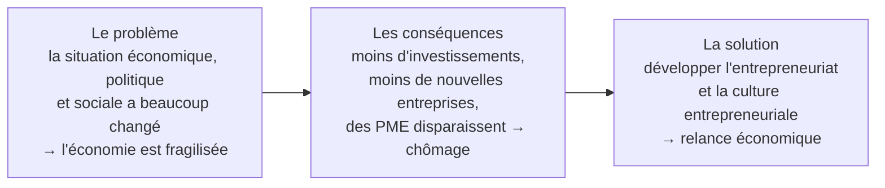
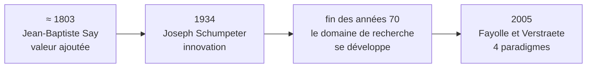
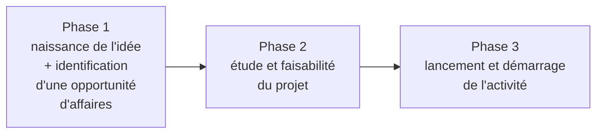

# Résumé plus max — Chapitre 1 : Aperçu sur l'entrepreneuriat

**Guide de révision simplifié** : tout le chapitre (12 pages) expliqué en français simple, avec des astuces pour tout mémoriser.

Cours : Entrepreneuriat, semestre 1 (2026) · niveau 3LCE / 3LCS, groupes IoT3-IRS3 / GLSI3 · enseignante : Amel ZIDI
Support du cours : [[Chapitre 1 - Aperçu sur l'entrepreneuriat.pdf]] · ce guide en PDF : [[Guide de révision - Chapitre 1 - Aperçu sur l'entrepreneuriat.pdf|Guide de révision (PDF)]] · la fiche détaillée : [[Résumé - Chapitre 1 - Aperçu sur l'entrepreneuriat]]

Au programme : explications simples · astuces mémo · pièges d'examen · [[#Fiche résumé — tout le chapitre sur une page|fiche résumé]] · [[#Quiz d'entraînement|quiz corrigé]]

## 0. Avant de commencer

*Comment utiliser ce guide + le chapitre en 1 minute*

> [!abstract] Le chapitre en une seule phrase
> L'entrepreneuriat, c'est **créer ou développer une activité** qui produit de la **valeur** (richesse + emplois).

### Le plan du chapitre (4 grandes parties)

| Partie | Titre | La question à laquelle elle répond |
|---|---|---|
| **Intro** | Introduction générale | Pourquoi on a besoin d'entrepreneurs aujourd'hui ? |
| **I** | Historique de la notion | Qui a parlé de l'entrepreneur, et qu'est-ce qu'il a dit ? |
| **II** | Enjeux socio-économiques (Tunisie) | À qui ça profite quand on crée des entreprises ? |
| **III** | Définitions | C'est quoi exactement, l'entrepreneuriat ? |
| **IV** | Les 8 formes d'entrepreneuriat | De quelles façons peut-on entreprendre ? |

### Les codes couleur du guide

> [!abstract] À retenir
> Ce qu'il faut savoir par cœur pour l'examen.

> [!astuce] Astuce mémo
> Un truc (phrase, lettres, image) pour ne pas oublier.

> [!exemple] Exemple
> Un exemple concret pour comprendre.

> [!danger] Piège
> Les confusions classiques à éviter le jour de l'examen.

### Méthode conseillée pour réviser

1. **Lis** une partie en entier, sans essayer de mémoriser.
2. **Apprends** les encadrés « À retenir » et « Astuce mémo ».
3. **Ferme** le guide et essaie de réciter à voix haute (ou d'écrire) ce que tu as retenu.
4. À la fin, fais la [[#Fiche résumé — tout le chapitre sur une page|fiche résumé]] (page de synthèse) puis le [[#Quiz d'entraînement|quiz]]. Corrige-toi avec les réponses.
5. Le lendemain, relis seulement la fiche résumé : c'est la répétition qui fixe la mémoire.

> [!definition] Petit lexique de départ
> - **Entrepreneur** = la personne qui lance et dirige le projet.
> - **Entrepreneuriat** = l'activité / le phénomène d'entreprendre.
> - **PME** = Petites et Moyennes Entreprises.
> - **Start-up** = jeune entreprise innovante qui peut grandir très vite.
> - **Valeur** = richesse + emplois créés.
> - **Tissu économique** = l'ensemble des entreprises d'un pays ou d'une région.

## Introduction générale

*Pourquoi a-t-on besoin d'entrepreneurs ?*

L'introduction raconte une petite histoire en 3 étapes : **un problème → une solution → les conditions pour que la solution marche**.

### 1. Le problème : un tissu économique fragilisé

Ces dernières années, la scène **économique, politique et sociale** locale a connu beaucoup de **mutations** (changements) et de **bouleversements**. Résultat : certains équilibres du pays sont déstabilisés. Cela se voit par :

- **Un ralentissement des investissements** : les investisseurs locaux et étrangers hésitent (ils sont « réticents »).
- **Moins de créations d'entreprises**, et même la **disparition de certaines PME**. Conséquence : moins de richesse créée, des emplois perdus et **plus de chômage**.

### 2. La solution : une dynamique d'entrepreneuriat

Il faut promouvoir le **rôle de l'entreprise** et la **culture entrepreneuriale**. C'est « plus que jamais nécessaire » pour la **relance économique** et la **prospérité** des pays.

### 3. Les 3 conditions pour réussir

| Condition | Ce que ça veut dire |
|---|---|
| **Des individus** | Des **entrepreneurs**, hommes et femmes, qui prennent des décisions pour créer des entreprises qui produisent de la **valeur** et des **emplois**. |
| **Un contexte** | Des **facteurs environnementaux** favorables = le **contexte entrepreneurial** : facteurs **économiques**, **institutionnels**, **socio-culturels**… |
| **Des mentalités** (priorité) | Surtout (« prioritairement ») : changer les **mentalités**, les façons de voir, d'être et de faire, pour orienter les gens vers l'entrepreneuriat. |

> [!astuce] Astuce mémo : les 3 conditions = « I-C-M »
> **I**ndividus · **C**ontexte · **M**entalités → « **I**l **C**rée sa **M**aison ». Et rappelle-toi que la priorité, ce sont les **Mentalités**.

### 4. Pourquoi l'entreprise est si importante

- Tout le monde est d'accord : l'entrepreneuriat et la création d'entreprise jouent un **rôle majeur** dans la société.
- La croissance d'un pays dépend beaucoup de son **taux d'activité entrepreneuriale** = sa capacité à créer de nouvelles entreprises.
- Les entreprises sont des **acteurs essentiels** de l'économie : elles participent à la **croissance** et créent des **emplois**.

> [!abstract] Définition de l'introduction (à savoir par cœur)
> L'entrepreneuriat recouvre **les activités qui concourent à la formation et la croissance d'une entreprise**, dont la conséquence première est la **création de valeur (richesse et emploi)**.

### 5. Le plan de tout le cours (pas seulement ce chapitre)

- **Axe 1** : la notion d'entrepreneuriat et sa conceptualisation (= ce chapitre).
- **Axe 2** : le **processus entrepreneurial** : profil de l'entrepreneur et ses motivations, la notion d'**idée-opportunité**, et le modèle **BMC (Business Model Canvas)** avec des exemples.

*Le chapitre 1 lui-même présente : l'histoire, les défis et les enjeux de l'entrepreneuriat, quelques définitions et les formes entrepreneuriales.*

## I. Historique de la notion d'entrepreneuriat

*Qui a parlé de l'entrepreneur, et qu'a-t-il dit ?*

### 1. Un sujet d'actualité

Aujourd'hui, **3 groupes** s'intéressent de plus en plus à l'entrepreneuriat : les **académiciens** (chercheurs), les **hommes de terrain** (praticiens) et les **politiciens**.

Pour répondre à une demande qui augmente sans arrêt, on voit apparaître :

- des **programmes de formation** pour entrepreneurs ;
- des **incubateurs** (de start-ups) ;
- des **structures d'accompagnement** : **pépinières d'entreprises**, **centres d'affaires**, **technopôles**… ;
- des projets de création ou de développement d'entreprises.

Pourquoi ? Parce que l'entreprise est vue comme **la principale source de richesse, d'emplois et de croissance** des nations.

> [!abstract] À retenir
> L'entrepreneuriat est le domaine de recherche qui étudie **la création, la survie et le développement des entreprises**. Il s'est développé rapidement **depuis la fin des années 70**. Les notions d'entrepreneur et d'entrepreneuriat ont évolué avec le temps.

### 2. La ligne du temps des auteurs

| Quand | Qui | Ce qu'il a dit |
|---|---|---|
| **≈ 1803** | **Jean-Baptiste Say** | L'entrepreneur **déplace les ressources économiques** d'un niveau de rendement donné vers un **niveau supérieur** → il crée de la **valeur ajoutée**. C'est un **agent de changement**, responsable avant tout de la **création de valeur**. L'accent est mis sur la **transformation** et l'**innovation productive**, **pas seulement sur le commerce**. |
| **1934** | **Joseph Schumpeter**, « la véritable révolution » du 20ᵉ siècle | Il introduit la notion d'**innovation**. L'entrepreneur est **une personne qui veut et qui est capable de transformer une idée ou une invention en une innovation réussie**. L'essence de l'entrepreneuriat = **percevoir et exploiter de nouvelles opportunités**. |
| **Fin des années 70** | — | Le domaine de recherche « entrepreneuriat » se développe rapidement. |
| **2005** | **Fayolle et Verstraete** | Ils identifient **4 paradigmes** (= 4 façons de voir) qui délimitent le domaine de l'entrepreneuriat. |

### 3. Zoom sur Schumpeter (très important)

> [!failure] L'inventeur
> Il fait une **découverte**. Mais il ne la transforme pas forcément en produit qui se vend.

> [!success] L'entrepreneur (selon Schumpeter)
> Il **introduit** la découverte dans l'industrie sous forme d'**innovation**. Sa vraie fonction : **prendre des initiatives** (esprit d'initiative) et **créer** (esprit créatif).

> [!exemple] Exemple pour comprendre
> Un chercheur invente une nouvelle batterie dans un labo → c'est l'**inventeur**. Une personne crée une société qui fabrique et vend des téléphones avec cette batterie → c'est l'**entrepreneur** au sens de Schumpeter.

### 4. Les 4 paradigmes de Fayolle et Verstraete (2005)

| # | Paradigme | Explication simple |
|---|---|---|
| 1 | **La création d'une organisation** | Créer une structure organisée (attention : **pas seulement** une entreprise ; ça peut être une association, un projet…) |
| 2 | **La détection et l'exploitation d'une opportunité d'affaires** | Repérer un besoin ou une occasion, puis en profiter |
| 3 | **La création de valeur** | Produire de la richesse, des emplois, quelque chose d'utile |
| 4 | **L'innovation** | Apporter quelque chose de nouveau |

> [!astuce] Astuce mémo : « O-O-V-I »
> **O**rganisation · **O**pportunité · **V**aleur · **I**nnovation.
> Phrase : « J'**O**rganise une **O**pportunité pour créer de la **V**aleur en **I**nnovant. »

> [!astuce] Astuce mémo : qui a dit quoi ?
> **S**ay = **S**urplus de valeur (valeur ajoutée) · **Sch**umpeter = **Ch**angement par l'innovation · **F**ayolle & **V**erstraete = les **4** paradigmes (2005 → « 2 auteurs, 4 paradigmes »).

## II. Enjeux socio-économiques (contexte tunisien)

*À qui ça profite quand on crée des entreprises ?*

La création d'entreprises répond à une **demande sociale** qui vient de **plusieurs acteurs**. Chacun y gagne quelque chose. Le cours en cite 6 (et met « … » : la liste n'est pas fermée).

> [!astuce] Astuce mémo : les 6 acteurs = « É-C-G-B-A-I »
> Phrase : « **É**t **C**haque **G**rande **B**anque **A**ide l'**I**ndividu. »
>
> | Lettre | Acteur | Dans la phrase |
> |---|---|---|
> | **É** | État | **É**t |
> | **C** | Collectivités | **C**haque |
> | **G** | Grandes entreprises | **G**rande |
> | **B** | Banques / institutions financières | **B**anque |
> | **A** | Assurances | **A**ide |
> | **I** | Individus | l'**I**ndividu |

### 1. L'État

Pour l'État, l'entrepreneuriat est :

- le **principal moteur de croissance** ;
- une **solution majeure au chômage** ;
- un moyen de **renouveler le tissu productif** (remplacer les entreprises qui disparaissent) ;
- une **source de richesse** : il rapporte des revenus à l'État grâce aux impôts → **TVA** (Taxe sur la Valeur Ajoutée) et **IS** (Impôt sur les Sociétés) ;
- un **levier** pour lancer des activités **innovantes** et **rapidement exportables** ;
- un **garant de la paix sociale** (moins de chômage = moins de tensions).

### 2. Les collectivités territoriales

*= les régions, municipalités…*

Elles veulent **rééquilibrer le tissu économique local** et **compenser les emplois perdus** quand de grandes entreprises de la région **délocalisent** une partie de leurs activités.
**Leur outil préféré : la pépinière d'entreprises.**

### 3. Les grandes entreprises

Elles participent à la création d'entreprises pour :

- faire des **reconversions de sites industriels** ;
- gagner des **partenaires** : les nouvelles entreprises deviennent leurs **clients, fournisseurs, sous-traitants** ;
- stimuler **en interne** l'esprit d'entreprendre et d'innovation.

### 4. Les institutions financières et d'investissement

**SICAR** (Sociétés d'Investissement en Capital À Risque), les banques comme la **BTS** (Banque Tunisienne de Solidarité), la **BFPME** (Banque de Financement des PME) et tout le système bancaire.

Pourquoi ? Les nouveaux entrepreneurs = une **nouvelle clientèle**. Elles essaient de repérer **le plus tôt possible** les jeunes entreprises à fort potentiel (**start-ups**).

### 5. Les assurances · 6. Les individus

**Assurances** : citées dans la liste (les nouvelles entreprises ont besoin d'être assurées).

**Individus** (étudiants, salariés, chômeurs…) : selon leur situation et leurs motivations, créer une entreprise permet de :

- se **réinsérer** professionnellement et socialement ;
- **maîtriser son destin**, **s'accomplir** ;
- satisfaire un besoin d'**indépendance** ou d'**autonomie**.

> [!danger] Pièges
> - **TVA** = Taxe sur la Valeur Ajoutée ; **IS** = Impôt sur les Sociétés. Ce sont des avantages pour **l'État**.
> - L'outil des **collectivités** = la **pépinière** d'entreprises (pas l'incubateur, pas la banque).
> - La **reconversion de sites industriels** = objectif des **grandes entreprises**.
> - **BTS** = Banque Tunisienne de **Solidarité** (pas « de Société »).

## III. Définitions

*C'est quoi exactement, l'entrepreneuriat ?*

Le cours donne **3 définitions**. Chacune met l'accent sur une idée différente.

### Définition 1 — Knight (1967) et Drucker (1970) : le risque

> [!abstract] À retenir
> L'entrepreneuriat consiste à **prendre des risques**. L'entrepreneur est une personne **prête à mettre en jeu sa carrière et sa sécurité financière** pour réaliser une idée, et à mettre **son temps et son capital** dans une entreprise risquée.

### Définition 2 — Verstraete et Fayolle (2005, p. 44) : la plus complète

La phrase du cours est longue. On la découpe en **5 morceaux** :

| Ce que dit le cours | Ce que ça veut dire |
|---|---|
| « une **initiative** portée par **un individu** (ou plusieurs individus s'associant pour l'occasion) » | Une ou plusieurs personnes décident d'agir. |
| « construisant ou saisissant une **occasion d'affaires** » | Elles créent ou attrapent une opportunité. |
| « dont le profit **n'est pas forcément d'ordre pécuniaire** » | Le gain n'est pas forcément de l'argent (ça peut être social, personnel…). |
| « par l'impulsion d'une **organisation** pouvant faire naître **une ou plusieurs entités** » | On lance une organisation, qui peut donner une ou plusieurs structures. |
| « et créant de la **valeur nouvelle** (plus forte dans le cas d'une **innovation**) pour des **parties prenantes** auxquelles le projet s'adresse » | On crée de la valeur pour les personnes concernées (clients, partenaires…). Si c'est une innovation, la valeur est encore plus forte. |

> [!astuce] Astuce mémo
> Les mots-clés de cette définition sont les mêmes que les **4 paradigmes** (O-O-V-I) des mêmes auteurs : **O**ccasion d'affaires, **O**rganisation, **V**aleur, **I**nnovation + « profit pas forcément en argent ».

### Définition 3 — La définition simple

> [!abstract] À retenir
> L'entrepreneuriat, c'est **le fait d'entreprendre et de développer un projet**. Dans les affaires : la **création d'une activité économique** pour **répondre à un besoin** ou **atteindre un objectif spécifique**.

### Et l'entrepreneur ?

La personne qui s'engage dans l'entrepreneuriat s'appelle l'**entrepreneur**. C'est lui qui est **à la tête du projet** (il peut quand même recevoir de l'aide extérieure).

> [!exemple] Exemples concrets donnés par le cours
> Créer son **e-commerce** (boutique en ligne) · son **restaurant** · sa **société de plomberie** · sa **boîte de développement** · sa **start-up** (= jeune entreprise innovante à fort potentiel de croissance) · une **SSII** (Société de Services en Ingénierie Informatique), appelée aujourd'hui **ESN** (Entreprise de Services du Numérique).

> [!astuce] Astuce mémo : les 3 définitions = « R-O-B »
> **R**isque (Knight & Drucker) · **O**ccasion + organisation + valeur (Verstraete & Fayolle) · **B**esoin (définition simple).
> Pour les années : Knight **1967**, puis Drucker **1970** → « **K**night d'abord, **D**rucker 3 ans après ».

> [!danger] Piège
> Ne confonds pas les 2 apports de Fayolle et Verstraete en 2005 : dans la **partie I** ce sont les **4 paradigmes** ; dans la **partie III** c'est leur **définition** (p. 44). Mêmes auteurs, même année, mais 2 choses différentes.

## IV. Les 8 formes d'entrepreneuriat

*De quelles façons peut-on entreprendre ? (la partie la plus importante)*

Dans la littérature, on voit apparaître de plus en plus de formes d'entrepreneuriat. On en distingue généralement **8 principales**, classées selon **3 critères** : leurs **caractéristiques**, leur **principe** et leur **degré de risque**.

> [!astuce] Astuce mémo : les 8 formes dans l'ordre du cours
> Phrase : « **E**n **R**oute, **F**aisons **E**nsemble l'**I**mpossible **A**vec **P**assion et **S**olidarité. »
>
> | Lettre | Forme | Dans la phrase |
> |---|---|---|
> | **E** | 1 · Ex-nihilo | **E**n |
> | **R** | 2 · Reprise | **R**oute |
> | **F** | 3 · Franchise | **F**aisons |
> | **E** | 4 · Essaimage | **E**nsemble |
> | **I** | 5 · Intrapreneuriat | l'**I**mpossible |
> | **A** | 6 · Auto-entrepreneuriat | **A**vec |
> | **P** | 7 · Public | **P**assion |
> | **S** | 8 · Social | **S**olidarité |

### Vue d'ensemble : les 2 questions magiques

Pour reconnaître une forme, pose-toi deux questions : **L'entreprise existe-t-elle déjà ?** et **Qui est derrière le créateur ?**

| # | Forme | L'entreprise existe déjà ? | En une phrase | Exemple |
|---|---|---|---|---|
| 1 | **Ex-nihilo** | Non, on part de zéro | Créer à partir de rien | Lancer ta start-up |
| 2 | **Reprise** | Oui | Racheter tout ou une partie d'une entreprise | Des salariés rachètent leur entreprise |
| 3 | **Franchise** | La marque existe, ton magasin est nouveau | Utiliser la marque et le savoir-faire d'un autre contre paiement | KFC, Zara, Shell |
| 4 | **Essaimage** | Non : nouvelle entreprise, **à l'extérieur** | Ton employeur t'aide à créer ta propre entreprise | STEG, Tunisie Télécom |
| 5 | **Intrapreneuriat** | Oui : on reste **à l'intérieur** | Entreprendre dans l'entreprise où on travaille | Gmail (Google), Post-it (3M) |
| 6 | **Auto-entrepreneuriat** | Non : activité individuelle | Travailleur indépendant, démarches simplifiées | Chauffeurs Uber, Bolt |
| 7 | **Public** | Dans le secteur public | Créer / améliorer des structures publiques | Projet agile dans un service public |
| 8 | **Social (et solidaire)** | Variable | But principal : social ou environnemental | Foodealz, Enactus |

> [!abstract] N.B. du cours (dernière phrase du chapitre)
> Le porteur de projet a la **liberté de choisir la forme** qui lui correspond.

### 1. Création ex-nihilo

*= création pure = création « à zéro »*

> [!info] L'idée clé
> Créer une entreprise qui n'existait pas du tout avant, en partant de rien.

- **« Ex nihilo »** = expression **latine** qui veut dire « **à partir de rien** ».
- Il n'y a **ni rachat de fonds de commerce**, **ni rachat de parts sociales** d'une société déjà existante.
- On crée un établissement économique actif qui **n'existait pas** → l'organisation doit être **créée**. La nouvelle entité est **indépendante**.
- Elle correspond à l'**exploitation de nouveaux moyens de production**.
- **L'idée est à l'origine** de la création pure : le **créateur pur** (ou les fondateurs) trouve une idée et la développe.

#### Le processus en 3 phases

> [!abstract] Le paradoxe à retenir
> C'est la forme **la plus risquée** MAIS **de loin la plus répandue**. Le créateur se lance dans l'**inconnu**.

> [!methode] Ce qu'il faut
> Beaucoup de **temps**, de **travail**, de **rigueur** et de **ténacité**.

### 2. Reprise d'entreprise

*entreprise saine ou en difficulté*

> [!info] L'idée clé
> Racheter tout ou une partie d'une entreprise qui existe déjà.

- Celui qui rachète s'appelle le **repreneur**. Ce peut être une **personne physique** (un individu) ou une **personne morale** (une société).
- La reprise peut être faite par **une ou plusieurs personnes**. Les **salariés** ou les **cadres dirigeants** peuvent racheter leur propre entreprise.
- **Grande différence avec l'ex-nihilo** : l'organisation **existe déjà**, on n'a pas à la créer.

> [!abstract] Définition de Deschamps (2000) — écrit « Deshamps » dans le cours
> La reprise par une personne physique est « le processus qui, par une **opération de rachat**, aboutit à la **continuation de la vie d'une entreprise**, en difficulté ou non, et de tout ce qu'elle contient (structures, ressources humaines, financières, techniques, commerciales…) ». Le repreneur devient **propriétaire ET dirigeant**.

#### Les 2 cas de reprise et leurs risques

| Cas | Difficulté / risque | Ce qu'il faut |
|---|---|---|
| **Entreprise saine** (en bonne santé) | Son **prix de marché peut être élevé**. | Beaucoup d'**argent** + bonnes **compétences générales** + **expérience de management** réussie. |
| **En difficulté — a déjà déposé son bilan** | Le repreneur doit payer certaines **charges laissées par l'ancien propriétaire** : **payer ses dettes**, **garder ses salariés**… | Prudence : bien vérifier la situation réelle avant d'acheter. |
| **En difficulté — n'a pas encore déposé son bilan** (en redressement judiciaire) | Le vendeur peut **maquiller ses comptes** et ses résultats pour cacher ses pertes. | Prudence : bien vérifier la situation réelle avant d'acheter. |

> [!definition] Vocabulaire
> - **Déposer son bilan** = déclarer officiellement qu'on ne peut plus payer ses dettes (faillite).
> - **Redressement judiciaire** = procédure où la justice essaie de sauver l'entreprise.
> - **Maquiller les comptes** = truquer les chiffres.

### 3. Franchise

*= franchisage = entrepreneuriat par franchise*

> [!info] L'idée clé
> Ouvrir son entreprise sous le nom d'une marque connue (la maison-mère), en lui payant une compensation.

| | Le franchiseur | Le franchisé |
|---|---|---|
| **Qui ?** | la **maison-mère**, la marque (ex. KFC) | celui qui **ouvre** le point de vente |
| **Il donne** | le droit exclusif d'utiliser son **enseigne / marque**, son **savoir-faire**, de vendre ses produits/services + une **assistance** commerciale ou technique (**formation, gestion, publicité**) | un **pourcentage** de son **chiffre d'affaires** ou de ses **bénéfices**, et il doit respecter les **directives du contrat** |
| **Il reçoit** | un **droit d'entrée**, des **redevances** ou des **marges** sur les produits | le droit d'utiliser la marque et le savoir-faire + l'assistance |

- C'est un **contrat de droit commercial** : le franchiseur **concède** au franchisé le droit d'utiliser ses **droits incorporels** (= choses non matérielles : **nom commercial, marques**…).
- Les deux entreprises collaborent étroitement mais restent **indépendantes juridiquement, financièrement et économiquement**.

> [!exemple] Exemples du cours
> - **Restauration** : McDonald's, KFC ; en Tunisie : Mliha, Chahia, El Mazraa
> - **Prêt-à-porter** : Zara, Kiabi, H&M, Marwa
> - **Meubles** : Gautier
> - **Télécoms** : Orange, Ooredoo, Tunisie Telecom
> - **Carburant** : Shell, TOTAL

> [!astuce] Astuce mémo
> Franchis**eur** = celui qui donne (comme un « donn**eur** ») · Franchis**é** = celui qui reçoit (il est « autoris**é** »).

### 4. Essaimage

*= « extrapreneuriat »*

> [!info] L'idée clé
> Une grande entreprise aide un de ses salariés à créer **sa propre** entreprise, **à l'extérieur**.

> [!exemple] Image pour comprendre
> « Essaimer » vient des abeilles : une partie de la ruche part fonder une **nouvelle ruche ailleurs**. Ici, le salarié quitte la « ruche » (l'entreprise) pour créer la sienne, avec l'aide de la ruche-mère.

- Une entreprise (**publique ou privée**), en général un **grand groupe**, aide un ou plusieurs salariés à monter et lancer leur projet : aide **matérielle, financière, logistique ou commerciale**.
- Le projet se fait dans le cadre de **conventions** entre l'essaimante et le promoteur, qui définissent le contenu du projet et les engagements des deux parties, selon une **convention-type**.
- La nouvelle entité est **financièrement et juridiquement autonome** de l'entreprise d'origine.

| Qui ? | Le nom à utiliser |
|---|---|
| l'employeur | l'**entreprise essaimante** |
| le projet créé | l'**entreprise essaimée** |
| le salarié créateur | le **promoteur** (l'**essaimé**) |

#### Les 3 remarques du cours

1. L'essaimage concerne les promoteurs **internes** (le personnel) **ET externes**. Le projet essaimé peut être **lié ou non** à l'activité de l'entreprise essaimante.
2. Le **législateur n'a pas fixé** les modalités d'aide → toute forme d'aide est possible : **étude de marché**, **participation au capital**, **aide logistique** au démarrage, aide pour **boucler le financement**, aide pour obtenir les **primes et avantages**.
3. Encouragements financiers, surtout les **fonds de soutien** gérés par la **SAGES** (Société d'Assistance et de Gestion des fonds d'Essaimage).

#### Pourquoi c'est « gagnant » pour l'entreprise

Il permet la **mobilité** et le **renouvellement des effectifs** : le salarié part créer son entreprise → on embauche quelqu'un d'autre pour le remplacer. Il **promeut la culture entrepreneuriale** et encourage les salariés à trouver des **concepts innovants**. Il se développe **de plus en plus en Tunisie**.

#### Les avantages des deux côtés

| Avantages pour l'essaimé (le salarié) | Avantages pour l'essaimante (l'entreprise mère) |
|---|---|
| 1 · **Congé pour création d'entreprise** : s'il **échoue**, il peut **revenir** travailler dans son entreprise. | Forte **notoriété** et bonne **image de marque** (elle aide l'emploi et l'autonomie des salariés). |
| 2 · L'essaimante **paie les frais d'études** et de **démarrage**. | Elle construit un **réseau d'entrepreneurs / d'affaires** autour d'elle. |
| 3 · Le **background et l'assistance** de l'entreprise : **transfert de technologie**, **formation**, programme bien établi. | **Avantage fiscal en Tunisie** : les dépenses d'essaimage sont **déduites de la base de l'IS** de l'année où elles sont engagées, dans la limite de **1 % du chiffre d'affaires brut annuel**, avec un **plafond de 30 000 DT par projet**. |

> [!exemple] Entreprises essaimantes en Tunisie
> - **Tunisie Télécom**
> - **STEG** (Société Tunisienne d'Électricité et du Gaz)
> - **SONEDE** (Société Nationale d'Exploitation et de Distribution des Eaux)
> - **PT** (Poste Tunisienne)
> - **ONAS** (Office National d'Assainissement)
> - **CPG** (Compagnie de Phosphate de Gafsa)
> - **CIOK** (Ciments d'Oum el Kelil)
> - **GCT** (Groupe Chimique Tunisien)
> - **SNCPA** (Société Nationale de Cellulose et de Papier Alfa)

> [!astuce] Astuce mémo : les chiffres
> « **1** % et **30** mille » → **1 %** du chiffre d'affaires brut annuel, plafond **30 000 DT** par projet.
> Les 3 avantages du salarié = « **R-F-A** » : **R**etour possible · **F**rais payés · **A**ssistance.

### 5. Intrapreneuriat

*Personnage clé : l'intrapreneur · mot inventé par Pinchot (1985)*

> [!info] L'idée clé
> Entreprendre **à l'intérieur** de l'entreprise où l'on travaille, sans créer de nouvelle entreprise.

- **Pinchot (1985)** est le premier à utiliser le mot « intrapreneuriat » : entreprendre **dans une structure existante**, en développant des comportements d'entrepreneur **à l'intérieur d'une grande entreprise**.
- L'entreprise confie à un de ses **cadres** la mission de créer et développer un **centre d'activité** : **agence, succursale, usine, filiale, établissement à l'étranger**…
- L'intrapreneur reçoit les **moyens financiers** pour lancer le projet, et peut parfois être **associé au capital**.
- L'entreprise développe des **projets stratégiques et d'innovation sans créer une nouvelle entreprise**.

| Pour le salarié | Pour l'entreprise |
|---|---|
| Apprendre **progressivement** le métier d'entrepreneur… | Pousse à **innover**. |
| …**sans prise de risque** et sans perdre son **statut social** de salarié. | Augmente la **rétention** (garder) des meilleurs employés. |
| Un **accélérateur de carrière** (donc de promotion). | L'aide à se **réinventer**. |
| | Nouvelles opportunités de croissance pour les entreprises qui **manquent d'innovation**. |

#### Exemples du cours

| Entreprise | Ce que l'intrapreneuriat a donné |
|---|---|
| **Medianet** (SSII tunisienne, TIC) | Un projet de **Coworking Space** (2017), qui mélange interne et externe, partage, collaboration, innovation |
| **Google** | La naissance de **Gmail** |
| **3M** (Minnesota Mining & Manufacturing) | Le **Post-it** (note qu'on colle et décolle sans abîmer le support) |
| **TOTAL** | L'appli **Kleen** (lavage auto dans les stations) et **Le Bon Gaz** (livraison de bouteilles de gaz à domicile) |
| **Groupe Adecco** (ressources humaines) | Un **incubateur digital mondial** |
| **La Poste** | Un **concours interne annuel** |
| **Poulina Group Holding** | Des **filiales** dans plusieurs **DAS** (Domaines d'Activité Stratégiques), ex. **El Mazraa** (intégration avicole) |

> [!astuce] Astuce mémo
> **Intra** = **dedans** (comme « intranet », « intraveineuse »). « **G**oogle a fait **G**mail, **3M** a fait le **P**ost-it » → les 2 exemples stars.

> [!danger] Le piège n°1 de l'examen : essaimage ≠ intrapreneuriat
> | | Essaimage (extrapreneuriat) | Intrapreneuriat |
> |---|---|---|
> | **Où ?** | **À l'extérieur** de l'entreprise mère | **À l'intérieur** de l'entreprise |
> | **Nouvelle entreprise ?** | Oui, juridiquement et financièrement autonome | Non (agence, filiale, projet interne…) |
> | **Le salarié…** | part créer sa propre entreprise | reste salarié, sans risque |
> | **Mot clé** | essaimante / essaimé, SAGES, 30 000 DT | Pinchot 1985, intrapreneur |
> | **Exemple** | STEG, SONEDE, Tunisie Télécom | Gmail, Post-it, Medianet |

### 6. Auto-entrepreneuriat

*= micro-entrepreneurs · terme créé en 2008 en France*

> [!info] L'idée clé
> Travailler comme indépendant, seul, avec des démarches administratives très simplifiées.

- **Cause** : la **démocratisation du travail indépendant**, comme **première** activité ou comme **deuxième** activité (en plus d'un emploi).
- **Avantage** : les **démarches administratives sont fortement simplifiées**.
- **Exemple classique** : les chauffeurs **Uber** (plateforme mondiale qui met en relation des conducteurs indépendants et des utilisateurs). En Tunisie : les chauffeurs **Bolt**.
- **En Tunisie** : le statut d'auto-entrepreneur est un **régime simplifié de l'entreprise individuelle** → site **www.autoentrepreneur.tn**.

### 7. Entrepreneuriat public

> [!info] L'idée clé
> Entreprendre dans le secteur public : créer des entreprises publiques ou rendre un service public plus efficace.

- Il représente la **création d'entreprises publiques** : tous les **établissements gouvernementaux** nécessaires au **développement économique national**.
- C'est un concept d'**importance croissante** : il change la façon dont les gouvernements gèrent l'**innovation**, la **prestation de services** et la **croissance économique**.
- Concrètement : un entrepreneur lance un **projet agile de l'intérieur d'un service public** pour **augmenter son efficacité**.

### 8. Entrepreneuriat social (et solidaire)

> [!info] L'idée clé
> Créer une entreprise dont le but principal est de résoudre un problème social ou environnemental.

- Créer des activités économiques qui produisent de la **valeur sociale** : des **solutions innovantes contre des problèmes sociaux**.
- Domaines : **développement durable, santé, environnement, création d'emplois**…
- Au service de l'**intérêt général** : la finalité principale est **sociale ou environnementale** (entrepreneuriat **responsable et durable**).
- Ces entreprises **réinvestissent la majorité de leurs bénéfices** dans leur mission.
- Objectif : entreprendre **différemment** et de façon **responsable** pour un monde **innovant, durable et solidaire**.

| Exemple tunisien | Ce qu'il fait |
|---|---|
| **Foodealz** | Appli créée par des jeunes contre le **gaspillage alimentaire** (accords avec les fournisseurs) → protège l'environnement |
| **Wildly** | Projet de **divertissement** qui réunit les passionnés de **nature** pour des activités dans la nature tunisienne |
| **Jhonny bikes** | Start-up de **location de vélos** avec stations dans les rues → écologique, promeut la culture du cyclisme |
| **Enactus** (association) | Clubs dans les universités : les **étudiants** réalisent des projets qui mêlent **esprit d'entreprise** et **utilité sociale** → former des leaders responsables |

> [!astuce] Astuce mémo : « F-W-J-E »
> « **F**aire **W**ow **J**uste **E**nsemble » → **F**oodealz · **W**ildly · **J**honny bikes · **E**nactus.

## Les pièges et confusions classiques

*Ce qui fait perdre des points à l'examen*

| # | On confond souvent… | La bonne réponse |
|---|---|---|
| 1 | **Essaimage** et **intrapreneuriat** | Essaimage = nouvelle entreprise **dehors**. Intrapreneuriat = projet **dedans**, sans nouvelle entreprise. |
| 2 | **Inventeur** et **entrepreneur** (Schumpeter) | L'inventeur découvre ; l'entrepreneur **transforme** la découverte en **innovation réussie**. |
| 3 | **Franchiseur** et **franchisé** | Franchiseur = la marque mère (reçoit droit d'entrée + redevances). Franchisé = celui qui ouvre le magasin. |
| 4 | Ex-nihilo = la plus risquée, donc la plus rare ? | **Faux** : la plus risquée **mais la plus répandue**. |
| 5 | **Ex-nihilo** et **reprise** | Ex-nihilo : l'organisation **n'existe pas**. Reprise : elle **existe déjà**. |
| 6 | Dans l'essaimage, le promoteur est toujours un salarié ? | **Non** : il peut être **interne ou externe**, et le projet peut être lié ou non à l'activité de l'essaimante. |
| 7 | Dans la définition de Verstraete & Fayolle, le profit est en argent ? | **Non** : « pas forcément d'ordre **pécuniaire** ». |
| 8 | Le paradigme « création d'une organisation » = créer une entreprise ? | **Pas seulement** : « non réduite à la seule création d'entreprise ». |
| 9 | Les dates | Say ≈ 1803 · Schumpeter 1934 · Knight 1967 · Drucker 1970 · fin des années 70 · Pinchot 1985 · Deschamps 2000 · Fayolle & Verstraete 2005 · auto-entrepreneur 2008 · Medianet coworking 2017. |
| 10 | Les sigles | TVA, IS, PME, SICAR, BTS, BFPME, SSII = ESN, SAGES, DAS, STEG, SONEDE, ONAS, CPG, GCT… (voir le tableau ci-dessous). |
| 11 | Reprise d'une entreprise en difficulté : un seul risque ? | **Deux cas** : bilan déposé → payer dettes + garder salariés ; pas encore déposé (redressement judiciaire) → comptes maquillés. |
| 12 | Pépinière, incubateur, technopôle… | Ce sont des **structures d'accompagnement**. L'outil **privilégié des collectivités** = la **pépinière**. |

### Les sigles à connaître

| Sigle | Signification |
|---|---|
| **PME** | Petites et Moyennes Entreprises |
| **TVA** | Taxe sur la Valeur Ajoutée |
| **IS** | Impôt sur les Sociétés |
| **BMC** | Business Model Canvas |
| **TIC** | Technologies de l'Information et de la Communication |
| **SICAR** | Sociétés d'Investissement en Capital À Risque |
| **BTS** | Banque Tunisienne de Solidarité |
| **BFPME** | Banque de Financement des PME |
| **SSII / ESN** | Société de Services en Ingénierie Informatique / Entreprise de Services du Numérique |
| **SAGES** | Société d'Assistance et de Gestion des fonds d'Essaimage |
| **DAS** | Domaines d'Activité Stratégiques |
| **STEG** | Société Tunisienne d'Électricité et du Gaz |
| **SONEDE** | Société Nationale d'Exploitation et de Distribution des Eaux |
| **PT** | Poste Tunisienne |
| **ONAS** | Office National d'Assainissement |
| **CPG** | Compagnie de Phosphate de Gafsa |
| **CIOK** | Ciments d'Oum el Kelil |
| **GCT** | Groupe Chimique Tunisien |
| **SNCPA** | Société Nationale de Cellulose et de Papier Alfa |

## Fiche résumé — tout le chapitre sur une page

*À relire la veille de l'examen*

> [!abstract] Introduction
> **Problème** : économie fragilisée → moins d'investissements, PME qui disparaissent, chômage.
> **Solution** : culture entrepreneuriale. Conditions **I-C-M** : Individus, Contexte (éco., institutionnel, socio-culturel), Mentalités (priorité).
> **Déf.** : activités qui concourent à la formation et la croissance d'une entreprise → création de valeur (richesse + emploi).

> [!abstract] I. Historique
> Domaine en essor depuis la **fin des années 70** (création, survie, développement des entreprises).
> **Say ≈ 1803** : valeur ajoutée, agent de changement.
> **Schumpeter 1934** : innovation ; transformer une invention en innovation réussie ; initiative + créativité.
> **Fayolle & Verstraete 2005** : 4 paradigmes **O-O-V-I**.

> [!abstract] II. Enjeux — « Ét Chaque Grande Banque Aide l'Individu »
> **État** : croissance, chômage, tissu productif, TVA + IS, export, paix sociale.
> **Collectivités** : rééquilibrer le local, compenser délocalisations → **pépinière**.
> **Grandes entreprises** : reconversion de sites, partenaires, esprit d'innovation.
> **Banques** (SICAR, BTS, BFPME) : nouvelle clientèle, repérer les start-ups. **Assurances**.
> **Individus** : réinsertion, destin, accomplissement, indépendance.

> [!abstract] III. Définitions — « R-O-B »
> **Knight 1967 & Drucker 1970** : prendre des **risques** (carrière, sécurité financière, temps, capital).
> **Verstraete & Fayolle 2005** : initiative d'un ou plusieurs individus, occasion d'affaires, profit pas forcément en argent, organisation, valeur nouvelle pour les parties prenantes.
> **Simple** : créer une activité pour répondre à un **besoin**.

### IV. Les 8 formes — « En Route, Faisons Ensemble l'Impossible Avec Passion et Solidarité »

| Forme | Idée clé | Détails à ne pas oublier | Exemples |
|---|---|---|---|
| **1. Ex-nihilo** | À partir de rien | Latin ; ni fonds de commerce ni parts ; 3 phases (idée → étude → lancement) ; **+ risquée mais + répandue** | — |
| **2. Reprise** | Racheter l'existant | Repreneur physique/moral ; Deschamps 2000 ; saine = prix élevé ; en difficulté = dettes/salariés ou comptes maquillés | Salariés qui rachètent |
| **3. Franchise** | Marque d'un autre | Contrat commercial ; droits incorporels ; droit d'entrée + redevances ; indépendants | KFC, Mliha, Zara, Shell |
| **4. Essaimage** | Créer **dehors**, aidé | Essaimante/essaimé ; convention-type ; SAGES ; retour possible ; **1 % CA, max 30 000 DT** | STEG, SONEDE, TT |
| **5. Intrapreneuriat** | Innover **dedans** | Pinchot 1985 ; agence/filiale ; sans risque ; rétention, carrière | Gmail, Post-it, Medianet |
| **6. Auto-entrep.** | Indépendant simplifié | 2008 France ; micro-entrepreneur ; autoentrepreneur.tn | Uber, Bolt |
| **7. Public** | Secteur public | Établissements gouvernementaux ; projet agile pour l'efficacité | — |
| **8. Social** | But social / écolo | Intérêt général ; réinvestit la majorité des bénéfices | Foodealz, Wildly, Jhonny bikes, Enactus |

**N.B.** Le porteur de projet est **libre de choisir** la forme qui lui correspond.

## Quiz d'entraînement

*Réponds sans regarder, puis corrige-toi avec le [[#Corrigé du quiz|corrigé]].*

### A. QCM (une seule bonne réponse)

1. **Qui a introduit la notion d'innovation dans la théorie de l'entrepreneuriat en 1934 ?**
   a) J.B. Say · b) Schumpeter · c) Pinchot · d) Drucker

2. **Combien de paradigmes Fayolle et Verstraete ont-ils identifiés en 2005 ?**
   a) 3 · b) 4 · c) 6 · d) 8

3. **Quel est l'outil privilégié des collectivités territoriales pour soutenir la création d'entreprises ?**
   a) La SICAR · b) La franchise · c) La pépinière d'entreprises · d) La TVA

4. **Selon Knight et Drucker, l'entrepreneuriat consiste surtout à :**
   a) innover · b) prendre des risques · c) racheter des entreprises · d) répondre à un besoin social

5. **Quelle forme est « la plus risquée mais de loin la plus répandue » ?**
   a) La reprise · b) La franchise · c) La création ex-nihilo · d) L'essaimage

6. **Dans la franchise, celui qui reçoit un droit d'entrée et des redevances est :**
   a) le franchisé · b) le franchiseur · c) le repreneur · d) l'essaimé

7. **Le plafond de déduction fiscale pour l'essaimage en Tunisie est de :**
   a) 10 000 DT par projet · b) 30 000 DT par projet · c) 1 % du bénéfice · d) 50 000 DT par an

8. **Gmail est né grâce à :**
   a) l'essaimage · b) la franchise · c) l'intrapreneuriat · d) l'auto-entrepreneuriat

9. **Qui gère les fonds de soutien financier de l'essaimage ?**
   a) La BTS · b) La SAGES · c) La BFPME · d) L'ONAS

10. **Foodealz est un exemple de :**
    a) entrepreneuriat public · b) franchise · c) entrepreneuriat social · d) reprise

### B. Vrai ou faux ?

11. Dans la création ex-nihilo, on rachète des parts sociales d'une société existante.
12. Le franchiseur et le franchisé sont juridiquement indépendants.
13. Dans l'intrapreneuriat, le salarié crée une nouvelle entreprise à l'extérieur.
14. Pour Verstraete et Fayolle, le profit n'est pas forcément d'ordre pécuniaire.
15. Dans l'essaimage, le promoteur peut être externe à l'entreprise essaimante.
16. Le terme « auto-entrepreneur » a été créé en 2008 en Tunisie.

### C. Questions de cours (réponses courtes)

17. Quelle est la différence entre un inventeur et un entrepreneur selon Schumpeter ?
18. Cite les 3 avantages de l'essaimage pour le salarié (l'essaimé).
19. Quels sont les risques d'une reprise d'entreprise en difficulté ? (2 cas)
20. Cite 4 enjeux de l'entrepreneuriat pour l'État.
21. Quelle est la différence entre essaimage et intrapreneuriat ?

## Corrigé du quiz

*Compte tes points : 1 point par bonne réponse (sur 21)*

> [!question]- Voir le corrigé (21 réponses)
> | N° | Réponse et explication |
> |---|---|
> | 1 | **b) Schumpeter** — 1934, « la véritable révolution » : notion d'innovation. |
> | 2 | **b) 4** — Organisation, Opportunité, Valeur, Innovation (O-O-V-I). |
> | 3 | **c) La pépinière d'entreprises.** |
> | 4 | **b) prendre des risques** — mettre en jeu sa carrière et sa sécurité financière. |
> | 5 | **c) La création ex-nihilo.** |
> | 6 | **b) le franchiseur** — la maison-mère qui donne la marque et le savoir-faire. |
> | 7 | **b) 30 000 DT par projet** — dans la limite de 1 % du chiffre d'affaires brut annuel. |
> | 8 | **c) l'intrapreneuriat** — un projet né à l'intérieur de Google. |
> | 9 | **b) La SAGES** (Société d'Assistance et de Gestion des fonds d'Essaimage). |
> | 10 | **c) entrepreneuriat social** — lutte contre le gaspillage alimentaire. |
> | 11 | **Faux** — ni rachat de fonds de commerce ni rachat de parts sociales : on part de zéro. |
> | 12 | **Vrai** — indépendants juridiquement, financièrement et économiquement. |
> | 13 | **Faux** — ça, c'est l'essaimage. L'intrapreneuriat se fait à l'intérieur, sans nouvelle entreprise. |
> | 14 | **Vrai.** |
> | 15 | **Vrai** — il concerne les promoteurs internes et externes. |
> | 16 | **Faux** — créé en 2008 en **France** (la Tunisie a ensuite son propre régime simplifié). |
> | 17 | L'inventeur fait une découverte ; l'entrepreneur la transforme et l'introduit dans l'industrie sous forme d'**innovation réussie** (initiative + créativité). |
> | 18 | (1) **Congé pour création** : retour possible en cas d'échec ; (2) **frais d'études et de démarrage** payés par l'essaimante ; (3) **background et assistance** : transfert de technologie, formation, programme établi. |
> | 19 | Bilan **déjà déposé** → payer les dettes, garder les salariés de l'ancien propriétaire. Bilan **pas encore déposé** (redressement judiciaire) → le vendeur peut **maquiller ses comptes**. |
> | 20 | Au choix : moteur de croissance · solution au chômage · renouvellement du tissu productif · revenus (TVA, IS) · activités innovantes exportables · paix sociale. |
> | 21 | Essaimage = l'employeur aide le salarié à créer une **nouvelle entreprise autonome à l'extérieur**. Intrapreneuriat = le salarié développe un projet **à l'intérieur** de l'entreprise, **sans créer de nouvelle entreprise** et sans risque. |

> [!success] Ton score
> - **18 à 21** : prêt pour l'examen.
> - **13 à 17** : relis la [[#Fiche résumé — tout le chapitre sur une page|fiche résumé]] et les [[#Les pièges et confusions classiques|pièges]].
> - **Moins de 13** : reprends les parties une par une avec les astuces mémo, puis refais le quiz demain.
