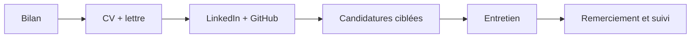

# Résumé — Environnement professionnel

## La démarche

## CV — checklist

- [ ] Une page, en PDF
- [ ] Un titre qui dit ce que je cherche
- [ ] Projets au format **verbe + quoi + résultat**
- [ ] Les mots-clés de l'offre (filtres ATS)
- [ ] Liens LinkedIn et GitHub
- [ ] Zéro faute (relu par quelqu'un d'autre)

## Lettre de motivation

**Vous** (l'entreprise) → **Moi** (ce que j'apporte) → **Nous** (la suite). Toujours personnalisée.

## Entretien

> [!methode] STAR
> **S**ituation → **T**âche → **A**ction (« je ») → **R**ésultat (chiffré si possible)

| Avant | Pendant | Après |
|---|---|---|
| se renseigner sur l'entreprise | se présenter en 2 minutes | remercier sous 24 h |
| relire l'offre | répondre avec STAR | demander un retour en cas de refus |
| préparer 3 questions | poser ses questions | noter ce qu'on a appris |

## Les soft skills recherchées

Communication · travail en équipe · autonomie · adaptabilité · gestion du temps · esprit critique.

> [!tip] Le bon réflexe
> Chaque compétence affirmée a **une preuve** : un projet, un stage, un chiffre.

Cours : [[Chapitre 1 - Préparer son insertion professionnelle]] · atelier : [[TP 1 - Atelier CV et profil LinkedIn]] · en anglais : Résumé - Anglais professionnel.
