# Résumé — IoT : applications et plateformes

Support : [[Cours - IoT, architecture, cloud et IA.pdf]] (144 pages) · Dr. Ahmed Bannour · LCS3-GLSI, ISIMa · travaux pratiques : [[Fascicule de TP - 12 laboratoires.pdf]] et les 12 TP simplifiés (de [[TP 1 - MQTT en ligne de commande]] à [[TP 12 - Projet Smart Home]])

Le cours suit une donnée **de bout en bout** : un capteur la mesure, un réseau la transporte, MQTT la distribue, l'edge et le cloud la traitent et la stockent, l'IA en tire une décision, et l'entreprise l'exploite, en sécurité. Le mot qui revient partout est **AIoT** : *Artificial Intelligence of Things*, l'IoT rendu intelligent par l'IA.

## Le cours en un coup d'œil

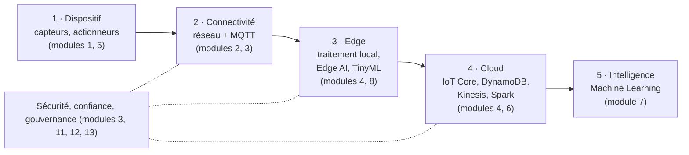

| Module | Sujet | Pages du PDF | TP associés |
|---|---|---|---|
| 1 | Fondamentaux de l'IoT | 3–24 | — |
| 2 | Réseaux IoT | 25–31 | [[TP 1 - MQTT en ligne de commande\|TP 1]] |
| 3 | MQTT | 32–48 | [[TP 1 - MQTT en ligne de commande\|TP 1]], [[TP 4 - Connecter le dispositif à MQTT\|4]], [[TP 5 - Commandes et accusés de réception\|5]], [[TP 6 - Sécuriser MQTT (TLS, mots de passe, ACL)\|6]] |
| 4 | Cloud & Edge Computing | 49–55 | [[TP 12 - Projet Smart Home\|TP 12]] |
| 5 | Construire un dispositif AIoT virtuel | 56–65 | [[TP 2 - Simulateur de dispositif en Python\|TP 2]], [[TP 3 - Dispositif réaliste (dérive, bruit, états)\|3]], [[TP 7 - Stocker et analyser avec MongoDB\|7]] |
| 6 | Cloud AWS pour l'IoT | 66–75 | [[TP 9 - AWS IoT Core et DynamoDB\|TP 9]], [[TP 10 - Flux temps réel avec Kinesis\|10]] |
| 7 | IA & Machine Learning | 76–84 | [[TP 11 - TinyML, reconnaissance de gestes\|TP 11]] |
| 8 | Edge AI & TinyML | 85–92 | [[TP 11 - TinyML, reconnaissance de gestes\|TP 11]] |
| 9 | Études de cas & synthèse | 93–98 | — |
| 10 | Architecture d'entreprise & jumeaux numériques | 99–112 | [[TP 8 - API REST avec FastAPI\|TP 8]], [[TP 12 - Projet Smart Home\|12]] |
| 11 | Sécurité, vie privée & éthique de l'IA | 113–118 | — |
| 12 | Blockchain pour l'IoT d'entreprise | 119–127 | — |
| 13 | Sécurité avancée & conformité | 128–137 | [[TP 6 - Sécuriser MQTT (TLS, mots de passe, ACL)\|TP 6]] |
| 14 | Bibliographie & références | 138–143 | — |

---

## Module 1 — Fondamentaux de l'IoT

*PDF p. 3–24*

### Définition

> [!definition] Internet des objets (IoT)
> **IoT = Internet + Things.** *Internet* : un réseau de machines qui peuvent se parler. *Things* : des objets physiques « intelligents », équipés de capteurs, de processeurs, de logiciel et de modules de communication.

Le fonctionnement tient en quatre temps :

| Étape | Ce qui se passe |
|---|---|
| **Sense** | les dispositifs collectent des données de l'environnement physique |
| **Process** | les données sont traitées sur le dispositif, ou à l'edge / dans le cloud |
| **Connect** | les données sont transmises par Internet |
| **Share & Act** | elles servent à produire des informations utiles, automatiser des actions et créer de la valeur |

Tout devient connecté autour du **Cloud & de l'IA** : villes, santé, transports, industrie, énergie, logistique. Porté par la 5G/6G et la miniaturisation.

### Le dispositif IoT

> [!definition] Dispositif IoT
> Un objet physique équipé de **capteurs**, de **logiciel** et d'une **connectivité réseau** pour collecter et échanger des données.

Ses quatre composants :

1. **Capteurs & actionneurs** : collectent les données de l'environnement et exécutent des actions physiques.
2. **Connectivité** : Wi-Fi, cellulaire, Bluetooth ; il lui faut une **adresse** pour communiquer.
3. **Puissance de traitement** : processeur et firmware embarqués, pour traiter localement ou transmettre au cloud.
4. **Échange de données** : avec d'autres appareils, plateformes ou applications.

Le dispositif est un **pont** entre le monde physique et le backend :

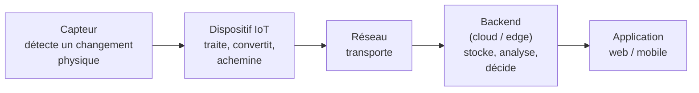

L'IoT, c'est fondamentalement **collecter de l'information, puis la traiter pour prendre des décisions éclairées**. Dans une architecture typique, les capteurs parlent à une **passerelle** (gateway) qui contient un **broker MQTT** et un **traducteur de protocole CoAP**, et la passerelle parle au cloud en HTTP sur TCP/IP.

La **chaîne de valeur** complète : monde physique → capteurs (capter des données réelles) → Internet (transmettre, de façon sécurisée) → applications (traiter, analyser, visualiser) → **décisions business** (créer de la valeur).

### Le Smart Object

Le socle de tout dispositif IoT. Il **détecte, communique, traite et agit** pour relier le monde physique et le monde numérique.

| Fonction | Rôle | Exemples |
|---|---|---|
| Sense (capteur) | détecter et mesurer les changements | voix, température, mouvement |
| Communicate (réseau) | échanger avec d'autres systèmes | Wi-Fi, Bluetooth, cellulaire, Ethernet |
| Process (calcul) | analyser, produire de l'information | reconnaissance vocale, ML, moteur de règles |
| Take action (actionneur) | agir selon une décision ou une commande | haut-parleur, LED, moteur |
| Software / application | intelligence, contrôle, expérience utilisateur | assistant vocal, firmware, application cloud |

Exemples : capteur de température, caméra de surveillance, enceinte connectée, compteur intelligent, robot industriel.

> [!example] Smart building
> 1. Un **capteur de température** détecte un incendie. 2. Il envoie le signal au **centre de contrôle** (ROC). 3. Le ROC envoie une commande à l'**arroseur**. 4. L'arroseur s'allume.

### Capteur et actionneur

| | Capteur : il **perçoit** le monde réel | Actionneur : il **agit** sur le monde réel |
|---|---|---|
| Conversion | grandeur physique → **signal électrique** (analogique) | signal électrique → **action ou mouvement** physique |
| Principe | sensible aux changements physiques ou chimiques → variation de tension, de courant ou de résistance | déclenché par un signal : son, commutation (relais), mouvement (servomoteur, solénoïde) |
| Types | environnementaux, entités (GPS, mouvement), densité de particules | hydraulique, pneumatique, mécanique, électrique, thermique |
| Exemples | PT100, caméra, microphone | haut-parleur, écran, moteur, vanne, pompe |

Le signal d'un capteur est **analogique** : il faut le **numériser**, par **échantillonnage** (combien de mesures par seconde) et selon une **résolution** (sur combien de bits on code chaque mesure ; 10 bits = 1 024 niveaux possibles).

- **PT100** : une sonde de température en **platine** qui vaut **100 Ω à 0 °C** ; sa résistance augmente avec la température. Deux constructions : un **fil** de platine enroulé sur un cylindre en céramique, ou un **film** de platine déposé sur un substrat céramique, avec ses fils de connexion.
- **Le smartphone** contient les deux : la caméra (la lumière devient signal) et le micro (le son devient signal) sont des **capteurs** ; l'écran (le signal devient lumière) et le haut-parleur (le signal devient son) sont des **actionneurs**.

### Les catégories de capteurs

| Catégorie | Grandeurs mesurées | Types de capteurs |
|---|---|---|
| Environnementaux | température, humidité, pression | thermistance, thermocouple, hygromètre |
| Entités | localisation, mouvement | GPS, accéléromètre, gyroscope, tachymètre |
| Densité de particules | qualité de l'air, fumée, gaz | infrarouge, électrochimique, photoélectrique |

Grandes familles : position / présence / proximité, mouvement / vitesse / déplacement, température, humidité, acoustique / vibration, chimique / gaz, débit, force / charge / couple / pression, fuites / niveaux, électrique / magnétique, accélération / inclinaison, vision / lumière ambiante.

Plus de **10 milliards** de dispositifs IoT dans le monde aujourd'hui, **30 milliards** attendus d'ici 2030.

### Usage général ou sur mesure

| Catégorie | Caractéristiques | Exemples |
|---|---|---|
| **Usage général** (apprentissage, test) | IDE, SDK et pilotes fournis ; on y branche facilement capteurs et actionneurs | ESP32, Raspberry Pi 4, Arduino Uno |
| **Sur mesure** (production) | capteurs dédiés intégrés, sécurité renforcée, étanchéité IP68, protection contre l'ouverture (*tamper-proofing*) | InnoSent, DSEGenset, Google Nest, Alexa |

- Processeurs : de **8 bits (2 à 40 MHz)** jusqu'à des **32 bits multicœurs**.
- Logiciel : **assembleur / C** sur les petits dispositifs ; un système temps réel (**FreeRTOS, MbedOS, RTLinux**) sur les plus puissants.
- **Raspberry Pi 4** : RAM au choix (2, 4 ou 8 Go), alimentation USB-C, deux micro-HDMI (2 écrans 4K), Ethernet gigabit, USB 2 et USB 3 : une plateforme complète pour prototyper.
- Grandes familles : maison intelligente, wearables (montres, bagues), industrie (IIoT), automobile, agriculture.

### De M2M à l'AIoT

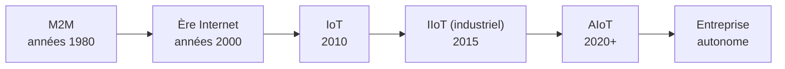

**AIoT** = ramener l'intelligence dans les réseaux d'objets, selon le cycle **Learn → Predict → Recommend → Act** : maintenance prédictive (prévoir les pannes), inspection qualité par vision, optimisation énergétique, prévision de la demande, opérations autonomes (robots), apprentissage continu (boucle de retour), aide à la décision en temps réel.

### Les 4 grands défis de conception

| Défi | En quoi ça consiste |
|---|---|
| **Conception à l'échelle** | passer de 10 à 100, 1 000, 100 000, puis des **millions** de dispositifs |
| **Interopérabilité** | faire parler des équipements hétérogènes (automates PLC, robots, capteurs, caméras, compteurs, CVC) qui utilisent des protocoles différents : MQTT, OPC UA, Modbus, BACnet, CAN, HTTP/REST |
| **Sécurité** | architecture Zero Trust, l'**identité** comme nouveau périmètre, moindre privilège, défense en profondeur, gouvernance / risque / conformité |
| **Latence & performance** | répondre vite (opérations critiques), réduire la bande passante (n'envoyer que le nécessaire au cloud), rester fiable pendant les coupures réseau, maîtriser les coûts |

Le cours résout ces quatre défis un par un à partir du module 2. Deux vidéos illustrent l'IoT en application (Seafar) : la conduite de navires et la manipulation d'une **grue à distance**, grâce à des systèmes de contrôle et des capteurs (lidars, caméras, antennes 5G).

---

## Module 2 — Réseaux IoT

*PDF p. 25–31*

### Client-serveur classique contre réseau IoT

| Client-serveur (traditionnel) | IoT |
|---|---|
| connexion stable et fiable supposée | connectivité **imprévisible, intermittente**, faible bande passante |
| architecture simple : requête → réponse | architecture **multicouche** : Device → Gateway → Edge → Cloud |
| protocoles : HTTP/HTTPS, REST, WebSockets | protocoles **multiples** : BLE, Zigbee, LoRaWAN, NB-IoT, MQTT, CoAP… |
| peu de clients, trafic prévisible | **échelle massive** : des milliers à des millions de dispositifs |
| appareils toujours alimentés (PC, serveurs) | dépendance à la **batterie** : l'efficacité énergétique est critique |

L'IoT n'est pas qu'une question de connectivité : c'est gérer la **diversité**, la **fiabilité** et le **passage à l'échelle**.

### Les 3 modes de communication

| Mode | Principe | Exemple |
|---|---|---|
| **Device-to-Device** (D2D) | communication directe, sans intermédiaire | un capteur de température signale directement à un ventilateur |
| **Device-to-Gateway** (D2G) | les dispositifs passent par une passerelle qui agrège et traite localement | des capteurs industriels vers un contrôleur edge |
| **Device-to-Cloud** (D2C) | communication directe avec le cloud, pour l'analytique avancée | des compteurs intelligents qui envoient leurs données pour la facturation |

### Les 3 éléments d'un réseau IoT

1. **Interfaces réseau** : le matériel et le logiciel qui relient le dispositif au réseau. Filaires (USB, Ethernet, RS232 / RS485) ou sans fil (BLE, Zigbee, Wi-Fi, LoRaWAN, 5G, NB-IoT).
2. **Topologies** : **point à point** (deux dispositifs reliés directement), **maillage** (*mesh*, plusieurs chemins possibles entre les nœuds), **LAN sans fil** (en étoile autour d'un point d'accès).
3. **Protocoles de communication** : les règles de la transmission. Traditionnels (HTTP, FTP), de messagerie (SMTP, XMPP), spécialisés IoT (**MQTT, CoAP**).

### Les protocoles par couche OSI

| Couche | Rôle | Protocoles / technologies |
|---|---|---|
| Physique | transmettre les bits | filaire : Ethernet, RS232, USB ; sans fil : BLE, Zigbee, LoRaWAN, 5G, NB-IoT |
| Liaison de données | adressage MAC | Wi-Fi MAC, Zigbee MAC, Bluetooth MAC, Ethernet MAC |
| Réseau | adressage et routage | IPv4, IPv6 |
| Transport | fiabilité ou rapidité | **TCP** (fiable), **UDP** (rapide), RTSP (streaming temps réel) |
| Application | échange entre applications | HTTP/HTTPS, **MQTT** (publish/subscribe), **CoAP** (dispositifs contraints), Modbus, FTP, SMTP |

> [!remarque] RTSP
> La diapositive range RTSP au niveau transport. En réalité, RTSP est un protocole de la couche **application** qui pilote des flux temps réel (lecture, pause) ; il s'appuie lui-même sur TCP ou UDP.

### Comparatif des technologies sans fil

| Technologie | Portée | Débit | Consommation | Coût |
|---|---|---|---|---|
| Bluetooth LE | 1–100 m | ≤ 2 Mbit/s | très faible | faible |
| Zigbee (IEEE 802.15.4) | 10–100 m (maillage) | 20–250 kbit/s | faible | faible |
| Wi-Fi (802.11) | ~25 m en intérieur | 7 Mbit/s – 9,6 Gbit/s | modérée | modéré à élevé |
| **LoRaWAN** | **5–10 km** | 0,3–50 kbit/s | ultra-faible | faible |
| **NB-IoT** | 1–10 km | 20–200 kbit/s | très faible (**10 ans** de batterie) | faible |
| LTE (4G), RedCap (5G) | zone étendue | ≤ 100 Mbit/s | élevée | élevé |

> [!tip] Le compromis à retenir
> On n'a jamais à la fois une grande portée, un haut débit et une faible consommation. LoRaWAN va loin et consomme très peu, mais avec un débit minuscule ; le Wi-Fi est rapide mais porte peu et consomme plus. La tendance : passer d'un protocole unique à une connectivité **hybride**, choisie par cas d'usage.

### 4 critères pour choisir un protocole

1. **Coût** : de la pile réseau et du transceiver, selon la distance.
2. **Bande passante** : adaptée à la topologie, à la distance et aux pics de charge.
3. **Consommation énergétique** : traitement et transfert, filaire ou sans fil.
4. **Attributs d'infrastructure** : sécurité, latence, nombre de connexions simultanées.

---

## Module 3 — MQTT

*PDF p. 32–48 · en pratique : [[TP 1 - MQTT en ligne de commande|TP 1]], [[TP 4 - Connecter le dispositif à MQTT|TP 4]], [[TP 5 - Commandes et accusés de réception|TP 5]], [[TP 6 - Sécuriser MQTT (TLS, mots de passe, ACL)|TP 6]]*

MQTT est le protocole de messagerie standard de l'IoT : léger, au-dessus de TCP, sur le modèle **publish / subscribe**.

### Pourquoi publish/subscribe plutôt que la communication directe ?

| Communication directe (point à point) | Publish / subscribe via un broker |
|---|---|
| chaque dispositif parle directement à chaque application | toute la communication passe par un **broker** central |
| explosion du nombre de connexions | les éditeurs ne connaissent pas les abonnés |
| couplage fort entre dispositifs et applications | on ajoute des dispositifs ou des applications sans toucher aux autres |
| complexe à déployer, maintenir et faire évoluer | passe à l'échelle (des millions de dispositifs) |
| latence et surcharge réseau élevées | livraison fiable grâce à la **QoS** |

Calcul avec l'exemple de la diapositive : 5 000 capteurs × 20 applications = **100 000** liaisons en point à point, contre 5 000 + 20 = **5 020** connexions vers un broker.

### Les trois rôles

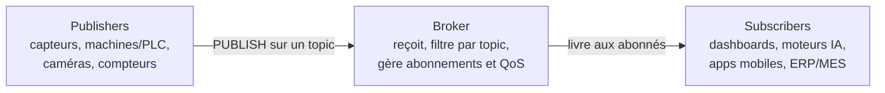

Les publishers ne savent pas qui les écoute ; les subscribers ne savent pas qui publie. Le broker gère tout entre les deux. C'est ce **découplage** qui fonde l'architecture AIoT d'entreprise.

### Le protocole, message par message

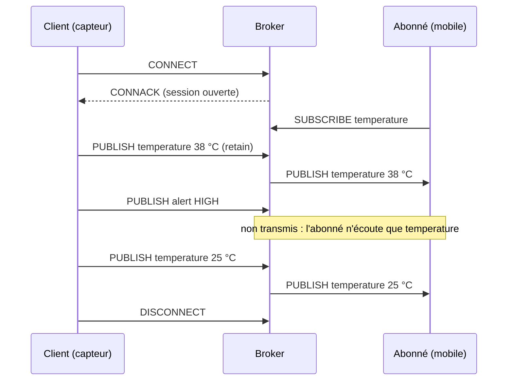

`CONNECT` / `CONNACK` ouvrent la session ; `SUBSCRIBE` enregistre l'intérêt pour un topic ; chaque `PUBLISH` est routé par le broker vers les abonnés de ce topic. Avec **retain**, le broker garde le dernier message du topic et le donne à chaque nouvel abonné.

### Les topics : la boîte aux lettres intelligente

Un topic est une adresse **hiérarchique**, en niveaux séparés par `/` : site / zone / machine / mesure, par exemple `factory1/production/machine12/temperature`.

| Syntaxe | Sens | Exemple |
|---|---|---|
| `+` | joker pour **un seul niveau** | `factory1/+/machine12/temperature` |
| `#` | joker **multi-niveaux** (tout ce qui suit), en fin de topic | `factory1/#` (à utiliser avec prudence en production) |
| `$SYS/…` | topics réservés aux statistiques internes du broker | clients connectés, messages envoyés |

Exemple de la diapositive : un tableau de bord s'abonne à `factory1/production/machine12/temperature`, un moteur IA à `factory1/production/+/status`, une application mobile à `factory1/+/machine12/vibration`, l'analytique énergie à `factory1/#`. Des noms de topics qui reflètent l'organisation rendent le système **organisé, filtrable, routable et scalable**.

### Brokers et protocoles voisins

- Protocoles de messagerie : **MQTT** (publish/subscribe léger pour l'IoT), **AMQP** (*Advanced Message Queuing Protocol*), **NATS** (messagerie haute performance).
- Brokers MQTT : **Mosquitto** (Eclipse, mosquitto.org), HiveMQ, RabbitMQ, EMQX, MQTT Route ; côté cloud : AWS IoT Core, Azure IoT Hub. Liste complète : mqtt.org/software.

### La qualité de service (QoS)

| Niveau | Garantie | Mécanisme | Usage typique |
|---|---|---|---|
| **QoS 0** | **au plus une fois** (*best effort*) : peut être perdu | aucun accusé de réception | télémétrie, mesures périodiques |
| **QoS 1** | **au moins une fois** : doublons possibles | accusé `PUBACK` | alertes, notifications, suivi de stock |
| **QoS 2** | **exactement une fois** | poignée de main en 4 étapes : `PUBLISH`, `PUBREC`, `PUBREL`, `PUBCOMP` | commandes critiques, transactions, arrêt d'urgence |

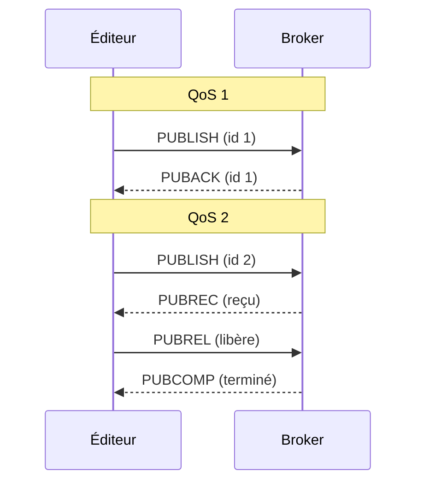

Vitesse : QoS 0 > 1 > 2. Fiabilité et surcharge réseau : QoS 0 < 1 < 2.

> [!important] Règle d'or
> Choisir **le QoS le plus bas qui satisfait le besoin métier** : cela réduit la charge réseau, la latence et le coût.

### Sécuriser MQTT

Le scénario de l'**usine non sécurisée** : sans protection, un attaquant peut :

| Attaque | Effet |
|---|---|
| fausses données de capteur | tromper l'exploitation et l'analytique |
| vol d'identifiants | compromettre des dispositifs ou des utilisateurs |
| interception des messages | espionner des données sensibles en transit |
| dispositifs non autorisés | brancher des appareils pirates qui publient de fausses données |
| commandes malveillantes | perturber ou endommager les systèmes |

En AIoT, ce sont les données qui pilotent les décisions et les actions : une communication fiable mais **non sécurisée peut être plus dangereuse que pas de communication du tout**.

Les **trois piliers** (mis en œuvre au [[TP 6 - Sécuriser MQTT (TLS, mots de passe, ACL)|TP 6]]) :

| Pilier | Question | Comment | Bénéfice |
|---|---|---|---|
| **Authentification** | Qui êtes-vous ? | certificats X.509, OAuth, identifiants forts | seules les identités de confiance se connectent ; pas d'usurpation |
| **Chiffrement** | Quelqu'un peut-il lire le message ? | **TLS 1.2 ou plus** | confidentialité, pas d'interception ni de falsification |
| **Autorisation** | Que pouvez-vous faire ? | **ACL** par topic (droits publish / subscribe) | **moindre privilège**, pas d'action non autorisée |

En entreprise, la sécurité est **en couches**, du dispositif au système d'entreprise : chiffrement TLS entre les dispositifs et le broker ; broker durci, à jour et supervisé ; vérification d'identité (mot de passe, certificat X.509, jeton OAuth 2.0) ; contrôle d'accès (ACL, permissions par topic) ; sécurité réseau (pare-feu, VPN, segmentation, IDS/IPS) ; journalisation et supervision.

**Les 8 bonnes pratiques** :

1. toujours activer **TLS 1.2+** ;
2. **authentification forte** (certificats, OAuth, identifiants robustes) ;
3. un **certificat X.509** par dispositif (identité unique et évolutive) ;
4. **moindre privilège** : seulement les permissions nécessaires ;
5. **broker sécurisé** : à jour, derrière un pare-feu, accès anonyme désactivé ;
6. **rotation** régulière des mots de passe, jetons et certificats ;
7. **journalisation et supervision** des connexions et des activités ;
8. **bloquer l'accès anonyme** : chaque client est authentifié et autorisé.

La sécurité se construit **dès l'architecture**, pas après le déploiement.

### MQTT dans l'écosystème d'entreprise

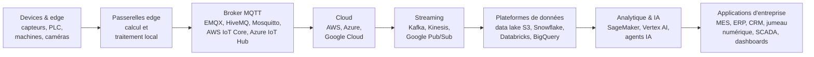

---

## Module 4 — Cloud et Edge Computing

*PDF p. 49–55*

### Pourquoi une plateforme IoT ?

Elle se place au croisement de l'**IT** (cloud, ERP, CRM, données métier, analytique et IA, utilisateurs) et de l'**OT** (*Operational Technology* : automates PLC, SCADA, DCS, machines, capteurs, contrôle de procédé, sûreté). Son rôle : **Connect · Collect · Process · Act**.

### L'architecture multicouche

| Couche | Où | Rôle |
|---|---|---|
| **Cloud** | centre de données central | analytique globale, stockage long terme |
| **Fog** | centre de données régional | traitement intermédiaire |
| **Edge** | à proximité de l'utilisateur | faible latence |
| **Mist** | extrême périphérie | traitement au plus près du capteur |
| **Device** | le dispositif lui-même | traitement directement sur l'objet |

Le traitement a lieu à **plusieurs niveaux** ; chaque couche est un compromis différent entre **latence, puissance et coût**.

### Le cloud : forces et limites

| Rôle du cloud | Limites d'une architecture 100 % cloud |
|---|---|
| plateforme centralisée, toujours disponible, très scalable | latence trop élevée pour du contrôle en temps réel |
| ingestion et stockage long terme | dépendance totale à la connexion Internet |
| entraînement des modèles IA/ML | coûts de transmission importants |
| gestion des dispositifs, intégration aux systèmes d'entreprise | confidentialité et lieu de stockage des données |
| tableaux de bord, analytique avancée | inadapté aux systèmes de sécurité critiques |

Ces limites conduisent naturellement à l'**edge computing** : traiter les données **au plus près de leur source**, sur le dispositif ou une passerelle proche. Ses 6 fonctions :

1. **filtrage et agrégation** : réduire le volume avant transmission ;
2. **décisions par seuil** : règles locales en temps réel ;
3. **traduction de protocoles** : interopérabilité entre dispositifs hétérogènes ;
4. **stockage temporaire** : continuer pendant une coupure réseau ;
5. **opérations fail-safe** : la sécurité est maintenue même hors ligne ;
6. **inférence IA à l'edge** : prédire localement, sans dépendre du cloud.

### Device, edge ou cloud : quand utiliser quoi ?

| Couche | Rôle | À utiliser quand… |
|---|---|---|
| **Device** | détecter et agir | une action immédiate est requise sur le capteur ou l'actionneur lui-même |
| **Edge** | intelligence locale | il faut une faible latence, la connexion est peu fiable, la décision est critique pour la sécurité |
| **Cloud** | intelligence globale | analytique long terme, corrélation entre sites, entraînement IA/ML, reporting métier |

> [!important] Complémentaires, pas concurrents
> Edge et cloud ensemble apportent **vitesse + échelle + intelligence**.

| Cas d'usage | À l'edge | Dans le cloud |
|---|---|---|
| Usine intelligente | surveillance des machines, détection d'anomalies | maintenance prédictive |
| Ville intelligente | contrôle des feux de circulation | optimisation et planification du trafic |
| Santé connectée | alertes patient en temps réel | historique du patient, analytique |

> [!warning] 5 erreurs fréquentes
> Tout envoyer au cloud · ignorer l'intelligence edge · sur-compliquer la logique edge · une sécurité faible à l'edge · aucune stratégie de repli en cas de panne.

---

## Module 5 — Construire un dispositif AIoT virtuel

*PDF p. 56–65 · en pratique : [[TP 2 - Simulateur de dispositif en Python|TP 2]], [[TP 3 - Dispositif réaliste (dérive, bruit, états)|TP 3]], [[TP 4 - Connecter le dispositif à MQTT|TP 4]], [[TP 7 - Stocker et analyser avec MongoDB|TP 7]]*

Créer, tester et faire évoluer des dispositifs connectés **entièrement en logiciel**. Pourquoi :

1. **prototypage rapide** : valider une idée avant que le matériel existe ;
2. **tests approfondis** des applications et intégrations, en environnement contrôlé ;
3. **réduction des risques** : simuler pannes, anomalies et cas limites sans danger ;
4. **simulation à l'échelle** : des milliers de dispositifs pour tester la scalabilité ;
5. **génération de données** : télémétrie réaliste à haute fréquence pour l'analytique ;
6. **apprentissage et innovation** : expérimenter sans risque.

### L'exemple fil rouge : MCH-007

Une **machine de remplissage de bouteilles** d'une usine de boissons.

| Profil | Capteurs (ce qu'on mesure) | Actionneurs (ce qu'on pilote) |
|---|---|---|
| ID `MCH-007`, *Bottle Filling Machine*, ligne 2 (zone de remplissage), une mesure toutes les **5 s**, protocole **MQTT** | température, vibration, pression du liquide, énergie consommée, état de la machine (Running, Idle, Fault, Maintenance) | moteur (convoyeur), pompe (débit), vanne (ouverture / fermeture) |

### Le cycle de comportement

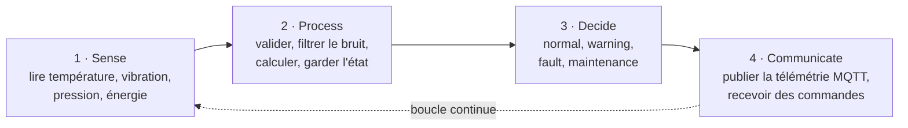

### Les briques de code

- **Identité et configuration** : une `dataclass` (`device_id`, type, localisation, intervalle d'échantillonnage, statut, date de création). Bénéfices : identification unique parmi des milliers, contexte pour le routage et l'analytique, comportement cohérent, traçabilité.
- **Capteurs virtuels** : des valeurs réalistes, légèrement aléatoires, dans des plages opérationnelles : température 70–85 °C, vibration 1,5–3,5 mm/s, pression 5–7 bar, énergie 1–2 kWh. Chaque capteur est indépendant ; on en ajoute facilement.
- **Télémétrie** : convertie en **JSON** et publiée sur `factory/production-line-2/machine/MCH-007/telemetry`, en **QoS 1**. MQTT découple le dispositif des applications qui consomment ses données.

Synthèse : identité → capteurs virtuels → télémétrie JSON → boucle continue → connexion MQTT → persistance **MongoDB** (la mémoire et l'historique du dispositif). Pour la supervision, un outil comme **Grafana** affiche des tableaux de bord temps réel, des cartes, des alertes et des prédictions.

---

## Module 6 — Cloud AWS pour l'IoT

*PDF p. 66–75 · en pratique : [[TP 9 - AWS IoT Core et DynamoDB|TP 9]], [[TP 10 - Flux temps réel avec Kinesis|TP 10]]*

### Le cycle de vie de la donnée IoT

**Collecte** (capteurs) → **Transmission** (réseau, vers cloud ou edge) → **Stockage** (persistance) → **Traitement** (temps réel ou différé) → **Visualisation** (rapports, tableaux de bord).

### AWS IoT Core

| Composant | Rôle |
|---|---|
| **Thing** | la brique de base : un dispositif qui génère des données via ses capteurs |
| **Device Registry** | enregistrement et provisionnement des dispositifs, en masse, avec hiérarchies |
| **Device Shadow** | une « fiche d'état » persistante du dispositif, accessible **même hors connexion** |
| **Rule Engine** | achemine automatiquement les messages vers DynamoDB, S3, Lambda, Kinesis…, avec une syntaxe **SQL** (`SELECT * FROM 'topic'`) |
| **Jobs** | déployer à grande échelle des mises à jour, redémarrages, certificats |
| **Sécurité** | certificats **X.509**, MQTTS, HTTPS : authentification et communication chiffrée |

### Amazon DynamoDB

Base **NoSQL** gérée par AWS, adaptée à l'IoT.

| Caractéristiques | Modèle de données |
|---|---|
| entièrement gérée, *serverless* : aucune administration | table ≈ table SQL (appelée « collection » dans la diapositive) |
| s'adapte seule à la charge en lecture / écriture | item ≈ ligne ; attributs imbriqués jusqu'à **32 niveaux** |
| redondante : plusieurs zones et régions | **clé de partition + clé de tri** pour un accès optimisé |
| très faible latence (tables de hachage) | alimentée facilement depuis IoT Core |
| chiffrement au repos, sauvegarde / restauration | peut alimenter Kinesis pour un traitement en flux |

### Stream ou batch ?

| Critère | Stream processing (flux) | Batch processing (lots) |
|---|---|---|
| Timing | chaque donnée traitée **dès son arrivée** | données collectées **puis** traitées ensemble |
| Délai du résultat | secondes à minutes | minutes, heures, voire jours |
| Objectif | alertes, informations immédiates | tendances, corrélations, analyse historique |
| Puissance requise | faible mais **continue** | élevée mais sur une **courte durée** |
| Coût | peut être élevé (disponibilité permanente) | généralement plus économique |

### Le streaming sur AWS

1. **Kinesis Data Streams** : l'unité de capacité est le **shard**. Un shard accepte 1 000 enregistrements par seconde en écriture (et 1 Mo/s) et 5 lectures par seconde (et 2 Mo/s).
2. **Kinesis Data Firehose** : livraison **sans code** vers S3, Redshift, Elasticsearch / OpenSearch, avec ajustement automatique à la charge.
3. **« Kinesis Pipes »** : sépare un flux en plusieurs chemins de traitement (Lambda, EMR, Redshift). Dans la console AWS, ce service s'appelle **Amazon EventBridge Pipes** (avec un flux Kinesis comme source).
4. **Amazon SQS** : une **file de messages** qui découple les composants, avec un délai de livraison programmable jusqu'à **15 minutes**.
5. **Apache Kafka** : système publish/subscribe open source, distribué, très fiable et scalable (utilisé par Netflix, par exemple).
6. **Kinesis ou SQS ?** Kinesis pour le **temps réel** (flux relisible par plusieurs consommateurs) ; SQS pour des **tâches en arrière-plan** (un message traité une fois puis retiré).

### Le traitement par lots (batch)

- **Apache Spark** : moteur unifié, jusqu'à **100 fois plus rapide que MapReduce** (traitements en mémoire) ; en Java, Scala, Python, R et SQL. Lien avec le cours de Big Data.
- **YARN** : gestionnaire de cluster qui attribue les ressources à Spark.
- **Stockage** : HDFS, HBase, DynamoDB, S3, Azure Blob.
- **Reporting** : Tableau, Power BI, Amazon QuickSight.
- **Mini-batch à l'edge** : agréger localement pour réduire les données envoyées au cloud.
- Avantages : efficacité, simplicité. Défis : dépannage complexe, coûts de mise en place élevés.

### Étude de cas : santé connectée

Surveillance de patients en temps réel par capteurs connectés.

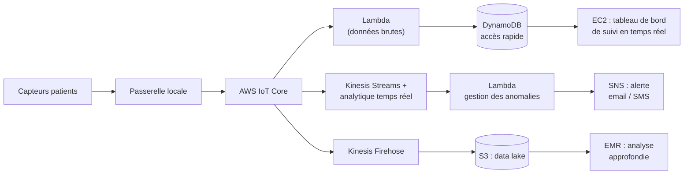

Résultat : un tableau de bord de surveillance en temps réel, avec alertes automatiques.

### Étude de cas : usine intelligente avec AWS Greengrass

Les machines de l'usine passent par une conversion de protocole (Lambda), puis par **AWS Greengrass**, qui exécute l'**inférence ML sur place** (à l'edge). Côté cloud : IoT Core → IoT Analytics → Lambda (transformation), alertes par Lambda + Amazon Pinpoint (email, SMS), visualisation Jupyter et QuickSight. Les modèles sont **entraînés dans le cloud** avec **SageMaker**, stockés dans S3, puis déployés vers Greengrass. C'est l'idée de toute la suite : **entraîner dans le cloud, inférer à l'edge**.

---

## Module 7 — IA et Machine Learning pour l'AIoT

*PDF p. 76–84 · en pratique : [[TP 11 - TinyML, reconnaissance de gestes|TP 11]] · voir aussi : cours de Machine Learning*

### IA, Machine Learning, modèle

- **IA** (l'objectif) : construire des systèmes capables de tâches qui demandent normalement l'intelligence humaine : raisonner, apprendre, décider, reconnaître la parole, comprendre une image. Exemples : IA générative (ChatGPT), vision par ordinateur, NLP, recommandation.
- **Machine Learning** (la méthode) : un sous-domaine de l'IA où le système **apprend à partir des données**, sans programmation explicite, en reconnaissant des motifs et des relations.
- **Modèle = Algorithme + Données + Entraînement.** C'est le moteur réel de l'application IA.

| Aspect | Programmation traditionnelle | Machine Learning |
|---|---|---|
| Logique | règles fixes écrites à la main | le système apprend les motifs depuis les données |
| Adaptabilité | il faut réécrire les règles | s'améliore avec plus de données et d'entraînement |
| Exemple | « si température > 40 → alerte » | prédire une panne à partir de plusieurs capteurs |
| Flux | données + règles → résultat | données + résultats attendus → modèle entraîné → prédiction |

### Le workflow ML dans un système AIoT

1. **Collecte** : les capteurs produisent température, vibration, pression, courant en continu.
2. **Prétraitement** : nettoyer, traiter les valeurs manquantes, filtrer le bruit, normaliser.
3. **Feature engineering** : transformer en variables porteuses de sens (tendances, moyennes).
4. **Entraînement** : le modèle apprend motifs et relations sur l'historique.
5. **Évaluation** : mesurer sa fiabilité (précision, rappel, F1) avant la mise en production.

Historique + entraînement + correction d'erreurs = modèle de prédiction intelligent.

### Feature engineering

Le pont entre données brutes et prédictions :

- **données brutes** : température, vibration, pression, courant moteur, horodatages ;
- **variables dérivées** : variation de température, moyenne glissante sur 10 min, vitesse de montée de la pression ;
- **indicateurs temporels** : heure, jour de la semaine, équipe de travail, week-end ;
- **ce qu'on en tire** : certaines machines consomment plus la nuit ; les pannes sont plus fréquentes aux heures de pointe.

> [!important] Principe clé
> Un algorithme **simple** avec de **bonnes features** bat souvent un algorithme complexe nourri de données de mauvaise qualité. La réussite d'un projet IA dépend souvent plus du feature engineering que de la complexité du modèle.

### Apprentissage supervisé (données étiquetées)

| Algorithme | Principe | Cas d'usage AIoT |
|---|---|---|
| **Régression logistique** | prédit la probabilité d'un événement **binaire** | panne oui / non, risque de défaillance |
| **Arbre de décision** | suite de règles, **facile à interpréter** | état de la machine : Normal → Warning → Fault |
| **Random Forest** | ensemble d'arbres : plus précis, moins de surapprentissage | maintenance prédictive à partir de plusieurs capteurs |
| **SVM** | trouve la **frontière optimale** entre classes | détection d'anomalies (normal ou anormal) |

Le choix dépend de la complexité, de l'interprétabilité requise, de la précision visée et des contraintes du dispositif.

> [!example] Bâtiment intelligent (énergie et équipements)
> Capteurs sur la climatisation (CVC), la température et la consommation. **Régression logistique** : le compresseur va-t-il tomber en panne dans les 24 h ? **Arbre de décision** : quel est l'état actuel du CVC (normal, surchargé, défaut) ? **Random Forest** : comment optimiser la consommation sans perdre en confort ? **SVM** : le comportement est-il anormal par rapport à d'habitude ? Résultat : moins de pannes imprévues, meilleure efficacité, maintenance moins chère, plus de sécurité.

### Apprentissage non supervisé (sans étiquettes)

Trouver des motifs et des structures dans des données **non étiquetées** : utile avec de gros volumes, des environnements changeants, des pannes encore inconnues.

| Algorithme | Rôle |
|---|---|
| **K-Means** | regroupe les comportements similaires (*clustering*) |
| **DBSCAN** | trouve des groupes **et du bruit** : repère les comportements atypiques |
| **Isolation Forest** | isole les points anormaux : détection d'anomalies |

Usages : regrouper des équipements, découvrir des profils de consommation, segmenter une flotte. Bénéfice clé : détecter des problèmes **inconnus** avant qu'ils deviennent des pannes coûteuses.

### Évaluer un modèle

Pour un détecteur de pannes, on compte les **vrais positifs** (VP, panne prédite et réelle), **faux positifs** (FP, fausse alerte), **faux négatifs** (FN, panne manquée) et **vrais négatifs** (VN).

| Métrique | Formule | Signification | Importance en AIoT |
|---|---|---|---|
| **Accuracy** | $\frac{VP+VN}{\text{total}}$ | part des prédictions correctes | performance générale |
| **Precision** | $\frac{VP}{VP+FP}$ | fiabilité des alertes | réduit les **fausses alertes** |
| **Recall** (rappel) | $\frac{VP}{VP+FN}$ | capacité à trouver les vraies pannes | évite les **pannes manquées** (sécurité) |
| **F1-score** | $\frac{2 \cdot P \cdot R}{P+R}$ | équilibre précision / rappel | qualité de prédiction globale |
| **MAE** | $\frac{1}{n}\sum \lvert y - \hat{y}\rvert$ | erreur moyenne d'une prévision | prévisions (forecasting) |

Une **fausse alerte** coûte une maintenance inutile ; une **panne manquée** coûte des dégâts matériels, une perte de production, un risque pour la sécurité. Quand rater une panne est grave, on privilégie le **rappel**.

---

## Module 8 — Edge AI et TinyML

*PDF p. 85–92 · en pratique : [[TP 11 - TinyML, reconnaissance de gestes|TP 11]]*

### Cloud AI ou Edge AI ?

| | Cloud AI | Edge AI |
|---|---|---|
| Latence | élevée | très faible |
| Connexion Internet | requise | non requise |
| Confidentialité | plus faible (les données voyagent) | plus élevée (les données restent sur place) |
| Coût | continu (abonnement, usage) | investissement ponctuel |
| Usages | analytique complexe, entraînement de modèles | IoT, robotique, sécurité critique |

En pratique, on combine : l'edge pour la **vitesse et l'autonomie**, le cloud pour l'**échelle et l'intelligence approfondie**.

Les **4 avantages** de l'Edge AI : **latence réduite** (réponse en millisecondes), **confidentialité** (données sensibles locales, conformité RGPD facilitée), **moins de bande passante** (seules les informations utiles partent au cloud), **fiabilité** (fonctionne même sans réseau).

### TinyML

> [!definition] TinyML
> Déployer des modèles d'IA sur du matériel **ultra-contraint** (microcontrôleurs, DSP), avec **quelques kilo-octets** de mémoire et une consommation de l'ordre du **milliwatt**. Usages : mot de réveil vocal, reconnaissance de geste, détection d'anomalie.

| Edge AI | TinyML |
|---|---|
| matériel plus puissant (smartphones, GPU, serveurs edge) | microcontrôleurs, **moins de 1 Mo de RAM** |
| vise surtout la **réduction de la latence** | vise surtout l'**autonomie énergétique** |
| système d'exploitation complet | souvent sans OS (*bare-metal*) ou RTOS léger |

> [!example] L'IA sur 3 niveaux : une montre santé
> **Tiny AI (la montre)** : détecte une anomalie du rythme cardiaque ou une chute, en continu et à très basse consommation. **Edge AI (le téléphone ou la passerelle)** : analyse les motifs dans le temps, génère alertes et notifications. **Cloud AI** : analytique prédictive de santé, tendances à long terme, recommandations personnalisées.

### Le matériel

| Composant | Rôle | Exemples |
|---|---|---|
| **NPU** (*Neural Processing Unit*) | accélère les calculs d'IA, faible latence et consommation | Arm Ethos, Apple Neural Engine |
| **GPU** | calcul parallèle intensif : entraînement, vision avancée | NVIDIA Jetson |
| **VPU** | traitement d'image, vision par ordinateur | Intel Movidius Myriad X |
| **TPU** | circuit dédié (ASIC) à l'accélération du ML | Google Coral Edge TPU |
| **MCU** (microcontrôleur) | ultra basse consommation, ressources limitées | STM32, ESP32, ATmega328P (Arduino) |

Frameworks : TensorFlow Lite / TFLite Micro, ONNX Runtime, Edge Impulse, OpenCV.

### Rendre un modèle assez petit

| Technique | Principe | Exemple |
|---|---|---|
| **Quantization** | coder les paramètres sur 8 ou 16 bits au lieu de 32 : modèle plus petit, inférence plus rapide | caméra qui détecte des intrus en 8 bits, sans cloud |
| **Pruning** (élagage) | supprimer les poids et neurones inutiles | modèle de maintenance prédictive allégé sur une passerelle industrielle |
| **Knowledge distillation** | un petit modèle « élève » apprend à imiter un grand modèle « professeur » | montre qui détecte un rythme cardiaque anormal |
| **Architectures optimisées** | concevoir pour l'edge dès le départ, plutôt que compresser un gros modèle | **MobileNet** pour la détection de visage sur smartphone ou sonnette |

Bénéfices combinés : moins de mémoire, inférence plus rapide, meilleure autonomie, moins de stockage. Passer de 32 à 8 bits divise par 4 la place de chaque paramètre, d'où les **~75 %** de réduction de l'étude de cas ci-dessous.

> [!example] Étude de cas : sécurité en usine
> Des caméras IA vérifient le port du casque et des équipements de protection. **Défis** : latence du cloud, coût de la bande passante, vie privée des employés, passerelle peu puissante. **Démarche** : quantization en 8 bits (taille réduite d'environ 75 %), pruning (moins de calcul), distillation (modèle élève compact, précision maintenue), déploiement sur une passerelle reliée aux caméras. **Résultats** : détection en **moins de 100 ms**, **−80 %** de bande passante, vie privée préservée, violations détectées instantanément.

---

## Module 9 — Études de cas et synthèse

*PDF p. 93–98*

### Cas réels

- **Internet of Vehicles (Volkswagen)** : communication véhicule ↔ infrastructure ↔ cloud ; trafic en temps réel, analytique prédictive, services personnalisés, conduite autonome, gestion de flotte. MQTT choisi pour sa **haute concurrence** et sa **faible latence** ; broker **EMQX** (EMQ Technologies, open source).
- **FleetLINK (gestion de flotte)** : suivi GPS en temps réel, rapports automatisés, alertes ; contrôle bidirectionnel à distance ; verrouillage géolocalisé des remorques ; protocoles cellulaire, MQTT, Wi-Fi ; données de carburant, maintenance, localisation, main-d'œuvre.
- **ioFog** : framework open source de microservices conteneurisés pour l'edge.
- **Novetta (catastrophes)** : LoRa + AWS Snowball Edge pour localiser personnes, véhicules et équipements **sans réseau cloud**.
- **Agriculture de précision** : caméras + ML embarqué (AWS Greengrass) pour suivre la croissance des cultures sans payer une connexion 3G permanente.
- **DB Railway (Allemagne)** : position des trains en temps réel via MQTT (Eclipse Mosquitto / Paho), toutes les **10 secondes**.
- **Réseau électrique intelligent** : il réagit en temps réel à la consommation réelle.
- **uReplicator (Uber)** : réplication Kafka multi-datacenters, fiable, pour les journaux temps réel et batch à très grande échelle.

### L'architecture AIoT complète

| Couche | Contenu |
|---|---|
| 1. **Dispositif** | capteurs, actionneurs, simulateur Python, identité et télémétrie |
| 2. **Connectivité** | réseau + MQTT (publish/subscribe, QoS, TLS) |
| 3. **Edge** | traitement local, filtrage, inférence Edge AI / TinyML |
| 4. **Cloud** | IoT Core, DynamoDB, Kinesis (stream), Spark (batch) |
| 5. **Intelligence** | Machine Learning supervisé, non supervisé, modèles optimisés |

Le dispositif **capte**, le réseau **transporte**, l'edge **décide vite**, le cloud **stocke et analyse** à grande échelle, l'IA rend le système **intelligent**.

> [!abstract] Ce qu'il faut retenir du cours (diapositive 94)
> - L'IoT relie capteurs, actionneurs et backend via un réseau adapté.
> - MQTT est le standard de messagerie de l'IoT d'entreprise.
> - Cloud et edge sont complémentaires, pas concurrents.
> - Un dispositif AIoT peut être entièrement prototypé en Python.
> - AWS IoT Core + DynamoDB + Kinesis forment une chaîne cloud complète.
> - Le Machine Learning transforme la donnée capteur en décision.
> - L'Edge AI et le TinyML amènent l'intelligence au plus près du capteur.
> - La sécurité (authentification, chiffrement, autorisation) n'est pas négociable.

---

## Module 10 — Architecture d'entreprise et jumeaux numériques

*PDF p. 99–112 · en pratique : [[TP 8 - API REST avec FastAPI|TP 8]], [[TP 12 - Projet Smart Home|TP 12]]*

### L'usine intelligente

Une commande client devient un processus de fabrication intelligent : ERP, MES, contrôle qualité, chaîne logistique et clients, autour d'une ligne équipée de capteurs, de connectivité IIoT, d'edge computing, d'analytique IA, d'un jumeau numérique et de cybersécurité.

### Les 6 défis de l'IoT d'entreprise

| Défi | Enjeu | Principe directeur |
|---|---|---|
| Scalabilité | passer de 10 à des millions de dispositifs sans tout reconcevoir | concevoir pour la croissance dès le départ |
| Interopérabilité | relier des protocoles hétérogènes (MQTT, OPC UA, Modbus…) | unifier via une plateforme AIoT commune |
| Sécurité & vie privée | une brèche à n'importe quelle couche touche tout le système | sécurité dès la conception, à chaque couche |
| Latence & edge | toutes les décisions ne doivent pas passer par le cloud | edge pour le temps réel, cloud pour l'analyse |
| Données & IA | une IA n'est fiable que si ses données le sont | une gouvernance des données solide avant l'IA |
| Fiabilité & résilience | fonctionner même en cas de panne partielle | la résilience est une exigence, pas une option |

### L'architecture de référence (5 couches)

1. **Device & protocole** : capteurs, passerelles, protocoles de terrain.
2. **Edge** : traitement local, filtrage, décisions en temps réel.
3. **Données** : ingestion, stockage structuré et non structuré, gouvernance.
4. **IA & analytique** : Machine Learning, prédiction, optimisation.
5. **Intégration & application** : API, tableaux de bord, systèmes d'entreprise (ERP, MES).

Construite une fois, déployée partout. Principes : **réutilisable, scalable, sécurisée, interopérable, observable, intelligente**.

### Le cycle de vie de la donnée : une boucle

**Génération & collecte** (événements physiques → données) → **transmission & traitement** (edge : filtrage, dédoublonnage, enrichissement) → **stockage & gouvernance** (qualité, sécurité, cycle de vie) → **analytique & IA** (du descriptif au prédictif : anomalies, prévisions, optimisation) → **action & feedback** (visualiser, décider, agir, mesurer l'impact) → et on recommence. Chaque étape produit de nouvelles données : c'est une **amélioration continue**.

### Le jumeau numérique (Digital Twin)

> [!definition] Jumeau numérique
> Une **représentation numérique vivante**, synchronisée en temps réel, d'un actif ou d'un système physique, utilisée pour **analyser, prédire et optimiser**.

- Né de la convergence **IoT + IA + systèmes cyber-physiques**.
- Pipeline continu : actif physique → capteurs / connectivité → edge → plateforme cloud → IA & analytique → actions.
- Usages : maintenance prédictive, simulation de scénarios (« que se passe-t-il si… »), optimisation continue.
- Impact mesurable : fabrication **−20 à −40 %** de temps d'arrêt ; énergie **−10 à −30 %**.
- Défis : qualité des données, complexité d'intégration, cybersécurité, **dérive du modèle** (le jumeau s'éloigne de la réalité).
- Vision : des jumeaux intelligents, autonomes et centrés sur l'humain (**Industrie 5.0**).

### Anatomie d'un dispositif intelligent : l'enceinte connectée

| Couche | Dans l'enceinte |
|---|---|
| Device | **microphones** : captent la voix et le son ambiant |
| Connectivité | Wi-Fi / Bluetooth sécurisés |
| Edge | détection du **mot de réveil** (« Alexa ») **en local** |
| Cloud | service vocal : reconnaissance de la parole et de l'intention |
| IA & analytique | NLP et IA générative pour comprendre et répondre |
| Actionneur | **haut-parleur** : la réponse audio |

Autour : un processeur (OS, mot de réveil, traitement local), un logiciel système (pilotes, sécurité), la sécurité dès la conception, la gestion de l'énergie (toujours allumée), les **mises à jour OTA**, la configuration (Wi-Fi, préférences).

### Étude de cas : le suivi d'actifs (asset tracking)

| Technologie | Couverture | Précision | Usage typique |
|---|---|---|---|
| Code-barres / QR | intérieur | manuelle (ponctuelle) | point de vente, inventaire, documents |
| Bluetooth LE | intérieur, extérieur limité | moyenne | entrepôts, campus, visiteurs |
| Wi-Fi | intérieur, extérieur limité | moyenne | actifs en intérieur |
| GPS | **extérieur seulement** | élevée | véhicules, flottes, conteneurs |
| UWB (Ultra-Wideband) | intérieur, extérieur limité | **très élevée** | actifs de grande valeur en usine |
| Hybride | intérieur et extérieur | élevée | grandes entreprises, environnements complexes |

Évolution : ère **manuelle** (papier, erreurs) → ère **IoT** (visibilité en temps réel) → ère **AIoT** (prédiction et action autonome). Bénéfices : visibilité temps réel, alertes intelligentes, traçabilité complète, analyses IA, efficacité opérationnelle.

### Les secteurs

Industrie 4.0 (maintenance prédictive, inspection qualité par IA, jumeau d'usine) · chaîne logistique (visibilité, flottes, chaîne du froid) · santé (patients suivis à distance, dispositifs médicaux connectés) · villes et infrastructures (trafic, éclairage, qualité de l'air, déchets, sécurité) · énergie et agriculture (réseaux intelligents, agriculture de précision) · bâtiments (énergie, occupation, confort).

> [!example] Singapour : l'AIoT à l'échelle d'une nation
> **Smart Nation Sensor Platform** (le « système nerveux » numérique de la ville) ; transport intelligent (trafic temps réel, stationnement, information voyageurs) ; gestion des déchets, de l'énergie et de la sécurité publique ; **Virtual Singapore**, un jumeau numérique 3D du pays pour l'urbanisme et la gestion des risques. La même architecture d'entreprise, à l'échelle d'un pays.

---

## Module 11 — Sécurité, vie privée et éthique de l'IA

*PDF p. 113–118*

### Pourquoi l'AIoT exige un nouveau réflexe sécurité

1. **Surface d'attaque élargie** : des milliards de dispositifs et de données en mouvement.
2. **Des modèles qui apprennent** : un comportement parfois imprévisible, plus dur à auditer qu'une règle fixe.
3. **Manipulation des décisions** : un attaquant peut viser les décisions de l'IA elle-même.
4. **Risque physique ET numérique** : une compromission a des effets dans le monde réel.
5. **Gouvernance** : sécurité, éthique et gouvernance doivent travailler ensemble, pas en silos.
6. **Chaque couche est une cible** : dispositifs, edge, modèles, données, pipeline, applications.

### Les modèles d'IA sont des cibles

| Attaque | Principe | Conséquence |
|---|---|---|
| **Entrées adverses** | données subtilement modifiées pour tromper le modèle | décisions fausses ou dangereuses |
| **Empoisonnement des données** | données d'entraînement corrompues volontairement | modèle biaisé ou détourné |
| **Vol / extraction de modèle** | reconstruire le modèle par requêtes répétées | perte de propriété intellectuelle |
| **Deepfakes, entrées synthétiques** | contenus générés pour tromper | fraude, désinformation, usurpation |
| **Injection de prompt** | instructions malveillantes cachées dans les entrées (IA générative) | actions non voulues, fuite de données |

La sécurité doit couvrir **tout le cycle de vie du modèle** : collecte → entraînement → validation → déploiement → inférence → supervision → retrait.

### La vie privée dans les systèmes à capteurs

- Les **données personnelles et comportementales** (identité, biométrie, habitudes) sont les plus sensibles ; les **données de localisation** (GPS, géorepérage) révèlent les habitudes de vie.
- **Privacy by Design** : la protection est intégrée dès la conception, pas ajoutée après.
- Techniques : **apprentissage fédéré** (le modèle va aux données, pas l'inverse), **confidentialité différentielle**, anonymisation, chiffrement.
- Gestion responsable : **collecter moins, protéger plus, ne garder que l'essentiel**.
- Les risques existent à chaque étape : collecte → transmission → stockage → traitement → partage → suppression.

### Les principes d'une IA responsable

| Principe | Définition |
|---|---|
| Équité | les décisions traitent tous les individus équitablement, sans biais |
| Transparence | on sait comment et pourquoi le système décide |
| Explicabilité | les décisions peuvent être **comprises** par des humains |
| Respect de la vie privée | données personnelles et droits protégés à chaque étape |
| Redevabilité | l'organisation reste **responsable** des résultats de son IA |
| Supervision humaine | un humain peut intervenir, corriger ou **arrêter** le système |

### La pyramide de l'AIoT de confiance

Chaque niveau s'appuie sur celui du dessous, de la base au sommet :

1. **Fondation sécurité** : protection des systèmes, réseaux et données.
2. **Dispositifs & edge de confiance** : identité fiable, communication sécurisée.
3. **Modèles IA & données** : intégrité, protection contre le vol et la manipulation.
4. **Vie privée** : données personnelles et droits individuels.
5. **Conformité & gouvernance** : réglementations et standards.
6. **IA éthique** (le sommet) : équitable, transparente, centrée sur l'humain.

Sécuriser l'AIoT n'est pas qu'une exigence technique : c'est un impératif business et de **confiance**.

---

## Module 12 — Blockchain pour l'IoT d'entreprise

*PDF p. 119–127*

### Pourquoi une blockchain ?

| Le problème des systèmes centralisés | Ce que la blockchain apporte |
|---|---|
| données sous l'autorité d'**une seule** organisation | un **registre partagé** entre tous les participants |
| risque de falsification | des enregistrements **immuables**, infalsifiables une fois écrits |
| base centrale = **point unique de défaillance** | une confiance **distribuée par consensus**, sans autorité unique |
| peu de transparence entre partenaires | visibilité de bout en bout des événements |
| réconciliation manuelle coûteuse entre organisations | des **smart contracts** qui s'exécutent automatiquement |

La blockchain ne remplace ni l'IoT ni le cloud : elle ajoute **confiance, immuabilité et transparence entre organisations**.

### Architecture de référence

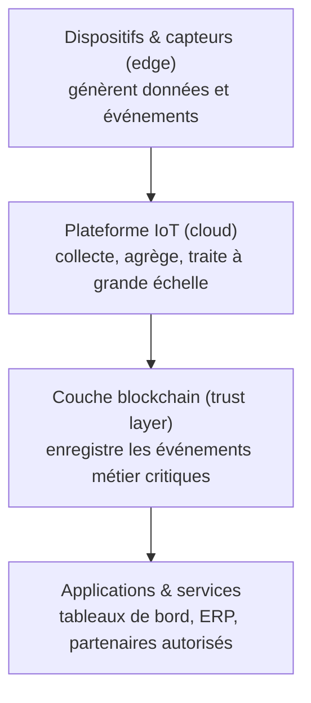

> [!important] Règle d'or : on-chain pour la confiance, off-chain pour le volume
> Les données à haute fréquence restent **hors chaîne** ; seuls les **événements métier importants** sont inscrits sur la blockchain. On garde la performance tout en garantissant la confiance.

| Off-chain (hors chaîne) | On-chain (sur la chaîne) |
|---|---|
| données volumineuses : vidéos, images, télémétrie brute | événements métier (transferts, certifications) |
| historique des capteurs, journaux détaillés | **preuves d'intégrité** : empreintes (hash) des données |
| stockage cloud / edge classique, rapide et économique | identité des dispositifs, enregistrements d'accès |
| seule une **référence (hash)** est ancrée sur la chaîne | exécution et résultats des smart contracts |

### L'identité décentralisée des dispositifs (DID)

Chaque dispositif a besoin d'une identité **unique et vérifiable**, sans dépendre d'une autorité centrale.

- Problème de l'identité centralisée : point unique de défaillance, dépendance à un fournisseur, gestion complexe à grande échelle.
- **DID = identité auto-souveraine**, contrôlée par le dispositif ou l'organisation, ancrée sur la blockchain.
- Cycle de vie tracé : fabrication → provisionnement → opération → révocation.
- **Onboarding sans contact** : provisionnement sécurisé et automatique des nouveaux dispositifs.
- Bénéfices : sécurité, résistance à la falsification, **interopérabilité entre organisations**. Usages : industrie, santé, logistique, véhicules connectés, énergie.

### Smart contract : maintenance prédictive automatisée

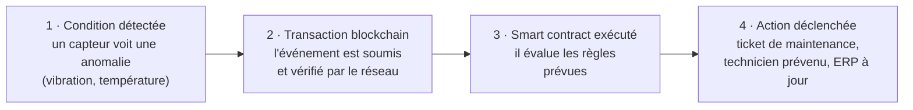

Des actions **automatiques, traçables et infalsifiables**, sans intervention manuelle.

> [!example] Traçabilité de la chaîne d'approvisionnement
> Matière première → fabrication → contrôle qualité → emballage → transport → entrepôt → point de vente → client : chaque étape est **horodatée et inscrite de façon immuable**. Les smart contracts automatisent paiements, alertes de température et mises à jour de stock. Secteurs : pharmacie (chaîne du froid), agroalimentaire, aéronautique, automobile, luxe. Bénéfices : lutte contre la contrefaçon, visibilité de bout en bout, conformité, confiance des clients.

Autres usages : industrie (identité des machines, ordres de travail numériques), énergie (certificats d'énergie renouvelable, échanges pair à pair, recharge de véhicules électriques), santé (traçabilité des médicaments, dossiers médicaux), villes (stationnement, services aux citoyens), gestion d'actifs (passeports d'équipement, maintenance partagée).

> [!abstract] Synthèse du module
> La blockchain devient la **couche de confiance** de l'Industrie 4.0 : l'IoT produit la donnée, la blockchain la rend fiable ; chaque dispositif a une identité auto-souveraine ; les smart contracts automatisent les workflows entre organisations ; on-chain pour la confiance, off-chain pour le volume.

---

## Module 13 — Sécurité avancée et conformité

*PDF p. 128–137 · en pratique : [[TP 6 - Sécuriser MQTT (TLS, mots de passe, ACL)|TP 6]] · voir aussi, en Sécurité informatique : Résumé - Chapitre 1 - Notions de base de la sécurité informatique et Résumé - Chapitre 2 - Chiffrement symétrique et modes opératoires*

### Zero Trust : « Never trust, always verify »

1. **Never trust** : aucun utilisateur, appareil ou application n'est digne de confiance par défaut, où qu'il se trouve.
2. **Always verify** : authentifier et vérifier **chaque** demande d'accès, en continu, avec une identité forte du dispositif.
3. **Least privilege** : le minimum d'accès nécessaire à la tâche, rien de plus.
4. **Assume breach** : concevoir comme si l'attaquant était déjà dedans ; limiter l'impact et les déplacements latéraux.
5. **Continuous monitoring** : surveiller dispositifs, applications et réseaux en continu.

Le changement de posture : on passe de « **d'où** vous connectez-vous ? » (le réseau interne était de confiance) à « **qui** êtes-vous et quelle est votre intention ? ».

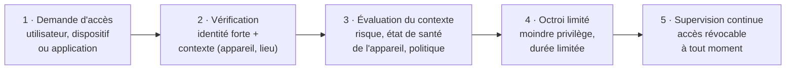

Le Zero Trust n'est pas une vérification ponctuelle : chaque accès est validé **en continu**.

### Identité des dispositifs et PKI

| Sans identité de dispositif | Avec identité (PKI) |
|---|---|
| n'importe quel appareil se connecte sans vérification | chaque dispositif s'authentifie, est autorisé et protégé |
| usurpation, attaques de l'**homme du milieu** | une **autorité de certification (CA)** émet un certificat numérique unique par dispositif |
| accès non vérifié dans tout le système | communication chiffrée et vérifiée de bout en bout |
| impossible de garantir l'origine d'une donnée | sécurité dès la conception, dès la fabrication |

« On ne peut pas protéger ce qu'on ne peut pas identifier. On ne peut pas faire confiance à ce qu'on ne peut pas vérifier. »

Le **cycle de vie de l'identité** : 1. fabrication et provisionnement (identité injectée en usine) → 2. émission du certificat par la CA → 3. enrôlement et authentification continue → 4. supervision et **renouvellement** avant expiration → 5. **révocation** en fin de vie. C'est la fondation du Zero Trust : la bonne identité, le bon dispositif, au bon moment.

### Mises à jour OTA sécurisées (Over-The-Air)

| Sans OTA sécurisées | Avec OTA sécurisées |
|---|---|
| failles non corrigées, risque élevé | correctifs déployés rapidement, à distance |
| maintenance manuelle, interventions physiques lentes et chères | mises à jour **authentifiées et signées numériquement** |
| coûts opérationnels élevés à grande échelle | maintenance moins chère, agilité |
| non-conformité croissante | conformité maintenue, confiance des clients |

Chaîne de confiance : **dispositif de confiance → mise à jour de confiance → fonctionnement de confiance**.

Le **cycle de vie sécurisé** d'un dispositif : fabrication (identité et clés injectées) → provisionnement (enregistrement sécurisé) → déploiement et opération (supervision continue) → mises à jour (correctifs signés via OTA) → retrait (révocation des accès, mise hors service sécurisée). Une boucle qui ne s'arrête qu'au retrait.

### Normes et référentiels

| Norme | Portée | Apport principal |
|---|---|---|
| **IEC 62443** | IoT industriel (OT / ICS) | zones et conduits, niveaux de sécurité **SL1 à SL4** |
| **NIST Cybersecurity Framework** (2.0, 2024) | gouvernance de la cybersécurité | Identify, Protect, Detect, Respond, Recover (+ Govern dans la version 2.0) |
| **ISO/IEC 27001** (2022) | système de management de la sécurité de l'information (SMSI) | gestion des risques, amélioration continue |
| **ETSI EN 303 645** | IoT grand public | exigences de sécurité de base des objets connectés |
| **OWASP IoT Top 10** (2018) | vulnérabilités applicatives IoT | les 10 risques les plus courants |

Aucun standard ne suffit seul : on **combine** plusieurs référentiels.

### Défense en profondeur : 7 couches

1. **Sécurité réseau** : pare-feu, segmentation, VPN, IDS/IPS.
2. **Gestion des identités et des accès** : certificats, MFA, contrôles d'identité forts.
3. **Chiffrement** : TLS pour les données en transit.
4. **Sécurité du broker** : broker MQTT durci, ACL, configuration sûre, correctifs à jour.
5. **Sécurité applicative** : valider les entrées, API sécurisées, bonnes pratiques de code.
6. **Supervision et détection** : journaux, connexions, comportements ; détecter tôt.
7. **Réponse aux incidents** : un plan, des exercices, une réaction rapide.

Aucune couche ne suffit seule : si l'une cède, les autres protègent encore.

**Les 10 bonnes pratiques** : sécurité dès la conception · Zero Trust partout · défense en profondeur · moindre privilège · supervision continue · automatisation de la conformité et de la remédiation · gestion du cycle de vie de chaque dispositif · culture et sensibilisation des équipes · conformité dès la conception · gestion du risque et résilience.

---

## Module 14 — Bibliographie

*PDF p. 138–143*

- **Normes de sécurité** : IEC 62443, NIST CSF 2.0, ISO/IEC 27001:2022, ETSI EN 303 645 V2.1.1 (2020), OWASP IoT Top 10 (2018).
- **Spécifications** : MQTT 5.0 (standard OASIS), CoAP (RFC 7252), TLS 1.2 / 1.3 (RFC 5246 / RFC 8446), HTTP (RFC 9110), IEEE 802.15.4 (Zigbee).
- **Documentation** : AWS IoT Core, DynamoDB, Kinesis Data Streams, Eclipse Mosquitto, MongoDB, Docker.
- **Bibliothèques des TP** : Paho MQTT, PyMongo, FastAPI, boto3, scikit-learn, TensorFlow Lite for Microcontrollers.
- **Organismes** : NIST, ISO / IEC, ETSI, IETF (les RFC), OASIS (MQTT), Eclipse Foundation (Mosquitto, Paho), OWASP, AWS.

---

## Les chiffres et repères à connaître

| Repère | Valeur |
|---|---|
| Dispositifs IoT dans le monde | plus de 10 milliards ; 30 milliards attendus en 2030 |
| Évolution | M2M (1980s) → Internet (2000s) → IoT (2010) → IIoT (2015) → AIoT (2020+) |
| PT100 | sonde en platine, 100 Ω à 0 °C |
| Processeurs IoT | de 8 bits (2–40 MHz) à 32 bits multicœurs |
| Ports MQTT | **1883** en clair, **8883** avec TLS |
| QoS | 0 au plus une fois · 1 au moins une fois (PUBACK) · 2 exactement une fois (PUBREC, PUBREL, PUBCOMP) |
| LoRaWAN / NB-IoT | 5–10 km, 0,3–50 kbit/s / 1–10 km, 10 ans de batterie |
| Shard Kinesis | 1 000 écritures/s, 5 lectures/s |
| Délai max SQS | 15 minutes |
| Imbrication DynamoDB | jusqu'à 32 niveaux |
| TinyML | quelques Ko de mémoire, < 1 Mo de RAM, de l'ordre du milliwatt |
| Quantization 32 → 8 bits | taille ÷ 4 (~75 % de moins) |
| Cas usine (EPI) | détection < 100 ms, −80 % de bande passante |
| Jumeaux numériques | −20 à −40 % d'arrêts (fabrication), −10 à −30 % (énergie) |
| IEC 62443 | niveaux de sécurité SL1 à SL4 |

## Questions de révision

1. Donner les quatre temps du fonctionnement d'un objet IoT et un exemple pour chacun.
2. Quelle est la différence entre un capteur et un actionneur ? Classer la caméra, l'écran, le micro et le haut-parleur d'un smartphone.
3. Citer trois différences entre un réseau client-serveur classique et un réseau IoT.
4. Quelle technologie sans fil choisir pour des capteurs d'humidité dans un champ de 5 km, sur pile ? Et pour une caméra dans un salon ?
5. Pourquoi passer par un broker plutôt que relier directement chaque capteur à chaque application ?
6. Que reçoit un abonné à `factory1/+/machine12/temperature` ? Et à `factory1/#` ?
7. Expliquer les trois niveaux de QoS et la règle d'or.
8. Quels sont les trois piliers de la sécurité MQTT, et quelle question pose chacun ?
9. Quand traiter une donnée à l'edge plutôt que dans le cloud ? Donner deux exemples.
10. Quel composant d'AWS IoT Core permet de connaître l'état d'un dispositif hors ligne ? Lequel route les messages vers DynamoDB ?
11. Stream ou batch : lequel pour une alerte de rythme cardiaque ? Pour un rapport mensuel de consommation ?
12. Pourquoi dit-on qu'un bon feature engineering compte plus qu'un algorithme complexe ?
13. Une fausse alerte ou une panne manquée : laquelle est mesurée par la précision, laquelle par le rappel ?
14. Citer trois techniques pour réduire un modèle afin de l'exécuter à l'edge.
15. Qu'est-ce qu'un jumeau numérique ? Donner deux usages.
16. Qu'est-ce qu'on stocke sur la blockchain, et qu'est-ce qu'on garde hors chaîne ? Pourquoi ?
17. Énoncer les cinq principes du Zero Trust.

> [!question]- Réponses
> 1. **Sense** (un thermomètre mesure la température), **Process** (le dispositif ou l'edge compare à un seuil), **Connect** (la mesure part sur Internet via MQTT), **Share & Act** (un tableau de bord l'affiche, un arroseur se déclenche).
> 2. Le capteur transforme une grandeur physique en signal électrique ; l'actionneur transforme un signal électrique en action physique. Caméra et micro : capteurs. Écran et haut-parleur : actionneurs.
> 3. Connectivité intermittente au lieu d'une connexion stable ; architecture multicouche (device → gateway → edge → cloud) au lieu de requête → réponse ; des milliers à des millions de clients sur batterie, avec des protocoles multiples, au lieu de quelques clients sur secteur.
> 4. Le champ : **LoRaWAN** (5–10 km, ultra-faible consommation, petit débit suffisant pour des mesures) ou NB-IoT. La caméra : **Wi-Fi** (fort débit, alimentation sur secteur, courte portée suffisante).
> 5. Pour **découpler** : les éditeurs ne connaissent pas les abonnés, on ajoute des dispositifs ou des applications sans toucher aux autres, et le nombre de connexions reste proportionnel à éditeurs + abonnés au lieu d'éditeurs × abonnés (5 020 au lieu de 100 000 dans l'exemple du cours).
> 6. `+` : la température de la machine 12 dans **n'importe quelle zone** (un seul niveau). `#` : **tous** les messages de l'usine 1, à tous les niveaux.
> 7. QoS 0 : au plus une fois, sans accusé. QoS 1 : au moins une fois, accusé `PUBACK`, doublons possibles. QoS 2 : exactement une fois, poignée de main en 4 étapes. Règle d'or : le QoS **le plus bas** qui satisfait le besoin.
> 8. Authentification (qui êtes-vous ?), chiffrement (quelqu'un peut-il lire le message ?), autorisation (que pouvez-vous faire ?).
> 9. Quand il faut une **faible latence**, quand la connexion est **peu fiable**, ou pour une **décision de sécurité**. Exemples : contrôle des feux de circulation ; alerte patient immédiate ; arrêt d'une machine qui surchauffe.
> 10. Le **Device Shadow** ; le **Rule Engine** (règle `SELECT … FROM 'topic'` avec une action DynamoDB).
> 11. L'alerte cardiaque : **stream** (secondes). Le rapport mensuel : **batch** (moins cher, pas urgent).
> 12. Parce qu'un modèle ne peut apprendre que ce que ses entrées laissent voir : des variables bien choisies (moyenne glissante, vitesse de variation, heure) rendent le problème facile même pour un algorithme simple, alors qu'un algorithme puissant ne rattrape pas des données pauvres ou mal préparées.
> 13. La **précision** mesure la fiabilité des alertes (peu de fausses alertes) ; le **rappel** mesure la capacité à ne pas manquer de vraies pannes.
> 14. Quantization (8 bits), pruning (élagage), knowledge distillation (élève / professeur), architectures conçues pour l'edge (MobileNet).
> 15. Une représentation numérique vivante d'un actif physique, synchronisée en temps réel. Usages : maintenance prédictive, simulation de scénarios, optimisation continue (ex. Virtual Singapore pour l'urbanisme).
> 16. Sur la chaîne : les événements métier importants, les preuves d'intégrité (hash), l'identité des dispositifs, les smart contracts. Hors chaîne : la télémétrie brute, les vidéos, l'historique détaillé. Parce que la blockchain est lente et coûteuse pour de gros volumes : on n'y met que ce qui demande **preuve et confiance**, avec un hash qui pointe vers les données stockées ailleurs.
> 17. Never trust, always verify, least privilege, assume breach, continuous monitoring.
