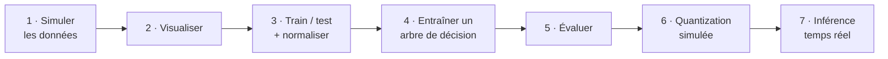

# TP 11 — TinyML : reconnaissance de gestes sur données de capteur

Énoncé complet : [[Fascicule de TP - 12 laboratoires.pdf]], pages 54 à 58 · durée 1 h 30 · cours : [[Résumé - IoT#Module 7 — IA et Machine Learning pour l'AIoT|module 7]] et [[Résumé - IoT#Module 8 — Edge AI et TinyML|module 8]] · avant : [[TP 10 - Flux temps réel avec Kinesis]] · suite : [[TP 12 - Projet Smart Home]] · voir aussi : cours de Machine Learning

> [!abstract] En une phrase
> À partir des 3 axes d'un accéléromètre (x, y, z), on entraîne un **tout petit modèle** qui reconnaît 4 gestes (gauche, droite, haut, bas), assez léger pour tenir sur un microcontrôleur.

## Le principe

Le **TinyML**, c'est faire tourner un modèle de Machine Learning sur un microcontrôleur (ESP32, Arduino) qui n'a que quelques centaines de kilo-octets de mémoire et fonctionne sur pile. On ne cherche donc pas le modèle le plus précis, mais le plus **petit qui soit assez bon**.



```sh
pip install scikit-learn numpy pandas matplotlib
```

Tout tient dans un seul script, `gesture_tinyml.py`, présenté étape par étape.

## Étapes 1 et 2 — Simuler et visualiser les données

Chaque geste a une **signature** : vers la gauche, l'accélération sur x est fortement négative ; vers le haut, c'est y qui est fortement positif, etc. On ajoute un bruit gaussien (écart-type 0,3) autour de cette signature.

```python
# gesture_tinyml.py
import matplotlib
matplotlib.use("Agg")                  # pas de fenêtre : on enregistre l'image
import matplotlib.pyplot as plt
import numpy as np
import pandas as pd
from sklearn.metrics import accuracy_score, classification_report
from sklearn.model_selection import train_test_split
from sklearn.preprocessing import StandardScaler
from sklearn.tree import DecisionTreeClassifier, export_text

np.random.seed(42)                     # mêmes données à chaque exécution

# --- Étape 1 : simuler l'accéléromètre --------------------------------------
GESTURES = ["left", "right", "up", "down"]
SIGNATURES = {                         # valeur typique de (x, y, z) pour chaque geste
    "left": (-1.5, 0.1, 0.2),
    "right": (1.5, 0.1, 0.2),
    "up": (0.1, 1.5, 0.2),
    "down": (0.1, -1.5, 0.2),
}


def generate_samples(n_per_gesture=150):
    rows = []
    for gesture in GESTURES:
        bx, by, bz = SIGNATURES[gesture]
        for _ in range(n_per_gesture):
            x = bx + np.random.normal(0, 0.3)       # bruit gaussien autour de la signature
            y = by + np.random.normal(0, 0.3)
            z = bz + np.random.normal(0, 0.3)
            rows.append([x, y, z, gesture])
    return pd.DataFrame(rows, columns=["x", "y", "z", "gesture"])


data = generate_samples()
print(data.head().round(3))
print(data["gesture"].value_counts().to_string())

# --- Étape 2 : visualiser X contre Y ----------------------------------------
for gesture in GESTURES:
    subset = data[data["gesture"] == gesture]
    plt.scatter(subset["x"], subset["y"], label=gesture, alpha=0.6, s=12)
plt.xlabel("Axe X")
plt.ylabel("Axe Y")
plt.legend()
plt.title("Séparation des gestes (X vs Y)")
plt.savefig("gestures_scatter.png", dpi=120)

# --- Étape 3 : jeux d'entraînement / de test + normalisation ----------------
X = data[["x", "y", "z"]].values
y = data["gesture"].values
X_train, X_test, y_train, y_test = train_test_split(
    X, y, test_size=0.2, random_state=42, stratify=y)
scaler = StandardScaler()
X_train_scaled = scaler.fit_transform(X_train)   # apprend moyenne et écart-type sur le train
X_test_scaled = scaler.transform(X_test)         # ... et les réutilise sur le test
print(f"\nEntraînement : {len(X_train)} échantillons, test : {len(X_test)}")

# --- Étape 4 : un modèle léger -----------------------------------------------
model = DecisionTreeClassifier(max_depth=4, random_state=42)
model.fit(X_train_scaled, y_train)
print("Profondeur réelle de l'arbre :", model.get_depth())
print("Nombre de feuilles :", model.get_n_leaves())
print(export_text(model, feature_names=["x", "y", "z"], decimals=2))

# --- Étape 5 : évaluer --------------------------------------------------------
y_pred = model.predict(X_test_scaled)
print("Accuracy :", round(accuracy_score(y_test, y_pred), 3))
print(classification_report(y_test, y_pred, digits=3))

# --- Étape 6 : quantization simulée (seuils arrondis à 0,1) ------------------
model.tree_.threshold[:] = np.round(model.tree_.threshold, 1)
y_pred_quantized = model.predict(X_test_scaled)
print("Accuracy après quantization simulée :",
      round(accuracy_score(y_test, y_pred_quantized), 3))


# --- Étape 7 : inférence « temps réel » --------------------------------------
def predict_gesture(x, y, z):
    sample = scaler.transform([[x, y, z]])
    return model.predict(sample)[0]


for live_sample in [(1.4, 0.15, 0.25), (-1.2, 0.3, 0.1), (0.2, 1.6, 0.3), (0.0, -1.1, 0.2)]:
    print(f"Lecture capteur {live_sample} -> geste détecté : {predict_gesture(*live_sample)}")
```

```sh
python gesture_tinyml.py
```

Étape 1, les données : 150 exemples par geste, 600 au total.

```text
       x      y      z gesture
0 -1.351  0.059  0.394    left
1 -1.043  0.030  0.130    left
2 -1.026  0.330  0.059    left
3 -1.337 -0.039  0.060    left
4 -1.427 -0.474 -0.317    left
gesture
left     150
right    150
up       150
down     150
```

Étape 2, le graphique `gestures_scatter.png` : quatre nuages **bien séparés**. Si les nuages se chevauchaient, aucun modèle ne pourrait bien les distinguer ; c'est la première chose à vérifier.

![[tp11-gestes.png|520]]

## Étape 3 — Séparer et normaliser

- `train_test_split(…, test_size=0.2, stratify=y)` : 80 % des exemples pour **apprendre**, 20 % gardés de côté pour **évaluer** sur des données jamais vues ; `stratify` garde la même proportion de chaque geste dans les deux parts.
- `StandardScaler` ramène chaque axe à une moyenne de 0 et un écart-type de 1, pour qu'aucun axe ne domine. Il apprend moyenne et écart-type **sur l'entraînement seulement** (`fit_transform`), puis les réutilise tels quels sur le test (`transform`).

```text
Entraînement : 480 échantillons, test : 120
```

## Étape 4 — Un modèle léger : l'arbre de décision

`max_depth=4` limite volontairement la taille de l'arbre. Résultat : il n'en a même pas besoin.

```text
Profondeur réelle de l'arbre : 3
Nombre de feuilles : 4
|--- x <= -0.80
|   |--- class: left
|--- x >  -0.80
|   |--- y <= -0.67
|   |   |--- class: down
|   |--- y >  -0.67
|   |   |--- x <= 0.72
|   |   |   |--- class: up
|   |   |--- x >  0.72
|   |   |   |--- class: right
```

Tout le modèle, ce sont **3 comparaisons**. Sur un microcontrôleur, il s'écrit directement en C (les seuils sont en unités normalisées : on applique d'abord `(valeur - moyenne) / écart-type`) :

```c
const char* predict_gesture(float x, float y) {   // x et y déjà normalisés
    if (x <= -0.80f) return "left";
    if (y <= -0.67f) return "down";
    if (x <= 0.72f)  return "up";
    return "right";
}
```

L'axe z n'apparaît nulle part : l'arbre a appris tout seul qu'il ne sert à rien pour ces 4 gestes.

## Étape 5 — Évaluer

```text
Accuracy : 0.983
              precision    recall  f1-score   support

        down      1.000     0.967     0.983        30
        left      1.000     1.000     1.000        30
       right      1.000     0.967     0.983        30
          up      0.938     1.000     0.968        30

    accuracy                          0.983       120
```

118 gestes sur 120 bien reconnus. Lecture des métriques (voir le [[Résumé - IoT#Évaluer un modèle|cours]]) :

- **precision** de `up` = 0,938 : quand le modèle dit « up », il a raison 94 % du temps (2 erreurs : un `right` et un `down` pris pour `up`) ;
- **recall** de `down` = 0,967 : sur 30 vrais `down`, il en a reconnu 29 ;
- **f1-score** : la moyenne harmonique des deux.

## Étape 6 — Simuler la quantization

Sur un vrai microcontrôleur, on stocke les paramètres avec moins de précision (8 bits au lieu de 32) pour gagner de la place. On simule l'effet en arrondissant les seuils à 0,1 près : −0,80 → −0,8 ; −0,67 → −0,7 ; 0,72 → 0,7.

```text
Accuracy après quantization simulée : 0.983
```

Aucune perte ici, car les nuages sont bien séparés. Avec des données plus bruitées, une petite baisse serait normale et acceptable : c'est **le compromis du TinyML**, un peu de précision contre beaucoup de mémoire et d'énergie.

## Étape 7 — Inférence en temps réel

```text
Lecture capteur (1.4, 0.15, 0.25) -> geste détecté : right
Lecture capteur (-1.2, 0.3, 0.1) -> geste détecté : left
Lecture capteur (0.2, 1.6, 0.3) -> geste détecté : up
Lecture capteur (0.0, -1.1, 0.2) -> geste détecté : down
```

Sur un ESP32, cette fonction tournerait en continu sur **chaque nouvelle lecture** de l'accéléromètre, sans réseau.

## Mini-défi : arbre ou petit réseau de neurones ?

> [!tip]- Solution testée
> À ajouter à la fin du script :
> ```python
> # à ajouter à la fin de gesture_tinyml.py
> from sklearn.neural_network import MLPClassifier
>
> mlp = MLPClassifier(hidden_layer_sizes=(16, 16), max_iter=2000, random_state=42)
> mlp.fit(X_train_scaled, y_train)
> n_params = sum(w.size for w in mlp.coefs_) + sum(b.size for b in mlp.intercepts_)
> print(f"Arbre : {model.tree_.node_count} nœuds, accuracy {accuracy_score(y_test, y_pred_quantized):.3f}")
> print(f"MLP   : {n_params} paramètres, accuracy {accuracy_score(y_test, mlp.predict(X_test_scaled)):.3f}")
> ```
> ```text
> Arbre : 7 nœuds, accuracy 0.983
> MLP   : 404 paramètres, accuracy 1.000
> ```
> Le réseau gagne 2 gestes sur 120, mais avec 404 paramètres (et des multiplications) contre 3 comparaisons. Pour un objet sur pile, l'arbre est le meilleur choix. En augmentant le bruit gaussien (0,6 puis 0,9…), les nuages se chevauchent et l'accuracy de l'arbre chute nettement : la qualité des données compte plus que le modèle.

## À retenir

- TinyML = un modèle **minuscule** sur microcontrôleur : quelques Ko, quelques mW, sans réseau.
- Toujours **visualiser** les données avant d'entraîner.
- Séparer entraînement / test ; normaliser avec les statistiques de l'entraînement seulement.
- Un arbre de décision peu profond = quelques `if`, facile à embarquer et à expliquer.
- Quantization : moins de précision des paramètres, beaucoup moins de mémoire, perte de précision faible.

## Questions du fascicule

1. Pourquoi un Decision Tree est-il plus adapté au TinyML qu'un grand réseau de neurones profond ?
2. Quel est le compromis principal entre précision du modèle et contraintes matérielles ?
3. Quelles étapes supplémentaires seraient nécessaires pour déployer ce modèle sur un vrai microcontrôleur (ESP32) ?

> [!question]- Réponses
> 1. Il est **minuscule** (7 nœuds ici, quelques dizaines d'octets), son inférence n'est que quelques comparaisons (rapide, peu d'énergie, pas de calcul flottant lourd), il se traduit directement en `if` en C, et il est **explicable**. Un réseau profond a des millions de paramètres (des Mo de mémoire) et demande beaucoup de multiplications, voire un accélérateur.
> 2. Un modèle plus petit et quantifié consomme moins de **mémoire**, d'**énergie** et de **temps**, mais peut perdre un peu de **précision**. On choisit le plus petit modèle dont la précision reste suffisante pour l'usage (ici 98 %).
> 3. Collecter de **vraies** données avec le capteur réel (un MPU6050 en I2C, par exemple) et réentraîner, car le réel diffère de la simulation ; découper le signal en fenêtres et en extraire des caractéristiques ; exporter le modèle (en `if`/`else` C pour un arbre, ou via TensorFlow Lite avec quantization int8 puis TensorFlow Lite for Microcontrollers pour un réseau) avec les moyennes et écarts-types du scaler ; compiler et flasher (Arduino IDE ou ESP-IDF) ; mesurer mémoire, temps d'inférence et consommation ; tester sur de vrais gestes.
