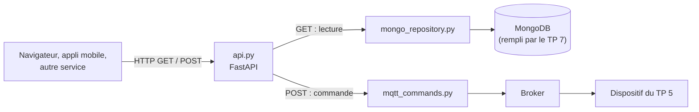

# TP 8 — Exposer le dispositif via une API REST (FastAPI)

Énoncé complet : [[Fascicule de TP - 12 laboratoires.pdf]], pages 40 à 46 · durée 1 h 30 · cours : [[Résumé - IoT#Module 10 — Architecture d'entreprise et jumeaux numériques|couche intégration & application]] · avant : [[TP 7 - Stocker et analyser avec MongoDB]] · suite : [[TP 9 - AWS IoT Core et DynamoDB]] · voir aussi : cours REST

> [!abstract] En une phrase
> Une petite **API web** donne accès à la télémétrie (lue dans MongoDB) et permet d'envoyer des commandes au dispositif (via MQTT), à n'importe quelle application qui parle HTTP.

## Pourquoi une API REST ?

Jusqu'ici, il fallait parler MQTT ou interroger MongoDB directement. Un site web ou une application mobile ne savent pas faire ça, mais tous savent faire des **requêtes HTTP**. L'API devient la porte d'entrée unique :



| Méthode | Route | Rôle |
|---|---|---|
| GET | `/health` | MongoDB et MQTT répondent-ils ? |
| GET | `/devices/{device_id}/telemetry/latest` | la dernière mesure |
| GET | `/devices/{device_id}/telemetry?limit=20` | l'historique récent (1 à 100) |
| GET | `/devices/{device_id}/events/warnings` | seulement les états WARNING |
| POST | `/devices/{device_id}/commands` | envoyer START, STOP ou STATUS |

**GET** consulte sans rien changer ; **POST** déclenche une action.

```sh
pip install fastapi uvicorn pymongo paho-mqtt
```

## Étape 1 — La configuration

```python
# config.py
MQTT_CONFIG = {
    "broker_host": "localhost",
    "broker_port": 1883,
    "keepalive": 60,
    "command_topic_template": "factory/production-line-2/machine/{device_id}/command",
}

MONGODB_CONFIG = {
    "uri": "mongodb://localhost:27017",
    "database": "aiot_platform",
    "collection": "telemetry",
}

API_CONFIG = {"title": "Enterprise AIoT Device API", "version": "1.0.0"}
```

## Étape 2 — L'accès aux données, à part

Les routes de l'API ne parlent jamais à MongoDB directement : elles passent par un **repository**, le seul fichier qui connaît la base.

```python
# mongo_repository.py
from pymongo import DESCENDING, MongoClient

from config import MONGODB_CONFIG


class TelemetryRepository:
    """Le seul fichier du projet qui parle à MongoDB."""

    def __init__(self):
        self.client = MongoClient(MONGODB_CONFIG["uri"], serverSelectionTimeoutMS=5000,
                                  tz_aware=True)          # dates rendues en UTC
        db = self.client[MONGODB_CONFIG["database"]]
        self.collection = db[MONGODB_CONFIG["collection"]]

    def ping(self):
        self.client.admin.command("ping")

    def latest(self, device_id):
        return self.collection.find_one({"device_id": device_id},
                                        sort=[("timestamp", DESCENDING)])

    def history(self, device_id, limit=20):
        return list(self.collection.find({"device_id": device_id})
                    .sort("timestamp", DESCENDING).limit(limit))

    def warnings(self, device_id, limit=20):
        return list(self.collection.find({"device_id": device_id, "state": "WARNING"})
                    .sort("timestamp", DESCENDING).limit(limit))

    def close(self):
        self.client.close()
```

`serverSelectionTimeoutMS=5000` : si MongoDB ne répond pas, erreur au bout de 5 s au lieu de 30. `tz_aware=True` : les dates reviennent avec leur fuseau (`+00:00`) au lieu d'heures « nues » ambiguës.

## Étape 3 — Publier une commande depuis l'API

```python
# mqtt_commands.py
import json
import uuid

import paho.mqtt.client as mqtt

from config import MQTT_CONFIG


class MQTTCommandPublisher:
    def __init__(self):
        self.connected = False
        self.client = mqtt.Client(mqtt.CallbackAPIVersion.VERSION2, client_id="aiot-rest-api")
        self.client.on_connect = self._on_connect
        self.client.on_disconnect = self._on_disconnect
        self.client.connect(MQTT_CONFIG["broker_host"], MQTT_CONFIG["broker_port"],
                            MQTT_CONFIG["keepalive"])
        self.client.loop_start()

    def _on_connect(self, client, userdata, flags, reason_code, properties):
        self.connected = (reason_code == 0)

    def _on_disconnect(self, client, userdata, flags, reason_code, properties):
        self.connected = False          # sinon /health dirait « healthy » broker arrêté

    def send_command(self, device_id, command, reason=None):
        if not self.connected:
            raise RuntimeError("Broker MQTT non connecté.")
        # "request_id" : c'est le nom de champ que lit le dispositif du TP5
        request_id = f"CMD-{uuid.uuid4().hex[:10].upper()}"
        payload = {"command": command, "request_id": request_id}
        if reason:
            payload["reason"] = reason
        topic = MQTT_CONFIG["command_topic_template"].format(device_id=device_id)
        self.client.publish(topic, json.dumps(payload))
        return {"topic": topic, "request_id": request_id, "command": command}

    def close(self):
        self.client.disconnect()
        self.client.loop_stop()
```

> [!warning] Deux corrections par rapport au fascicule
> - Le fascicule envoie l'identifiant sous le nom **`correlation_id`**, alors que le dispositif du TP 5 lit **`request_id`**. Le dispositif ne le trouve pas, en invente un autre, et l'ACK ne correspond plus à la commande envoyée par l'API. On garde `request_id` partout.
> - Sans `on_disconnect`, `connected` reste à `True` après une coupure du broker : `/health` annoncerait « healthy » alors que les commandes ne partent plus.

## Étape 4 — L'API

```python
# api.py
from contextlib import asynccontextmanager
from typing import Optional

from fastapi import FastAPI, HTTPException, Query
from pydantic import BaseModel

from config import API_CONFIG
from mongo_repository import TelemetryRepository
from mqtt_commands import MQTTCommandPublisher

repository = None
command_publisher = None


@asynccontextmanager
async def lifespan(app):
    # Au démarrage : une seule connexion MongoDB et une seule connexion MQTT pour toute l'API
    global repository, command_publisher
    repository = TelemetryRepository()
    repository.ping()
    command_publisher = MQTTCommandPublisher()
    yield
    # À l'arrêt : on ferme proprement
    command_publisher.close()
    repository.close()


app = FastAPI(title=API_CONFIG["title"], version=API_CONFIG["version"], lifespan=lifespan)


def serialize(doc):
    doc = dict(doc)
    doc["_id"] = str(doc["_id"])        # ObjectId n'est pas convertible en JSON tel quel
    return doc


@app.get("/health")
def health():
    try:
        repository.ping()
        mongo = "healthy"
    except Exception:
        mongo = "unavailable"
    mqtt = "healthy" if command_publisher.connected else "unavailable"
    status = "healthy" if mongo == mqtt == "healthy" else "degraded"
    return {"status": status, "services": {"mongodb": mongo, "mqtt": mqtt}}


@app.get("/devices/{device_id}/telemetry/latest")
def latest_telemetry(device_id: str):
    doc = repository.latest(device_id)
    if not doc:
        raise HTTPException(404, f"Aucune télémétrie pour {device_id}")
    return serialize(doc)


@app.get("/devices/{device_id}/telemetry")
def telemetry_history(device_id: str, limit: int = Query(20, ge=1, le=100)):
    docs = repository.history(device_id, limit)
    return {"device_id": device_id, "count": len(docs), "records": [serialize(d) for d in docs]}


@app.get("/devices/{device_id}/events/warnings")
def warning_events(device_id: str, limit: int = Query(20, ge=1, le=100)):
    docs = repository.warnings(device_id, limit)
    return {"device_id": device_id, "count": len(docs), "records": [serialize(d) for d in docs]}


class CommandRequest(BaseModel):
    command: str                    # START, STOP ou STATUS
    reason: Optional[str] = None


@app.post("/devices/{device_id}/commands")
def send_command(device_id: str, request: CommandRequest):
    command = request.command.upper().strip()
    if command not in {"START", "STOP", "STATUS"}:
        raise HTTPException(400, "Commande non supportée. Utilisez START, STOP ou STATUS.")
    try:
        result = command_publisher.send_command(device_id, command, request.reason)
    except RuntimeError as exc:
        raise HTTPException(503, str(exc))
    return {"status": "accepted", "message": "Commande publiée sur MQTT.", **result}
```

Ce que FastAPI fait à notre place :

- `{device_id}` dans le chemin devient un paramètre de la fonction ;
- `limit: int = Query(20, ge=1, le=100)` : valeur par défaut 20, et toute valeur hors de 1–100 est refusée automatiquement (code **422**) ;
- `CommandRequest` décrit le JSON attendu dans un POST : un corps mal formé est refusé (422) ;
- le dictionnaire renvoyé est converti en JSON ; `HTTPException(404, …)` renvoie une erreur propre.

`lifespan` ouvre les connexions **une fois** au démarrage et les ferme à l'arrêt, au lieu d'ouvrir une connexion par requête.

## Étape 5 — Lancer et tester

```sh
python mqtt_to_mongodb.py          # terminal 1 : l'ingestion du TP 7
python device_two_way.py           # terminal 2 : le dispositif du TP 5
uvicorn api:app --reload           # terminal 3 : l'API sur http://127.0.0.1:8000
```

Si le port 8000 est déjà pris par un autre programme : `uvicorn api:app --reload --port 8001`.

Ouvrir **http://127.0.0.1:8000/docs** : FastAPI génère une page de test interactive pour chaque route (bouton *Try it out*), sans une ligne de HTML.

![[tp08-swagger.png|640]]

Les mêmes tests en ligne de commande avec `curl` :

```sh
curl -s http://127.0.0.1:8000/health
```

```json
{"status": "healthy", "services": {"mongodb": "healthy", "mqtt": "healthy"}}
```

```sh
curl -s http://127.0.0.1:8000/devices/MCH-007/telemetry/latest
```

```json
{
  "_id": "6aee45f8cc22d1f8099262c9",
  "device_id": "MCH-007",
  "device_type": "Bottle Filling Machine",
  "location": "Production Line 2",
  "timestamp": "2026-11-06T21:25:46+00:00",
  "state": "RUNNING",
  "message": "Normal operation",
  "readings": {"temperature": 72.9, "vibration": 2.05, "pressure": 6.2, "energy": 1.41},
  "status": {"warning": false, "fault": false},
  "ingested_at": "2026-11-06T21:25:46.458000+00:00",
  "source": "mqtt_ingestion_service",
  "schema_version": "1.0"
}
```

```sh
curl -s -X POST http://127.0.0.1:8000/devices/MCH-007/commands \
     -H "Content-Type: application/json" -d '{"command": "STOP", "reason": "Test maintenance"}'
```

```json
{"status": "accepted", "message": "Commande publiée sur MQTT.", "topic": "factory/production-line-2/machine/MCH-007/command", "request_id": "CMD-7CCBB716CA", "command": "STOP"}
```

Et dans le terminal 2, le dispositif reçoit la commande **avec le même `request_id`** :

```text
Commande reçue : {"command": "STOP", "request_id": "CMD-7CCBB716CA", "reason": "Test maintenance"}
Commande exécutée : STOP | état = STOPPED
Machine arrêtée : pas de télémétrie
```

Tous les cas testés :

| Requête | Code HTTP | Réponse |
|---|---|---|
| `GET /devices/MCH-007/telemetry?limit=3` | 200 | `count: 3`, du plus récent au plus ancien |
| `GET /devices/MCH-007/events/warnings` | 200 | uniquement des documents `state: WARNING` |
| `GET /devices/MCH-404/telemetry/latest` | **404** | `{"detail": "Aucune télémétrie pour MCH-404"}` |
| `GET /devices/MCH-007/telemetry?limit=500` | **422** | `Input should be less than or equal to 100` |
| `POST … {"command": "start"}` | 200 | accepté, converti en `START` |
| `POST … {"command": "EXPLODE"}` | **400** | `Commande non supportée. Utilisez START, STOP ou STATUS.` |
| `GET /health`, broker arrêté (`sudo systemctl stop mosquitto`) | 200 | `{"status": "degraded", "services": {"mongodb": "healthy", "mqtt": "unavailable"}}` |
| `POST … {"command": "STATUS"}`, broker arrêté | **503** | `{"detail": "Broker MQTT non connecté."}` |

Au redémarrage du broker, paho se reconnecte tout seul et `/health` repasse à `healthy`.

> [!tip] Vers la production
> Il manquerait ici : authentification des appels (clé d'API ou jeton), HTTPS, limitation du nombre de requêtes, secrets hors du code, journal d'audit des commandes. Volontairement omis pour rester simple.

## À retenir

- L'API REST est la **porte d'entrée universelle** : lecture dans MongoDB, commandes vers MQTT.
- Séparer les couches : routes (`api.py`), données (`mongo_repository.py`), messagerie (`mqtt_commands.py`).
- **GET** lit sans effet de bord ; **POST** déclenche une action.
- Codes HTTP : 200 OK, 400 requête invalide, 404 introuvable, 422 paramètres invalides, 503 service indisponible.
- `/docs` : documentation et tests interactifs générés automatiquement.

## Questions du fascicule

1. Pourquoi séparer `mongo_repository.py` de `api.py` plutôt que d'écrire les requêtes MongoDB directement dans les routes ?
2. Pourquoi la commande est-elle envoyée en POST plutôt qu'en GET ?
3. Que renverrait `GET /health` si le broker MQTT était arrêté mais que MongoDB fonctionnait normalement ?

> [!question]- Réponses
> 1. Chaque fichier a **une seule responsabilité** : les routes gèrent HTTP, le repository gère la base. Pour passer à DynamoDB (TP 9), on ne change qu'un fichier ; on peut tester l'API avec un faux repository ; et on évite de recopier les mêmes requêtes dans plusieurs routes.
> 2. GET doit être **sans effet de bord** : un navigateur, un cache ou un robot d'indexation peut le rejouer ou le précharger sans prévenir. Une commande change l'état d'une machine : c'est une action, donc POST, avec les paramètres dans un corps JSON.
> 3. `{"status": "degraded", "services": {"mongodb": "healthy", "mqtt": "unavailable"}}`, testé ci-dessus, et les POST répondent 503. Avec le code du fascicule (sans `on_disconnect`), on aurait obtenu à tort `healthy`.
