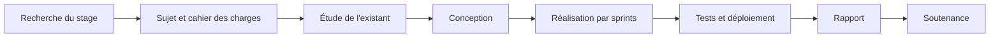

# Méthodologie du projet de fin d'études

Le PFE vaut à lui seul **30 crédits**, soit tout le semestre 6. C'est un stage de plusieurs mois en entreprise (ou en laboratoire) pendant lequel on mène un vrai projet, avant de le défendre devant un jury.

## Les grandes étapes

| Étape | Durée indicative | Livrable |
|---|---|---|
| Recherche du stage | avant le semestre | convention de stage signée |
| Cadrage | 2 à 3 semaines | cahier des charges validé |
| Étude et conception | 3 à 4 semaines | diagrammes, choix techniques |
| Réalisation | 8 à 10 semaines | application, code versionné |
| Tests et déploiement | 2 semaines | application en ligne, tests |
| Rédaction et soutenance | 3 semaines (idéalement en continu) | rapport, présentation |

La recherche du stage s'appuie sur le cours d'insertion professionnelle.

## Le cahier des charges

Il fixe **ce que** le système doit faire, pas **comment**.

1. **Contexte** et **problématique** : pourquoi ce projet ?
2. **Existant** : comment fait-on aujourd'hui, quelles solutions existent, quelles sont leurs limites.
3. **Acteurs** : qui utilise le système.
4. **Besoins fonctionnels** : ce que le système permet (« l'administrateur peut valider une demande »).
5. **Besoins non fonctionnels** : performance, sécurité, disponibilité, ergonomie, compatibilité.
6. **Contraintes** : technologies imposées, délais, budget.
7. **Planning** prévisionnel.

> [!tip] Un besoin testable
> À éviter : « L'application doit être rapide. »
> Mieux : « La liste des commandes s'affiche en moins de 2 secondes pour 10 000 commandes. »

## Gérer le projet avec Scrum

La plupart des PFE suivent une méthode **agile**, le plus souvent **Scrum**.

| Élément | Dans un PFE |
|---|---|
| **Product Owner** | souvent l'encadrant en entreprise : il priorise les besoins |
| **Scrum Master** | l'encadrant ou toi-même |
| **Équipe** | toi (et ton binôme) |
| **Product backlog** | la liste priorisée des *user stories* |
| **Sprint** | 2 à 3 semaines, terminé par une démonstration |
| **Daily** | un point rapide chaque jour |
| **Rétrospective** | ce qui a marché, ce qu'on améliore |

> [!definition] User story
> « En tant que **[rôle]**, je veux **[action]** afin de **[bénéfice]**. »
> Exemple : « En tant qu'étudiant, je veux recevoir une notification quand une note est publiée afin de ne pas devoir vérifier tous les jours. »

Outils : Jira, Trello ou GitHub Projects pour le backlog ; **Git** pour le code (une branche par fonctionnalité, des commits clairs).

## La conception

Les diagrammes UML les plus attendus :

- **Cas d'utilisation** : les acteurs et les fonctionnalités (le « quoi »).
- **Diagrammes de séquence** : les échanges dans un scénario précis.
- **Diagramme de classes** : la structure des données.
- **Architecture** : couches, services, déploiement — souvent un client et une API, ou des microservices (voir Chapitre 1 - SOA, SOAP et REST).

## Le rapport

La structure classique :

1. Introduction générale
2. **Chapitre 1** — Contexte : présentation de l'entreprise, problématique, étude de l'existant, méthodologie
3. **Chapitre 2** — Analyse et spécification des besoins
4. **Chapitre 3** — Conception
5. **Chapitres suivants** — Réalisation, sprint par sprint (ou module par module) : environnement, captures, tests
6. Conclusion générale et perspectives
7. Bibliographie et webographie, annexes

> [!warning] Les erreurs qui coûtent cher
> Commencer le rapport la dernière semaine · captures d'écran illisibles · documentation copiée-collée sans source · fautes d'orthographe · choix techniques jamais justifiés.

Rédiger **au fil des sprints** : à la fin de chaque sprint, écrire les pages correspondantes. LaTeX (Overleaf) ou Word avec des styles et une table des matières automatique.

## La soutenance

- Environ 20 minutes de présentation, puis les questions du jury (vérifier la durée exacte imposée).
- Le fil conducteur : contexte → problématique → solution → démonstration → bilan et perspectives.
- Une idée par diapositive, peu de texte, des schémas, et **une démonstration** (avec une vidéo de secours en cas de panne).
- Répéter au moins trois fois, chronométré, devant quelqu'un.

> [!abstract] À retenir
> Un cahier des charges testable → Scrum avec un backlog et des sprints → une conception UML → une réalisation versionnée sous Git → un rapport rédigé au fil de l'eau → une soutenance répétée. Checklist : [[Résumé - Checklist PFE]].
