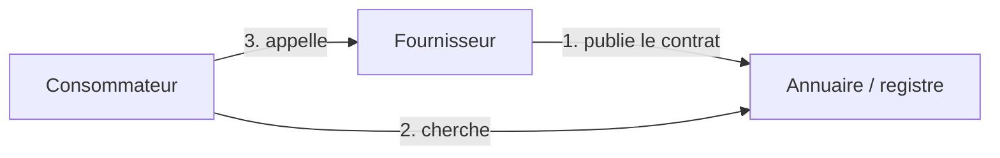

# SOA, SOAP et REST

## L'architecture orientée services

> [!definition] SOA (*Service-Oriented Architecture*)
> Une façon de construire un système d'information comme un ensemble de **services** : des fonctionnalités métier autonomes, exposées par une **interface standard** et appelées à travers le réseau, quels que soient leur langage et leur plateforme.

Les principes d'un bon service :

- **Contrat standardisé** : l'interface est décrite formellement (WSDL, OpenAPI).
- **Couplage faible** : le client ne dépend que du contrat, pas de l'implémentation.
- **Abstraction** : les détails internes sont cachés.
- **Réutilisabilité** et **composabilité** : on assemble des services pour en créer d'autres.
- **Autonomie**, et **sans état** autant que possible.

## Les rôles



Dans une grande entreprise, un **ESB** (*Enterprise Service Bus*) sert d'intermédiaire : routage, transformation des messages (XML vers JSON et inversement), sécurité, supervision. Exemples : MuleSoft, WSO2, Apache Camel.

## Les services web SOAP

**SOAP** est un protocole d'échange de messages **XML**, le plus souvent transportés sur HTTP.

- Le contrat est un fichier **WSDL** : opérations, types des messages, adresse du service.
- Les types sont définis en **XML Schema** (XSD).
- Des extensions standard : **WS-Security** (signature, chiffrement), WS-ReliableMessaging, transactions.

```xml
<soap:Envelope xmlns:soap="http://schemas.xmlsoap.org/soap/envelope/">
  <soap:Header/>
  <soap:Body>
    <getEtudiant xmlns="http://exemple.org/ws">
      <id>42</id>
    </getEtudiant>
  </soap:Body>
</soap:Envelope>
```

En Java, **JAX-WS** génère le service à partir d'annotations :

```java
@WebService
public class EtudiantService {
    @WebMethod
    public Etudiant getEtudiant(int id) { return repo.find(id); }
}
```

## Les services REST

**REST** n'est pas un protocole mais un **style d'architecture** (Roy Fielding, 2000). Tout est **ressource**, identifiée par une URI et manipulée avec les verbes HTTP.

> [!propriete] Les contraintes REST
> Client-serveur · **sans état** (chaque requête contient tout ce qu'il faut) · mise en cache possible · interface uniforme · système en couches · code à la demande (optionnel).

| Verbe | Action | Exemple | Idempotent |
|---|---|---|---|
| `GET` | lire | `GET /etudiants/42` | oui |
| `POST` | créer | `POST /etudiants` | non |
| `PUT` | remplacer | `PUT /etudiants/42` | oui |
| `PATCH` | modifier en partie | `PATCH /etudiants/42` | non (en général) |
| `DELETE` | supprimer | `DELETE /etudiants/42` | oui |

> [!tip] De bonnes URI
> Des **noms au pluriel**, pas de verbes : `/etudiants/42/notes`, pas `/getNotesEtudiant?id=42`.

### Les codes de statut

| Code | Sens |
|---|---|
| `200 OK` · `201 Created` · `204 No Content` | succès |
| `400 Bad Request` | requête invalide |
| `401 Unauthorized` · `403 Forbidden` | non authentifié · pas le droit |
| `404 Not Found` | ressource inexistante |
| `409 Conflict` | conflit (doublon…) |
| `500 Internal Server Error` | bug côté serveur |

### Un contrôleur Spring Boot

```java
@RestController
@RequestMapping("/etudiants")
public class EtudiantController {
    private final EtudiantRepository repo;
    public EtudiantController(EtudiantRepository repo) { this.repo = repo; }

    @GetMapping
    public List<Etudiant> tous() { return repo.findAll(); }

    @GetMapping("/{id}")
    public ResponseEntity<Etudiant> un(@PathVariable Long id) {
        return repo.findById(id).map(ResponseEntity::ok).orElse(ResponseEntity.notFound().build());
    }

    @PostMapping
    public ResponseEntity<Etudiant> creer(@RequestBody Etudiant e) {
        Etudiant cree = repo.save(e);
        return ResponseEntity.created(URI.create("/etudiants/" + cree.getId())).body(cree);
    }
}
```

Le contrat d'une API REST se décrit avec **OpenAPI** (anciennement Swagger) ; `springdoc-openapi` le génère et fournit une page de test, `/swagger-ui.html`.

## SOAP ou REST ?

| | SOAP | REST |
|---|---|---|
| Nature | protocole | style d'architecture |
| Format | XML uniquement | JSON surtout (XML possible) |
| Contrat | WSDL obligatoire | OpenAPI (optionnel) |
| Transport | HTTP, SMTP, JMS… | HTTP |
| Sécurité | WS-Security | HTTPS + OAuth2 / JWT |
| Usage | banque, assurance, systèmes historiques | web, mobile, microservices |

## Des services aux microservices

Les **microservices** poussent la SOA plus loin : chaque service est **petit**, possède **sa propre base de données**, se déploie seul (souvent dans un conteneur — voir Chapitre 1 - Virtualisation et conteneurs) et communique par REST ou par messages (voir le intergiciels orientés messages). Une **API Gateway** sert de porte d'entrée unique.

> [!abstract] À retenir
> SOA = services autonomes + contrats standard + couplage faible. SOAP = XML + WSDL, très outillé. REST = ressources + verbes HTTP + JSON, sans état. Sécuriser avec HTTPS et des jetons (voir le cours de sécurité). Fiche : [[Résumé - Services Web]].
