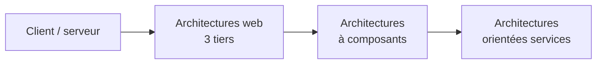
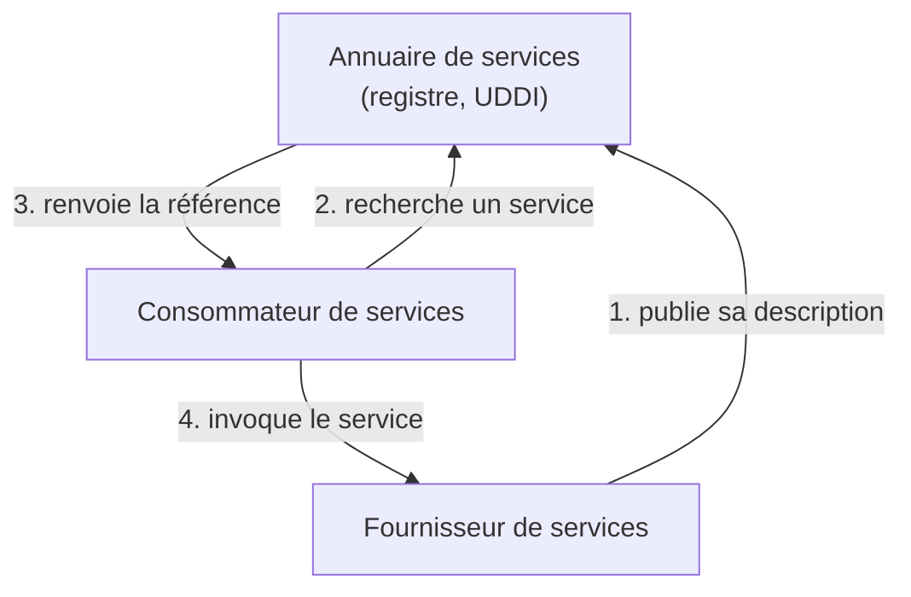
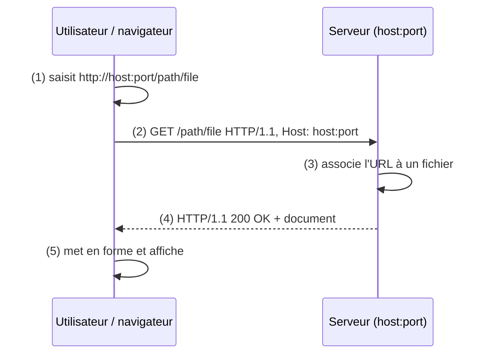

# Résumé — Chapitre 1 : introduction aux architectures orientées services

Support : [[Chapitre 1 - Introduction aux architectures orientées services.pdf]] (41 diapositives) · Hamdi Aloulou · ISIMa · suite : [[Résumé - Chapitre 2 - Le langage XML]]

Le chapitre retrace le chemin qui mène à la **SOA** (*Service Oriented Architecture*) : **client-serveur**, puis **architectures web** (3 tiers), puis **architectures à composants**, puis **services**. Il définit le **service web**, ses **trois acteurs**, oppose **couplage fort** et **couplage faible**, et finit par une révision du protocole **HTTP** : requête, réponse, méthodes, URL et codes de statut.

## Le chapitre en un coup d'œil



| Diapositives | Thème |
|---|---|
| 2 à 5 | architecture client-serveur |
| 7 à 12 | architectures web, 3 tiers, serveurs, DNS, protocoles |
| 14 et 15 | architectures à composants |
| 17 à 28 | SOA : définition, principes, service, service web, trois acteurs, couplage |
| 29 à 31 | types de services web (REST, SOAP) et standards |
| 32 à 41 | HTTP : fonctionnement, URL, méthodes, requête, réponse, codes |

## 1. L'architecture client-serveur

*Diapositives 3 à 5*

> [!definition] Client-serveur
> Répartir un système informatique sur des **machines distantes**, avec des **protocoles standards** et du **matériel banalisé**. Deux types de logiciels : les **clients**, qui demandent, et les **serveurs**, qui répondent.

| Modèle | Usage |
|---|---|
| serveur de **fichiers** | partager des fichiers sur un réseau |
| serveur de **bases de données** relationnelles | requêtes distantes sur une base |
| serveur de **transactions** | applications à temps de réponse critique |

Caractéristiques : **partage des ressources** et **distribution de la charge**, **intégrité** des données partagées, **transparence de la localisation**, **évolutivité** (ajouter des postes clients, changer de serveur).

## 2. Les architectures web

*Diapositives 7 à 12*

Internet interconnecte les réseaux à l'échelle mondiale avec **TCP/IP** ; le client-serveur passe **du réseau local à Internet**, avec un **client léger** (le navigateur) et une **architecture 3 tiers**.

> [!definition] Architecture 3 tiers
> Séparer trois niveaux :
> 1. **IHM** (interface homme-machine) : la présentation ;
> 2. **application** : la logique métier ;
> 3. **gestion des données**.
>
> Les applications se déploient et s'administrent **indépendamment des IHM**, et les serveurs logiciels peuvent être répartis sur **un ou plusieurs serveurs physiques**.

En **2 tiers**, le client contient l'interface **et** la logique et parle directement à la base ; en **3 tiers**, la logique passe dans un serveur d'application intermédiaire.

- un **serveur** est un ordinateur connecté en permanence, avec une **adresse IP publique** (ex. `178.12.77.1`) ;
- le **DNS** (l'annuaire) traduit `www.site.com` en adresse IP ;
- un **protocole** fixe les formats de dialogue, les règles d'échange et la présentation des données.

| Protocole | Rôle |
|---|---|
| **HTTP** / HTTPS | transférer des documents hypertextes entre serveur et client Web |
| **IMAP** | consulter le courrier : livraison garantie, filtrage, accusés de réception |
| **SMTP** | **envoyer** des messages, du client au serveur et entre serveurs |
| **FTP** | transférer des fichiers d'un ordinateur à un autre |

## 3. Les architectures à composants

*Diapositives 14 et 15*

On **construit une application en assemblant des composants**, développés séparément, par des acteurs différents, à des endroits différents ; la **composition** sert de mécanisme de **réutilisation**.

> [!definition] Composant
> Brique logicielle **préfabriquée**, conçue pour être **assemblée** avec d'autres, **réutilisable**, utilisable **sans connaître son implémentation**, livrée comme **unité binaire** (le code source n'est pas forcément fourni).

## 4. La SOA

*Diapositives 17 à 21*

> [!definition] SOA (*Service Oriented Architecture*)
> Architecture qui **décompose une fonctionnalité en un ensemble de fonctions basiques**, les **services**, fournies par des composants. Elle **intègre** les briques applicatives d'un système d'information, **gère leurs liens** et décrit finement le **schéma d'interaction** entre les services.

| Principe | En pratique |
|---|---|
| **Diviser pour régner** | remplacer le découpage par applications par des composants **plus petits** et plus simples à faire évoluer |
| **Alignement métier** | organiser le système selon les **réalités métier**, qu'on retrouve dans ses constituants |
| **Neutralité technologique** | **indépendance totale entre interface et implémentation** : le consommateur n'est contraint ni par la technologie ni par la localisation du service |
| **Réutilisation** | un service métier sert à **plusieurs** applications ; on construit des services de haut niveau en **combinant** des services existants |

> [!definition] Service
> **Périmètre fonctionnel** exposé à un type de consommateurs ; fonctionnalité **réutilisable** dont le comportement est défini par un **contrat** ; il expose **peu d'opérations**, chacune offrant un **traitement de bout en bout**.

## 5. Le service web

*Diapositives 22 et 23*

> [!definition] Service web
> **Composant logiciel accessible sur le Web**, limité à une opération élémentaire, appelé avec les **protocoles standards d'Internet**. Son **interface** peut être **découverte dynamiquement** et est décrite dans un **format lisible par une machine**.

- utilisé **par et pour des applications**, **sans intervention humaine**, de façon **synchrone ou asynchrone** ;
- invoqué par d'autres services ou par des applications clientes ;
- permet l'échange **machine à machine** entre systèmes **hétérogènes**, **indépendamment des plateformes et des langages** ;
- requêtes et réponses dans des **formats ouverts** (HTML, XML, JSON, texte), transportées par Internet.

## 6. Les trois acteurs

*Diapositives 24 et 25*



| Acteur | Rôle |
|---|---|
| **Consommateur** | **décrit** le service dont il a besoin et l'appelle |
| **Fournisseur** | offre le service ; il est **découvert à l'exécution** grâce à un intermédiaire |
| **Annuaire** (registre) | contient les **descripteurs** des services et les **références** des fournisseurs |

## 7. Couplage fort et couplage faible

*Diapositives 26 à 28*

| | Couplage fort | Couplage faible |
|---|---|---|
| Liens | chaque entité est **liée directement** aux autres (« Agent » → « Accord de prêt » → « Compte » ; « Agent » → « Prêt » → « SMS Gateway ») | chaque service **fonctionne indépendamment** ; un **processus métier** (« Processus de prêt ») **orchestre** les services |
| Image | **architecture en spaghetti** | **architecture urbanisée** |
| Conséquences | développement **coûteux**, interconnexions **redondantes**, **grande complexité**, réutilisation et maintenance **difficiles** | SI découpé en **modules autonomes**, **zones d'échange** d'informations localisées |

Le couplage faible est l'objectif de la SOA : changer un service ne casse pas les autres.

## 8. Types et standards des services web

*Diapositives 29 à 31*

| Type | Autre nom | Détail |
|---|---|---|
| **REST** | *Web API* | ressources + méthodes HTTP, souvent JSON (chapitre 5) |
| **SOAP** | *Big Web Services* | messages XML, contrat WSDL |

| Besoin | Standards |
|---|---|
| format des données | **XML**, **XML Schema** (chapitres 2 et 3) |
| transport | **HTTP**, HTTPS, SMTP, FTP ; messages **SOAP**, **XML-RPC** |
| description du service | **WSDL**, WSCL : interface abstraite du service |
| découverte, publication | **UDDI** (*Universal Description, Discovery and Integration*) |
| composition | **BPEL** |

Les services web ne sont liés à **aucun langage** : du .NET peut appeler du Java ou du Python. C'est leur apport principal : l'**interopérabilité**.

## 9. Le protocole HTTP

*Diapositives 33 à 35*

> [!definition] HTTP (*HyperText Transfer Protocol*)
> Protocole d'échange d'informations sur le Web : le **client** récupère des documents du **serveur**, **statiques** (HTML, PDF, image) ou **dynamiques** (générés à la demande : PHP, JSP, ASP). Il est **sans état** : chaque requête est indépendante des précédentes.

Fonctionnement : le client **se connecte**, envoie une **requête**, le serveur renvoie le document (**200**) ou une erreur (**404** s'il n'existe pas), puis **déconnexion**.



## 10. L'URL

*Diapositives 36 et 37*

> [!definition] URL (*Uniform Resource Locator*)
> Chaîne qui **identifie une ressource de manière unique** sur le Web : `protocole://hôte:port/chemin`.

`http://www.example.com:8080/chemin/page.html` : protocole `http`, hôte `www.example.com`, port `8080`, chemin `/chemin/`, page `page.html`. Sans port, le navigateur utilise **80** pour HTTP (**443** pour HTTPS).

## 11. Méthodes, requête et réponse

*Diapositives 38 à 40*

| Méthode | Rôle |
|---|---|
| **GET** | récupérer un document |
| **POST** | soumettre un formulaire (données dans le corps) |
| **PUT** | envoyer un fichier du client vers le serveur |
| **DELETE** | demander la suppression d'un document |
| **HEAD** | récupérer seulement les informations sur un document (type, taille, date de modification) |

```http
GET /doc.html HTTP/1.0
Accept: text/html
Accept-Language: fr
User-Agent: Mozilla/4.0

```

**Requête** : une **ligne de requête** (méthode, URI, version), des **en-têtes** optionnels, une **ligne vide**, puis un **corps** (vide pour un GET).

```http
HTTP/1.0 200 OK
Date: Wed, 05 Feb 2018 16:42:30 GMT
Server: Apache/1.3.24
Last-Modified: Wed, 02 Oct 2021 23:50:01 GMT
Content-Type: text/html
Content-Length: 4205

<HTML><HEAD>…</HEAD><BODY>…</BODY></HTML>
```

**Réponse** : une **ligne de statut** (version, code, message), des en-têtes (date, serveur, type et taille du contenu), une ligne vide, puis le **corps** (le document).

## 12. Les codes de réponse

*Diapositive 41*

| Classe | Sens | Exemples |
|---|---|---|
| **1xx** | information, réponse provisoire | 100 Continue |
| **2xx** | **succès** | **200 OK**, **201 Created** |
| **3xx** | **redirection** : une autre action est nécessaire | 301 Moved Permanently |
| **4xx** | **erreur du client** | **403 Forbidden**, **404 Not Found**, **405 Method Not Allowed** |
| **5xx** | **erreur du serveur** | **500 Internal Server Error**, 501 Not Implemented |

## À retenir

> [!abstract] Résumé
> - Évolution : **client-serveur** → **web 3 tiers** (IHM, application, données) → **composants** réutilisables → **services**.
> - **SOA** : découper le système en **services** réutilisables, alignés sur le métier, **indépendants de la technologie** (interface ≠ implémentation).
> - **Service web** : fonction exposée sur le Web, appelée **par des machines** avec des protocoles standards, décrite de façon lisible par une machine ; **interopérable** entre langages.
> - **Trois acteurs** : fournisseur (publie), annuaire (référence), consommateur (cherche puis invoque).
> - **Couplage faible** (services indépendants orchestrés par un processus) contre **couplage fort** (spaghetti).
> - Deux familles : **REST** (Web API) et **SOAP** (Big Web Services, WSDL, UDDI).
> - **HTTP** : sans état ; méthodes GET, POST, PUT, DELETE, HEAD ; URL `protocole://hôte:port/chemin` ; codes 2xx succès, 3xx redirection, 4xx erreur client, 5xx erreur serveur.
