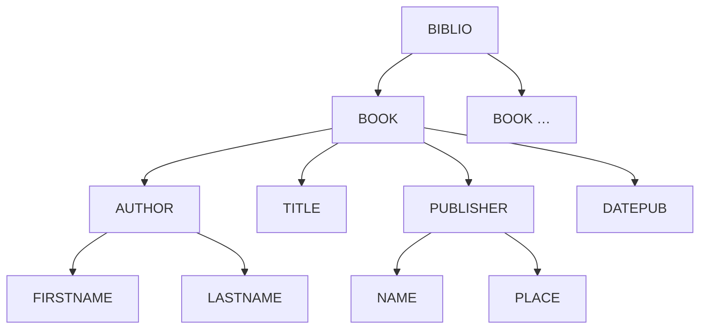

# Résumé — Chapitre 2 : le langage XML

Support : [[Chapitre 2 - Le langage XML.pdf]] (37 diapositives) · Hamdi Aloulou · ISIMa · précédent : [[Résumé - Chapitre 1 - Introduction aux architectures orientées services]] · suite : [[Résumé - Chapitre 3 - Schéma XML]] · TP lié : [[Correction TP 1 - Technologies XML]]

**XML** (*eXtensible Markup Language*) est le format d'échange de données des services web SOAP et un format possible pour REST. Le chapitre explique pourquoi HTML ne suffit pas, décrit la **structure d'un document XML** (prologue, éléments, attributs, entités), donne les règles d'un document **bien formé**, puis distingue **bien formé** et **valide** (conforme à une **DTD** ou à un **schéma XML**).

## Le chapitre en un coup d'œil

| Diapositives | Thème |
|---|---|
| 3 à 7 | limites de HTML, XML et HTML sont complémentaires |
| 8 et 9 | définition et objectifs de XML |
| 10 à 15 | la bibliographie en XML, modèle arborescent |
| 16 à 22 | prologue, commentaires, éléments, attributs, entités |
| 23 et 24 | exercice : un e-mail en XML |
| 25 à 33 | document bien formé, exercices |
| 34 à 37 | document valide (DTD, XML Schema), applications de XML |

## 1. Pourquoi XML ? Les limites de HTML

*Diapositives 3 à 7*

HTML est fait pour **présenter** des données : ses balises sont **prédéfinies** et servent à la **mise en forme**. Dans une bibliographie en HTML, `<H2>` est un titre, `<UL>` une liste, `<LI>` un élément, `<I>` de l'italique : **rien ne dit** qu'Alain Michard est un **auteur**, que « XML, Langage et Applications » est un **titre**, qu'Eyrolles est un **éditeur** à **Paris** et que 1998 est une **date**. Un logiciel ne peut pas comprendre le **sens** (la sémantique) du texte, et l'échange de contenu entre applications est difficile.

| | HTML | XML |
|---|---|---|
| Question | **comment présenter** les données ? | **comment structurer** les données ? |
| S'intéresse à | la **forme** | le **fond** |
| Balises | **prédéfinies** par la norme | **définies librement** |

XML **ne remplace pas** HTML : les deux sont **complémentaires**, et le Web évolue vers la **séparation du fond et de la forme**.

## 2. Définition et objectifs

*Diapositives 8 et 9*

> [!definition] XML
> Langage **balisé standardisé** de **description et d'échange de données structurées** ; langage universel des données sur le Web, qui permet de livrer du contenu **d'une application à une autre**. Un standard d'échange **lisible** (texte balisé), **clair** (fond séparé de la forme) et **extensible** (il suit l'évolution des applications).

Objectifs : documents **faciles à créer**, **nouvelles balises et attributs libres**, balises qui ont un **sens** et une **hiérarchie**, **vérification de la structure** par des schémas.

## 3. Structure d'un document XML

*Diapositives 12 à 18*

```xml
<?xml version="1.0" encoding="ISO-8859-1" standalone="yes"?>   <!-- prologue -->
<!-- Nom du fichier : BIBLIO.xml -->                              <!-- commentaire -->
<BIBLIO subject="XML">                                            <!-- élément racine -->
  <BOOK ISBN="9782212090529" LANG="fr" SUBJECT="général">        <!-- élément avec attributs -->
    <AUTHOR>
      <FIRSTNAME>Alain</FIRSTNAME>
      <LASTNAME>Michard</LASTNAME>
    </AUTHOR>
    <TITLE>XML, Langage et Applications</TITLE>
    <PUBLISHER>
      <NAME>Eyrolles</NAME>
      <PLACE>Paris</PLACE>
    </PUBLISHER>
    <DATEPUB>1998</DATEPUB>
  </BOOK>
  <BOOK ISBN="9782840825685" LANG="fr" SUBJECT="applications">
    <!-- ... TRANSLATOR PREFIX="adapté de l'anglais par" ... -->
  </BOOK>
</BIBLIO>
```

Le document est un **arbre** : `BIBLIO` contient des `BOOK`, qui contiennent `AUTHOR` (`FIRSTNAME`, `LASTNAME`), `TITLE`, `PUBLISHER` (`NAME`, `PLACE`) et `DATEPUB`. Les informations supplémentaires (langue, sujet, ISBN) sont des **attributs**.



### Le prologue

| Partie | Exemple | Rôle |
|---|---|---|
| déclaration XML | `<?xml version="1.0"?>` | **optionnelle mais recommandée**, porte la version |
| `encoding` | `encoding="ISO-8859-1"` (ou `UTF-8`) | **codage des caractères** du fichier, pour écrire les accents sans les coder un par un |
| `standalone` | `standalone="yes"` | le document est **autonome** ; `no` s'il fait référence à une DTD ou un schéma externe |

Les trois attributs doivent apparaître **dans cet ordre** : `version`, `encoding`, `standalone`.

**Commentaires** : `<!-- ... -->` ; ils ne peuvent pas être placés **à l'intérieur d'une balise** et ne sont pas forcément transmis à l'application.

Après le prologue vient **un seul élément racine** (comparable à `<BODY>` en HTML) qui contient tous les autres. Trois constructions syntaxiques : les **éléments**, les **attributs** et les **entités**.

## 4. Éléments, attributs, entités

*Diapositives 19 à 22*

**Élément** : s'ouvre et se ferme par une balise qui reprend son nom : `<TITLE>…</TITLE>`.

**Attribut** :

- se place dans la **balise ouvrante**, n'est pas repris dans la balise fermante ;
- un élément peut en avoir **plusieurs**, mais **un même attribut une seule fois** ;
- leur **ordre** n'a pas d'importance ;
- la valeur est **entre guillemets** (doubles ou simples).

**Entité** : chaîne qui commence par `&` et finit par `;`, **remplacée** par le caractère qu'elle représente. Les entités prédéfinies permettent d'écrire les **caractères réservés** :

| Caractère | Entité |
|---|---|
| `&` | `&amp;` |
| `<` | `&lt;` |
| `>` | `&gt;` |
| `"` | `&quot;` |
| `'` | `&apos;` |

Exemple : `<message>salaire &lt; 1000</message>` affiche « salaire < 1000 ».

> [!warning] `&apos;` et non `&apost;`
> La diapositive 22 écrit `&apost;` : l'entité correcte est **`&apos;`** (comme dans la diapositive 27).

## 5. Exercice : un e-mail en XML

*Diapositives 23 et 24*

```xml
<?xml version="1.0" encoding="ISO-8859-1"?>
<email>
  <entete>
    <date type="JJMMAAAA">28102003</date>
    <heure type="24" local="(GMT+01:00)">14:01:01</heure>
    <expediteur><adresse mail="marcel@ici.fr">Marcel</adresse></expediteur>
    <recepteur><adresse mail="robert@labas.fr">Robert</adresse></recepteur>
    <sujet>Hirondelle</sujet>
  </entete>
  <corps>
    <salutation>Salut,</salutation>
    <paragraphe>Pourrais-tu m'indiquer quelle est la vitesse de vol d'une hirondelle transportant une noix de coco ?</paragraphe>
    <politesse>A très bientôt,</politesse>
    <signature>Marcel</signature>
  </corps>
</email>
```

On sépare l'**en-tête** du **corps**, on décrit le **sens** de chaque morceau, et on met les métadonnées (format de la date, fuseau, adresse) en **attributs**.

## 6. Document bien formé

*Diapositives 25 à 31*

> [!important] Les règles d'un document bien formé
> 1. **une seule balise racine** qui englobe toutes les autres ;
> 2. toute balise ouvrante a sa **balise fermante** ; un élément vide peut s'écrire `<BOOK/>` (= `<BOOK></BOOK>`) ;
> 3. **pas d'entrelacement** : `<a><b></a></b>` est interdit, on ferme dans l'ordre inverse de l'ouverture ;
> 4. la **casse** est respectée : `<to>` ne se ferme pas avec `</To>` ;
> 5. les valeurs d'attributs sont **entre guillemets** ou apostrophes ;
> 6. `<` et `&` sont **interdits dans le contenu** : `&lt;` et `&amp;` ; `&gt;`, `&apos;`, `&quot;` évitent les ambiguïtés ;
> 7. **pas d'espace** après `<` ni avant `>` dans une balise (`< date>` est faux).

> [!note] « Les noms des attributs doivent être en minuscule »
> La diapositive 26 l'affirme, mais ce n'est pas une règle de XML : les noms sont **sensibles à la casse** et peuvent contenir des majuscules (l'exemple du cours utilise `ISBN` et `LANG`). C'est une **convention** de style.

**L'exemple corrigé pas à pas** (diapositives 28 à 31) :

```xml
<?xml version="1.0" standalone="yes"?>
< date>                  <!-- 1. espace après < -->
  <mois> 09 </mois>
  <année> 2007 </année>
</data>                  <!-- 3. ne ferme pas <date> -->
```

On enlève l'espace, on ajoute `encoding="ISO-8859-1"` (2. le nom `année` contient un caractère accentué, il faut déclarer l'encodage du fichier), puis on corrige `</data>` en `</date>`.

### L'exercice des notes

*Diapositives 32 et 33*

| Erreur | Correction |
|---|---|
| deux éléments `<note>` au niveau supérieur (et un troisième `<note/>`) : plusieurs racines | les envelopper dans `<document>` |
| `date=3 janvier` sans guillemets | `date="3 janvier"` |
| `<to>Bob</To>` : casse différente | `</to>` |
| commentaire **dans** la balise ouvrante | le sortir : `<note date="5 janvier"><!-- ... -->` |
| `<from>Bob` jamais fermé | `<from>Bob</from>` |
| `&` dans le texte | `&amp;` |

## 7. Bien formé ou valide ?

*Diapositives 34 et 35*

| | **Bien formé** | **Valide** |
|---|---|---|
| Condition | respecte la **syntaxe** XML | bien formé **et** conforme à un **schéma** |
| Vérifie | balises correctement imbriquées : le document est **analysable** (*parsable*) | les **balises autorisées**, leur **ordre**, leur **nombre**, le **type** des valeurs |

XML n'est vraiment puissant que si sa **cohérence est contrôlée**. Deux technologies définissent un langage basé sur XML, son **vocabulaire** (les balises) et sa **grammaire** (les imbrications) :

| | **DTD** | **XML Schema** (XSD) |
|---|---|---|
| Puissance | **suffisante** dans la plupart des cas | **puissant** : données **fortement typées** |
| Syntaxe | **différente** de XML | **syntaxe XML** |

Le schéma XML est l'objet du [[Résumé - Chapitre 3 - Schéma XML|chapitre 3]].

## 8. Applications de XML

*Diapositives 36 et 37*

| Langage | Usage |
|---|---|
| **MathML** | échanger et afficher des **expressions mathématiques** sur le Web |
| **SVG** (*Scalable Vector Graphics*) | **graphiques vectoriels 2D**, interactifs et dynamiques |
| **SOAP** (*Simple Object Access Protocol*) | protocole d'échange entre applications distantes, au-dessus de **HTTP (POST)** ; message = **Envelope**, **Header**, **Body** |
| **REST** (*REpresentational State Transfer*) | échange fortement basé sur **HTTP** (GET, POST, PUT, DELETE) ; **peut** utiliser XML comme format |

## À retenir

> [!abstract] Résumé
> - HTML décrit la **forme**, XML le **fond** : des balises **libres**, qui ont un **sens** et une **hiérarchie** ; les deux sont complémentaires.
> - Un document XML = **prologue** (`<?xml version encoding standalone?>`, dans cet ordre) + **un élément racine** qui forme un **arbre**.
> - **Éléments** (balise ouvrante et fermante), **attributs** (dans la balise ouvrante, entre guillemets, uniques), **entités** (`&amp; &lt; &gt; &quot; &apos;`).
> - **Bien formé** : une racine, balises fermées et non entrelacées, casse respectée, valeurs entre guillemets, `<` et `&` échappés.
> - **Valide** = bien formé + conforme à une **DTD** (syntaxe propre) ou un **XML Schema** (syntaxe XML, typage fort).
> - Applications : **MathML**, **SVG**, **SOAP** (Envelope, Header, Body), **REST**.
