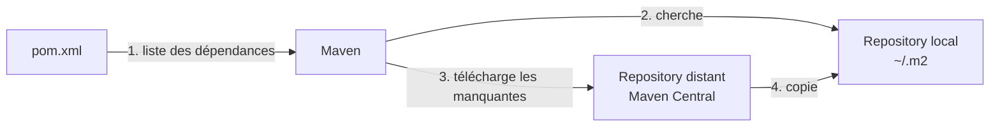

# Résumé — Chapitre 4 : développement de services web avec Spring Boot

Support : [[Chapitre 4 - Développement de services web avec Spring Boot.pdf]] (43 diapositives) · Hamdi Aloulou · ISIMa · précédent : [[Résumé - Chapitre 3 - Schéma XML]] · suite : [[Résumé - Chapitre 5 - Les services web REST]] · TP lié : [[Correction TP 0 - Créer une application avec Spring Boot]]

Le chapitre explique **pourquoi** découper une application en services web (scalabilité, robustesse, résilience, autonomie des équipes), rappelle l'**architecture 3 tiers** et ses serveurs, puis présente l'outil des TP : **Spring** et surtout **Spring Boot**, avec ses deux idées clés, l'**autoconfiguration** et les **starters**, son **Tomcat embarqué** et la structure d'un projet (`@SpringBootApplication`, `application.properties`, `pom.xml` et Maven).

## Le chapitre en un coup d'œil

| Diapositives | Thème |
|---|---|
| 2 à 8 | les services web et leurs apports |
| 9 à 14 | évolution des architectures, 3 tiers, serveurs Web, d'application et de BD |
| 16 à 18 | framework et bibliothèque |
| 19 à 24 | Spring : conteneur léger, modules, projets |
| 25 à 36 | Spring Boot : intérêt, autoconfiguration, starters, versions, propriétés, déploiement |
| 37 à 43 | outils, structure d'un projet, Maven, Spring Initializr |

## 1. Les services web et leurs apports

*Diapositives 4 à 8*

Les services web découpent une application en **petits services autonomes et interconnectés** (exemple : emploi du temps, gestion des stages, gestion des étudiants, réclamations).

| Apport | Pourquoi |
|---|---|
| **Scalabilité** | on **duplique** un service sur plusieurs serveurs ; l'appelant reçoit la même réponse quelle que soit l'instance (application *cloud-native*) |
| **Robustesse** | une mise à jour ne touche que **le service concerné** (nouveau moyen de paiement : on modifie et redéploie le seul service de paiement) |
| **Résilience forte** | chaque service peut utiliser **sa propre technologie** (Java, C++, Node.js), l'essentiel étant d'exposer une **API REST** ; un service évolue sans gêner le reste |
| **Autonomie des équipes** | plus besoin de vérifier la compatibilité technique avec les autres équipes : gain de **temps** et d'**innovation** |

## 2. Évolution des architectures

*Diapositives 10 à 14*

| Architecture | Principe |
|---|---|
| **client-serveur** | les clients envoient des demandes à un **serveur central** |
| **3 tiers** | trois couches : **présentation**, **métier**, **persistance des données** |
| **orientée services** | services **autonomes et interconnectés**, déployés **indépendamment**, chacun évolutif |

| Serveur | Rôle | Exemples |
|---|---|---|
| **Web** | programme qui traite les **requêtes HTTP** des navigateurs, sur une machine accessible en TCP/IP | Apache HTTP Server, IIS, Apache Tomcat |
| **d'application** | services de base : **transactions**, **multithreading**, **connexions à la base** ; peut contenir un serveur Web | serveurs Java EE : GlassFish, JBoss |
| **de base de données** | **stocker**, **gérer** et **rendre accessible** la base (le plus souvent relationnelle) | MySQL Server, Oracle, SQL Server |

## 3. Framework et bibliothèque

*Diapositives 16 à 18*

> [!definition] Framework
> Ensemble **cohérent de composants logiciels** qui pose les **fondations** et les **grandes lignes** d'un logiciel, pour **accélérer** le développement et **améliorer la qualité**.

| | Bibliothèque | Framework |
|---|---|---|
| Rôle | fournit des classes ou fonctions que **votre code appelle** (`Math.pow`, `Math.sqrt`) | fournit la **structure** de l'application ; c'est lui qui **appelle votre code** *(complément : « inversion de contrôle »)* |
| Relation | | **intègre** souvent une ou plusieurs bibliothèques |

Frameworks Web : Angular, React, Vue (*front-end*) ; Symfony, Laravel, Django, **Spring** (*back-end*).

## 4. Spring, le « conteneur léger »

*Diapositives 19 à 24*

> [!definition] Spring
> Framework **open source** Java EE pour les applications **n-tiers**, qui facilite le développement et les tests. Au lieu de déployer l'application dans un **serveur d'application complexe** qui contient tous les services, **l'application embarque elle-même les services dont elle a besoin** : elle devient un **mini-conteneur**. D'où le nom de **conteneur léger** ; avec Spring, le « serveur d'application » = **Tomcat (serveur Web) + conteneur Spring**.

Grande **modularité** : on n'incorpore que les modules nécessaires, sans dépendre d'un serveur monolithique.

| Module / projet | Rôle |
|---|---|
| **Spring Core** | base de l'écosystème : le **conteneur** ; contient **Spring MVC** pour le Web |
| **Spring Data** | accès à de nombreux types de bases grâce à des **interfaces** et des **conventions de nommage** (chapitre 6) |
| **Spring Security** | **authentification**, **autorisation**, sécurité des API |
| **Spring Cloud** | applications **distribuées** dans le cloud, **microservices** |
| **Spring Boot** | **simplifie et accélère** le développement d'applications Spring : fonctionnalités prêtes à l'emploi, conventions de configuration |

## 5. Pourquoi Spring Boot ?

*Diapositives 25 et 26*

| | Spring standard | Spring Boot |
|---|---|---|
| Configuration | **manuelle** (dépendances, serveur Web) | **automatique** |
| Dépendances | gérées **à la main** | **starters** : pas de conflit de versions, pas de recherche des bonnes bibliothèques |
| Serveur Web | déploiement sur un **serveur externe** (fastidieux) | **Tomcat intégré** : on lance l'application comme un programme Java |
| Base de données | connexions et transactions configurées à la main | quelques **propriétés** dans un fichier |

Résultat : une application **packagée en JAR, totalement autonome**, exactement ce qu'il faut pour des services web.

## 6. Autoconfiguration et starters

*Diapositives 27 à 34*

> [!definition] Autoconfiguration
> Avec Spring « classique », intégrer les modules demande beaucoup de **fichiers XML** et une bonne connaissance de chaque module. L'annotation **`@SpringBootApplication`**, placée sur la classe principale (générée automatiquement), **déclenche de nombreuses configurations** en arrière-plan d'après les dépendances présentes : le développeur se concentre sur le **code métier**.

> [!definition] Starter
> **Ensemble homogène de dépendances** pour un besoin donné, déclaré en **une seule ligne** dans le `pom.xml`, au format `spring-boot-starter-NOM`. Le starter **gère lui-même les versions** des dépendances.

| Starter | Usage |
|---|---|
| `spring-boot-starter-web` | projets Web standards, **API REST** (Spring MVC + Tomcat + JSON) |
| `spring-boot-starter-mail` | envoi d'e-mails |
| `spring-boot-starter-thymeleaf` | interface avec le moteur de templates **Thymeleaf** |
| `spring-boot-starter-web-services` | services **SOAP** |
| *(complément)* `spring-boot-starter-data-jpa` | accès aux bases avec JPA (chapitre 6) |

```xml
<dependency>
  <groupId>org.springframework.boot</groupId>
  <artifactId>spring-boot-starter-web</artifactId>
  <!-- pas de <version> : c'est le parent Spring Boot qui la fixe -->
</dependency>
```

## 7. Propriétés et déploiement

*Diapositives 35 et 36*

Les propriétés (nom de la base, port de Tomcat…) se saisissent dans **`application.properties`** et sont prises en compte **sans écrire de code**.

Le produit final est **un simple JAR** : une **JRE** suffit pour l'exécuter, car le JAR contient un **Tomcat embarqué** dans lequel l'application Web se déploie (`java -jar application.jar`).

## 8. Structure d'un projet Spring Boot

*Diapositives 37 à 43*

Outils : un **JDK** (au moins 1.8 ; il contient la JRE) et **Spring Tool Suite** (STS), un Eclipse adapté à Spring. On génère le projet sur **Spring Initializr** (`https://start.spring.io`) puis on l'importe dans l'IDE.

```
mon-projet/
├── pom.xml                                   ← dépendances Maven
└── src/main/
    ├── java/tn/isima/demo/
    │   └── DemoApplication.java              ← classe principale, main()
    └── resources/
        ├── static/                           ← HTML, CSS, JavaScript, images
        ├── templates/                        ← vues Thymeleaf (rendues côté serveur)
        └── application.properties            ← configuration, lue au démarrage
```

**La classe principale**

```java
@SpringBootApplication
public class DemoApplication {
    public static void main(String[] args) {
        SpringApplication.run(DemoApplication.class, args);
    }
}
```

`@SpringBootApplication` est l'annotation principale : elle déclenche la configuration et **englobe `@ComponentScan`**, qui fait **scanner le package courant et ses sous-packages** pour trouver les autres annotations Spring (`@Controller`, `@Bean`…). Les classes doivent donc être **dans le package de la classe principale ou en dessous**.

**`application.properties`** (diapositive 40) :

```properties
# Tomcat utilise le port 8080 par défaut
server.port=9090
spring.datasource.url=jdbc:mysql://localhost:3306/bibliotheque
spring.datasource.username=root
spring.datasource.password=
spring.datasource.driver-class-name=com.mysql.cj.jdbc.Driver
# create, create-drop, update
spring.jpa.hibernate.ddl-auto=update
spring.jpa.properties.hibernate.dialect=org.hibernate.dialect.MySQL5Dialect
```

> [!warning] Les commentaires d'un `.properties`
> Un commentaire commence par `#` **en début de ligne**. Écrit après une valeur (`server.port=9090 # port`), il fait **partie de la valeur** et le démarrage échoue.

*(Complément : `MySQL5Dialect` n'existe plus dans Hibernate 6, utilisé par Spring Boot 3 ; on écrit `org.hibernate.dialect.MySQLDialect`, ou on supprime la ligne : le dialecte est détecté automatiquement.)*

**Maven et le `pom.xml`**



Maven **lit** les dépendances du `pom.xml`, **vérifie** le dépôt local, **télécharge** depuis le dépôt distant celles qui manquent et les **copie** dans le dépôt local pour les prochaines fois.

## À retenir

> [!abstract] Résumé
> - Services web : petits services **autonomes** ; apports : **scalabilité**, **robustesse**, **résilience**, **autonomie** des équipes.
> - 3 tiers : présentation, métier, données ; serveur **Web** (HTTP), **d'application** (transactions, threads, connexions), **de BD**.
> - Une **bibliothèque** est appelée par votre code ; un **framework** structure l'application et intègre des bibliothèques.
> - **Spring** = conteneur **léger** : l'application embarque ses services ; modules **Core/MVC**, **Data**, **Security**, **Cloud**, **Boot**.
> - **Spring Boot** : **autoconfiguration** (`@SpringBootApplication`), **starters** (`spring-boot-starter-*`, versions gérées), **Tomcat embarqué**, JAR autonome, propriétés dans `application.properties`.
> - Projet : classe principale + `@ComponentScan` des sous-packages, `static/`, `templates/`, `application.properties`, `pom.xml` géré par **Maven** ; génération sur **start.spring.io**.
