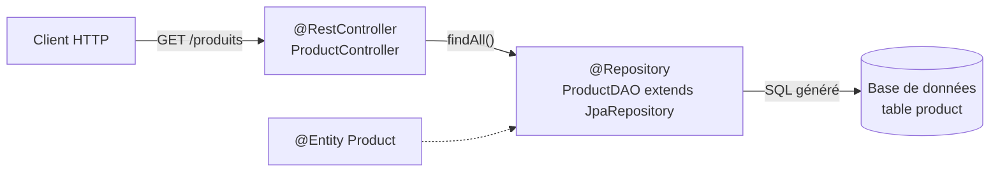

# Résumé — Chapitre 6 : Spring Data JPA

Support : [[Chapitre 6 - Spring Data JPA.pdf]] (33 diapositives) · Hamdi Aloulou · ISIMa · précédent : [[Résumé - Chapitre 5 - Les services web REST]]

Une API REST doit **lire et écrire dans une base de données**. Au lieu d'écrire le SQL et les classes d'accès aux données, **Spring Data JPA** demande seulement des **entités** (`@Entity`) et des **interfaces** (`JpaRepository`) : il **génère l'implémentation**. Le chapitre présente le patron **DAO**, l'intégration (starter, entité, repository, contrôleur), les méthodes **CRUD** fournies, les **requêtes dérivées du nom des méthodes** (`findByPrixGreaterThan`) et les requêtes **JPQL** ou **SQL** avec `@Query`.

## Le chapitre en un coup d'œil



| Diapositives | Thème |
|---|---|
| 2 à 6 | pourquoi Spring Data JPA, le patron DAO |
| 7 à 11 | intégration : starter, `@Entity`, `@Repository`, `@RestController` |
| 12 à 20 | méthodes CRUD : création, lecture, mise à jour, suppression |
| 21 à 25 | requêtes dérivées du nom de la méthode |
| 26 à 33 | `@Query`, le langage JPQL, paramètres numérotés et nommés |

## 1. Pourquoi Spring Data JPA ?

*Diapositives 2 et 3*

L'application doit **créer, chercher, supprimer** des objets dans une base. Normalement, il faudrait écrire le code qui exécute les requêtes SQL. Avec **Spring Data JPA**, on écrit **uniquement des interfaces** et il **fournit leur implémentation** : toutes sortes d'opérations **sans écrire de requête** et **sans implémenter de DAO**.

*(Complément : **JPA**, Java Persistence API, est la norme Java du **mapping objet-relationnel** (ORM) : une classe ↔ une table, un objet ↔ une ligne. **Hibernate** en est l'implémentation utilisée par Spring Boot ; Spring Data JPA s'appuie dessus.)*

## 2. Le patron DAO

*Diapositives 4 à 6*

> [!definition] DAO (*Data Access Object*)
> Patron de conception qui isole l'accès aux données :
> - la **donnée** est modélisée par une **classe** (`Data`) ;
> - les **opérations** sur la base sont spécifiées par une **interface** (`DataDAO`) ;
> - les opérations sont **implémentées** dans une classe (`DataDAOImpl`).

| Élément du DAO | Avec Spring Data JPA |
|---|---|
| classe de données | une **entité** `@Entity`, écrite par nous |
| interface d'opérations | un **repository**, interface écrite par nous |
| implémentation (la partie la **plus longue et complexe**) | **générée par Spring Data JPA** : on ne l'écrit pas |

## 3. Intégration en quatre éléments

*Diapositives 7 à 11*

**Le starter** (`pom.xml`) :

```xml
<dependency>
  <groupId>org.springframework.boot</groupId>
  <artifactId>spring-boot-starter-data-jpa</artifactId>
</dependency>
```

Il faut aussi le **pilote** de la base (`mysql-connector-j` pour MySQL, `h2` pour une base en mémoire) et l'URL de connexion dans `application.properties` (voir [[Résumé - Chapitre 4 - Développement de services web avec Spring Boot#8. Structure d'un projet Spring Boot|chapitre 4]]).

**L'entité** :

```java
@Entity
public class Product {
    @Id
    @GeneratedValue(strategy = GenerationType.IDENTITY)   // complément : id auto-incrémenté
    private int id;
    private String nom;
    private int prix;
    // constructeur vide, getters et setters
}
```

| Annotation | Rôle |
|---|---|
| `@Entity` | la classe décrit un objet **persistant** : elle correspond à une **table** |
| `@Id` | l'attribut **identifiant** (clé primaire) |

**Le repository** :

```java
@Repository
public interface ProductDAO extends JpaRepository<Product, Integer> { }
//                                               entité   type de l'id
```

- une interface **par entité** ;
- elle **hérite** de `JpaRepository<Entité, TypeDeL'Id>` et reçoit ainsi toutes les méthodes CRUD ;
- `@Repository` indique un composant qui gère les données *(complément : il est facultatif sur une interface qui hérite de `JpaRepository`, Spring la détecte de toute façon)*.

**Le contrôleur** :

```java
@RestController
public class ProductController {
    private final ProductDAO productDao;

    public ProductController(ProductDAO productDao) {   // injection par le constructeur
        this.productDao = productDao;
    }

    @GetMapping("/produits")
    public List<Product> listeProduits() {
        return productDao.findAll();
    }
}
```

Le champ `final` de la diapositive 10 doit être initialisé : Spring **injecte** le repository par le **constructeur** (ou avec `@Autowired`).

> [!important] Les trois couches
> - l'**entité** est annotée `@Entity` (obligatoire) ;
> - la communication avec la **base** passe par une **interface** `@Repository` ;
> - la communication avec les **clients** passe par des **URI**, dans une classe `@RestController`.

## 4. Les méthodes CRUD fournies

*Diapositives 12 à 20*

Les **noms** des méthodes ne sont pas choisis au hasard : respecter les **conventions** donne des fonctionnalités gratuites.

| Opération | Méthodes de `JpaRepository` |
|---|---|
| **Créer** | `save(entity)` : enregistre et renvoie l'entité **avec son id** ; `saveAll(entities)` |
| **Lire** | `findAll()` : toutes les lignes (`List`) ; `findAllById(ids)` ; `findById(id)` : une ligne, dans un **`Optional`** |
| **Mettre à jour** | **les mêmes** `save` / `saveAll` : si l'id **existe déjà** dans la table, c'est un **UPDATE**, sinon un **INSERT** |
| **Supprimer** | `deleteById(id)`, `delete(entity)`, `deleteAll()`, `deleteAllById(ids)` |
| *(complément)* autres | `count()`, `existsById(id)` |

```java
Optional<Product> existingProduct = productDao.findById(1);
Product pro1 = existingProduct.get();          // lève une exception si l'Optional est vide
System.out.println("Nom actuel : " + pro1.getNom());
pro1.setNom("Telephone");
productDao.save(pro1);                         // même id → UPDATE
System.out.println("Après modification : " + productDao.findById(1).get().getNom());
```

> [!tip] L'`Optional`
> `findById` renvoie un `Optional` parce que la ligne **peut ne pas exister**. Plutôt que `.get()`, écrire `productDao.findById(id).orElse(null)` ou `.orElseThrow()` pour renvoyer une erreur 404 proprement.

## 5. Les requêtes dérivées du nom de la méthode

*Diapositives 21 à 25*

Spring Data **génère la requête SQL à partir du nom de la méthode**, construit avec les **noms des attributs de l'entité** et des **mots-clés**.

```java
List<Product> findByPrixGreaterThan(int prixLimit);
// SELECT * FROM product WHERE prix > ?
```

| Morceau | Sens |
|---|---|
| `findBy` | l'opération est un **SELECT** |
| `Prix` | l'**attribut** de l'entité concerné (avec une majuscule) |
| `GreaterThan` | la **condition** « plus grand que » |
| `prixLimit` | la **valeur** de la condition |

Mots-clés courants (diapositives 22 à 24) :

| Mot-clé | Exemple | SQL généré (`WHERE ...`) |
|---|---|---|
| (aucun), `Is`, `Equals` | `findByNom(String nom)` | `nom = ?` |
| `And`, `Or` | `findByNomAndPrix(...)` | `nom = ? AND prix = ?` |
| `GreaterThan`, `LessThan` | `findByPrixLessThan(int p)` | `prix < ?` |
| `GreaterThanEqual`, `LessThanEqual` | `findByPrixGreaterThanEqual(int p)` | `prix >= ?` |
| `Between` | `findByPrixBetween(int a, int b)` | `prix BETWEEN ? AND ?` |
| `Like`, `StartingWith`, `EndingWith`, `Containing` | `findByNomContaining(String s)` | `nom LIKE %s%` |
| `IsNull`, `IsNotNull` | `findByPhotoIsNull()` | `photo IS NULL` |
| `In`, `NotIn` | `findByIdIn(List<Integer> ids)` | `id IN (...)` |
| `Not` | `findByNomNot(String n)` | `nom <> ?` |
| `True`, `False` | `findByDisponibleTrue()` | `disponible = true` |
| `OrderBy...Asc/Desc` | `findByPrixGreaterThanOrderByNomAsc(int p)` | `... ORDER BY nom ASC` |
| `IgnoreCase` | `findByNomIgnoreCase(String n)` | `UPPER(nom) = UPPER(?)` |
| *préfixes* `countBy`, `existsBy`, `deleteBy` | `countByPrixGreaterThan(int p)` | `SELECT COUNT(*) ...` |

> [!warning] Le nom doit correspondre à un attribut
> `findByPrice` sur une entité dont l'attribut s'appelle `prix` fait **échouer le démarrage** de l'application (« No property 'price' found for type 'Product' »).

## 6. `@Query` : JPQL ou SQL natif

*Diapositives 26 à 33*

Quand le besoin ne s'exprime ni avec le CRUD ni avec une requête dérivée, on écrit la requête dans le repository avec **`@Query`** :

| | **JPQL** | **SQL natif** |
|---|---|---|
| Manipule | les **entités** et leurs **attributs** | les **tables** et leurs **colonnes** |
| Écriture | `@Query("SELECT p FROM Product p WHERE p.prix > :min")` | `@Query(value = "SELECT * FROM product WHERE prix > :min", nativeQuery = true)` |
| Portabilité | indépendante de la base | liée au dialecte de la base |

> [!definition] JPQL (*Java Persistence Query Language*)
> Langage de requêtes de la spécification JPA, **inspiré de SQL** mais qui manipule des **entités JPA**, pas des tables. Dans la clause `from`, on ne peut désigner que des **entités** (`@Entity`), sous leur nom (par défaut, le **nom de la classe**). Il permet `select`, `update` et `delete`.

Clauses d'un `select` : `select` (ce qui est renvoyé), `from` (d'où), `where` (filtre), `group by` (regroupe), `having` (filtre les groupes), `order by` (trie). Dans `where` et `having` : `[NOT] LIKE`, `[NOT] BETWEEN`, `[NOT] IN`, `AND`, `OR`, `NOT`, `[NOT] EXISTS`, `ALL`, `SOME/ANY`, `IS [NOT] NULL`, `IS [NOT] EMPTY` et `[NOT] MEMBER OF` (collections).

```sql
select e from Employe e                 -- des objets Employe (« as » facultatif)
select e.nom, e.salaire from Employe e  -- deux propriétés
```

**Paramètres** :

| Forme | Exemple | Règle |
|---|---|---|
| **numérotés** | `?1`, `?2` | numérotés **à partir de 1**, dans l'ordre des paramètres de la méthode |
| **nommés** (recommandés, plus lisibles) | `:date`, `:titre` | associés au paramètre du même nom |

Un paramètre peut servir **plusieurs fois** ; il faut le **même nombre** de paramètres dans la requête et la méthode, dans le **bon ordre** et du **bon type**.

```java
public interface EtudiantDAO extends JpaRepository<Etudiant, Long> {

    @Query("SELECT i FROM Etudiant i WHERE i.naissance <= ?1")
    List<Etudiant> findNaissanceAvant(Date date);

    @Query("SELECT i FROM Etudiant i WHERE i.naissance <= :date")
    List<Etudiant> findNaissanceAvantNomme(@Param("date") Date date);
}
```

*(Compléments : préfixer les propriétés par l'alias, `i.naissance`, est la forme standard de JPQL. `@Param("date")` lie explicitement le paramètre nommé ; un projet généré par Spring Initializr compile avec les noms de paramètres et peut s'en passer, mais l'annotation évite l'erreur « parameter name information not available ». Une requête `update` ou `delete` demande en plus `@Modifying` et `@Transactional`.)*

## À retenir

> [!abstract] Résumé
> - Spring Data JPA applique le patron **DAO** : on écrit l'**entité** et l'**interface**, il **génère l'implémentation**.
> - Starter `spring-boot-starter-data-jpa` + pilote de la base + URL dans `application.properties`.
> - `@Entity` + `@Id` sur la classe ; `interface XxxDAO extends JpaRepository<Entité, TypeId>` ; `@RestController` qui reçoit le repository par injection.
> - CRUD fourni : `save`/`saveAll` (insertion **ou** mise à jour selon l'id), `findAll`, `findById` (`Optional`), `findAllById`, `deleteById`, `delete`, `count`, `existsById`.
> - **Requêtes dérivées** : `findBy` + Attribut + mot-clé (`GreaterThan`, `Between`, `Like`, `OrderBy`…) → SQL généré.
> - **`@Query`** : **JPQL** (entités, `SELECT p FROM Product p`) ou SQL natif (`nativeQuery = true`) ; paramètres `?1` ou `:nom`.
