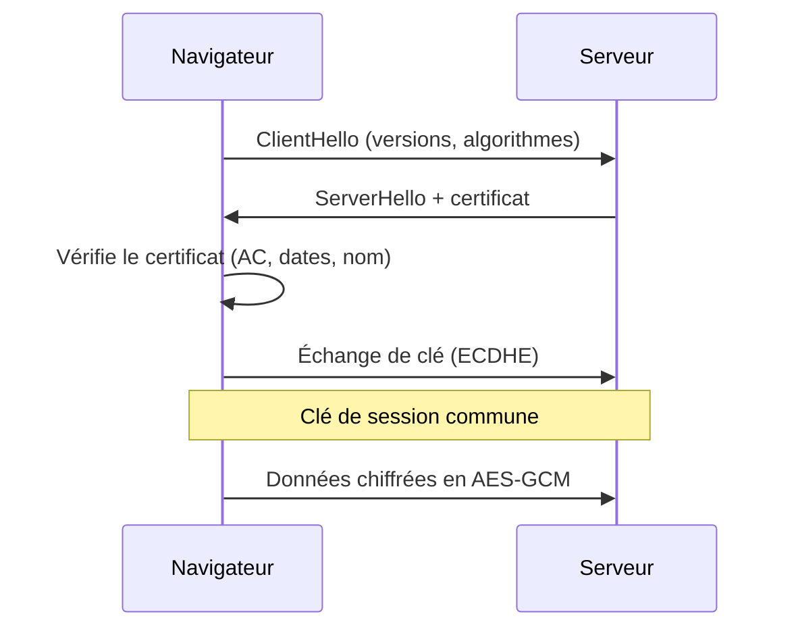

# Cryptographie et sécurité des applications

## Les objectifs de la sécurité

> [!definition] La triade CIA
> - **Confidentialité** : seules les personnes autorisées lisent les données.
> - **Intégrité** : les données ne sont pas modifiées à notre insu.
> - **Disponibilité** : le service répond quand on en a besoin.

On y ajoute souvent l'**authentification** (prouver qui on est) et la **non-répudiation** (ne pas pouvoir nier avoir fait une action).

## Le vocabulaire du risque

- **Vulnérabilité** : une faiblesse (mot de passe par défaut, bug).
- **Menace** : ce qui peut l'exploiter (un attaquant, un logiciel malveillant).
- **Risque** = probabilité × impact.

## Chiffrement symétrique

Une **même clé** chiffre et déchiffre.

- Algorithme de référence : **AES** (clés de 128, 192 ou 256 bits).
- Très rapide → on s'en sert pour chiffrer les données elles-mêmes (disques, trafic TLS).
- Le problème : comment **échanger la clé** sans qu'on l'intercepte ?

> [!warning] Le mode compte autant que l'algorithme
> AES en mode **ECB** chiffre deux blocs identiques de la même façon : les motifs restent visibles. On utilise **GCM** (qui chiffre *et* vérifie l'intégrité) ou CBC avec un vecteur d'initialisation aléatoire.

## Chiffrement asymétrique

Chaque personne a une **paire de clés** : une **publique** (diffusée à tous) et une **privée** (gardée secrète).

- Chiffrer **avec la clé publique** du destinataire → lui seul peut déchiffrer avec sa clé privée (confidentialité).
- **Signer avec sa clé privée** → tout le monde vérifie avec la clé publique (authenticité, non-répudiation).
- Algorithmes : **RSA** (2048 bits minimum), courbes elliptiques (**ECDSA**, **Ed25519**, échange de clés **ECDH**).
- Beaucoup plus lent que le symétrique → on s'en sert pour **échanger une clé AES**, puis on chiffre les données en AES.

## Fonctions de hachage

Une **empreinte** de taille fixe calculée à partir de n'importe quelle donnée.

> [!propriete] Une bonne fonction de hachage
> - est à sens unique : impossible de retrouver le message depuis l'empreinte ;
> - résiste aux collisions : impossible de trouver deux messages de même empreinte ;
> - a un effet avalanche : un bit modifié change complètement l'empreinte.

- À utiliser : SHA-256, SHA-3 · à éviter : MD5 et SHA-1 (collisions connues).
- **HMAC** = hachage + clé secrète → prouve l'intégrité **et** l'origine d'un message.

### Stocker des mots de passe

On ne stocke **jamais** un mot de passe en clair, ni avec un simple SHA-256 (trop rapide, donc facile à attaquer par force brute). On utilise une fonction **lente et salée** : **bcrypt**, **scrypt** ou **Argon2**.

## Certificats et TLS

Un **certificat X.509** lie une clé publique à une identité (`exemple.com`). Il est signé par une **autorité de certification** (AC) en qui le navigateur a confiance.



HTTPS = HTTP + TLS : l'**asymétrique** sert à s'authentifier et à s'accorder sur une clé, le **symétrique** chiffre les données.

## Sécurité des applications web (OWASP)

Le **Top 10 de l'OWASP** liste les failles les plus fréquentes. Les incontournables :

### Injection SQL

```java
// Vulnérable : l'entrée de l'utilisateur devient du code SQL
String sql = "SELECT * FROM users WHERE login = '" + login + "'";
// avec login = ' OR '1'='1  → la requête renvoie tous les utilisateurs

// Correct : requête préparée : l'entrée reste une simple valeur
PreparedStatement ps = conn.prepareStatement("SELECT * FROM users WHERE login = ?");
ps.setString(1, login);
```

### XSS (*Cross-Site Scripting*)

L'attaquant fait exécuter son JavaScript dans le navigateur des autres, par exemple avec un commentaire contenant `<script>`. Parades : **échapper** toute donnée affichée, une politique **CSP**, des cookies `HttpOnly`.

### CSRF

Un site piégé fait envoyer une requête à un site où la victime est connectée. Parades : jeton anti-CSRF, cookies `SameSite`.

### Contrôle d'accès défaillant

Changer `/factures/41` en `/factures/42` donne la facture de quelqu'un d'autre. Parade : **vérifier les droits côté serveur** à chaque requête.

## Authentifier une API

Les services REST (Chapitre 1 - SOA, SOAP et REST) utilisent souvent des jetons **JWT** de la forme `en-tête.contenu.signature`, encodés en Base64URL.

> [!warning] Un JWT n'est pas chiffré
> N'importe qui peut lire son contenu. La signature garantit seulement qu'il n'a **pas été modifié**. Jamais de mot de passe ni de donnée sensible dedans.

> [!abstract] À retenir
> Symétrique (AES) = rapide, une clé partagée. Asymétrique (RSA, courbes elliptiques) = paire de clés, signatures, échange de clé. Hachage (SHA-256) = intégrité ; mots de passe → bcrypt ou Argon2. Côté web : requêtes préparées, échappement, droits vérifiés côté serveur. Fiche : [[Résumé - Sécurité informatique]].
