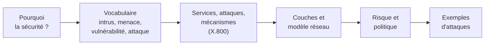
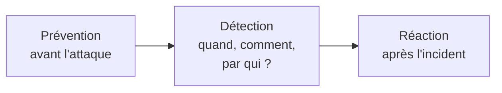
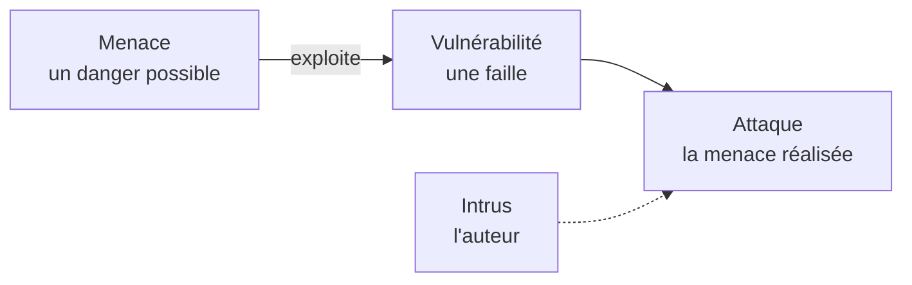
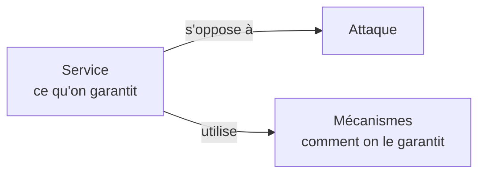
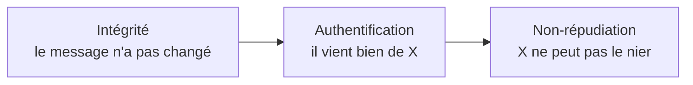
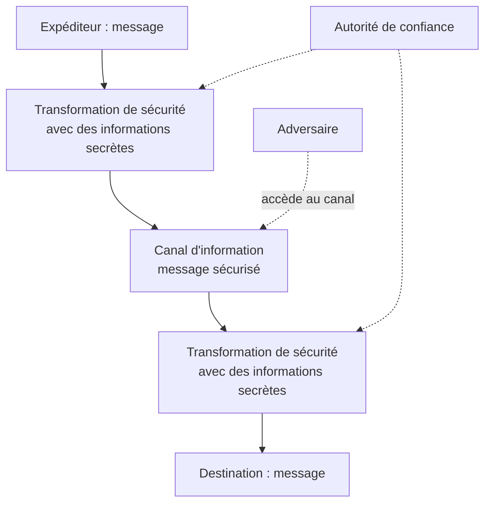
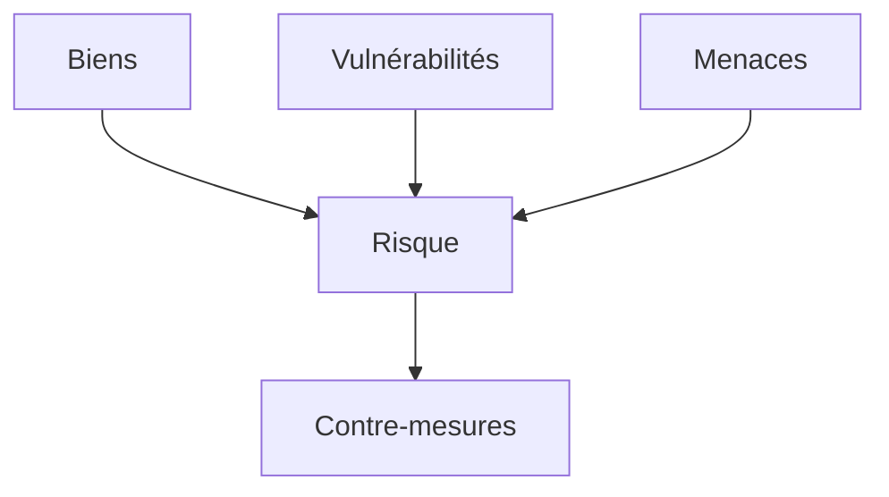

# Résumé — Chapitre 1 : Notions de base de la sécurité informatique

Support : [[Chapitre 1 - Notions de base de la sécurité informatique.pdf]] (36 diapositives ; la diapositive N est la page N du PDF) · Ben Hassine Ines · ISIMa · suite : [[Résumé - Chapitre 2 - Chiffrements classiques]] · exercices : [[Résumé - TD 1 - Introduction à la sécurité informatique]]

Le chapitre pose le vocabulaire de toute la matière. On protège des **biens** (l'information, le système d'information) contre des **menaces**, qui exploitent des **vulnérabilités** pour réaliser des **attaques**. Pour y répondre, on définit des **services de sécurité** (ce qu'on veut garantir), mis en œuvre par des **mécanismes** (comment on le garantit), le tout guidé par une **gestion du risque** et une **politique de sécurité**.

> [!abstract] L'idée du chapitre en une phrase
> Un **service** de sécurité s'oppose à une **attaque** en utilisant un ou plusieurs **mécanismes** ; X.800 en définit cinq : **authentification, contrôle d'accès, confidentialité, intégrité, non-répudiation**.

## Le chapitre en un coup d'œil

| Diapositives | Thème |
|---|---|
| 3 à 5 | pourquoi la sécurité, prévention, détection, réaction |
| 6 à 9 | intrus, menace, exemples, vulnérabilité |
| 10 à 17 | attaques, mécanismes et services ; les cinq services de X.800 |
| 18 à 22 | attaques passives et actives ; interruption, interception, modification, fabrication |
| 23 et 24 | mécanismes de sécurité |
| 25 à 28 | sécurité dans les couches de protocoles, modèle de sécurité réseau |
| 29 à 31 | gestion du risque, politique de sécurité |
| 32 à 36 | exemples d'attaques : chiffres, rançongiciels, phishing, DDoS, fuite de données |

## 1. Pourquoi la sécurité ?

*Diapositives 3 et 4*

**L'information est une ressource stratégique**, et les technologies de communication ne sont pas sûres par construction :

| Faiblesse | Ce que ça veut dire |
|---|---|
| **Ethernet est *promiscuous*** | sur un réseau local partagé, les trames passent devant toutes les cartes réseau ; une carte en mode *promiscuous* les capte toutes, pas seulement les siennes |
| **TCP/IP envoie les données en clair** | n'importe qui sur le chemin peut les lire ; c'est aux applications de les sécuriser |
| **L'adresse IP source peut être *spoofée*** | un attaquant peut écrire une fausse adresse d'expéditeur dans ses paquets |

*Les explications de la colonne de droite sont un complément de cette fiche, hors diapositives.*

Un **système d'information** (SI) est un **patrimoine essentiel** de l'entreprise, d'où la nécessité de le protéger : c'est la **sécurité du SI**.

- **Menaces** : erreurs humaines, employés malhonnêtes, accès externes…
- **Dégâts d'une intrusion** : vol de données confidentielles, pertes financières (transactions erronées), perte de confiance des clients, jusqu'à **menacer l'existence de l'entreprise sur le marché**.

## 2. Ce que couvre la sécurité : prévenir, détecter, réagir

*Diapositive 5*

| Volet | Ce qu'on fait |
|---|---|
| **Prévention** | prendre des mesures pour **empêcher** les biens et les actifs d'être attaqués |
| **Détection** | prendre des mesures pour **détecter quand, comment et par qui** un actif ou un bien a été endommagé |
| **Réaction** | prendre des mesures **après un incident** pour **restaurer** les biens et les actifs, ou **réduire l'impact** de l'incident |

## 3. Le vocabulaire : intrus, menace, vulnérabilité, attaque

*Diapositives 6 à 9*

> [!definition] Intrus (*intruder*), diapositive 6
> L'entité responsable d'une attaque de sécurité, capable de :
> - **accéder** de façon non autorisée à des ressources internes de la cible, appelée la **victime** ;
> - **manipuler** le fonctionnement interne des machines ;
> - **deviner ou décrypter les mots de passe** qui protègent des comptes ou des services : ce type d'intrus s'appelle un ***cracker***.

> [!definition] Menace, diapositive 7
> « Un signe qui laisse prévoir un danger. » Une menace peut être une **personne**, un **objet** ou un **événement** qui peut créer un danger pour un bien, en termes de **confidentialité, intégrité ou disponibilité**.
>
> Exemples : un virus circule sur le réseau local ; un programme installé semble épuiser les ressources (mémoire, CPU).

> [!definition] Vulnérabilité, diapositive 9
> Une **faille ou un bug** qui peut être utilisé pour obtenir un accès illicite à une ressource, ou des **privilèges supérieurs** à ceux considérés comme normaux pour cette ressource.
>
> Exemples : des mots de passe non robustes ; des comptes non protégés par mot de passe.

Les trois notions s'enchaînent :

> [!important] Deux phrases à savoir par cœur
> - « Une **attaque** de sécurité est la **réalisation d'une menace**. » (diapositive 7)
> - « Une **vulnérabilité** est **exploitée par une menace** pour engendrer une attaque. » (diapositive 9)

**Exemples de menaces et d'attaques** (diapositive 8) : accès non autorisé, perte de l'intégrité du système, déni de service, virus, coupure d'électricité, panne du matériel, divulgation de données confidentielles, vol de données, destruction de données. Une menace n'est donc pas toujours un pirate : une coupure de courant ou une panne en est une aussi.

## 4. Attaques, mécanismes et services

*Diapositive 10*

| Terme | Définition du cours |
|---|---|
| **Attaque de sécurité** | action qui **compromet la sécurité** de l'information d'une organisation |
| **Mécanisme de sécurité** | mécanisme conçu pour **détecter, empêcher ou récupérer** après une attaque |
| **Service de sécurité** | service qui **améliore la sécurité** du traitement et du transfert des données ; il **s'oppose aux attaques** et **utilise des mécanismes** |

## 5. Les services de sécurité (X.800)

*Diapositives 11 à 17*

**Objectif des services** (diapositive 11) : empêcher et détecter les attaques, améliorer et renforcer la sécurité, et **reproduire les fonctions des documents papier** : signature et date, protection contre la divulgation, la falsification et la destruction, certification, enregistrement.

La recommandation **X.800** (*Security architecture for OSI*) regroupe les services en **cinq catégories** (diapositive 12) :

| Service | Ce qu'il garantit | Détails du cours | Techniques citées |
|---|---|---|---|
| **Authentification** (13) | l'**origine** du message est correctement identifiée | le receveur est sûr que le message vient bien de la source qui prétend l'avoir envoyé ; chaque entité est bien celle qu'elle prétend être ; un tiers ne peut pas se faire passer pour une entité légitime | cryptage, signature numérique, secret (mots de passe, PIN) |
| **Contrôle d'accès** (14) | **empêcher l'utilisation non autorisée** d'une ressource (serveur, application…) | définir **qui** a le droit d'accéder, **sous quelles conditions**, et **ce qu'une entité a le droit de faire** | — |
| **Confidentialité** (15) | protéger les données transmises contre les **attaques passives**, et les flux contre l'**analyse** | seules les entités communicantes peuvent observer les données ; deux niveaux : toutes les données d'une **connexion**, ou un **seul bloc** | — |
| **Intégrité** (16) | **détecter si les données ont été modifiées** entre la source et la destination | **orienté connexion** : contre la duplication, la destruction, l'insertion, la modification, le rejeu, le reclassement ; **non orienté connexion** : contre la modification uniquement | cryptage, signature numérique, contrôle d'accès, contrôle d'intégrité |
| **Non-répudiation** (17) | empêcher l'émetteur ou le receveur de **nier** avoir envoyé ou reçu un message | **d'envoi** : le destinataire prouve que la source a bien émis le message ; **de réception** : l'émetteur prouve que le destinataire l'a bien reçu | signature électronique |

**Les services s'emboîtent** (schéma de la diapositive 17) :

Lecture (explication de cette fiche) : pour prouver qu'un message vient de quelqu'un, il faut d'abord savoir qu'il n'a pas été modifié ; et pour qu'il ne puisse pas le nier, il faut d'abord l'avoir authentifié.

> [!tip] Et la disponibilité ?
> Elle n'est pas dans les cinq catégories de X.800, mais le cours la cite avec la confidentialité et l'intégrité (diapositive 7), et le TD 1 compte **cinq objectifs** : confidentialité, intégrité, **disponibilité**, non-répudiation, authentification. Le **déni de service** est l'attaque qui la vise.

## 6. Les attaques : passives et actives

*Diapositives 18 à 22*

X.800 et la **RFC 2828** classent les attaques en deux classes :

| | Attaques **passives** | Attaques **actives** |
|---|---|---|
| But | **collecter ou utiliser** des informations sur le système | **modifier** les ressources du système ou **perturber** leur fonctionnement |
| Effet sur le système | **aucun** : rien n'est altéré | les ressources ou le trafic sont modifiés |
| Détection | **difficile** | *(complément, hors diapositives : plus facile à détecter, mais difficile à empêcher complètement)* |
| Protection | **assez simple** (ex. cryptage) | — |
| Exemples | interception, analyse de trafic | mascarade, rejeu, fabrication, modification, déni de service |

**Les attaques passives** (diapositive 19) :

- **Interception** : l'intrus interprète les données et en extrait l'information à partir du trafic (un email confidentiel, une communication téléphonique).
- **Analyse de trafic** : **même si les données sont chiffrées**, l'intrus apprend des choses en observant l'identité des utilisateurs, la fréquence et la longueur des messages.

**Les attaques actives** (diapositives 20 et 21) :

| Attaque | Principe |
|---|---|
| **Mascarade** | une entité **prétend être une autre** pour obtenir des privilèges supplémentaires (elle s'appuie en général sur d'autres attaques actives) |
| **Rejeu** (*replay*) | **capturer** passivement des données puis les **retransmettre plus tard** pour réaliser une action non autorisée |
| **Fabrication** | **créer et injecter** des messages pour produire un effet non autorisé |
| **Modification** | **altérer, détruire ou réordonner** une partie des messages échangés |
| **Déni de service** | **empêcher ou gêner l'utilisation normale** des moyens de communication : supprimer les messages vers une destination (ex. le service d'audit de sécurité), ou **surcharger** le réseau ou le système de trafic inutile |

**Quatre termes à ne pas confondre** (diapositive 22) :

| Terme | Ce que montre le schéma | Propriété attaquée *(complément)* |
|---|---|---|
| **Interruption** | la liaison est **coupée** : le message n'arrive pas | disponibilité |
| **Interception** | l'intrus **écoute** la liaison, le message arrive quand même | confidentialité |
| **Modification** | l'intrus **se place au milieu** et transmet un message modifié | intégrité |
| **Fabrication** | l'intrus **envoie un message** que l'émetteur n'a jamais écrit | authenticité |

## 7. Les mécanismes de sécurité

*Diapositives 23 et 24*

| Mécanisme | Définition du cours |
|---|---|
| **Cryptage** | des algorithmes mathématiques transforment les messages en une forme **inintelligible** ; la transformation dépend d'un algorithme et de **zéro à plusieurs clés** |
| **Signature numérique** | ajout de données, ou transformation cryptographique **irréversible**, qui **prouve la source et l'intégrité** d'une unité de données |
| **Échange d'authentification** | assure l'**identité** d'une entité par un échange d'informations |
| **Notarisation** (*notarization*) | une **tierce partie** garantit certaines propriétés d'un échange de données |
| **Horodatage** (*timestamping*) | inclure une **date et une heure correctes** dans un message |
| **Non cryptographiques** | ***traffic padding*** (ajouter des bits au flux pour faire échouer l'**analyse de trafic**), **détection d'intrusions**, **pare-feux** (*firewalls*) |

La liste complète des mécanismes de X.800 est dans le [[Résumé - TD 1 - Introduction à la sécurité informatique|TD 1]] (exercice 1, question 2).

## 8. La sécurité dans les couches de protocoles

*Diapositives 25 et 26*

- On a besoin de sécurité dans **plusieurs couches** (routage, transport, application).
- La sécurité **de bout en bout** est plus simple à fournir dans les **couches supérieures** que la sécurité **de point à point** dans les couches inférieures.
- En haut, les mécanismes sont plutôt **logiciels** ; en bas, plutôt **matériels**.

| Couche | Protocoles | Sigles |
|---|---|---|
| **Application** | PGP, PEM… | *Pretty Good Privacy*, *Privacy Enhanced Mail* (courrier sécurisé) |
| **Transport** | SSH, SSL… | *Secure Shell*, *Secure Socket Layer* |
| **IP** | AH, ESP… | *Authentication Header*, *Encapsulating Security Payload* (les deux protocoles d'IPsec) |

*Complément, hors diapositives : SSL est obsolète ; on utilise aujourd'hui son successeur **TLS** (versions 1.2 et 1.3), celui du `https`.*

## 9. Le modèle de sécurité réseau

*Diapositives 27 et 28*

Le message est **transformé** avant d'entrer dans le canal (avec des **informations secrètes**, par exemple une clé), puis retransformé à l'arrivée ; l'**adversaire** a accès au canal ; une **autorité de confiance** peut distribuer les secrets ou arbitrer.

Ce modèle impose aussi (diapositive 28) :

- une **fonction de filtrage** qui identifie les utilisateurs et laisse passer **uniquement les personnes autorisées** (mots de passe, certificats numériques…) ;
- des **contrôles internes** qui surveillent l'activité des utilisateurs et analysent les informations pour **détecter les actes malveillants**.

## 10. La gestion du risque

*Diapositives 29 et 30*

Le risque naît de la rencontre de **biens** qui ont de la valeur, de **vulnérabilités** et de **menaces** ; on y répond par des **contre-mesures**. La première étape est l'**inventaire et l'estimation des biens** (*assets*) :

| Type de bien | Exemples du cours |
|---|---|
| **Matériel** | CPU, disques, routeurs… |
| **Logiciel** | applications, bases de données… |
| **Données** | configuration, archives… |
| **Personnes** | développeurs, administrateurs… |

Il faut se demander **quelles ressources sont vitales** pour l'entreprise. Les biens **logiciels et données** sont **difficiles à évaluer** : un traitement erroné dans un logiciel de finance peut mener à des **poursuites judiciaires** ; des données erronées dans un système embarqué peuvent **endommager tout le système**.

## 11. La politique de sécurité

*Diapositive 31*

| | |
|---|---|
| **Définition** | un **ensemble de règles** qui précisent comment les ressources sont gérées pour satisfaire les exigences de sécurité, et quelles actions sont **permises** ou **interdites** |
| **Objectif** | **empêcher les violations** de sécurité : accès non autorisé, perte de données, interruption de services… |
| **Étendue** | **organisationnelle** ou **individuelle** |
| **Mise en œuvre** | **partiellement automatisée**, mais **toutes les personnes sont impliquées** |

## 12. Quelques exemples d'attaques

*Diapositives 32 à 36*

**Les chiffres** (diapositive 32) : les entreprises sont de plus en plus victimes de piratage. Selon l'**ANSSI**, hausse de **255 %** en 2020 ; violations de données en hausse de **20 %** ; dans le seul domaine hospitalier, **20 millions** de patients dont les documents ont été divulgués et **plus de 120 hôpitaux** touchés ; **192 attaques par rançongiciel** en 2020 contre **54** un an plus tôt, surtout contre les PME.

> [!remarque] D'où vient le « +255 % » ?
> La diapositive l'attribue aux « cyberattaques » en général, mais c'est exactement la hausse des **rançongiciels** citée plus bas : de 54 à 192, $(192 - 54) / 54 = 2{,}56$, soit **+255 %**. Le chiffre décrit donc les attaques par rançongiciel traitées par l'ANSSI, pas toutes les cyberattaques.

| Attaque | Comment elle marche | Chiffres du cours |
|---|---|---|
| **Rançongiciel** (*ransomware*, diapositive 33) | caché dans une pièce jointe, un programme **chiffre les documents** du premier ordinateur infecté, puis en quelques secondes **tous les fichiers partagés** ; on ne peut plus les ouvrir **sauf en payant une rançon**, qui augmente avec le temps | rançon moyenne : environ **11 000 €** en 2019, **130 000 €** en 2020 ; retour à la normale en plusieurs jours ou semaines |
| **Phishing** (hameçonnage, diapositive 34) | des emails qui **usurpent l'identité** d'une entreprise ou d'une administration (logos officiels) pour **récupérer des mots de passe** ou faire installer un programme malveillant avec le « consentement » de l'utilisateur | la technique la plus « rentable » selon Google ; taux de réussite estimé **entre 12 et 25 %** |
| **DDoS** (*Distributed Denial of Service*, diapositive 35) | de nombreuses machines se connectent ou envoient des données **en même temps** vers une cible, qui devient **inaccessible** en quelques secondes ; les pirates demandent ensuite une rançon pour arrêter | selon Netscout, **5,4 millions** d'attaques au premier semestre 2021, **+11 %** sur un an ; paralyse surtout les sites de e-commerce |
| **Fuite de données** (diapositive 36) | externe (un pirate infiltre le réseau) ou **interne** : un salarié, qui a les connaissances, les autorisations et le temps ; **intentionnelle** (clé USB, messagerie personnelle, revente à la concurrence) ou par **négligence** (sites non sécurisés, session laissée ouverte, mots de passe faibles) | — |

## À retenir

- **Prévention, détection, réaction** : les trois volets de la sécurité.
- Une **attaque** est la **réalisation d'une menace**, qui **exploite une vulnérabilité** ; l'**intrus** en est l'auteur (le ***cracker*** casse les mots de passe).
- Un **service** s'oppose aux attaques en utilisant des **mécanismes**. Les cinq services de **X.800** : **authentification, contrôle d'accès, confidentialité, intégrité, non-répudiation**.
- **Passives** (interception, analyse de trafic) : rien n'est modifié, **difficiles à détecter**, protection assez simple par chiffrement. **Actives** : mascarade, rejeu, fabrication, modification, déni de service.
- **Interruption / interception / modification / fabrication** visent respectivement la disponibilité, la confidentialité, l'intégrité et l'authenticité.
- Mécanismes : cryptage, signature numérique, échange d'authentification, notarisation, horodatage, *traffic padding*, détection d'intrusions, pare-feux.
- **Risque** = biens + vulnérabilités + menaces, traité par des **contre-mesures** ; la **politique de sécurité** fixe les actions permises et interdites et implique tout le monde.

## Questions de révision

1. Citer trois faiblesses des technologies de communication données par le cours.
2. Quels sont les trois volets de la sécurité ? Donner un exemple de mesure pour chacun.
3. Quelle différence entre une menace, une vulnérabilité et une attaque ? Les relier dans une phrase.
4. Qu'est-ce qu'un *cracker* ?
5. Définir attaque, mécanisme et service de sécurité, et dire comment ils sont liés.
6. Citer les cinq catégories de services de X.800.
7. Quelle différence entre l'intégrité orientée connexion et non orientée connexion ?
8. Quelle différence entre la non-répudiation d'envoi et de réception ? Quelle technique l'assure ?
9. Pourquoi les attaques passives sont-elles difficiles à détecter ? Comment s'en protéger ?
10. Un message est chiffré. Un intrus peut-il quand même en tirer de l'information ? Quel mécanisme le gêne ?
11. Classer : un pirate rejoue une demande de virement capturée la veille ; un pirate coupe le câble ; un pirate écoute le Wi-Fi ; un pirate envoie un faux email au nom du directeur.
12. Pourquoi la sécurité de bout en bout est-elle plutôt placée dans les couches hautes ? Citer un protocole par couche.
13. Quels sont les éléments du modèle de gestion du risque ? Pourquoi les biens logiciels et données sont-ils difficiles à évaluer ?
14. Définir une politique de sécurité : objectif, étendue, mise en œuvre.

> [!question]- Réponses
> 1. Ethernet est *promiscuous* (une carte peut capter toutes les trames du réseau local), TCP/IP envoie les données **en clair**, l'adresse IP source peut être **usurpée** (*spoofing*).
> 2. **Prévention** (empêcher l'attaque : un pare-feu, des mots de passe robustes), **détection** (savoir quand, comment, par qui : un système de détection d'intrusions, des journaux), **réaction** (restaurer, réduire l'impact : une sauvegarde qu'on restaure).
> 3. La **menace** est un danger possible, la **vulnérabilité** une faille, l'**attaque** la menace réalisée : « une vulnérabilité est exploitée par une menace pour engendrer une attaque ».
> 4. Un intrus spécialisé dans le fait de **deviner ou décrypter les mots de passe** qui protègent des comptes ou des services.
> 5. Une **attaque** compromet la sécurité de l'information ; un **mécanisme** détecte, empêche ou récupère après une attaque ; un **service** améliore la sécurité, **s'oppose aux attaques** et **utilise des mécanismes**.
> 6. **Authentification, contrôle d'accès, confidentialité, intégrité, non-répudiation.**
> 7. **Orienté connexion** : protège tout le flux contre la duplication, la destruction, l'insertion, la modification, le rejeu et le reclassement. **Non orienté connexion** : protège chaque message isolé contre la **modification uniquement**.
> 8. **D'envoi** : le destinataire peut prouver que la source a bien émis le message. **De réception** : l'émetteur peut prouver que le destinataire l'a bien reçu. Technique : la **signature électronique**.
> 9. Parce qu'elles **n'altèrent rien** : le trafic arrive normalement. On s'en protège assez simplement par le **chiffrement**.
> 10. Oui, par l'**analyse de trafic** : identité des correspondants, fréquence et longueur des messages. Le ***traffic padding*** (bourrage du trafic) la fait échouer.
> 11. **Rejeu** (actif) ; **interruption**, un déni de service (actif) ; **interception** (passif) ; **fabrication**, ou mascarade (actif).
> 12. Parce que c'est **plus simple** à fournir en haut, de bout en bout, qu'à chaque saut dans les couches basses (et c'est du logiciel). Application : PGP, PEM ; transport : SSH, SSL (aujourd'hui TLS) ; IP : AH, ESP.
> 13. **Biens, vulnérabilités, menaces → risque → contre-mesures.** Les biens logiciels et données sont difficiles à évaluer parce que leurs dégâts sont indirects : un calcul faux en finance peut mener à des poursuites, une donnée fausse dans un système embarqué peut endommager tout le système.
> 14. Un **ensemble de règles** (gestion des ressources, actions permises et interdites) pour **empêcher les violations** (accès non autorisé, perte de données, interruption de service) ; étendue **organisationnelle ou individuelle** ; mise en œuvre **partiellement automatisée**, mais **tout le monde est impliqué**.
