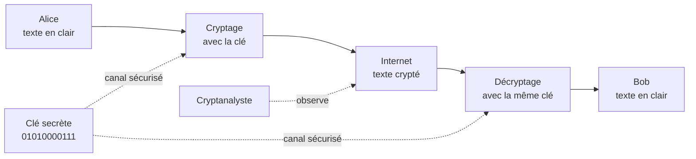
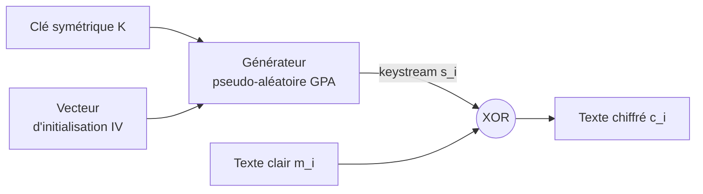
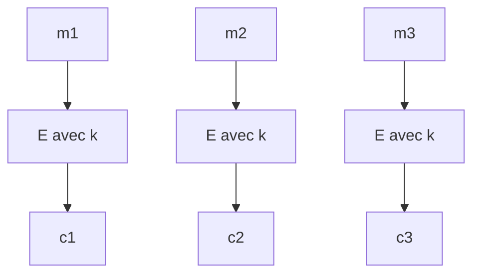
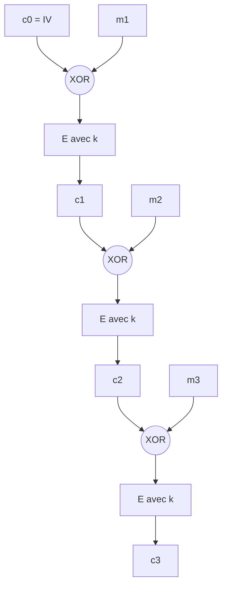

# Résumé — Chapitre 2, partie 2 : Chiffrement symétrique et modes opératoires

Support : [[Chapitre 2 - Cryptographie (partie 2) - Chiffrement symétrique et modes.pdf]] (13 pages, diapositives 70 à 83 du cours ; la diapositive 73 n'est pas dans le fichier, donc les pages 1 à 3 sont les diapositives 70 à 72, puis la page N est la diapositive N + 70) · Ben Hassine Ines · avant : [[Résumé - Chapitre 2 - Chiffrements classiques]] · suite : [[Résumé - Chapitre 2 - DES, 3DES et AES]]

On quitte les chiffrements historiques pour le **chiffrement symétrique** moderne : une seule clé secrète, partagée par les deux correspondants. Deux façons de traiter le message : **par flux** (bit par bit, comme un masque) ou **par blocs** (morceaux de taille fixe). Pour les blocs, le **mode opératoire** (ECB, CBC…) décide comment enchaîner les blocs, et il compte autant que l'algorithme.

> [!abstract] L'idée de la partie en une phrase
> En chiffrement symétrique, **la même clé chiffre et déchiffre** ; un chiffrement par blocs ne suffit pas seul : en **ECB**, deux blocs identiques donnent deux chiffrés identiques, alors que **CBC** les enchaîne avec un **vecteur d'initialisation**.

*Les propriétés des modes ont été testées en Python avec AES-128 et ChaCha20 (bibliothèque `cryptography` 50) : complément, hors diapositives.*

## 1. Le principe du chiffrement symétrique

*Diapositives 70 et 71*



- **Une seule clé secrète**, connue de l'émetteur et du récepteur.
- La clé doit être **transmise par un canal sécurisé** avant l'échange.
- Le **cryptanalyste** voit le texte crypté qui circule sur Internet, mais pas la clé.

*Complément : ce partage préalable de la clé est le point faible du symétrique (comment se mettre d'accord sur une clé avec un inconnu ?). C'est ce que résoudra le chiffrement asymétrique, annoncé au début du chapitre.*

## 2. Flux ou blocs ?

*Diapositive 72*

| | Chiffrement **par flux** (*stream cipher*) | Chiffrement **par blocs** (*block cipher*) |
|---|---|---|
| Principe | traite l'entrée **en continu**, un élément de sortie à la fois | découpe le texte en **blocs de taille fixe**, traités un par un |
| Attente | pas besoin d'attendre un bloc entier : adapté au **temps réel** | le bloc doit être **entièrement disponible** avant le traitement |
| Clé | « aussi longue que le flux de données » (voir la remarque) | la **même fonction et la même clé** pour tous les blocs |
| Implémentation | en général **matérielle** | en général **logicielle** |

> [!remarque] Précision, diapositive 72 : la clé n'est pas aussi longue que le flux
> Ce qui est aussi long que les données, c'est le **flux de clé** (*keystream*) ; la **clé** elle-même est courte (128 ou 256 bits), et c'est le **générateur pseudo-aléatoire** de la diapositive 74 qui l'étire. Seul le **masque jetable** (*one-time pad*) utilise une vraie clé aussi longue que le message. *Vérifié avec ChaCha20 : une clé de 32 octets chiffre un message d'un million d'octets.*

## 3. Le chiffrement par flux

*Diapositives 74 à 76*



$$c_i = m_i \oplus s_i \qquad m_i = c_i \oplus s_i$$

- **Pas besoin de lire le message ni de connaître sa longueur** pour commencer à chiffrer.
- Le générateur produit un **pseudo-aléa**, le **flux de clé** (*keystream*), combiné (souvent par **XOR**) avec le flux de données.
- On déchiffre avec **la même opération** : XOR deux fois avec le même $s_i$ rend le clair.

**Le XOR en un exemple** *(complément)* : $m$ = `1011 0110`, $s$ = `0110 1100`, donc $c = m \oplus s$ = `1101 1010`, et $c \oplus s$ redonne `1011 0110`.

**Où on les trouve** (diapositive 76), surtout pour les données **multimédia** :

| Algorithme | Utilisé dans |
|---|---|
| **RC4** | SSL et le Wi-Fi 802.11 |
| **E0** | Bluetooth |
| **A5/1, A5/2, A5/3** | le GSM |

> [!tip]- Complément : pourquoi un vecteur d'initialisation, et l'état actuel de ces algorithmes
> Le **même flux de clé ne doit jamais servir deux fois**. Avec la même clé et le même IV, $c_1 \oplus c_2 = m_1 \oplus m_2$ : la clé disparaît, et l'intrus combine directement les deux messages. *Vérifié avec ChaCha20 : `c1 xor c2 == m1 xor m2` est vrai quand on réutilise la clé et l'IV.* L'IV, qui change à chaque message, donne un flux de clé différent avec la même clé.
>
> RC4 est aujourd'hui **interdit dans TLS** (RFC 7465, 2015) et le Wi-Fi WEP qui l'utilisait est cassé ; A5/1 et A5/2 sont cassés aussi. Le chiffrement par flux moderne est **ChaCha20**, utilisé par TLS 1.3.

## 4. Le chiffrement par blocs et ses modes

*Diapositive 77*

Un algorithme par blocs chiffre **un bloc** ; le **mode opératoire** dit comment chiffrer un message de plusieurs blocs.

| Mode | Nom français | Dans le cours |
|---|---|---|
| **ECB** | dictionnaire de codes (*Electronic Code Book*) | détaillé |
| **CBC** | enchaînement des blocs (*Cipher Block Chaining*) | détaillé |
| **CFB** | chiffrement à rétroaction (*Cipher Feedback*) | cité |
| **OFB** | chiffrement à rétroaction de sortie (*Output Feedback*) | cité |

*Complément : CFB et OFB transforment un chiffrement par blocs en chiffrement par flux (le bloc chiffré sert à produire un flux de clé).*

## 5. ECB : chaque bloc seul

*Diapositives 78 à 80*



$$c_i = E(m_i, k) \qquad m_i = D(c_i, k)$$

On chiffre **chaque bloc indépendamment** des autres.

| Avantages | Défaut : **mauvaise sécurité** |
|---|---|
| **simple** | un bloc est **toujours chiffré de la même façon**, dans un message ou dans des messages différents avec la même clé |
| on peut **modifier un morceau** sans rechiffrer tout le reste | l'espion peut se **construire un dictionnaire** s'il obtient les versions claires et chiffrées de certains messages |
| on peut **précalculer** les blocs pour gagner en vitesse | |

**L'exemple de l'image** (diapositive 80) : une image a beaucoup de zones identiques (le ciel bleu, la neige), donc beaucoup de blocs identiques. En ECB, ils donnent les mêmes blocs chiffrés et **on reconnaît encore la montagne** ; avec un mode sûr, l'image chiffrée ressemble à du bruit.

*Vérifié avec AES-128 : trois blocs clairs identiques et un différent.*

```text
ECB: 2660ce4b 2660ce4b 2660ce4b 3fbfc696    les trois blocs identiques se voient
CBC: fcbb078e 3037a8a7 ff83d833 be954802    plus rien ne se répète
```

## 6. CBC : enchaîner les blocs

*Diapositives 81 et 82*



Chaque bloc clair est combiné (XOR) avec le **bloc chiffré précédent** avant d'être chiffré ; pour le premier, on utilise un **vecteur d'initialisation** (IV).

| Chiffrer | Déchiffrer |
|---|---|
| $c_0 = IV$ | $c_0 = IV$ |
| $c_1 = E(c_0 \oplus m_1, k)$ | $m_1 = c_0 \oplus D(c_1, k)$ |
| $c_2 = E(c_1 \oplus m_2, k)$ | $m_2 = c_1 \oplus D(c_2, k)$ |
| $c_p = E(c_{p-1} \oplus m_p, k)$ | $m_p = c_{p-1} \oplus D(c_p, k)$ |

> [!remarque] Coquille, diapositive 81
> La dernière ligne du déchiffrement est écrite $m_p = c_{p-1} \oplus D(m_p, k)$ : on ne peut pas déchiffrer $m_p$, qu'on cherche justement. Il faut lire **$D(c_p, k)$**, comme dans les lignes au-dessus. *Vérifié : en codant CBC à la main avec ces formules (et AES comme fonction E), on obtient exactement le CBC de la bibliothèque, et le déchiffrement retrouve le clair.*

| Avantage | Défaut (selon le cours) |
|---|---|
| **sûr** : deux blocs clairs identiques ne donnent plus le même chiffré | **une erreur rend illisible toute la suite des données** |

> [!remarque] Ce que fait vraiment une erreur en CBC
> **Pour l'examen**, retenir la phrase du cours. Mais l'effet dépend de l'endroit de l'erreur. *Testé avec AES-128 en CBC sur 6 blocs :*
>
> ```text
> un bit faux dans le CHIFFRÉ c2, au déchiffrement :
>   bloc 1: intact
>   bloc 2: 55 bits faux     (tout le bloc est illisible)
>   bloc 3: 1 bits faux      ('bloc dn clair  3' : un seul caractère touché)
>   blocs 4, 5, 6: intacts
>
> un octet changé dans le CLAIR m2, au chiffrement :
>   blocs chiffrés modifiés : [2, 3, 4, 5, 6]
> ```
>
> - Une erreur **de transmission** dans $c_i$ ne touche que **deux blocs** : $m_i$ entièrement, et le bit correspondant de $m_{i+1}$ (car $m_{i+1} = c_i \oplus D(c_{i+1})$). La suite se déchiffre normalement.
> - En revanche, un changement **dans le clair** se propage à **tous les blocs chiffrés suivants**, puisque chaque $c_i$ dépend de tous les blocs précédents. C'est sans doute le sens de la phrase du cours.

**Petit exercice à la main** *(ajouté par cette fiche, avec un chiffrement jouet sur 4 bits : $E(x) = x \oplus k$, qui n'a rien de sûr)* : $k$ = `0110`, $IV$ = `1010`, $m_1 = m_2$ = `0011`.

- **ECB** : $c_1 = c_2 = 0011 \oplus 0110$ = `0101` : la répétition se voit.
- **CBC** : $c_1 = E(1010 \oplus 0011) = E(1001)$ = `1111` ; $c_2 = E(1111 \oplus 0011) = E(1100)$ = `1010` : deux chiffrés différents.
- Retour : $m_1 = IV \oplus D(c_1) = 1010 \oplus 1001$ = `0011`, $m_2 = c_1 \oplus D(c_2) = 1111 \oplus 1100$ = `0011`.

## 7. Exemples d'algorithmes symétriques

*Diapositive 83*

| Type | Algorithme | Bloc | Clé |
|---|---|---|---|
| **Flux** | RC4 (RSA Security) | — | variable, **128 bits** en pratique |
| **Blocs** | **DES** | **64 bits** | **56 bits** |
| | **3DES** | 64 bits | **168 ou 112 bits** |
| | RC2 | 64 bits *(complément)* | 128 bits |
| | Blowfish | 64 bits *(complément)* | 128 bits, jusqu'à 448 bits |
| | **AES** | **128 bits** | **128, 192 ou 256 bits** |

DES, 3DES et AES sont détaillés dans la [[Résumé - Chapitre 2 - DES, 3DES et AES|partie suivante]].

## À retenir

- Symétrique : **une seule clé secrète**, transmise par un **canal sécurisé**.
- **Flux** : flux de clé pseudo-aléatoire (GPA, clé + IV) **XOR** le clair, temps réel, plutôt matériel ; RC4, E0, A5/x. **Blocs** : blocs de taille fixe, même clé, plutôt logiciel.
- **ECB** : $c_i = E(m_i, k)$, simple et parallèle, mais **même bloc → même chiffré** (l'image de la montagne reste visible).
- **CBC** : $c_i = E(c_{i-1} \oplus m_i, k)$ avec $c_0 = IV$ ; $m_i = c_{i-1} \oplus D(c_i, k)$ ; **sûr**, mais les erreurs se propagent (au déchiffrement, sur deux blocs seulement).
- DES : bloc 64, clé 56 ; 3DES : clé 168 ou 112 ; AES : bloc 128, clé 128, 192 ou 256.

## Questions de révision

1. Quel est le principe du chiffrement symétrique ? Quel est son point faible ?
2. Comparer chiffrement par flux et par blocs (principe, temps réel, implémentation).
3. Que produit le générateur pseudo-aléatoire d'un chiffrement par flux, et à partir de quoi ?
4. $m$ = `1100 1010`, $s$ = `1010 0110`. Calculer $c$, puis vérifier le déchiffrement.
5. Citer trois chiffrements par flux et où ils servent.
6. Citer les quatre modes opératoires du cours.
7. Donner les formules d'ECB. Pourquoi est-il peu sûr ? Que montre l'exemple de l'image ?
8. Donner les formules de chiffrement et de déchiffrement de CBC. À quoi sert l'IV ?
9. Un bit du bloc chiffré $c_3$ est modifié pendant la transmission en CBC. Quels blocs clairs sont abîmés ?
10. Donner la taille de bloc et de clé de DES, 3DES et AES.

> [!question]- Réponses
> 1. **La même clé secrète** sert à chiffrer et à déchiffrer ; elle doit être **partagée à l'avance par un canal sécurisé**, ce qui est le point faible.
> 2. **Flux** : traite les données en continu, élément par élément, sans attendre un bloc (temps réel), en général en matériel. **Blocs** : découpe en blocs de taille fixe, chaque bloc doit être complet, même fonction et même clé pour tous les blocs, en général en logiciel.
> 3. Un **flux de clé** (*keystream*) pseudo-aléatoire, à partir de la **clé symétrique K** et d'un **vecteur d'initialisation IV** ; on le combine par XOR avec le clair.
> 4. $c$ = `1100 1010` ⊕ `1010 0110` = **`0110 1100`** ; $c \oplus s$ = `0110 1100` ⊕ `1010 0110` = `1100 1010` = $m$.
> 5. **RC4** (SSL, Wi-Fi 802.11), **E0** (Bluetooth), **A5/1, A5/2, A5/3** (GSM).
> 6. **ECB, CBC, CFB, OFB.**
> 7. $c_i = E(m_i, k)$ et $m_i = D(c_i, k)$. Peu sûr car **un même bloc clair donne toujours le même bloc chiffré** (avec la même clé) : on peut construire un dictionnaire. Sur l'image, les zones identiques donnent des blocs identiques, et **la forme de la montagne reste visible** dans le chiffré.
> 8. $c_0 = IV$, $c_i = E(c_{i-1} \oplus m_i, k)$ ; $m_i = c_{i-1} \oplus D(c_i, k)$. L'**IV** sert de « bloc précédent » pour le premier bloc : deux messages identiques chiffrés avec des IV différents donnent des chiffrés différents.
> 9. **$m_3$** (entièrement illisible) et **$m_4$** (seulement le bit à la même position) ; $m_1$, $m_2$ et $m_5$ et la suite sont intacts. *(Le cours dit « toute la suite » : c'est vrai pour une modification du clair au chiffrement, pas pour une erreur de transmission.)*
> 10. **DES** : bloc 64, clé 56 ; **3DES** : bloc 64, clé 168 ou 112 ; **AES** : bloc 128, clé 128, 192 ou 256.
