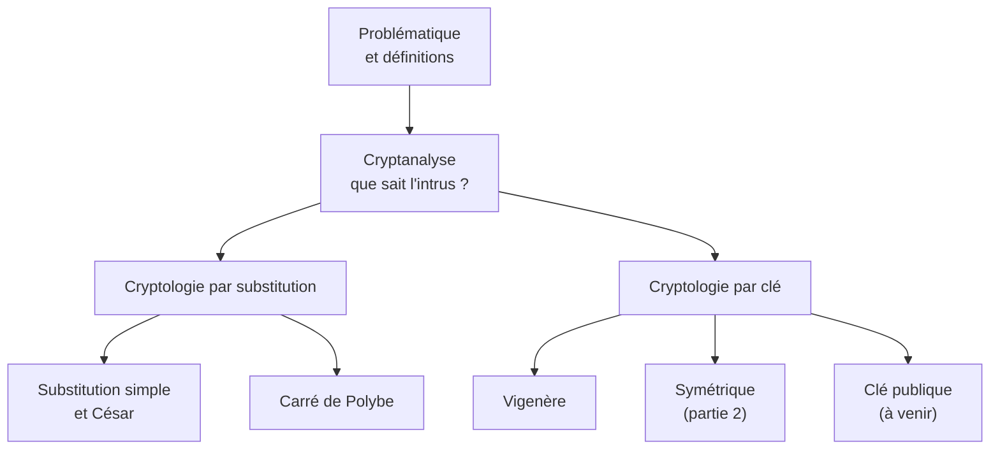

# Résumé — Chapitre 2, partie 1 : Chiffrements classiques

Support : [[Chapitre 2 - Cryptographie (partie 1) - Chiffrements classiques.pdf]] (18 pages, diapositives 32 à 49 du cours ; la diapositive N est la page N − 31 du PDF) · Ben Hassine Ines · avant : [[Résumé - Chapitre 1 - Notions de base de la sécurité informatique]] · suite : [[Résumé - Chapitre 2 - Chiffrement symétrique et modes opératoires]]

Le chapitre II (cryptographie) annonce trois sujets : les systèmes **symétriques et asymétriques**, les **fonctions de hachage** et la **signature numérique**. Cette première partie pose les définitions (crypto-système, cryptanalyse) puis passe par les chiffrements historiques : à chaque fois, on voit **comment chiffrer** et **comment casser**.

> [!abstract] L'idée de la partie en une phrase
> Un chiffrement qui remplace **toujours une lettre par la même** (César, substitution, Polybe) se casse par **force brute** ou par **analyse de fréquences** ; Vigenère résiste à l'analyse simple parce qu'**une même lettre est chiffrée de plusieurs façons**.

*Tous les exemples des diapositives ont été recalculés en Python (complément, hors diapositives). Quatre petites coquilles en sortent, signalées dans les remarques : diapositives 41, 42, 45 et 49.*

## La partie en un coup d'œil



| Diapositives | Pages | Thème |
|---|---|---|
| 33 à 37 | 2 à 6 | problématique, cryptographie, crypto-système, objectifs, cryptanalyse |
| 38 et 39 | 7 et 8 | classification, substitution simple |
| 40 à 42 | 9 à 11 | César, attaque par force brute, substitution quelconque |
| 43 et 44 | 12 et 13 | analyse de fréquences |
| 45 | 14 | carré de Polybe |
| 46 à 49 | 15 à 18 | Vigenère |

## 1. La problématique

*Diapositive 33*

Les protocoles d'Internet ont trois failles, chacune liée à un service du [[Résumé - Chapitre 1 - Notions de base de la sécurité informatique|chapitre 1]] :

| Faille | Problème |
|---|---|
| toute information qui circule peut être **capturée, enregistrée ou modifiée** | **confidentialité** et **intégrité** |
| n'importe qui peut **falsifier son adresse IP** (*spoofing*) et se faire passer pour un autre | **authentification** |
| Internet ne fournit **aucune preuve** de la participation à un échange | **traçabilité** (non-répudiation) |

**La cryptographie** (diapositive 34) est la science mathématique qui transforme un texte intelligible pour assurer une ou plusieurs de ces propriétés : **confidentialité, intégrité, authentification, non-répudiation**.

## 2. Le crypto-système

*Diapositives 35 et 36*

> [!definition] Crypto-système : le quintuplet (P, C, K, E, D)
> - **P** : un ensemble fini de **textes clairs** (*plain text*) ;
> - **C** : un ensemble fini de **textes chiffrés** (*cipher text*) ;
> - **K** : l'**espace des clés** (*key space*), un ensemble fini de clés possibles ;
> - pour chaque clé $k \in K$, une fonction de chiffrement $e_k : P \to C$ dans **E** et une fonction de déchiffrement $d_k : C \to P$ dans **D**, telles que
>
> $$d_k(e_k(x)) = x \quad \text{pour tout } x \in P$$

Autrement dit : avec la bonne clé, déchiffrer annule toujours le chiffrement.

*Exemple (complément) : César est un crypto-système où P et C sont les textes en lettres A à Z, K = {0, …, 25}, $e_k(x) = x + k \bmod 26$ lettre par lettre et $d_k(y) = y - k \bmod 26$.*

**Les trois objectifs** (diapositive 36) :

1. le texte clair ne doit pas être **facile à retrouver** à partir du texte chiffré ;
2. les clés ne doivent pas être **faciles à retrouver** à partir du texte chiffré ;
3. l'**espace des clés** doit être **assez grand** pour résister aux attaques par **force brute** (essayer toutes les clés).

## 3. La cryptanalyse

*Diapositive 37*

> [!definition] Cryptanalyse
> Les principes et méthodes qui permettent de **retrouver le message clair** à partir du message chiffré **sans connaître la clé**. Connaissant $C = E(P, K)$ mais pas K, le but est de trouver **P ou K**.

Les attaques se classent selon **ce que connaît l'intrus** (le *cryptanalyst*) :

| Attaque | L'intrus connaît | Exemple dans cette partie |
|---|---|---|
| **Texte chiffré seul** | C et l'algorithme E | César par force brute (diapositive 41), analyse de fréquences (43 et 44) |
| **Texte clair connu** | E, C et **quelques paires clair/chiffré** obtenues avec K | — |
| **Texte clair choisi** | E, C, et des chiffrés de **clairs qu'il a choisis** | — |

Plus l'intrus en sait, plus l'attaque est facile ; un bon chiffrement doit résister **même** au texte clair choisi.

## 4. Les familles de chiffrement

*Diapositive 38*

| Famille | Méthodes du cours |
|---|---|
| **Cryptologie par substitution** | substitution simple (dont César), carré de Polybe |
| **Cryptologie par clé** | chiffre de Vigenère, méthodes **symétriques à clé secrète**, méthodes à **clé publique et clé privée** |

## 5. La substitution simple (mono-alphabétique)

*Diapositive 39*

On remplace **chaque lettre par une autre, toujours la même** (on parle aussi d'« alphabets désordonnés »). La clé est le tableau de correspondance :

```text
Texte clair  ABCDEFGHIJKLMNOPQRSTUVWXYZ
Texte codé   WXEHYZTKCPJIUADGLQMNRSFVBO
```

Avec ce tableau, `SECURITE` devient `MYERQCNY`.

## 6. Le code de César

*Diapositives 40 et 41*

La diapositive 40 définit d'abord la **cryptologie** : la discipline qui inclut les principes, les moyens et les méthodes de transformation des données, pour **masquer leur contenu**, **empêcher leur modification** ou leur **utilisation illégale**.

César **décale l'alphabet de trois crans** : sous l'alphabet clair, on écrit l'alphabet qui commence à D, donc chaque lettre est remplacée par celle qui est **3 rangs plus loin** (A → D, B → E… X → A, Y → B, Z → C).

```text
ABCDEFGHIJKLMNOPQRSTUVWXYZ
DEFGHIJKLMNOPQRSTUVWXYZABC
```

$$c = (m + 3) \bmod 26 \qquad m = (c - 3) \bmod 26$$

`AVE CAESAR` devient **`DYH FDHVDU`**.

**Le casser par force brute** (diapositive 41). Le message intercepté utilise **27 symboles** : les 26 lettres et `_` pour l'espace (placé avant A). On essaie tous les décalages :

| Décalage | Résultat |
|---|---|
| 1 | `E_FDLXQDLOTQYUZDLYQZQZELMLC_YQ` |
| 2 | `DZECKWPCKNSPXTYCKXPYPYDKLKBZXP` |
| 3 à 12 | du charabia |
| **13** | **`TOUS_LES_CHEMINS_MENENT_A_ROME`** |

Il n'y a que **26 clés utiles** : on les essaie toutes en un instant. **César n'est pas sûr.**

```python
A27 = "_ABCDEFGHIJKLMNOPQRSTUVWXYZ"   # "_" = espace, placé avant A

def decale(texte, k, alpha=A27):
    return "".join(alpha[(alpha.index(c) + k) % len(alpha)] for c in texte)

intercepte = "FAGEMYREMPURZV_EMZR_R_FMNMDAZR"
for k in range(1, 27):
    print(k, decale(intercepte, -k))   # la ligne 13 donne TOUS_LES_CHEMINS_MENENT_A_ROME
```

> [!remarque] Deux détails de la diapositive 41
> - Le message intercepté y est imprimé `…EMZR_R FMNMDAZR` avec une espace : c'est en fait un `_` (le décalage 2 le confirme, il donne bien `Y` à cette place).
> - La ligne du décalage 1, `E_FDLXQDLOTQYUZDLYQZQELMLC_YQ`, a **29 caractères pour 30** : il manque un `Z` (le calcul donne `…YQZQZELMLC_YQ`). Les lignes 2 et 13 sont justes.

## 7. Une substitution quelconque : la force brute ne suffit plus

*Diapositive 42*

Au lieu d'un simple décalage, on prend **n'importe quelle permutation** des 27 symboles :

```text
_ABCDEFGHIJKLMNOPQRSTUVWXYZ
RDOHXAMTC_BKPEZQIWNJFLGVYUS
```

`TOUS_LES_CHEMINS_MENENT_A_ROME` devient `FQLJRPAJRHCAE_ZJREAZAZFRDRNQEA`.

Peut-on essayer toutes les clés ? Il y en a **27! = 10 888 869 450 418 352 160 768 000 000** (environ $1{,}09 \times 10^{28}$, vérifié) : c'est **impossible** par force brute. *Pour 26 lettres seules : 26! ≈ 4,03 × 10²⁶.*

> [!remarque] Coquille, diapositive 42
> La diapositive donne `FQLJRPAJRHCAE_ZJREAZAFRDRNQEA` (29 caractères) : le mot `MENENT` (6 lettres) y devient `EAZAF` (5 lettres). Avec la table de la diapositive, `MENENT` donne **`EAZAZF`**, et le message complet fait 30 caractères.

## 8. L'analyse de fréquences

*Diapositives 43 et 44*

La force brute est impossible, mais la substitution garde un défaut : **chaque lettre est chiffrée toujours de la même façon**, et **certaines lettres sont plus fréquentes** que d'autres. En français, l'espace (19,3 %) et le E (13,9 %) dominent, puis A, S, I, T, N, R, U.

On compte les symboles du cryptogramme (196 caractères) :

| Rang | En français | Dans le cryptogramme |
|---|---|---|
| 1 | `_` 19,3 % | `P` 14,3 % |
| 2 | `E` 13,9 % | `K` 12,8 % |
| 3 | `A` 6,7 % | `S` 9,2 % |
| 4 | `S` 6,3 % | `J` 9,2 % |
| 5 | `I` 6,1 % | `X`, `Q`, `N` 5,6 % |

*Fréquences recalculées sur le cryptogramme (complément) : identiques au tableau de la diapositive 43, ce qui confirme la transcription.*

On remplace pas à pas, en commençant par les plus fréquents, et on **lit les mots qui apparaissent** pour deviner la suite (diapositive 44) :

| Étape | Remplacements | Ce qui aide |
|---|---|---|
| 1 | `P` → `_`, `K` → `E` | les deux plus fréquents |
| | `Q` → `A`, `B` → `L` | on voit apparaître `LA_` |
| 2 | `S` → `S`, `G` → `D` | `DES`, `LES` |
| | `J` → `T`, `I` → `R` | `EST`, `TRES`, `LETTRES` |
| 3 | `X` → `I`, `H` → `Q`, `N` → `U` | `STATISTIQUES` |
| | `V` → `F`, `D` → `N` | `SUFFIT`, `DIFFERENTES` |
| 4 | `R` → `B`, `L` → `O` | `SUBSTITUTION`, `LONG` |

Message final :

```text
LA_SUBSTITUTION_MONO_ALPHABETIQUE_EST_TRES_VULNERABLE_A_LA_CRYPTANALYSE_
POURVU_QUE_LE_MESSAGE_SOIT_SUFFISAMMENT_LONG_IL_SUFFIT_DE_TENIR_COMPTE_
DES_STATISTIQUES_D_OCCURRENCE_DES_DIFFERENTES_LETTRES
```

*Complément : la table complète retrouvée (22 symboles utilisés) est P→_, K→E, S→S, J→T, Q→A, N→U, X→I, B→L, D→N, I→R, L→O, V→F, C→M, Z→C, G→D, E→P, R→B, H→Q, U→V, T→Y, W→G, _→H ; elle est cohérente sur les 196 caractères.*

> [!important] La leçon des diapositives 42 à 44
> Un **grand espace de clés ne suffit pas** : 27! clés, et pourtant le message tombe en quelques étapes, parce que la **statistique des lettres** traverse le chiffrement. Il faut un message **suffisamment long** pour que les fréquences parlent.

## 9. Le carré de Polybe

*Diapositive 45*

|   | 1 | 2 | 3 | 4 | 5 |
|---|---|---|---|---|---|
| **1** | A | B | C | D | E |
| **2** | F | G | H | I, J | K |
| **3** | L | M | N | O | P |
| **4** | Q | R | S | T | U |
| **5** | V | W | X | Y | Z |

On remplace chaque lettre par ses **coordonnées, ligne puis colonne** : A → 11, B → 12, F → 21, M → 32. I et J partagent la même case (25 cases pour 26 lettres).

`LONGTEMPS JE ME SUIS COUCHE DE BONNE HEURE` donne :

```text
313433224415323543 2415 3215 43452443 133445132315 1415 1234333315 2315454215
```

> [!remarque] Coquille, diapositive 45
> La diapositive oublie le mot **SUIS** : il manque `43452443` (S = 43, U = 45, I = 24, S = 43) entre `3215` (ME) et `133445132315` (COUCHE).

*Complément : Polybe reste une substitution mono-alphabétique (chaque lettre donne toujours le même nombre), donc l'analyse de fréquences le casse aussi.*

## 10. Le chiffre de Vigenère

*Diapositives 46 à 49*

Pour coder ou décoder, on utilise **un mot-clé** et le **carré de Vigenère** : 26 alphabets, chacun décalé d'un cran par rapport au précédent. On code **lettre à lettre** : **chiffré = clair + clef**.

$$c_i = (m_i + k_i) \bmod 26 \qquad m_i = (c_i - k_i) \bmod 26$$

avec A = 0, B = 1… Z = 25, et la clé **répétée** autant de fois que nécessaire sous le message.

**Méthode** (diapositive 48) : on écrit la clé sous le message en la répétant ; pour chaque lettre, on prend dans le tableau l'intersection de la **ligne de la lettre claire** et de la **colonne de la lettre de clé**.

**Exemple de la diapositive 47**, clé `ECS` :

| Clair | H | E | L | L | O | W | O | R | L | D |
|---|---|---|---|---|---|---|---|---|---|---|
| Clé | E | C | S | E | C | S | E | C | S | E |
| Calcul | 7+4 | 4+2 | 11+18 | 11+4 | 14+2 | 22+18 | 14+4 | 17+2 | 11+18 | 3+4 |
| mod 26 | 11 | 6 | 3 | 15 | 16 | 14 | 18 | 19 | 3 | 7 |
| **Chiffré** | **L** | **G** | **D** | **P** | **Q** | **O** | **S** | **T** | **D** | **H** |

`HELLOWORLD` donne **`LGDPQOSTDH`** : les deux L du clair donnent D puis P, et les deux D du chiffré viennent de deux L.

**Exemple de la diapositive 48**, `CRYPTOGRAPHIE DE VIGENERE` avec la clé `MATHWEB` : C + M donne O (ligne C, colonne M), R + A donne R, Y + T donne R… Le chiffré complet *(complément, calculé)* est `ORRWPSHDAIOEI EQ VBNARFDE`.

```python
A = "ABCDEFGHIJKLMNOPQRSTUVWXYZ"

def vigenere(texte, cle, sens=+1):   # sens=-1 pour déchiffrer
    return "".join(A[(A.index(c) + sens * A.index(cle[i % len(cle)])) % 26]
                   for i, c in enumerate(texte))

print(vigenere("HELLOWORLD", "ECS"))                  # LGDPQOSTDH
print(vigenere("CRYPTOGRAPHIEDEVIGENERE", "MATHWEB"))  # ORRWPSHDAIOEIEQVBNARFDE
print(vigenere("LGDPQOSTDH", "ECS", -1))              # HELLOWORLD
```

**Points forts** (diapositive 49) :

- très **facile à utiliser**, et le déchiffrement est aussi facile **si on connaît la clé** ;
- **une même lettre est chiffrée de plusieurs façons** : impossible de retrouver les E par une analyse statistique simple ;
- on peut produire **une infinité de clés**, et il est facile de convenir d'une clé avec quelqu'un.

> [!remarque] Précision, diapositive 49
> La diapositive dit que le E a été codé « en I, en A, en Q et en E ». Le message contient **cinq** E, codés en **I, Q, A, F et E** (le E de `VIGENERE` aligné sous le B de la clé devient F). La conclusion ne change pas.

*Complément, hors diapositives : Vigenère a été cassé au XIXe siècle (méthode de Kasiski, 1863). Si l'on devine la **longueur de la clé** L, les lettres de rang 1, L + 1, 2L + 1… sont toutes chiffrées par le même décalage : chaque colonne redevient un César, qu'on casse par fréquences.*

## À retenir

- Un **crypto-système** est un quintuplet **(P, C, K, E, D)** avec $d_k(e_k(x)) = x$.
- Objectifs : clair et clé **difficiles à retrouver**, **espace de clés** assez grand contre la **force brute**.
- **Cryptanalyse** : retrouver le clair sans la clé ; attaques à **texte chiffré seul**, **texte clair connu**, **texte clair choisi**.
- **César** : décalage de 3 ($c = m + 3 \bmod 26$) ; 26 clés seulement, cassé par **force brute**.
- **Substitution quelconque** : 26! (ou 27!) clés, mais cassée par **analyse de fréquences** parce qu'une lettre donne toujours la même.
- **Polybe** : chaque lettre devient ses coordonnées **ligne puis colonne** (I et J ensemble) ; toujours mono-alphabétique.
- **Vigenère** : **chiffré = clair + clef** lettre à lettre, clé répétée ; une même lettre est chiffrée de **plusieurs façons**.

## Questions de révision

1. Donner les cinq éléments d'un crypto-système et la condition qu'ils doivent respecter.
2. Quels sont les trois objectifs d'un bon chiffrement ?
3. Classer les attaques de cryptanalyse de la plus difficile à la plus facile pour l'intrus.
4. Chiffrer `SECURITE` avec César (décalage 3).
5. Pourquoi César n'est-il pas sûr ? Quel type d'attaque le casse ?
6. Une substitution quelconque a 26! clés. Pourquoi est-elle quand même vulnérable ?
7. Dans un long cryptogramme français par substitution, le symbole le plus fréquent est `P`. Que remplacer en premier ?
8. Coder `CLE` avec le carré de Polybe. Pourquoi I et J sont-ils dans la même case ?
9. Chiffrer `ATTAQUE` avec Vigenère et la clé `CLE`, puis déchiffrer le résultat.
10. Pourquoi l'analyse de fréquences simple ne marche-t-elle pas contre Vigenère ?

> [!question]- Réponses
> 1. **P** (clairs), **C** (chiffrés), **K** (clés), **E** (fonctions de chiffrement $e_k$), **D** (fonctions de déchiffrement $d_k$) ; pour toute clé k et tout clair x : $d_k(e_k(x)) = x$.
> 2. Le clair ne doit pas être facile à obtenir depuis le chiffré ; la clé non plus ; l'espace des clés doit être assez grand contre la force brute.
> 3. **Texte chiffré seul** (l'intrus sait le moins), puis **texte clair connu**, puis **texte clair choisi** (l'intrus sait le plus, l'attaque est la plus facile).
> 4. S → V, E → H, C → F, U → X, R → U, I → L, T → W, E → H : **`VHFXULWH`**.
> 5. Parce qu'il n'y a que **26 décalages** (27 avec `_`) : on les essaie tous. C'est une attaque par **force brute**, à texte chiffré seul.
> 6. Parce que **chaque lettre est toujours chiffrée de la même façon** : les **fréquences** des lettres passent dans le chiffré, et l'**analyse de fréquences** retrouve la clé sans les essayer toutes.
> 7. Remplacer `P` par l'**espace** (`_`, 19,3 % en français), puis le deuxième plus fréquent par **E**.
> 8. C = 13, L = 31, E = 15 : **`133115`**. Parce que la grille n'a que **25 cases** pour 26 lettres.
> 9. A + C = C, T + L = E, T + E = X, A + C = C, Q + L = B, U + E = Y, E + C = G : **`CEXCBYG`** ; en soustrayant la clé on retrouve `ATTAQUE` (vérifié en Python).
> 10. Parce qu'**une même lettre claire est chiffrée de plusieurs façons** selon la lettre de clé qui tombe dessus (E devient I, Q, A, F ou E dans l'exemple) : les fréquences du chiffré sont lissées.
