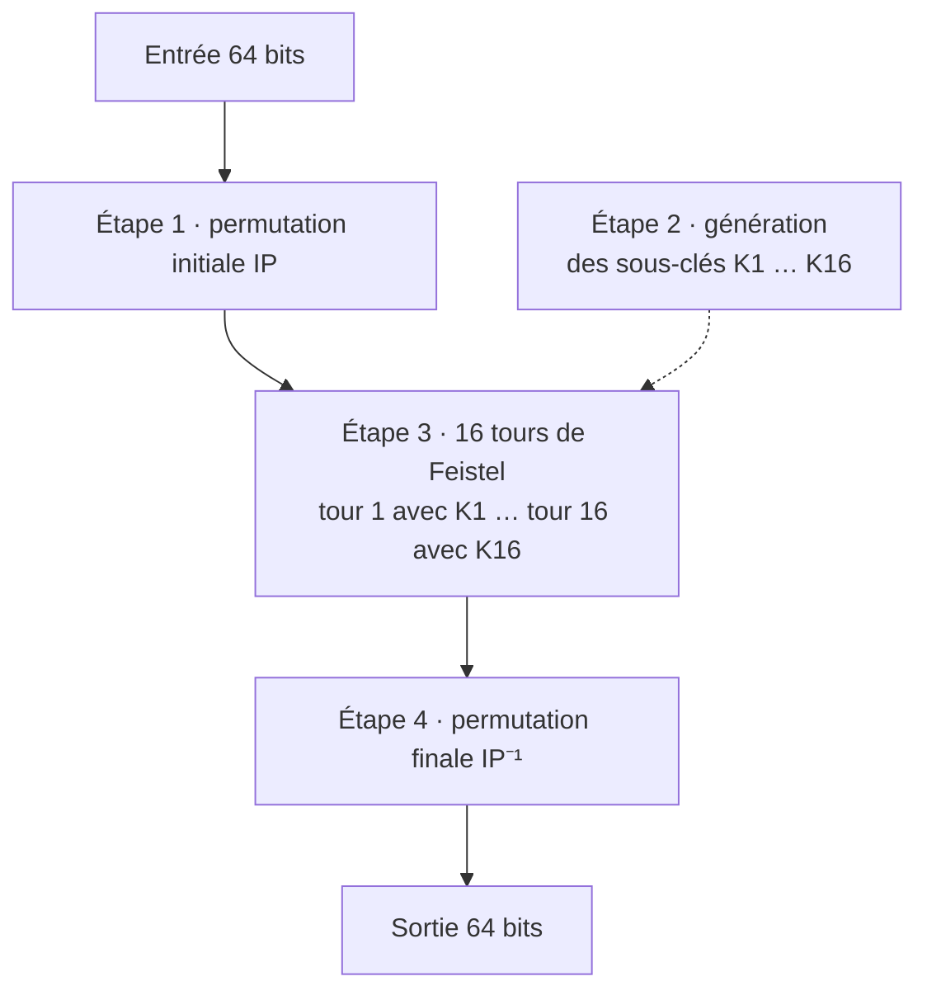
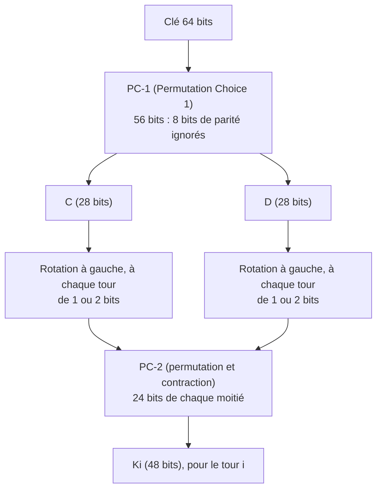
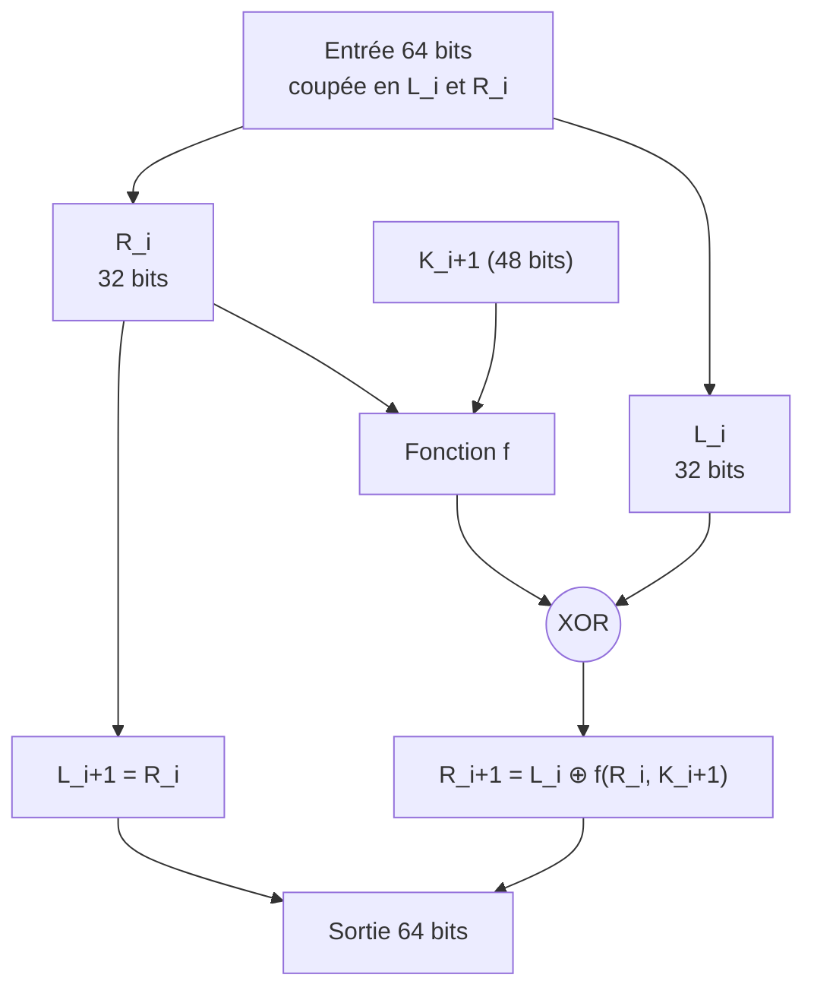
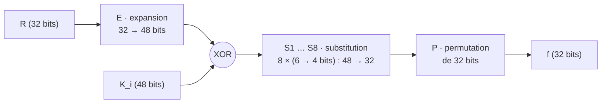
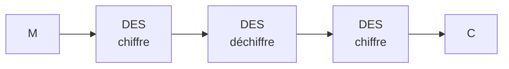

# Résumé — Chapitre 2, partie 3 : DES, 3DES et AES

Support : [[Chapitre 2 - Cryptographie (partie 3) - DES, 3DES et AES.pdf]] (22 pages ; les numéros imprimés sur les diapositives ne se suivent pas, cette fiche renvoie donc aux **pages du PDF**) · Ben Hassine Ines · avant : [[Résumé - Chapitre 2 - Chiffrement symétrique et modes opératoires]]

Cette partie ouvre la boîte noire « chiffrement par blocs » avec **DES** : comment un bloc de 64 bits traverse **16 tours de Feistel**, comment les **sous-clés** sont fabriquées, et ce que fait la **fonction f** avec ses **S-boxes**. Puis elle explique pourquoi DES est tombé (**clé de 56 bits**), pourquoi on n'a pas pris 2DES (**attaque par le milieu**), pourquoi 3DES n'était qu'une transition, et pourquoi **AES** l'a remplacé.

> [!abstract] L'idée de la partie en une phrase
> DES chiffre des blocs de **64 bits** avec une clé effective de **56 bits** en **16 tours de Feistel** ; sa clé est trop courte pour la **recherche exhaustive**, d'où **3DES** (sûr mais lent), puis **AES** (blocs de 128 bits, clés de 128, 192 ou 256 bits, 10 à 14 tours).

*Complément, hors diapositives : un DES complet a été programmé en Python à partir des tables de la norme (FIPS 46-3) et comparé au vrai DES (bibliothèque `cryptography` 50) ; il donne les mêmes résultats sur le vecteur de test classique et sur six autres couples clé et bloc. C'est ce programme qui tranche les remarques sur les pages 8 et 9.*

## La partie en un coup d'œil

| Pages | Thème |
|---|---|
| 1 à 5 | rappels : chiffrement symétrique, blocs et flots, anatomie d'un chiffrement par blocs, substitution et transposition |
| 6 et 7 | DES : présentation et cycle de vie d'un bloc |
| 8 | étapes 1 et 4 : permutation initiale et finale |
| 9 | étape 2 : génération des sous-clés |
| 10 à 16 | étape 3 : un tour DES, déchiffrement, fonction f, tables E et P, S-boxes |
| 17 à 20 | faiblesses, historique des attaques, 2DES et 3DES |
| 21 et 22 | AES, comparaison avec DES et 3DES |

## 1. Les rappels

*Pages 1 à 5*

- **Alice** chiffre m avec **E** et la clé **K**, **Bob** déchiffre c avec **D** et la même clé, **Eve** écoute le canal. E et D sont des fonctions **inversibles et efficaces** ; **m, k et c ont une taille déterminée** (page 1).
- Un algorithme symétrique transforme un **message clair M** de n bits avec une **clé secrète K** de k bits en un **chiffré C** de n bits : $M \in \{0,1\}^n$, $K \in \{0,1\}^k$, $C \in \{0,1\}^n$ (page 2).

**Deux grandes catégories** (page 3) :

| | Par **blocs** (*block ciphers*) | Par **flots** (*stream ciphers*) |
|---|---|---|
| Traitement | blocs de **taille fixe** (64 ou 128 bits) | **bit par bit**, en flux continu |
| Exemples | DES, AES, IDEA, RC6, Blowfish | RC4, Bluetooth E0/1, GSM A5/1 |

**Anatomie d'un chiffrement par blocs** (page 4) : $C = E(K, P)$, avec C le *ciphertext*, E l'algorithme, K la clé, P le *plaintext*.

| Paramètre | Ce que dit le cours |
|---|---|
| **Taille de bloc n** | généralement 64 ou 128 bits ; si $2^{n/2}$ blocs sont chiffrés avec la même clé, des **attaques sur les modes opératoires** deviennent possibles |
| **Taille de clé k** | doit être assez grande ; la **meilleure attaque** contre un algorithme robuste doit coûter $2^k$ opérations (**attaque exhaustive**) |
| **Évolution** | DES : n = 64, k = 56 ; 3DES : n = 64, k = 168 ou 112 ; AES : n = 128, k = 128, 192 ou 256 |

> [!tip]- Complément : ce que veut dire $2^{n/2}$ en pratique
> Avec n = 64 (DES, 3DES, Blowfish), $2^{32}$ blocs de 8 octets font **32 Gio** : une seule connexion longue suffit. C'est l'attaque **Sweet32** (2016) contre 3DES dans TLS. Avec n = 128 (AES), $2^{64}$ blocs de 16 octets font **256 Eio** : hors d'atteinte.
>
> La page 4 écrit aussi « k > 128 dans les standards modernes » : il faut lire **au moins 128** (AES-128, avec k = 128, est un standard moderne).

**Les deux opérations de base** (page 5) :

- **Substitution** : remplacer chaque élément (bit, lettre, groupe de bits ou de lettres) par un autre ;
- **Transposition** : réarranger les éléments du texte clair.

La plupart des systèmes **enchaînent plusieurs étapes** de transposition et de substitution, et **aucune information ne doit être perdue** (sinon on ne pourrait plus déchiffrer).

## 2. DES (*Data Encryption Standard*)

*Pages 6 et 7*

- L'algorithme de chiffrement par blocs à clé symétrique **le plus utilisé** (historiquement).
- Chiffre des **blocs de 64 bits** avec une clé de 64 bits dont **56 bits effectifs** : **8 bits** servent au **contrôle de parité** et sont ignorés.
- C'est un **produit de transpositions et de substitutions**, facile à implémenter **en matériel** : **P-box** (boîtes de transposition) et **S-box** (boîtes de substitution).

**Le cycle de vie d'un bloc** (page 7), en quatre étapes :



## 3. Étapes 1 et 4 : la permutation initiale et son inverse

*Page 8*

**IP** (permutation initiale) :

|   |   |   |   |   |   |   |   |
|---|---|---|---|---|---|---|---|
| 58 | 50 | 42 | 34 | 26 | 18 | 10 | 2 |
| 60 | 52 | 44 | 36 | 28 | 20 | 12 | 4 |
| 62 | 54 | 46 | 38 | 30 | 22 | 14 | 6 |
| 64 | 56 | 48 | 40 | 32 | 24 | 16 | 8 |
| 57 | 49 | 41 | 33 | 25 | 17 | 9 | 1 |
| 59 | 51 | 43 | 35 | 27 | 19 | 11 | 3 |
| 61 | 53 | 45 | 37 | 29 | 21 | 13 | 5 |
| 63 | 55 | 47 | 39 | 31 | 23 | 15 | 7 |

**IP⁻¹** (permutation finale) :

|   |   |   |   |   |   |   |   |
|---|---|---|---|---|---|---|---|
| 40 | 8 | 48 | 16 | 56 | 24 | 64 | 32 |
| 39 | 7 | 47 | 15 | 55 | 23 | 63 | 31 |
| 38 | 6 | 46 | 14 | 54 | 22 | 62 | 30 |
| 37 | 5 | 45 | 13 | 53 | 21 | 61 | 29 |
| 36 | 4 | 44 | 12 | 52 | 20 | 60 | 28 |
| 35 | 3 | 43 | 11 | 51 | 19 | 59 | 27 |
| 34 | 2 | 42 | 10 | 50 | 18 | 58 | 26 |
| 33 | 1 | 41 | 9 | 49 | 17 | 57 | 25 |

Ces permutations ne font que **déplacer les bits** : elles s'implémentent simplement en matériel (des fils qui se croisent).

> [!remarque] Comment lire la table IP (page 8)
> La page 8 dit : « le bit numéro 1 deviendra à la position 58 ». Dans la norme, c'est **l'inverse** : la **case i** contient le numéro du **bit d'entrée qui arrive en position i**. Donc **le bit 58 devient le bit 1**, et le bit 1 part en **position 40** (le 1 est dans la 40e case de IP).
>
> *Vérifié : notre DES lu de cette façon donne `85E813540F0AB405`, comme le vrai DES ; lu à la manière de la phrase (« le bit 1 va en 58 »), il donne `465B696594847A82`, faux.*
>
> Deux indices dans le cours lui-même : la **première case de IP⁻¹ vaut 40**, c'est bien là que IP avait envoyé le bit 1 ; et la page 15 lit la table E de la même façon (« T = r32 r1 r2 … », la sortie 1 reçoit le bit 32). À l'examen, appliquer les tables avec cette lecture.

## 4. Étape 2 : les sous-clés

*Page 9*

Les 16 **sous-clés** (*round keys*) de 48 bits sont tirées de la clé principale :



1. **PC-1** retire les 8 bits de parité et mélange : 56 bits.
2. On **coupe** en deux moitiés de 28 bits, C et D.
3. À chaque tour, chaque moitié **tourne de 1 ou 2 bits**.
4. **PC-2** choisit **24 bits dans chaque moitié** : la sous-clé $K_i$ de **48 bits**.

*Complément : le nombre de rotations par tour est fixé par la norme.*

| Tour | 1 | 2 | 3 | 4 | 5 | 6 | 7 | 8 | 9 | 10 | 11 | 12 | 13 | 14 | 15 | 16 |
|---|---|---|---|---|---|---|---|---|---|---|---|---|---|---|---|---|
| Rotation | 1 | 1 | 2 | 2 | 2 | 2 | 2 | 2 | 1 | 2 | 2 | 2 | 2 | 2 | 2 | 1 |

Le total fait 28 : après 16 tours, chaque moitié est revenue à son point de départ.

> [!remarque] À gauche, pas à droite (page 9)
> Le texte de la page 9 dit « rotation de chaque segment par un ou deux bits **à droite** », mais le schéma de la même page dit « décalage **à gauche** (*left shift*) ». Pour le **chiffrement**, c'est **à gauche**.
>
> *Vérifié : avec des rotations à gauche, notre DES donne `85E813540F0AB405`, comme le vrai DES ; à droite, il donne `61C8136240F4CCEB`.* Les rotations à droite existent, mais pour **déchiffrer** : elles produisent les sous-clés dans l'ordre inverse, de K16 à K1.

## 5. Étape 3 : un tour DES (réseau de Feistel)

*Pages 10, 11 et 13*

Le bloc de 64 bits est coupé en une moitié **gauche L** et une moitié **droite R** de 32 bits. À chaque tour :

$$L_{i+1} = R_i \qquad R_{i+1} = L_i \oplus f(R_i, K_{i+1})$$



**Le déchiffrement : l'effet miroir** (page 11). On déchiffre avec **le même circuit**, en prenant les sous-clés **dans l'ordre inverse, de K16 à K1**. *Vérifié : notre DES, avec les sous-clés inversées, redonne `0123456789ABCDEF`.*

> [!tip]- Complément : pourquoi le même circuit déchiffre
> Des deux équations du tour, on tire $R_i = L_{i+1}$ puis $L_i = R_{i+1} \oplus f(L_{i+1}, K_{i+1})$ : on remonte d'un tour en recalculant **la même fonction f** sur une valeur qu'on connaît, et le XOR s'annule ($a \oplus b \oplus b = a$). **f n'a jamais besoin d'être inversée** : c'est tout l'intérêt du réseau de Feistel.

## 6. La fonction f

*Pages 12, 14, 15 et 16*

$$f(R_{i-1}, K_i) = P\big(S(E(R_{i-1}) \oplus K_i)\big)$$



| Étape | Rôle |
|---|---|
| **E** (expansion) | permutation avec **expansion de 32 à 48 bits** (certains bits sont recopiés deux fois) |
| **XOR** avec $K_i$ | mélange la sous-clé de 48 bits |
| **S1 à S8** | **le cœur non linéaire** : 8 boîtes qui transforment chacune **6 bits en 4 bits** (48 → 32) |
| **P** | **permutation fixe** de 32 bits : le brassage final |

**Table E** (page 15) : la sortie 1 reçoit le bit 32, la sortie 2 le bit 1… ($T = r_{32}\, r_1\, r_2 \ldots r_{32}\, r_1$).

|   |   |   |   |   |   |
|---|---|---|---|---|---|
| 32 | 1 | 2 | 3 | 4 | 5 |
| 4 | 5 | 6 | 7 | 8 | 9 |
| 8 | 9 | 10 | 11 | 12 | 13 |
| 12 | 13 | 14 | 15 | 16 | 17 |
| 16 | 17 | 18 | 19 | 20 | 21 |
| 20 | 21 | 22 | 23 | 24 | 25 |
| 24 | 25 | 26 | 27 | 28 | 29 |
| 28 | 29 | 30 | 31 | 32 | 1 |

**Table P** (page 15) :

|   |   |   |   |
|---|---|---|---|
| 16 | 7 | 20 | 21 |
| 29 | 12 | 28 | 17 |
| 1 | 15 | 23 | 26 |
| 5 | 18 | 31 | 10 |
| 2 | 8 | 24 | 14 |
| 32 | 27 | 3 | 9 |
| 19 | 13 | 30 | 6 |
| 22 | 11 | 4 | 25 |

### Lire une S-box

*Page 16*

On découpe les 6 bits d'entrée : les **deux bits des extrémités** donnent la **ligne** (0 à 3), les **quatre bits du centre** donnent la **colonne** (0 à 15). La case contient la sortie de 4 bits.

**Exemple du cours** : entrée `011011` dans S5 → `0 1101 1` → ligne `01`, colonne `1101` (13) → sortie **`1001`**.

**S5** (page 16, identique à la norme) :

| Ligne | 0 | 1 | 2 | 3 | 4 | 5 | 6 | 7 | 8 | 9 | 10 | 11 | 12 | 13 | 14 | 15 |
|---|---|---|---|---|---|---|---|---|---|---|---|---|---|---|---|---|
| **00** | 2 | 12 | 4 | 1 | 7 | 10 | 11 | 6 | 8 | 5 | 3 | 15 | 13 | 0 | 14 | 9 |
| **01** | 14 | 11 | 2 | 12 | 4 | 7 | 13 | 1 | 5 | 0 | 15 | 10 | 3 | **9** | 8 | 6 |
| **10** | 4 | 2 | 1 | 11 | 10 | 13 | 7 | 8 | 15 | 9 | 12 | 5 | 6 | 3 | 0 | 14 |
| **11** | 11 | 8 | 12 | 7 | 1 | 14 | 2 | 13 | 6 | 15 | 0 | 9 | 10 | 4 | 5 | 3 |

(les valeurs sont en décimal : 9 = `1001`)

> [!tip]- Complément : le DES complet en Python, tel qu'il a servi aux vérifications
> Les tables PC-1, PC-2 et S1 à S8 viennent de la norme FIPS 46-3 (IP, IP⁻¹, E, P et S5 sont celles des diapositives) ; elles sont omises ici pour la place.
>
> ```python
> def permute(bloc, table):          # sortie[i] = entrée[table[i]] (numérotation à partir de 1)
>     return [bloc[t - 1] for t in table]
>
> def sbox(n, six):                  # bits extrêmes = ligne, bits du centre = colonne
>     ligne = six[0] * 2 + six[5]
>     col = six[1] * 8 + six[2] * 4 + six[3] * 2 + six[4]
>     return [int(b) for b in f"{S[n][ligne][col]:04b}"]
>
> def f(r, k):                       # P(S(E(R) xor K))
>     x = [a ^ b for a, b in zip(permute(r, E), k)]
>     return permute(sum((sbox(i, x[6*i:6*i + 6]) for i in range(8)), []), P)
>
> def sous_cles(cle64):
>     cd = permute(cle64, PC1)
>     c, d, ks = cd[:28], cd[28:], []
>     for s in [1, 1, 2, 2, 2, 2, 2, 2, 1, 2, 2, 2, 2, 2, 2, 1]:
>         c, d = c[s:] + c[:s], d[s:] + d[:s]      # rotation à gauche
>         ks.append(permute(c + d, PC2))           # 48 bits
>     return ks
>
> def des(bloc64, cle64, dechiffrer=False):
>     ks = sous_cles(cle64)[::-1] if dechiffrer else sous_cles(cle64)
>     x = permute(bloc64, IP)
>     l, r = x[:32], x[32:]
>     for k in ks:                                  # 16 tours de Feistel
>         l, r = r, [a ^ b for a, b in zip(l, f(r, k))]
>     return permute(r + l, IP_INV)                 # on échange les moitiés, puis IP⁻¹
> ```
>
> Résultat :
>
> ```text
> clé 133457799BBCDFF1, bloc 0123456789ABCDEF
>   DES réel (cryptography)            : 85E813540F0AB405
>   DES des tables, rotation à gauche  : 85E813540F0AB405
>   déchiffrement avec K16 -> K1       : 0123456789ABCDEF
> ```

## 7. Les faiblesses de DES

*Page 17*

**Souplesse d'implémentation** : on peut l'utiliser en **ECB ou CBC** (en changeant le prétraitement des blocs), et en faire des variantes en modifiant les fonctions d'expansion ou de sélection.

**Faiblesses** :

- **Conservation de la taille** : le chiffré a la taille du clair, donc on peut connaître la **taille exacte** de chaque message (sensible à l'**analyse de flux**) ;
- la clé est **réduite à 56 bits**, ce qui réduit la sécurité ;
- avec une clé de 128 bits, l'algorithme deviendrait **coûteux en temps** ;
- il peut être **cassé par les processeurs actuels** par **recherche exhaustive** (*exhaustive key search*).

Les deux réponses : **Triple DES** (trois clés), puis **AES**, le remplaçant de DES.

## 8. L'historique des attaques

*Page 18*

| Date | Événement |
|---|---|
| **1975** | DES est choisi comme norme aux États-Unis et devient le système le **plus utilisé** au monde |
| **1997** | DES commence à être critiqué pour sa **clé trop courte** (k = 56) |
| **1998** | le « **DES Challenge** » : la machine **Deep Crack**, conçue pour attaquer DES, retrouve la clé **en quelques jours** par **attaque exhaustive** |

**Le talon d'Achille** : $2^{56}$ = **72 057 594 037 927 936** clés possibles (vérifié), soit environ $7{,}2 \times 10^{16}$ : à la portée de la force brute.

> [!remarque] Deux précisions sur la page 18
> - **« 72 quadrillions »** est un mot anglais : en anglais, *quadrillion* = $10^{15}$. En français, un quadrillion vaut $10^{24}$. Il faut dire **72 millions de milliards** (ou 72 billiards).
> - *Complément, hors diapositives :* DES a été **proposé en 1975** et **publié comme norme fédérale (FIPS 46) en janvier 1977** ; Deep Crack a trouvé la clé en **56 heures**, en juillet 1998. Pour l'examen, garder les dates du cours.

## 9. Pourquoi pas 2DES ? Pourquoi 3DES ?

*Pages 19 et 20*

**2DES** : chiffrer deux fois avec deux clés, $E(x) = E(k_1, E(k_2, x))$. On espérait 112 bits de sécurité, mais le **chiffrement double** est vulnérable à l'**attaque par le milieu** (*meet-in-the-middle*).

> [!tip]- Complément : l'attaque par le milieu en trois lignes
> Avec un couple connu (m, c) : on **chiffre m avec toutes les clés** $k_2$ et on range les $2^{56}$ résultats ; puis on **déchiffre c avec toutes les clés** $k_1$ et on cherche une valeur déjà rangée. Une rencontre au milieu donne le couple $(k_1, k_2)$. Coût : environ $2 \times 2^{56} = 2^{57}$ opérations (plus beaucoup de mémoire), au lieu de $2^{112}$ : 2DES n'apporte presque rien.

**3DES** avec **trois clés indépendantes** :

$$E(x) = E\big(k_1, D(k_2, E(k_3, x))\big)$$



| | |
|---|---|
| **Avantage** | évite l'**attaque par le milieu** de 2DES et règle le problème de la **taille de clé** |
| **Inconvénient** | **3 fois plus lent** : une solution temporaire, robuste mais coûteuse en temps |
| **Conséquence** | **migration vers AES** |

> [!tip]- Complément : pourquoi un déchiffrement au milieu, et ce que valent 168 et 112 bits
> - Avec **k1 = k2 = k3**, le déchiffrement du milieu annule le premier chiffrement, et 3DES **redevient DES** : un matériel 3DES peut parler à un ancien matériel DES. *Vérifié : 3DES avec trois fois la même clé donne exactement le chiffré DES.*
> - **168 bits** = 3 clés de 56 bits ; **112 bits** = la variante à deux clés (k1 = k3). À cause de l'attaque par le milieu, même la version à trois clés offre environ **112 bits** de sécurité.
> - La formule du cours applique $k_3$ en premier, alors que le schéma met $k_1$ à gauche : ce n'est qu'une question de numérotation des clés.
> - Le NIST a interdit 3DES pour chiffrer de nouvelles données après **2023**.

## 10. AES

*Pages 21 et 22*

- AES est **2,7 fois plus rapide** que 3DES (gain de performance).
- Le **nombre de tours** dépend de la taille du bloc et de la clé :

| | K = 128 | K = 192 | K = 256 |
|---|---|---|---|
| **Bloc = 128** | **10** | 12 | 14 |
| Bloc = 192 | 12 | 12 | 14 |
| Bloc = 256 | 14 | 14 | 14 |

- La **recherche exhaustive** reste la meilleure attaque contre AES, et elle est **impossible avec 128 bits** ($2^{128} \approx 3{,}4 \times 10^{38}$ clés).
- La NSA a annoncé qu'AES est le meilleur standard pour protéger les informations **les plus sensibles**, avec des clés de **256 bits** (14 tours).
- AES a été **conçu pour résister** à la cryptanalyse **linéaire** et **différentielle**.

| | **DES / 3DES** | **AES** |
|---|---|---|
| Architecture | **réseau de Feistel** (16 tours) | **réseau de substitution-permutation** (SPN), 10 à 14 tours |
| Tailles | bloc 64 bits, clé 56 bits | bloc **128 bits**, clé **128, 192 ou 256 bits** |
| Sécurité | **cassé** (force brute possible) | résiste à la recherche exhaustive et à la cryptanalyse |
| Vitesse | lent (surtout 3DES) | **2,7 fois plus rapide** que 3DES |

**AES est aujourd'hui le standard pour les nouveaux produits** ; DES est relégué aux **systèmes hérités** (*legacy*).

> [!remarque] Trois précisions sur AES
> - **Les lignes « Bloc = 192 » et « Bloc = 256 »** décrivent **Rijndael**, l'algorithme d'origine. La norme **AES** (FIPS 197) fixe le bloc à **128 bits** : seule la première ligne compte pour AES (10, 12 ou 14 tours), comme le dit d'ailleurs la page 22 (« bloc 128 bits »). *Complément : le tableau suit la règle de Rijndael, nombre de tours = max(Nk, Nb) + 6, avec Nk et Nb la taille de la clé et du bloc en mots de 32 bits.*
> - **« Standard NSA »** (page 22) : AES est une norme du **NIST** (FIPS 197, 2001), choisie par un concours public parmi 15 candidats (Rijndael, de Daemen et Rijmen). La NSA l'a ensuite **approuvé** pour les informations classifiées.
> - **« 2,7 fois plus rapide »** : c'est la valeur du cours, à garder pour l'examen. Sur un processeur actuel, qui a des instructions dédiées à AES, l'écart est bien plus grand. *Mesuré avec `openssl speed` sur un Intel Core i7-1255U :*
>
> ```text
> AES-128-CBC    1048174.59k   (environ 1,05 Go/s)
> AES-256-CBC     781961.39k
> DES-EDE3-CBC     19660.80k   (environ 19,7 Mo/s, soit 53 fois moins qu'AES-128)
> ```

## À retenir

- DES : **bloc 64 bits**, clé **64 bits dont 56 effectifs** (8 de parité), **16 tours de Feistel** encadrés par **IP** et **IP⁻¹**.
- Lecture des tables : la **case i** donne le **bit d'entrée** qui arrive en **position i** (IP : le bit 58 devient le bit 1).
- Sous-clés : PC-1 (56 bits) → C et D de 28 bits → **rotation à gauche** de 1 ou 2 bits → **PC-2** → $K_i$ de **48 bits**.
- Un tour : $L_{i+1} = R_i$, $R_{i+1} = L_i \oplus f(R_i, K_{i+1})$ ; on déchiffre avec le même circuit et les clés **de K16 à K1**.
- $f(R, K) = P(S(E(R) \oplus K))$ : **E** 32 → 48, XOR, **8 S-boxes** 6 → 4 (bits extrêmes = ligne, centre = colonne), **P** sur 32 bits.
- Faiblesse principale : **$2^{56}$ clés**, cassées par force brute (Deep Crack, 1998).
- **2DES** tombe par l'**attaque par le milieu** ; **3DES** = $E(k_1, D(k_2, E(k_3, x)))$, sûr mais **3 fois plus lent**.
- **AES** : réseau **SPN**, bloc 128, clé 128, 192 ou 256, **10, 12 ou 14 tours**, résiste aux cryptanalyses linéaire et différentielle.

## Questions de révision

1. Quelles sont la taille de bloc et la taille de clé de DES ? Pourquoi parle-t-on de 56 bits « effectifs » ?
2. Décrire les quatre étapes du cycle de vie d'un bloc DES.
3. D'après la table IP, quel bit d'entrée arrive en position 1 ? Où part le bit 1 ?
4. Comment sont produites les sous-clés ? Quelle taille ont-elles ?
5. Écrire les équations d'un tour de Feistel. Comment déchiffre-t-on ?
6. Décrire la fonction f et la taille des données à chaque étape.
7. Donner la sortie de S5 pour l'entrée `101010`.
8. Combien de clés DES existe-t-il ? Quelle attaque en profite, et qui l'a réussie en 1998 ?
9. Pourquoi 2DES ne double-t-il pas la sécurité ?
10. Donner la formule de 3DES, son avantage et son inconvénient.
11. Combien de tours fait AES-128 ? AES-256 ?
12. Comparer DES et AES : architecture, tailles, sécurité, vitesse.

> [!question]- Réponses
> 1. **Bloc de 64 bits**, clé de **64 bits** dont **8 bits de parité** ignorés : il reste **56 bits** qui servent vraiment.
> 2. **1** · permutation initiale IP ; **2** · génération des 16 sous-clés ; **3** · 16 tours de Feistel, chacun avec sa sous-clé ; **4** · permutation finale IP⁻¹.
> 3. Le **bit 58** arrive en position 1 (première case de IP) ; le **bit 1** part en **position 40** (le 1 est dans la 40e case). *(La phrase de la page 8 dit l'inverse ; voir la remarque, vérifiée avec un vrai DES.)*
> 4. PC-1 garde 56 bits ; on coupe en **C et D de 28 bits** ; à chaque tour, chaque moitié **tourne à gauche de 1 ou 2 bits** ; **PC-2** choisit 24 bits de chaque moitié. Chaque sous-clé fait **48 bits**.
> 5. $L_{i+1} = R_i$ et $R_{i+1} = L_i \oplus f(R_i, K_{i+1})$. On déchiffre avec **le même circuit** en utilisant les sous-clés **de K16 à K1** (effet miroir).
> 6. R (**32 bits**) → **E** (expansion à **48 bits**) → **XOR** avec $K_i$ (48 bits) → **S1 à S8** (8 × 6 bits → 8 × 4 bits = **32 bits**) → **P** (permutation de **32 bits**).
> 7. `1 0101 0` : ligne `10` (2), colonne `0101` (5) → 13 = **`1101`**.
> 8. $2^{56}$ ≈ **72 millions de milliards** ($7{,}2 \times 10^{16}$). La **recherche exhaustive** (force brute) ; la machine **Deep Crack** l'a réussie lors du **DES Challenge** en 1998, en quelques jours.
> 9. À cause de l'**attaque par le milieu** : en chiffrant d'un côté et en déchiffrant de l'autre, on trouve les deux clés en environ $2^{57}$ opérations au lieu de $2^{112}$.
> 10. $E(x) = E(k_1, D(k_2, E(k_3, x)))$ avec 3 clés indépendantes (168 bits, ou 112 avec deux clés). **Avantage** : évite l'attaque par le milieu et règle la taille de clé. **Inconvénient** : **3 fois plus lent**, d'où la migration vers AES.
> 11. **10 tours** pour AES-128, **14 tours** pour AES-256 (et 12 pour AES-192).
> 12. **DES** : réseau de **Feistel** à 16 tours, bloc 64 / clé 56, **cassé** par force brute, lent (surtout 3DES). **AES** : réseau **SPN** à 10-14 tours, bloc 128 / clé 128, 192 ou 256, résiste à la recherche exhaustive et à la cryptanalyse, **2,7 fois plus rapide** que 3DES selon le cours.
