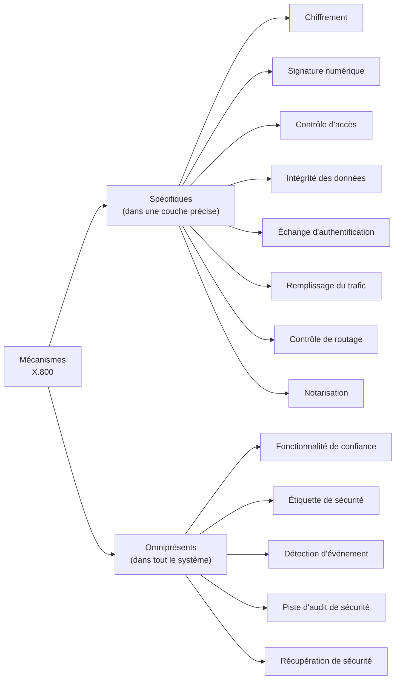
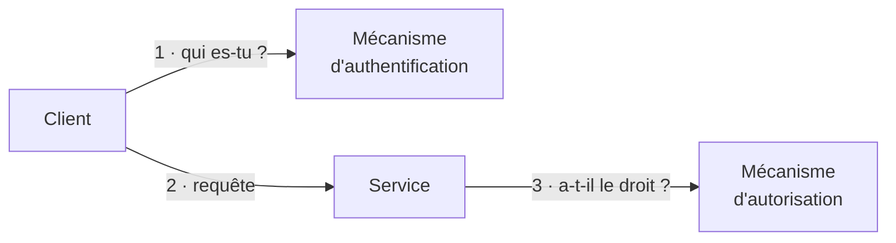

# Résumé — TD 1 : Introduction à la sécurité informatique

Support : [[Corrigé TD 1 - Introduction à la sécurité informatique.pdf]] (4 pages, A.U. 2024-2025) · Pr. Ben Hassine Ines · cours correspondant : [[Résumé - Chapitre 1 - Notions de base de la sécurité informatique]]

Le TD vérifie le vocabulaire du chapitre 1 : un **QCM de 10 questions**, un **exercice 1** de questions de cours (types de sécurité, mécanismes X.800, contrôle d'accès, non-répudiation, politique de sécurité) et un **exercice 2** qui relie, dans deux matrices, les **services** et les **mécanismes** aux **attaques**. Cette fiche reprend chaque réponse du corrigé avec sa justification.

> [!warning] Deux réponses du QCM à vérifier avec l'enseignante
> Aux questions **7** et **8**, la réponse surlignée dans le corrigé ne correspond pas aux définitions du cours ni aux autres questions du QCM (détails dans le tableau et les remarques ci-dessous).

## QCM

| N° | Question | Réponse du corrigé | Pourquoi |
|---|---|---|---|
| 1 | L'intégrité est de… | **a** : garder une information **inchangée** lors de sa transmission | b est la confidentialité, c l'authentification |
| 2 | L'écoute du réseau et la collecte des informations est… | **a et c** : une **attaque passive** qui **vise la confidentialité** | on lit sans rien modifier (diapositives 18 et 19) |
| 3 | La modification des informations collectées est… | **b** : une **attaque active** | on altère les ressources (diapositive 20) |
| 4 | La confidentialité est de… | **b** : garder une information **privée** entre l'émetteur et le récepteur | |
| 5 | La sécurité vise cinq objectifs… | **a** : **confidentialité, intégrité, disponibilité, non-répudiation, authentification** | b contient « répudiation » et « détection », c contient « intégralité » |
| 6 | Une vulnérabilité est… | **b** : une **faiblesse** qui permet à un attaquant de porter atteinte au fonctionnement normal du système | a est la non-répudiation ; une vulnérabilité n'est pas une attaque (c) |
| 7 | L'objectif de ___ est de garantir l'accès à un service ou à des ressources | corrigé : **b** (l'authenticité) | **voir la remarque : la bonne réponse est c, la disponibilité** |
| 8 | L'authentification… | corrigé : **a et b** | **voir la remarque : seule b convient** |
| 9 | La sécurité informatique est un… | **c** : ensemble des moyens techniques, organisationnels, juridiques et humains pour **conserver, rétablir et garantir** la sécurité | b, « payer », et d, « obéir », sont des pièges |
| 10 | La (les) bonne(s) affirmation(s) | **b et c** | on choisit des **mécanismes** qui assurent des objectifs (b) ; on ne supprime pas un risque, on **réduit son impact** (c) |

> [!remarque] Question 7 : la disponibilité, pas l'authenticité
> « Garantir l'accès à un service ou à des ressources », c'est la définition de la **disponibilité** (réponse **c**) : c'est elle que vise le **déni de service**, qui empêche justement l'accès (le corrigé lui-même associe la disponibilité au déni de service à l'exercice 1, question 11). L'authenticité garantit l'**origine** d'un message ou l'**identité** d'une entité, pas l'accès au service.

> [!remarque] Question 8 : la réponse a décrit la disponibilité
> Les quatre propositions de la question 8 sont les définitions classiques des objectifs de sécurité :
> - a, « maintenir le bon fonctionnement du système d'information » : la **disponibilité** ;
> - **b**, « assurer que seules les personnes autorisées aient accès aux ressources » : l'**authentification** ;
> - c, « garantir qu'une transaction ne peut pas être niée » : la **non-répudiation** ;
> - d, « garantir que les données sont bien celles que l'on croit être » : l'**intégrité**.
>
> Le corrigé surligne a et b ; seule **b** correspond à l'authentification.

## Exercice 1

**1) Les différents types de sécurité** : sécurité informatique, du *cloud computing*, des mobiles, des réseaux, d'Internet, du Web…

**2) Les mécanismes de sécurité de X.800** : deux familles.

*Complément : le « sentier d'audit » du corrigé est la **piste d'audit** (*audit trail*), le journal des actions qui permet de retrouver qui a fait quoi. Le « remplissage du trafic » est le* traffic padding *du cours (diapositive 24).*

**3) La vie privée (*privacy*) est-elle une exigence de sécurité ?** Elle est souvent définie comme la capacité de protéger les **informations personnelles identifiables**, et la protection est bien un élément de sécurité ; d'autres la définissent comme « le droit d'être laissé seul », ce qui ne suffit plus dans un monde centré sur les données. En pratique, la vie privée répond à cinq questions :

- quelles données **collecter** ?
- quelles **utilisations** sont permises ?
- avec qui les **partager** ?
- combien de temps les **conserver** ?
- quel **contrôle d'accès** fin appliquer ?

**4) Les services offerts par le contrôle d'accès** :

| Service | Question |
|---|---|
| **Authentification** | **qui** peut se connecter ? |
| **Autorisation** | **que peut faire** un utilisateur authentifié ? |
| **Responsabilisation** (traçabilité) | **qu'a fait** un utilisateur ? |

**5) Authentification ou autorisation ?** Le corrigé répond par un schéma : le client passe par un **mécanisme d'authentification**, puis le service consulte un **mécanisme d'autorisation**.

En une phrase *(explication de cette fiche)* : l'**authentification** vérifie **qui** est l'utilisateur (mot de passe, certificat) ; l'**autorisation**, qui vient **après**, décide **ce qu'il a le droit de faire** (lire, modifier, administrer).

**6) Identification et authentification dans un réseau de télécommunication** :

- l'**identification** des appelants et des appelés sert à **acheminer l'appel** ;
- l'**authentification** des deux correspondants sert à bien **réserver et gérer les ressources** disponibles.

**7) Proactive ou réactive ?** Une démarche **proactive**, pour **prévenir** les attaques (le volet prévention de la diapositive 5).

**8) Ce qu'apporte la non-répudiation** : la garantie qu'**aucun des correspondants ne pourra nier** la transaction.

**9) Une politique de sécurité est-elle indispensable ?** **Oui** (diapositive 31 : elle fixe les actions permises et interdites et implique tout le monde).

**10) Pirate (P) ou administrateur (A) ?**

| Acte | Réponse | Pourquoi |
|---|---|---|
| paralyser un service ou un réseau | **P** | c'est un déni de service |
| écouter le réseau et collecter des informations | **P et A** | le pirate espionne ; l'administrateur surveille son réseau |
| chiffrer les communications | **A** | c'est une protection |
| modifier les données | **P et A** | le pirate falsifie ; l'administrateur fait des mises à jour légitimes |
| journaliser les activités de chaque acteur | **A** | c'est la traçabilité |

**11) Le service et l'attaque qui le vise** :

| Service | Attaque |
|---|---|
| Authentification | usurpation d'identité, accès non autorisé |
| Intégrité | modification de l'information |
| Confidentialité | écoute et interception des données |
| Disponibilité | déni de service (DoS) |
| Non-répudiation | répudiation |

**12) Domaines où la sécurité est primordiale** : politique, militaire, financier, médical…

## Exercice 2

**1) Services et attaques** (Y = le service protège contre l'attaque) :

| Service | Analyse du trafic | Mascarade | Rejeu | Modification des messages | Déni de service |
|---|---|---|---|---|---|
| Authentification | | **Y** | | | |
| Contrôle d'accès | | **Y** | | | |
| Confidentialité | **Y** | | | | |
| Intégrité des données | | | **Y** | **Y** | |
| Non-répudiation | | **Y** | | | |
| Disponibilité | | | | | **Y** |

Lecture : la **mascarade** (se faire passer pour un autre) est arrêtée par tout ce qui vérifie l'identité ; le **rejeu** et la **modification** sont des atteintes au contenu du flux, que l'**intégrité orientée connexion** détecte (diapositive 16) ; l'**analyse du trafic** relève de la confidentialité des flux (diapositive 15) ; le **déni de service** vise la disponibilité.

**2) Mécanismes et attaques** :

| Mécanisme | Analyse du trafic | Mascarade | Rejeu | Modification des messages | Déni de service |
|---|---|---|---|---|---|
| Chiffrement | | | | | |
| Signature digitale | | **Y** | **Y** | **Y** | |
| Contrôle d'accès | **Y** | **Y** | **Y** | | **Y** |
| Intégrité des données | | | **Y** | **Y** | |
| Authentification mutuelle | | **Y** | **Y** | | **Y** |
| Contrôle de routage | **Y** | | | | **Y** |
| Notarisation | | **Y** | **Y** | **Y** | |

> [!tip] Pourquoi la ligne « Chiffrement » est vide
> Le chiffrement protège le **contenu** des messages (l'interception), et cette matrice n'a pas de colonne « divulgation du contenu ». Il ne protège pas contre l'**analyse du trafic** : la diapositive 19 dit justement qu'elle marche « même en présence de mécanismes de cryptage » ; c'est le ***traffic padding*** qui la gêne (diapositive 24).

## À retenir

- **Cinq objectifs** : confidentialité, intégrité, disponibilité, non-répudiation, authentification.
- **Disponibilité** = garantir l'accès au service ; elle est visée par le **déni de service**.
- **Authentification** (qui ?) avant **autorisation** (quoi ?), puis **responsabilisation** (qu'a-t-il fait ?).
- Mécanismes X.800 : **spécifiques** (chiffrement, signature, contrôle d'accès, intégrité, échange d'authentification, remplissage du trafic, contrôle de routage, notarisation) et **omniprésents** (fonctionnalité de confiance, étiquette, détection d'événement, piste d'audit, récupération).
- Un risque ne s'élimine pas : on **réduit son impact** en choisissant des **mécanismes**.

## Questions de révision

1. Quel objectif de sécurité garantit l'accès à un service ? Quelle attaque le vise ?
2. Associer à chaque définition son objectif : « maintenir le bon fonctionnement du SI » ; « garantir qu'une transaction ne peut pas être niée » ; « garantir que les données sont bien celles que l'on croit être ».
3. Quelle différence entre authentification et autorisation ? Dans quel ordre interviennent-elles ?
4. Citer quatre mécanismes spécifiques et deux mécanismes omniprésents de X.800.
5. Pourquoi l'écoute du réseau peut-elle être faite par un administrateur ?
6. Contre quelles attaques la signature numérique protège-t-elle ? Et le contrôle de routage ?

> [!question]- Réponses
> 1. La **disponibilité** ; elle est visée par le **déni de service**.
> 2. **Disponibilité** ; **non-répudiation** ; **intégrité**.
> 3. L'**authentification** vérifie **qui** est l'utilisateur ; l'**autorisation** décide **ce qu'il peut faire**. L'authentification vient d'abord.
> 4. Spécifiques : chiffrement, signature numérique, contrôle d'accès, intégrité des données, échange d'authentification, remplissage du trafic, contrôle de routage, notarisation. Omniprésents : fonctionnalité de confiance, étiquette de sécurité, détection d'événement, piste d'audit, récupération de sécurité.
> 5. Pour **surveiller** son réseau (diagnostiquer, détecter les intrusions) : c'est la même technique que le pirate, mais avec une autorisation et un but légitime.
> 6. Signature numérique : **mascarade, rejeu, modification des messages**. Contrôle de routage : **analyse du trafic** et **déni de service**.
