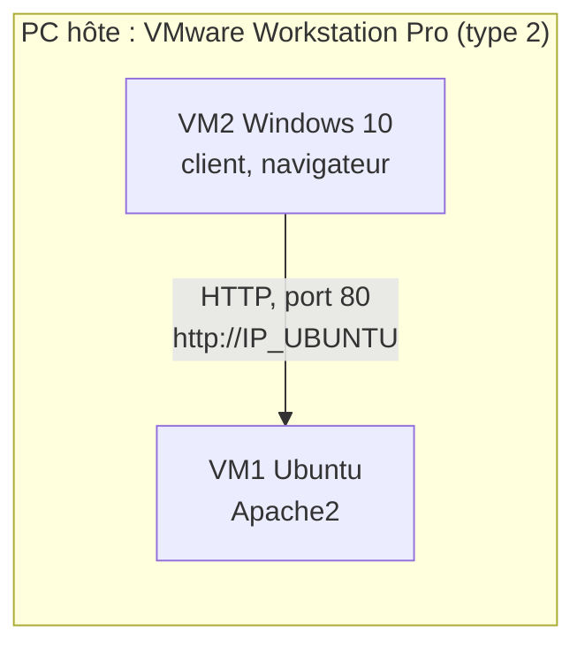

# Correction TP 0 — Virtualisation avec VMware Workstation Pro

Énoncé : [[TP 0 - Virtualisation avec VMware Workstation Pro.pdf]] · M. Karim Ghammam · cours : [[Résumé - Chapitre 1 - Principes de la virtualisation#11. Accès au réseau des machines virtuelles|modes réseau]], [[Résumé - Chapitre 2 - Principes de la virtualisation (suite)#4. Snapshot, clone et template|snapshot et clone]] · suite : [[Correction TP 1 - Virtualisation légère - Containers Docker]]

> [!abstract] Ce qu'on construit
> Deux VM sur un hyperviseur de **type 2** (VMware Workstation Pro) : **Ubuntu**, serveur Web **Apache2**, et **Windows 10**, client qui ouvre la page avec un navigateur. On les fait communiquer dans les trois modes réseau de VMware, puis on utilise un **snapshot** et un **clone**.



Les adresses IP ci-dessous sont des **exemples** : chaque installation de VMware tire au hasard le sous-réseau de VMnet1 et de VMnet8, et le mode Bridged dépend de la box ou du routeur.

## Étapes 4 et 5 : les deux VM

| | VM1 Ubuntu-Server | VM2 Windows10-Client |
|---|---|---|
| vCPU | 2 | 2 |
| RAM | 2 Go minimum | 4 Go |
| Disque | 20 Go minimum | 20 Go minimum |
| Rôle | serveur Web Apache2 | client Web |

Le PC hôte a besoin d'au moins **8 Go de RAM** : les deux VM réservent déjà 6 Go à elles deux.

## Étape 6 : les réseaux virtuels de VMware

| Mode | Réseau VMware | Adresse de la VM donnée par | Internet | Joignable depuis le LAN |
|---|---|---|---|---|
| **Bridged** | **VMnet0** | le **DHCP du vrai réseau** (box) : même plage que l'hôte, ex. `192.168.1.x` | oui | **oui** |
| **Host-Only** | **VMnet1** | le **DHCP virtuel** de VMware, ex. `192.168.56.128` | **non** | non (seulement l'hôte et les autres VM) |
| **NAT** | **VMnet8** | le **DHCP virtuel** de VMware, ex. `192.168.80.128`, passerelle `.2` | oui, avec l'**IP de l'hôte** | non |

Le mode se règle dans **VM → Settings → Network Adapter**. Les plages se lisent dans **Edit → Virtual Network Editor**. Le DHCP de VMware distribue par défaut à partir de **`.128`**.

## Étape 7 : test Host-Only

```sh
ip addr            # Ubuntu : l'adresse est sur l'interface ens33 (inet 192.168.56.129/24)
ipconfig           # Windows : « Adresse IPv4 » de la carte Ethernet0 (192.168.56.128)
ping 192.168.56.129    # depuis Windows
ping 192.168.56.128    # depuis Ubuntu
```

| Test | Résultat |
|---|---|
| Windows → Ubuntu | **réussi** |
| Ubuntu → Windows | **échoue** tant que le pare-feu Windows bloque le ping |
| `ping 8.8.8.8` | **échec** : pas de sortie vers Internet en Host-Only |

> [!warning] Le ping vers Windows échoue
> Le **pare-feu Windows Defender bloque les requêtes ICMP entrantes** (ping) par défaut. Ce n'est pas un problème de réseau : le ping inverse réussit et Apache reste accessible. Pour l'autoriser : *Pare-feu Windows Defender → Paramètres avancés → Règles de trafic entrant → « Partage de fichiers et d'imprimantes (Demande d'écho - Trafic entrant ICMPv4) » → Activer la règle*, ou en PowerShell administrateur :
> ```powershell
> New-NetFirewallRule -DisplayName "ICMPv4 entrant" -Protocol ICMPv4 -IcmpType 8 -Direction Inbound -Action Allow
> ```

Comme Host-Only n'a pas Internet, **installer Apache (étape 8) en mode NAT ou Bridged**, puis revenir en Host-Only pour les tests.

## Étapes 8 à 10 : Apache2

```sh
sudo apt update
sudo apt install apache2 -y
sudo systemctl status apache2     # Active: active (running)
curl http://localhost             # renvoie le HTML de « Apache2 Ubuntu Default Page »
```

Depuis Windows, `http://192.168.56.129` affiche la page **Apache2 Ubuntu Default Page : It works!**. Si la page ne s'affiche pas alors que le ping passe, vérifier le pare-feu d'Ubuntu : `sudo ufw status` ; s'il est actif, `sudo ufw allow 80/tcp`.

## Étapes 11 à 13 : page personnalisée, port, arrêt

```sh
sudo nano /var/www/html/index.html      # coller la page du TP, Ctrl+O, Entrée, Ctrl+X
sudo ss -lntp | grep :80
```

```
LISTEN 0  511  *:80  *:*  users:(("apache2",pid=...,fd=4),...)
```

**Port HTTP : 80** (Apache écoute sur toutes les interfaces, `*:80`).

| Action | Observation depuis Windows |
|---|---|
| `sudo systemctl stop apache2` | « **Impossible d'accéder à ce site** / connexion refusée » : plus aucun programme n'écoute sur le port 80 |
| `sudo systemctl start apache2` | la page personnalisée revient (rafraîchir avec **Ctrl+F5** pour ne pas voir la copie en cache) |

## Étape 14 : test NAT

```sh
ip addr      # ex. 192.168.80.128
ipconfig     # ex. 192.168.80.129
ping 8.8.8.8          # réussi
ping google.com       # réussi : la résolution DNS fonctionne aussi
```

`http://<IP_UBUNTU>` depuis Windows : **Oui**. Les deux VM sont sur le **même réseau NAT (VMnet8)**, elles se voient directement ; ce qui est masqué par le NAT, c'est leur accès **vers l'extérieur** (les machines du LAN ne les voient pas).

## Étape 15 : test Bridged

Les VM reçoivent une adresse **de la box**, dans la même plage que le PC hôte (ex. `192.168.1.47` et `192.168.1.48`) : elles sont des machines **comme les autres sur le réseau physique**. Ping et Apache fonctionnent (sauf le ping vers Windows bloqué par le pare-feu). Un autre PC ou un téléphone du même Wi-Fi peut aussi ouvrir `http://<IP_UBUNTU>`.

> [!note] Bridged sur Wi-Fi ou réseau d'école
> Si les VM n'obtiennent pas d'adresse en Bridged, choisir la bonne carte physique dans **Virtual Network Editor → VMnet0 → Bridged to** (la carte Wi-Fi au lieu de « Automatic »). Certains réseaux d'établissement refusent plusieurs adresses MAC sur un même port : utiliser alors NAT.

## Étape 16 : comparaison des modes

| Mode | VMware | Internet | VM ↔ VM | Apache depuis Windows |
|---|---|---|---|---|
| NAT | VMnet8 | **Oui** | **Oui** | **Oui** |
| Host-Only | VMnet1 | **Non** | **Oui** | **Oui** |
| Bridged | VMnet0 | **Oui** | **Oui** | **Oui** |

## Étapes 17 à 19 : snapshot

1. **VM → Snapshot → Take Snapshot**, nom `Apache-Fonctionnel`, description « état fonctionnel du serveur Apache avant modification » ;
2. ajouter `<h2>Modification après Snapshot</h2>` dans `index.html` : depuis Windows, **la nouvelle ligne apparaît** ;
3. **VM → Snapshot → Snapshot Manager → Apache-Fonctionnel → Go To** : la VM revient à l'état du snapshot, **la ligne a disparu** de la page.

Toutes les modifications faites après le snapshot sont perdues au retour ; VMware propose de prendre un nouveau snapshot avant de revenir.

## Étapes 20 à 23 : clone

**VM → Manage → Clone → The current state in the virtual machine → Create a full clone**, nom `Ubuntu-Server-Clone` (la VM source doit être **éteinte**).

| Machine | Hostname | Adresse IP |
|---|---|---|
| Ubuntu-Server | `ubuntu-server` | ex. `192.168.80.128` |
| Ubuntu-Server-Clone | **le même** `ubuntu-server` (tout le disque est copié) | une autre adresse, ex. `192.168.80.130` (sinon, voir l'avertissement plus bas) |

- le clone est une **VM indépendante** : Apache y est déjà installé et actif (`curl http://localhost` renvoie la page personnalisée), et `http://<IP_CLONE>` fonctionne depuis Windows ;
- les deux machines se pinguent : ce sont deux machines distinctes avec deux adresses.

> [!warning] Le clone reçoit la même adresse IP que l'original
> VMware donne une **nouvelle adresse MAC** au clone, mais Ubuntu s'identifie auprès du serveur DHCP avec un identifiant tiré de `/etc/machine-id`, **copié avec le disque**. Le DHCP peut alors donner **la même IP** aux deux VM : conflit, les pings et Apache répondent au hasard. Correction dans le clone :
> ```sh
> sudo hostnamectl set-hostname ubuntu-server-clone
> sudo rm /etc/machine-id
> sudo systemd-machine-id-setup
> sudo reboot
> ```

## Étape 24 : snapshot ou clone

| Caractéristique | Snapshot | Clone |
|---|---|---|
| Enregistre l'état d'une VM | **✔** | ✘ |
| Crée une nouvelle VM | ✘ | **✔** |
| Retour à un état précédent | **✔** | ✘ |
| Machine indépendante | ✘ (dépend du disque parent) | **✔** (full clone) |
| Test d'une modification | **✔** | ✔ (sur une copie, sans toucher l'original) |
| Espace disque supplémentaire | **faible au départ** (fichier delta qui grossit) | **important** (copie de tout le disque) |

## Étape 25 : réponses aux questions

1. **VMware Workstation Pro** est un **hyperviseur de type 2** : installé sur le système du PC, il crée et exécute plusieurs machines virtuelles qui partagent le processeur, la mémoire et le disque de l'hôte.
2. **Ubuntu** est le **serveur** : il héberge le serveur Web Apache2 et la page du site.
3. **Windows 10** est le **client** : il ouvre le site du serveur avec un navigateur.
4. Le serveur Web est **Apache2** (paquet `apache2`).
5. Sous Ubuntu : **`ip addr`** (ou `ip a`, `hostname -I`).
6. Sous Windows : **`ipconfig`**.
7. Le protocole entre Windows et Apache est **HTTP**, au-dessus de TCP.
8. HTTP utilise normalement le port **80** (HTTPS le 443).
9. **NAT** : la VM sort sur Internet avec l'adresse de l'hôte, elle n'est pas visible depuis le réseau physique. **Host-Only** : réseau privé entre l'hôte et les VM, sans Internet. **Bridged** : la VM est branchée sur le réseau physique comme une machine réelle, avec une adresse de la box.
10. Le **snapshot** enregistre l'état d'une VM (disque, configuration, mémoire si elle est allumée) pour **revenir en arrière** après un test ou une mise à jour ratée.
11. Le **snapshot** est un **point de retour dans la même VM** et dépend de son disque ; le **clone** est une **nouvelle VM indépendante**, copie complète de l'originale.
12. Une adresse IP **identifie une machine** sur un réseau : deux machines avec la même adresse créent un **conflit**, les paquets n'arrivent plus à la bonne machine (cas du clone ci-dessus).
