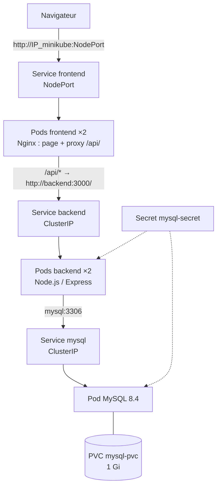

# Correction TP 2 — Orchestration et Kubernetes

Énoncé : [[TP 2 - Orchestration et Kubernetes.pdf]] · M. Karim Ghammam · cours : [[Résumé - Chapitre 2 - Principes de la virtualisation (suite)#7. Orchestration et cycle de vie|orchestration]] · avant : [[Correction TP 1 - Virtualisation légère - Containers Docker]]

> [!abstract] Ce qu'on construit
> Une application de **gestion des étudiants** en trois couches sur un cluster Kubernetes local (Minikube) : un **frontend** Nginx exposé en **NodePort**, une **API REST Node.js** derrière un Service **ClusterIP**, une base **MySQL** avec un **volume persistant** (PVC) et des mots de passe dans un **Secret**. On teste ensuite le **scaling**, le **remplacement automatique** des Pods et le **diagnostic**.

> [!note] Ce qui a été vérifié
> Le code de l'application (API, table SQL, proxy Nginx, page HTML) a été exécuté tel quel avec Docker (MySQL 8.4, Node 22, Express 5) : les réponses JSON et les messages d'erreur ci-dessous en sont tirés. Les sorties `kubectl` sont des **exemples types** : noms de Pods, adresses et ports changent d'un cluster à l'autre.



## Partie 1 : Minikube et kubectl

```sh
curl -LO https://storage.googleapis.com/minikube/releases/latest/minikube-linux-amd64
sudo install minikube-linux-amd64 /usr/local/bin/minikube
minikube version                    # minikube version: v1.x.y

KUBECTL_VERSION=$(curl -L -s https://dl.k8s.io/release/stable.txt)
curl -LO "https://dl.k8s.io/release/${KUBECTL_VERSION}/bin/linux/amd64/kubectl"
sudo install kubectl /usr/local/bin/kubectl
kubectl version --client

minikube start --driver=docker      # sans sudo
kubectl get nodes
```

```
NAME       STATUS   ROLES           AGE   VERSION
minikube   Ready    control-plane   1m    v1.3x.x
```

`kubectl get pods -A` liste les Pods du système (`kube-system`) : `etcd`, `kube-apiserver`, `kube-scheduler`, `kube-controller-manager`, `kube-proxy`, `coredns`, `storage-provisioner`.

> [!warning] Vérifier le téléchargement
> Le binaire `minikube` fait environ 100 Mo. Si `minikube version` n'affiche rien ou renvoie « Segmentation fault » (code 139), le fichier est **tronqué** (téléchargement interrompu) : le retélécharger et vérifier sa taille avec `ls -lh minikube-linux-amd64` avant `sudo install`. Si `kubectl` n'est pas installé, `minikube kubectl -- get pods` fonctionne aussi (alias pratique : `alias kubectl="minikube kubectl --"`).

**1. Rôle de Minikube** : créer un **cluster Kubernetes local à un seul nœud** (ici dans un conteneur Docker) pour apprendre et tester sans infrastructure ; il fournit aussi des outils (`minikube image load`, `minikube service`).

**2. Conteneur ou Pod** : un **conteneur** est un processus isolé lancé depuis une image ; un **Pod** est la **plus petite unité de Kubernetes** : il enveloppe **un ou plusieurs conteneurs** qui partagent la même **adresse IP**, les mêmes ports et des volumes, et qui sont planifiés ensemble sur le même nœud. Kubernetes ne gère pas des conteneurs, il gère des Pods.

**3. État Ready d'un nœud** : le **kubelet** du nœud est en bonne santé (réseau, disque, mémoire corrects) et le nœud **peut recevoir des Pods**.

## Partie 2 : premier déploiement Nginx

```sh
kubectl create deployment frontend-test --image=nginx
kubectl get deployments        # frontend-test   1/1   1   1
kubectl get pods               # frontend-test-7d4c...-x8kq2   1/1   Running
kubectl expose deployment frontend-test --type=NodePort --port=80
kubectl get services           # frontend-test   NodePort   10.10x.x.x   <none>   80:3xxxx/TCP
minikube service frontend-test --url    # http://192.168.49.2:3xxxx
```

L'URL affiche « Welcome to nginx! ». Avec le pilote Docker sous Linux, l'adresse `192.168.49.2` du nœud est joignable depuis la VM ; depuis un **autre** poste, il faudrait un transfert de port (`kubectl port-forward --address 0.0.0.0 service/frontend-test 8080:80`).

**4. Deployment** : décrit l'**état voulu** d'une application (image, nombre de **réplicas**) ; Kubernetes crée un **ReplicaSet** qui maintient ce nombre de Pods, les **recrée** s'ils disparaissent et permet les **mises à jour progressives** (*rolling update*) et les retours en arrière.

**5. Service** : donne à un ensemble de Pods (choisis par **label**) une **adresse stable** et un **nom DNS**, et **répartit le trafic** entre eux. Les Pods sont éphémères et changent d'IP ; le Service, lui, ne change pas.

**6. ClusterIP ou NodePort** :

| Type | Accessible depuis | Usage |
|---|---|---|
| **ClusterIP** (défaut) | **l'intérieur du cluster** uniquement | communication interne : backend, base de données |
| **NodePort** | l'extérieur, via `IP_du_nœud:port` (port entre **30000 et 32767**) | exposer une application en test |

## Partie 3 : backend Node.js

```sh
mkdir -p ~/gestion-etudiants/backend && cd ~/gestion-etudiants/backend
npm init -y
npm install express mysql2       # crée package-lock.json, indispensable à « npm ci »
```

Le fichier `app.js` est celui de l'énoncé. Il expose trois routes :

| Route | Rôle | Réponse |
|---|---|---|
| `GET /health` | vérifier que l'API tourne | `{"status":"ok"}` (ne touche **pas** à MySQL) |
| `GET /students` | lister les étudiants | tableau JSON, ou `500 {"error":"Erreur de consultation"}` |
| `POST /students` | ajouter `{nom, email}` | `201 {"id":4,...}`, `400` si un champ manque, `500` si l'insertion échoue |

`Dockerfile` :

```dockerfile
FROM node:22-alpine
WORKDIR /app
COPY package*.json ./
RUN npm ci --omit=dev        # installe exactement les versions du package-lock.json
COPY app.js .
EXPOSE 3000
CMD ["node", "app.js"]
```

```sh
docker build -t gestion-etudiants-api:v1 .
minikube image load gestion-etudiants-api:v1    # copie l'image dans le Docker du nœud Minikube
```

> [!tip] Ajouter un `.dockerignore`
> Un fichier `.dockerignore` contenant `node_modules` évite d'envoyer le dossier local au démon pendant le build : l'image installe ses propres dépendances avec `npm ci`.

**7. Dockerfile** : la **recette** pour construire l'image : image de base, dossier de travail, copie des fichiers, installation des dépendances, port documenté, commande de démarrage.

**8. Image ou conteneur** : l'image est le **modèle figé** en lecture seule ; le conteneur est une **instance en exécution** de cette image (voir [[Correction TP 1 - Virtualisation légère - Containers Docker#Étape 4 : images|TP 1]]).

**9. Pourquoi `0.0.0.0`** : écouter sur **toutes les interfaces réseau** du conteneur. Avec `127.0.0.1`, l'API n'accepterait que les connexions venues **de l'intérieur du conteneur** : le Service, le proxy Nginx et `port-forward` arrivent par l'interface réseau du Pod et seraient refusés.

**10. API REST** : une interface qui expose des **ressources** (ici `/students`) par des **URL** et des **méthodes HTTP** (`GET` pour lire, `POST` pour créer, `PUT`, `DELETE`), avec des échanges en **JSON** et des **codes de statut** (200, 201, 400, 500). Elle sépare le frontend de la base de données.

## Partie 4 : MySQL avec stockage persistant

```sh
kubectl create namespace gestion-etudiants
kubectl create secret generic mysql-secret \
  --namespace=gestion-etudiants \
  --from-literal=root-password='RootLab-2026!' \
  --from-literal=app-password='AppLab-2026!'
kubectl apply -f mysql.yaml
kubectl get pods,svc,pvc -n gestion-etudiants
kubectl rollout status deployment/mysql -n gestion-etudiants --timeout=180s
```

```
NAME                         READY   STATUS    RESTARTS   AGE
pod/mysql-6b9f...-abcde      1/1     Running   0          60s

NAME            TYPE        CLUSTER-IP     PORT(S)    AGE
service/mysql   ClusterIP   10.10x.x.x     3306/TCP   60s

NAME                              STATUS   VOLUME        CAPACITY   ACCESS MODES   STORAGECLASS
persistentvolumeclaim/mysql-pvc   Bound    pvc-3f1c...   1Gi        RWO            standard
```

Le PVC passe à **Bound** : le *storage-provisioner* de Minikube a créé automatiquement un PV correspondant. Le premier démarrage de MySQL prend une quinzaine de secondes (initialisation, création de la base `universite` et de l'utilisateur `appuser`).

```sh
kubectl exec -it deployment/mysql -n gestion-etudiants -- \
  sh -c 'MYSQL_PWD="$MYSQL_ROOT_PASSWORD" mysql -uroot universite'
```

Après le `CREATE TABLE` et l'`INSERT` de l'énoncé :

```
mysql> SELECT * FROM etudiants;
+----+------------------+---------------------+
| id | nom              | email               |
+----+------------------+---------------------+
|  1 | Ahmed Ben Ali    | ahmed@example.com   |
|  2 | Sarra Trabelsi   | sarra@example.com   |
|  3 | Youssef Mansouri | youssef@example.com |
+----+------------------+---------------------+
```

`MYSQL_PWD="$MYSQL_ROOT_PASSWORD"` passe le mot de passe sans l'écrire en clair dans la commande : la variable vient du Secret, injectée dans le conteneur.

**11. PV ou PVC** : un **PersistentVolume** (PV) est un **morceau de stockage réel** du cluster (disque, NFS, dossier du nœud), créé par l'administrateur ou automatiquement par une *StorageClass*. Un **PersistentVolumeClaim** (PVC) est la **demande** d'une application (« 1 Gi en ReadWriteOnce ») ; Kubernetes l'**associe** (*bind*) à un PV qui convient. Le Pod ne monte que le PVC : il ignore où est le stockage.

**12. Ne pas exposer la base** : elle contient les données ; publique, elle serait exposée aux **attaques par force brute** sur les mots de passe et aux failles de MySQL. Seul le backend en a besoin : principe du **moindre accès**. Le Service `mysql` est donc en ClusterIP.

**13. Service `mysql`** : donner à MySQL un **nom DNS stable** (`mysql`, ou `mysql.gestion-etudiants.svc.cluster.local`) et une IP fixe dans le cluster ; le backend se connecte à `mysql:3306` même si le Pod MySQL est recréé avec une autre IP.

## Partie 5 : backend

```sh
kubectl apply -f backend.yaml
kubectl rollout status deployment/backend -n gestion-etudiants
kubectl port-forward -n gestion-etudiants service/backend 3000:3000
```

Dans un deuxième terminal :

```sh
curl http://127.0.0.1:3000/health
# {"status":"ok"}
curl http://127.0.0.1:3000/students
# [{"id":1,"nom":"Ahmed Ben Ali","email":"ahmed@example.com"},{"id":2,"nom":"Sarra Trabelsi",...},{"id":3,...}]
curl -X POST http://127.0.0.1:3000/students \
  -H "Content-Type: application/json" \
  -d '{"nom":"Amira Gharbi","email":"amira@example.com"}'
# {"id":4,"nom":"Amira Gharbi","email":"amira@example.com"}    (HTTP 201 Created)
```

| Cas | Réponse |
|---|---|
| même e-mail envoyé une deuxième fois | `500 {"error":"Erreur d'ajout"}` ; logs : `Duplicate entry 'amira@example.com' for key 'etudiants.email'` (colonne `UNIQUE`) |
| `{"nom":"Sans email"}` | `400 {"error":"Nom et email obligatoires"}` |

> [!warning] `ErrImageNeverPull`, `ErrImagePull` ou `ImagePullBackOff`
> L'image `gestion-etudiants-api:v1` n'existe que localement. Sans `minikube image load`, le nœud ne la trouve pas et tente Docker Hub : `ErrImagePull`. Vérifier avec `minikube image ls | grep gestion`. `imagePullPolicy: IfNotPresent` dit d'utiliser l'image déjà présente sur le nœud. Après une modification du code, reconstruire avec un **nouveau tag** (`v2`), le charger, et mettre à jour le Deployment.

**14. Deux réplicas** : **disponibilité** (si un Pod tombe ou est redémarré, l'autre répond) et **répartition de charge** : le Service distribue les requêtes entre les deux.

**15. Comment le backend trouve MySQL** : par la variable `DB_HOST=mysql` ; **CoreDNS**, le DNS du cluster, résout le nom du Service `mysql` (même namespace) en son ClusterIP, et `kube-proxy` redirige vers le Pod MySQL.

**16. Backend en ClusterIP** : seul le **frontend** l'appelle, depuis l'intérieur du cluster (proxy Nginx) ; inutile et moins sûr de l'exposer à l'extérieur.

## Partie 6 : frontend

Les fichiers `index.html`, `default.conf` et le `Dockerfile` sont ceux de l'énoncé.

```sh
docker build -t gestion-etudiants-frontend:v1 .
minikube image load gestion-etudiants-frontend:v1
kubectl apply -f frontend.yaml
minikube service frontend -n gestion-etudiants --url    # http://192.168.49.2:3xxxx
```

![[k8s-tp2-frontend.png|560]]

La liste s'affiche, et le formulaire ajoute un étudiant puis recharge la liste.

**Le proxy `/api/`** :

```nginx
location /api/ {
    proxy_pass http://backend:3000/;
}
```

La page appelle `/api/students` sur **la même adresse** que le frontend. Nginx transmet au Service `backend` ; la **barre oblique finale** de `proxy_pass` **retire le préfixe** `/api/` : `/api/students` devient `/students`. Le navigateur ne parle qu'au frontend, donc **pas de problème de CORS** et le backend reste interne.

> [!warning] Le frontend en `CrashLoopBackOff`
> Nginx résout le nom `backend` **au démarrage**. Si le Service `backend` n'existe pas encore (frontend appliqué avant `backend.yaml`, ou namespace différent), Nginx s'arrête aussitôt :
> ```
> nginx: [emerg] host not found in upstream "backend" in /etc/nginx/conf.d/default.conf:12
> ```
> Kubernetes le relance en boucle : `CrashLoopBackOff`. Il suffit de créer le Service backend ; le Pod frontend redémarre alors correctement.

## Partie 7 : scaling et remplacement automatique

```sh
kubectl scale deployment backend --replicas=4 -n gestion-etudiants
kubectl scale deployment frontend --replicas=3 -n gestion-etudiants
kubectl get deployments -n gestion-etudiants
```

```
NAME       READY   UP-TO-DATE   AVAILABLE
backend    4/4     4            4
frontend   3/3     3            3
mysql      1/1     1            1
```

```sh
kubectl delete pod backend-5c8d...-7xq2p -n gestion-etudiants
kubectl get pods -n gestion-etudiants
# un nouveau Pod backend-5c8d...-k9wzt apparaît (AGE de quelques secondes) : toujours 4 réplicas
```

**17. Scaling horizontal** : augmenter (ou réduire) le **nombre d'instances** (Pods) d'une application pour absorber la charge, au lieu d'agrandir une seule instance (CPU, mémoire : scaling **vertical**). Il peut être automatique avec un *HorizontalPodAutoscaler*.

**18. Pourquoi le Pod est recréé** : le **ReplicaSet** du Deployment compare en permanence l'**état réel** (3 Pods) à l'**état voulu** (4) ; le contrôleur crée un Pod pour combler l'écart. C'est la **boucle de réconciliation** de Kubernetes.

**19. Pourquoi plusieurs réplicas ne suffisent pas** : ici tous les Pods tournent sur **un seul nœud** (Minikube) : s'il tombe, tout tombe. La **base MySQL** n'a qu'**un** réplica et un volume **ReadWriteOnce** : c'est un point unique de défaillance. Il manque aussi des **sondes** (readiness, liveness) pour retirer un Pod qui ne répond plus, et plusieurs nœuds, voire plusieurs zones.

## Partie 8 : diagnostic

```sh
kubectl get all -n gestion-etudiants
kubectl logs deployment/backend -n gestion-etudiants
kubectl describe pod NOM_DU_POD -n gestion-etudiants
kubectl get events -n gestion-etudiants --sort-by=.metadata.creationTimestamp
```

**Exercice : `DB_HOST` faux.** Dans `backend.yaml`, `value: mysql-inexistant`, puis `kubectl apply -f backend.yaml`.

| Observation | Résultat |
|---|---|
| `kubectl get pods` | les Pods backend sont **Running**, sans redémarrage |
| `curl .../health` | `{"status":"ok"}` |
| `curl .../students` | `500 {"error":"Erreur de consultation"}` |
| `kubectl logs deployment/backend` | `Error: getaddrinfo ENOTFOUND mysql-inexistant` |

> [!important] Pourquoi il n'y a pas de CrashLoopBackOff ici
> L'API ouvre une connexion MySQL **à chaque requête**, pas au démarrage : avec un mauvais hôte, le serveur démarre quand même, et seules les requêtes vers la base échouent. Kubernetes voit un Pod en bonne santé. Le problème ne se voit que dans les **logs** et dans les **réponses 500**. `ENOTFOUND` signifie que le **nom DNS n'existe pas** (pas de Service de ce nom dans le namespace) ; un `ECONNREFUSED` indiquerait un Service qui existe mais sans Pod prêt derrière, un `Access denied` un mauvais mot de passe.

On rétablit `DB_HOST=mysql`, on réapplique, et `/students` répond de nouveau.

**20. CrashLoopBackOff** : le conteneur **démarre puis s'arrête** (erreur, commande qui se termine) ; Kubernetes le relance avec un **délai qui double** à chaque échec (10 s, 20 s, 40 s… jusqu'à 5 min). Exemple dans ce TP : le frontend sans Service backend. Cause à chercher dans `kubectl logs --previous` (logs de l'exécution précédente) et `kubectl describe pod` (*Last State*, *Exit Code*).

**21. Diagnostiquer la connexion à MySQL** :

1. `kubectl get pods,svc,endpoints -n gestion-etudiants` : le Pod MySQL est-il Running, le Service a-t-il un **endpoint** (IP du Pod) ?
2. `kubectl logs deployment/backend` : `ENOTFOUND` (nom), `ECONNREFUSED` (port ou Pod pas prêt), `ER_ACCESS_DENIED_ERROR` (mot de passe), `ER_NO_SUCH_TABLE` (table non créée) ;
3. `kubectl exec deployment/backend -n gestion-etudiants -- env | grep DB_` : vérifier les variables ;
4. `kubectl logs deployment/mysql` : MySQL a-t-il bien démarré ?
5. tester depuis le cluster : `kubectl run test --rm -it --image=mysql:8.4 -n gestion-etudiants -- mysql -h mysql -uappuser -p universite`.

**22. `logs` ou `describe`** : `kubectl logs` affiche **ce que l'application écrit** (sa sortie standard : erreurs Node, requêtes) ; `kubectl describe` affiche **ce que Kubernetes sait de l'objet** : configuration, état des conteneurs, nombre de redémarrages, code de sortie et **événements** (planification, téléchargement de l'image, échec des sondes, `OOMKilled`).

## Partie 9 : travail supplémentaire

**Consultation par identifiant et suppression** (à ajouter dans `app.js`) :

```js
app.get("/students/:id", async (req, res) => {
  try {
    const db = await mysql.createConnection(dbConfig);
    const [rows] = await db.execute("SELECT id, nom, email FROM etudiants WHERE id = ?", [req.params.id]);
    await db.end();
    if (rows.length === 0) return res.status(404).json({ error: "Étudiant introuvable" });
    res.json(rows[0]);
  } catch (error) {
    console.error(error);
    res.status(500).json({ error: "Erreur de consultation" });
  }
});

app.delete("/students/:id", async (req, res) => {
  try {
    const db = await mysql.createConnection(dbConfig);
    const [result] = await db.execute("DELETE FROM etudiants WHERE id = ?", [req.params.id]);
    await db.end();
    if (result.affectedRows === 0) return res.status(404).json({ error: "Étudiant introuvable" });
    res.status(204).end();
  } catch (error) {
    console.error(error);
    res.status(500).json({ error: "Erreur de suppression" });
  }
});
```

Les `?` sont des **requêtes préparées** : la valeur est envoyée à part, ce qui protège de l'**injection SQL**. Reconstruire l'image en `v2`, `minikube image load`, puis `kubectl set image deployment/backend backend=gestion-etudiants-api:v2 -n gestion-etudiants`.

**Sondes, requests et limits** (dans le conteneur backend de `backend.yaml`) :

```yaml
          readinessProbe:            # le Pod ne reçoit du trafic que s'il répond
            httpGet:
              path: /health
              port: 3000
            initialDelaySeconds: 3
            periodSeconds: 5
          livenessProbe:             # le conteneur est redémarré s'il ne répond plus
            httpGet:
              path: /health
              port: 3000
            initialDelaySeconds: 10
            periodSeconds: 10
          resources:
            requests:                # réservé pour la planification
              cpu: 100m
              memory: 128Mi
            limits:                  # plafond (au-delà de la mémoire : OOMKilled)
              cpu: 500m
              memory: 256Mi
```

## Nettoyage

```sh
kubectl delete namespace gestion-etudiants      # supprime aussi le PVC, donc les données
kubectl delete deployment frontend-test --ignore-not-found
kubectl delete service frontend-test --ignore-not-found
minikube stop                                   # minikube delete pour supprimer tout le cluster
```
