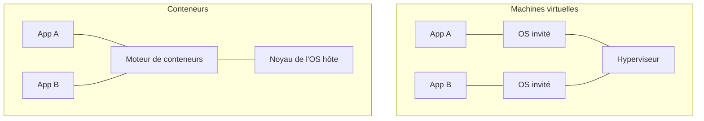

# Virtualisation, conteneurs et cloud

## La virtualisation

> [!definition] Virtualisation
> Faire tourner plusieurs **machines virtuelles** (VM) isolées sur une seule machine physique. Chaque VM a son propre système d'exploitation et croit disposer de son propre matériel.

Le logiciel qui crée et gère les VM s'appelle l'**hyperviseur**.

| | Type 1 (« bare metal ») | Type 2 (hébergé) |
|---|---|---|
| S'installe | directement sur le matériel | sur un OS existant |
| Performances | excellentes | plus faibles |
| Usage | serveurs, datacenters, cloud | poste de travail, tests |
| Exemples | VMware ESXi, Proxmox (KVM), Hyper-V, Xen | VirtualBox, VMware Workstation |

Ce que la virtualisation apporte : consolidation (moins de serveurs physiques), isolation, **snapshots**, migration à chaud d'une VM d'un serveur à l'autre, création d'une machine en quelques minutes.

## Les conteneurs

Un **conteneur** isole une application et ses dépendances, mais **partage le noyau** du système hôte. Sous Linux, il repose sur les **namespaces** (isolation des processus, du réseau, des fichiers) et les **cgroups** (limites de CPU et de mémoire).



| | Machine virtuelle | Conteneur |
|---|---|---|
| Contient | un OS complet | l'application et ses bibliothèques |
| Taille | quelques Go | quelques Mo |
| Démarrage | minutes | secondes |
| Isolation | forte (noyau séparé) | plus faible (noyau partagé) |

## Docker

| Notion | Sens |
|---|---|
| **Image** | modèle en lecture seule, construit en couches à partir d'un `Dockerfile` |
| **Conteneur** | une instance en cours d'exécution d'une image |
| **Registre** | dépôt d'images (Docker Hub, GitHub Container Registry) |
| **Volume** | stockage qui survit à la suppression du conteneur |

```dockerfile
FROM node:22-alpine
WORKDIR /app
COPY package*.json ./
RUN npm ci --omit=dev
COPY . .
EXPOSE 3000
CMD ["node", "server.js"]
```

```sh
docker build -t mon-api .
docker run -d -p 8080:3000 --name api mon-api   # port 8080 de l'hôte → 3000 du conteneur
docker ps          # conteneurs actifs
docker logs api    # sortie de l'application
docker exec -it api sh
```

> [!tip] L'ordre des lignes compte
> Chaque instruction crée une couche mise en cache. Copier `package.json` et installer les dépendances **avant** de copier le code évite de tout réinstaller à chaque modification.

**Docker Compose** décrit plusieurs conteneurs qui fonctionnent ensemble (une API et sa base de données, par exemple) dans un fichier `compose.yaml`, et les lance avec `docker compose up`.

## L'orchestration : Kubernetes

En production, il faut faire tourner des dizaines de conteneurs sur plusieurs machines, les redémarrer s'ils tombent et en ajouter quand la charge monte. C'est le rôle de **Kubernetes** (K8s).

- **Pod** : un ou plusieurs conteneurs déployés ensemble.
- **Deployment** : maintient N copies (*replicas*) d'un pod et gère les mises à jour progressives.
- **Service** : une adresse stable et la répartition de charge vers les pods.
- **Nœud** : une machine du cluster.

## Le cloud computing

> [!definition] Le cloud (définition du NIST)
> L'accès **à la demande**, par le réseau, à un ensemble **partagé** de ressources informatiques configurables, fournies et libérées rapidement avec un minimum d'effort.

Les 5 caractéristiques : libre-service à la demande · large accès réseau · mutualisation des ressources · **élasticité** rapide · service **mesuré** (on paie ce qu'on consomme).

### Les modèles de service

| Modèle | Le fournisseur gère | Tu gères | Exemples |
|---|---|---|---|
| **IaaS** | matériel, réseau, virtualisation | OS, runtime, application, données | AWS EC2, Azure VM, Google Compute Engine |
| **PaaS** | + l'OS et le runtime | application, données | Heroku, Google App Engine, Azure App Service |
| **SaaS** | tout | tes données et tes réglages | Gmail, Microsoft 365, Salesforce |

> [!exemple] La métaphore de la pizza
> IaaS : on te loue une cuisine équipée · PaaS : on te livre une pâte prête, tu ajoutes la garniture · SaaS : tu manges au restaurant.

### Les modèles de déploiement

- **Public** : les ressources d'un fournisseur, partagées entre ses clients (AWS, Azure, GCP).
- **Privé** : une infrastructure dédiée à une organisation (OpenStack, VMware).
- **Hybride** : un mélange des deux, par exemple les données sensibles en privé et les pics de charge en public.
- **Communautaire** : partagé entre organisations d'un même secteur.

Le cloud est aussi la plateforme naturelle du Big Data (stockage objet, clusters Spark à la demande) et de l'IoT (AWS IoT Core, DynamoDB, Kinesis : voir le résumé d'IoT, module 6).

> [!abstract] À retenir
> VM = un OS complet sur un hyperviseur ; conteneur = une application isolée, noyau partagé. Docker construit et lance, Kubernetes orchestre. Cloud : IaaS / PaaS / SaaS, public / privé / hybride, élasticité et paiement à l'usage. Fiche : [[Résumé - Cloud et virtualisation]].
