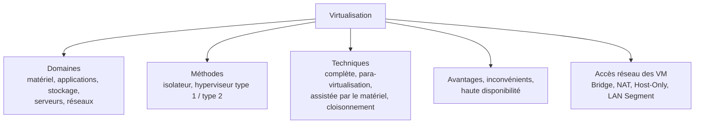
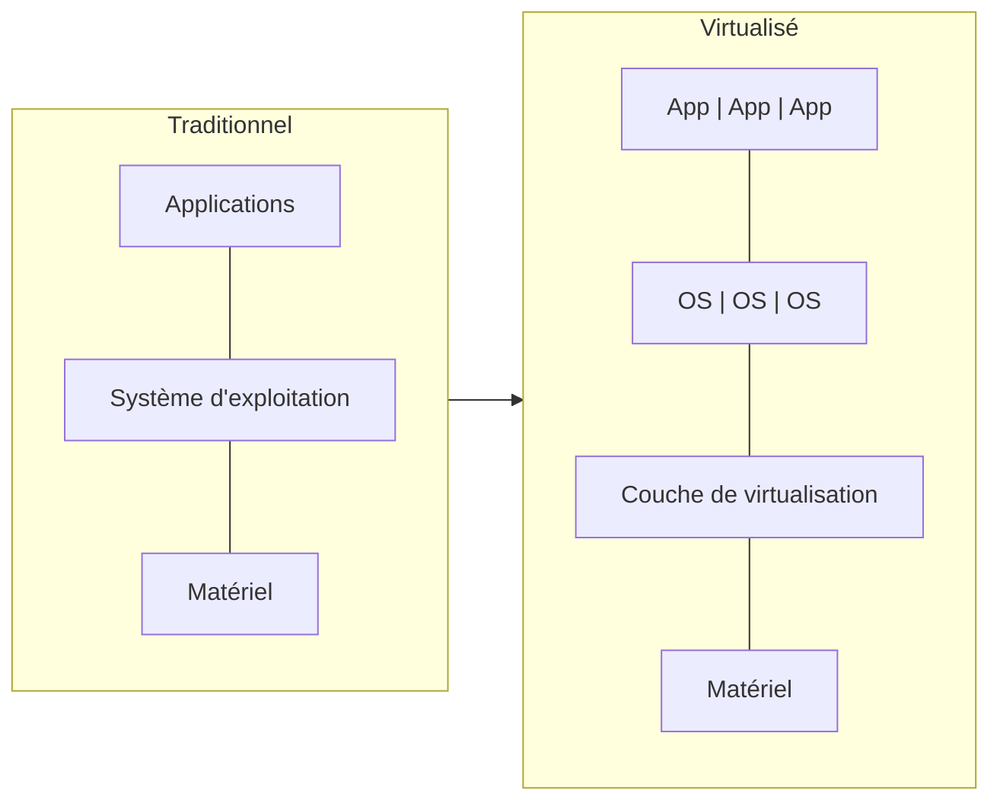

# Résumé — Chapitre 1 : principes de la virtualisation

Support : [[Chapitre 1 - Principes de la virtualisation.pdf]] (62 diapositives) · Dr. Ing. Wided Ben Daoud · Université de Monastir, ISIMa, 2026-2027 · suite : [[Résumé - Chapitre 2 - Principes de la virtualisation (suite)]] · TP lié : [[Correction TP 0 - Virtualisation avec VMware Workstation Pro|TP 0, VMware]]

Le module a deux objectifs généraux : comprendre **la virtualisation** (principes, techniques, formes), puis **le cloud computing** (modèles, services, acteurs). Ce premier chapitre pose la base : qu'est-ce que virtualiser, dans quels domaines, avec quelle architecture (**isolateur** ou **hyperviseur**), par quelle technique (**complète, para-virtualisation, assistée par le matériel, cloisonnement**), pour quels avantages, et comment une machine virtuelle accède au réseau (**Bridge, NAT, Host-Only, LAN Segment**).

## Le chapitre en un coup d'œil

| Diapositives | Thème |
|---|---|
| 7 à 13 | principe, vocabulaire (hôte, invité, hyperviseur), historique |
| 15 | objectifs |
| 17 à 25 | domaines : matériel, applications, stockage, serveurs, réseaux |
| 27 à 33 | méthodes : isolateur, hyperviseurs de type 1 et de type 2 |
| 35 à 41 | techniques et hyperviseurs du marché |
| 43 à 50 | avantages, inconvénients, haute disponibilité |
| 52 à 61 | accès au réseau des machines virtuelles |

## 1. Le principe

*Diapositives 7 à 9 et 11*

> [!definition] Virtualisation
> Utiliser des moyens techniques (matériels et/ou logiciels) pour faire fonctionner **sur une seule machine physique plusieurs systèmes d'exploitation ou plusieurs applications**, séparément les uns des autres, **comme s'ils fonctionnaient sur des machines physiques distinctes**. Autrement dit : **faire croire qu'une ressource virtuelle est une ressource réelle**, en utilisant les ressources physiques disponibles.

- objectif : **se libérer au maximum de la couche matérielle** ;
- elle repose sur le **partage** : les systèmes se partagent les ressources du serveur ;
- architecture traditionnelle : **une application, un système, un serveur** ; architecture virtualisée : une **couche de virtualisation** posée sur le matériel porte plusieurs couples (système, applications).

## 2. Le vocabulaire

*Diapositive 10*

| Terme | Définition |
|---|---|
| **Machine hôte** (ordinateur hôte) | la machine **physique** |
| **OS hôte** | le système d'exploitation exécuté sur la machine physique |
| **Hyperviseur** (VMM, *Virtual Machine Monitor*) | la **couche logicielle de virtualisation** |
| **Machine invitée** (VM) | la machine **virtuelle** créée par la virtualisation |
| **OS invité** (*guest OS*) | le système d'exploitation exécuté **dans** une VM |

## 3. Bref historique

*Diapositive 13*

| Année | Événement |
|---|---|
| 1964 | IBM explore la virtualisation sur **mainframes** |
| 1972 | IBM lance des VM sur mainframes |
| 1999 | **VMware** lance ses produits de virtualisation **x86** |
| 2002 | **Xen** devient open source |
| 2006 | Qumranet annonce **KVM** |
| 2007 | HP lance HP-UX Integrity VMs |
| 2008 | conteneurs Linux **LXC** ; Microsoft ajoute **Hyper-V** à Windows Server 2008 R2 |
| 2010 | RHEL 6.0 n'offre plus que KVM comme virtualisation |
| 2011 | IBM, Red Hat, HP et Intel fondent l'Open Virtualization Alliance pour KVM |
| 2013 | lancement de **Docker** |
| 2014 | lancement de Rocket (rkt) |

## 4. Objectifs

*Diapositive 15*

- **partager** les ressources d'un serveur physique en **N serveurs virtuels** alloués à différents clients ;
- donner à chaque client un **contrôle total** sur son serveur virtuel (il peut installer et réinstaller l'OS) ;
- **réduire les dépenses** : surface au sol, consommation électrique et climatisation, nombre d'administrateurs.

## 5. Les domaines de la virtualisation

*Diapositives 17 à 25*

| Domaine | Idée | Exemples |
|---|---|---|
| **Matériel** | créer une **représentation virtuelle des composants** (CPU, RAM, disque…) pour faire tourner plusieurs VM sur une machine | VM |
| **Applications** | **encapsuler une application et son contexte d'exécution** dans un environnement séparé : on l'utilise **sans l'installer** sur le poste ; meilleure **portabilité** et **compatibilité** | VMware **ThinApp**, Citrix **XenApp**, Microsoft **App-V** |
| **Stockage** | regrouper plusieurs disques physiques en **un seul espace virtuel** ; le disque d'une VM est un **fichier** sur l'hôte | formats **VHD** (Microsoft), **VMDK** (VMware), **VDI** (Oracle), **OVF** (format ouvert) |
| **Serveurs** | faire fonctionner **simultanément plusieurs serveurs virtuels** sur un serveur physique | consolidation |
| **Réseaux** | créer des **réseaux virtuels indépendants** sur une même infrastructure physique et en partager le débit et les ressources | **VLAN**, **VPN** |

**Stockage** : on peut ajouter un périphérique **sans interrompre les services**, regrouper des disques de vitesses, tailles et constructeurs différents, et **réallouer dynamiquement** l'espace (un serveur qui a besoin de moins d'espace le libère pour les autres).

> [!definition] VLAN et VPN
> - **VLAN** (*Virtual Local Area Network*) : réseau local qui regroupe des machines **de façon logique et non physique**.
> - **VPN** (*Virtual Private Network*) : connexion **sécurisée et virtuelle** qui relie un appareil à un réseau privé **à travers Internet**.

Les réseaux virtuels **réduisent le trafic de diffusion** (broadcast), renforcent la **sécurité** (information encapsulée dans une couche supplémentaire) et apportent de la **flexibilité** (changer la structure du réseau = changer la configuration du commutateur).

## 6. Méthodes : isolateur et hyperviseur

*Diapositives 27 à 33*

Deux variantes d'architecture : l'**isolateur**, et l'**hyperviseur** (avec le para-virtualisateur).

> [!definition] Isolateur
> Logiciel **installé dans un OS existant** qui isole l'exécution des applications dans des **contextes** (zones d'exécution) fortement séparés. Chaque contexte est **régi par l'OS hôte**, mais ses programmes ne communiquent qu'avec les processus et ressources **de leur propre contexte**.

> [!note] Les exemples de l'isolateur
> La diapositive 28 cite VMware Workstation, Virtual PC et VirtualBox. *(Complément : dans la plupart des références, et plus loin dans ce même cours, ces logiciels sont classés **hyperviseurs de type 2**. Les exemples typiques d'isolateurs sont `chroot`, les *jails* BSD, **OpenVZ**, **LXC**… c'est-à-dire le **cloisonnement** de la section 7.)*

> [!definition] Hyperviseur (*Virtual Machine Monitor*)
> Plateforme de virtualisation qui fait fonctionner **plusieurs VM en même temps sur un même serveur physique**. Il **alloue** les ressources matérielles aux VM, **partitionne** les ressources physiques, garantit l'**isolation** entre VM et **contrôle le flux d'instructions** entre les systèmes invités et le matériel.

| | **Type 1** : natif, *bare metal* | **Type 2** : hébergé, *host-based* |
|---|---|---|
| S'exécute | **directement sur le matériel** | **à l'intérieur d'un OS hôte** |
| Empilement | matériel → hyperviseur → VM | matériel → OS hôte → hyperviseur → VM (l'OS invité est au **3e niveau**) |
| Caractéristiques | très **léger**, optimisé ; implémente la plupart des services d'un noyau | plus simple à installer, moins performant |
| Usage | serveurs, centres de données | poste de travail, tests, TP |
| Exemples | **Xen**, **ESX(i)**, **Hyper-V** | **VMware Workstation**, **QEMU**, Microsoft **Virtual PC**, **VirtualBox** |

## 7. Les techniques de virtualisation

*Diapositives 35 à 39*

| Génération | Technique | OS invité | Principe | Exemples |
|---|---|---|---|---|
| 1re | **Virtualisation complète** (*full virtualization*) | **non modifié**, ne sait pas qu'il est virtualisé | l'hyperviseur **émule une machine entière** : il réécrit en temps réel les instructions de l'OS invité et simule le matériel | VMware ESXi, Hyper-V Server |
| 2e | **Para-virtualisation** (*OS-assisted*) | **modifié**, **conscient** de la virtualisation | **coopération** entre l'hyperviseur et l'OS invité ; évite un système hôte complet ; **meilleures performances** que la virtualisation complète | **Xen** (open source, version commerciale Citrix) |
| 3e | **Assistée par le matériel** (*silicon-based*) | **non modifié** | le **processeur** offre un support de la virtualisation (complément : Intel VT-x, AMD-V), séparation des ressources au niveau de la carte mère | VMware ESXi, Xen |
| — | **Cloisonnement** (isolation) | **un seul noyau partagé** | séparation forte de **contextes logiciels sur un même noyau** ; aucun contexte ne peut interférer avec les autres ; la technique **la plus légère** | **OpenVZ**, **LXC**, Linux-VServer |

> [!tip] Retenir la différence
> - **complète** : l'invité ne sait rien, l'hyperviseur fait tout le travail ;
> - **para** : l'invité est modifié et **coopère** ;
> - **matérielle** : le **CPU** aide, l'invité n'est pas modifié ;
> - **cloisonnement** : pas de VM, des **contextes** sur le **même noyau** (c'est l'ancêtre des conteneurs du chapitre 2).

## 8. Hyperviseurs du marché

*Diapositives 40 et 41*

| Hyperviseur | Éditeur, licence | Type (selon le cours) | Techniques |
|---|---|---|---|
| **KVM** | open source, intégré au noyau Linux en 2007 ; **le plus utilisé** | type 2 *(complément : souvent classé type 1, car le module transforme le noyau Linux lui-même en hyperviseur)* | complète, assistée par le matériel, para-virtualisation |
| **Xen** | open source, créé en 2003 à l'université de Cambridge, acquis par Citrix en 2007 | type 1 | assistée par le matériel, para-virtualisation |
| **VMware ESXi** | propriétaire VMware, très stable | type 1 | complète, assistée par le matériel |
| **Hyper-V** | Microsoft | type 1 | complète, assistée par le matériel |
| **VMware Workstation** | propriétaire VMware | type 2 | complète |
| **VirtualBox** | open source, gratuit, Oracle depuis 2010 | type 2 | assistée par le matériel, para-virtualisation |

## 9. Avantages et inconvénients

*Diapositives 43 à 45*

| Avantages | Inconvénients |
|---|---|
| **réduction des coûts** : moins de serveurs, d'énergie, d'espace ; ressources pleinement utilisées | **point unique de panne** : si la machine physique tombe, toutes ses VM s'arrêtent |
| **mise à disposition** de serveurs plus rapide | il faut des **machines puissantes** (outils gourmands) |
| **gestion des pannes** : serveurs virtuels de secours, reprise automatique, ressources ajoutées sans tout redimensionner | **dégradation des performances** des applications |
| installation, sauvegarde, déploiement et **migration faciles** (serveur surchargé ou remplacé) | |
| meilleure **sécurité** et **fiabilité** | |
| **tester** une application sur plusieurs OS et environnements | |
| **partager** les mêmes ressources entre plusieurs utilisateurs | |

## 10. Haute disponibilité et optimisation

*Diapositives 47 à 50*

> [!definition] Répartition de charge (*load balancing*)
> Héberger une application sur **plusieurs serveurs qui se partagent les utilisateurs** pour augmenter sa tenue en charge (un grand site web dont le trafic est réparti sur quelques serveurs). Avec la virtualisation, chaque serveur physique porte des VM de **plusieurs applications** : l'exemple de la diapositive 48 répartit deux applications sur **3 serveurs au lieu de 4**, et chaque application est répartie sur 3 serveurs au lieu de 2.

> [!definition] Reprise automatique (*failover*)
> **Redondance** des serveurs : les serveurs physiques se partagent les serveurs virtuels ; si l'un tombe en panne, **ses VM sont relancées sur les autres**.

**Optimisation** : sans virtualisation, un serveur n'utilise qu'une petite partie de ses ressources ; avec plusieurs environnements virtuels, sa charge monte vers sa capacité. Moins de serveurs physiques, moins d'énergie.

## 11. Accès au réseau des machines virtuelles

*Diapositives 52 à 61*

| Mode | La VM voit… | Adresse IP | Accès Internet / LAN | Communication avec l'hôte |
|---|---|---|---|---|
| **Bridge** (pont) | **le réseau physique** directement, comme une machine de plus | donnée par le **DHCP du réseau réel** (box, routeur) | **oui**, visible des autres machines du LAN | oui, via le réseau |
| **NAT** | un réseau privé derrière un **NAT simulé** par l'hyperviseur | donnée par le **DHCP virtuel** de l'hyperviseur | **oui en sortie**, avec l'**IP de l'hôte** (translation d'adresse) ; la VM n'est pas joignable de l'extérieur | oui |
| **Host-Only** | un **réseau privé VM ↔ hôte** | DHCP virtuel de l'hyperviseur | **non** : ni Internet, ni LAN | **oui, uniquement** |
| **LAN Segment** | un **LAN virtuel isolé** (« LAN-1 ») entre VM | aucune automatique (adresses fixes, ou un serveur DHCP placé dans une VM) | **non** | **non** |

- **Bridge** : l'OS invité a un accès direct à la carte réseau, indépendamment de l'OS hôte ; c'est **le mode le plus utilisé** ;
- **NAT** : la carte virtuelle de la VM est reliée à un NAT de l'hyperviseur ; le trafic sortant passe par l'OS hôte et sa carte physique, de façon **transparente** pour la VM ;
- **Host-Only** : les adaptateurs virtuels de la VM et de l'hôte obtiennent leurs adresses du **DHCP virtuel** ;
- **LAN Segment** : les VM d'un même segment communiquent entre elles ; celles de « LAN-2 » ne voient pas celles de « LAN-1 », et aucune ne voit l'hôte.

> [!exemple] Dans le TP 0
> VMware nomme ses réseaux virtuels : **VMnet0** = Bridged, **VMnet1** = Host-Only, **VMnet8** = NAT. Le serveur Ubuntu (Apache) et le client Windows 10 se voient dans les trois modes ; seul le mode Host-Only coupe Internet. Voir [[Correction TP 0 - Virtualisation avec VMware Workstation Pro]].

## À retenir

> [!abstract] Résumé
> - Virtualiser = faire tourner **plusieurs systèmes isolés sur une machine physique** en partageant ses ressources ; hôte = physique, invité = virtuel, hyperviseur = couche de virtualisation.
> - Domaines : **matériel, applications** (ThinApp, App-V), **stockage** (VHD, VMDK, VDI, OVF), **serveurs**, **réseaux** (VLAN, VPN).
> - **Isolateur** : contextes séparés dans un OS existant. **Hyperviseur type 1** : sur le matériel (Xen, ESXi, Hyper-V). **Type 2** : dans un OS hôte (Workstation, VirtualBox, QEMU).
> - Techniques : **complète** (invité non modifié, tout est émulé), **para** (invité modifié, coopère, plus rapide), **assistée par le matériel** (le CPU aide), **cloisonnement** (même noyau, le plus léger).
> - Avantages : coûts, déploiement, migration, reprise sur panne ; inconvénients : point unique de panne, machines puissantes, performances.
> - Haute disponibilité : **répartition de charge** + **reprise automatique**.
> - Réseau : **Bridge** (sur le LAN), **NAT** (sort avec l'IP de l'hôte), **Host-Only** (seulement l'hôte), **LAN Segment** (VM isolées entre elles).
