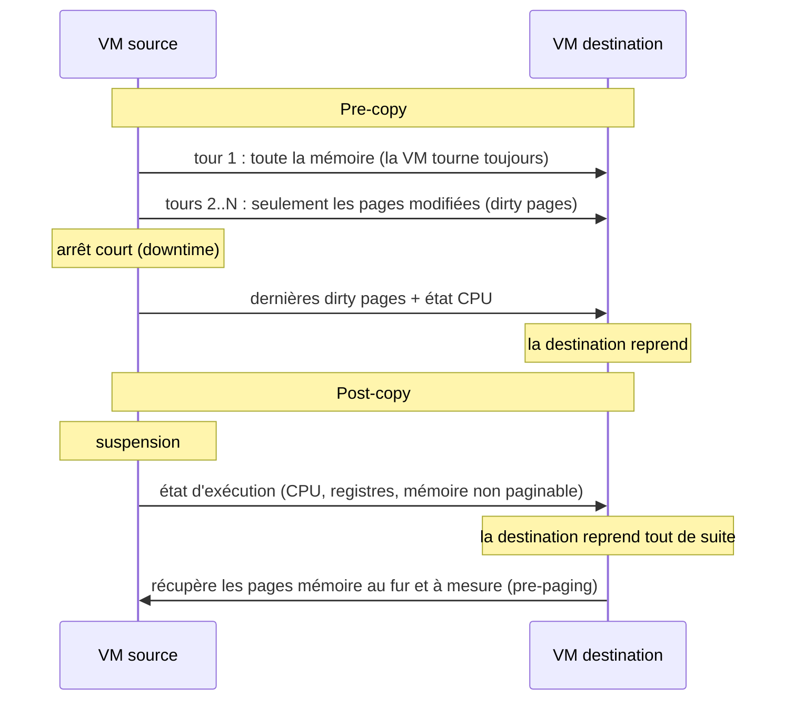
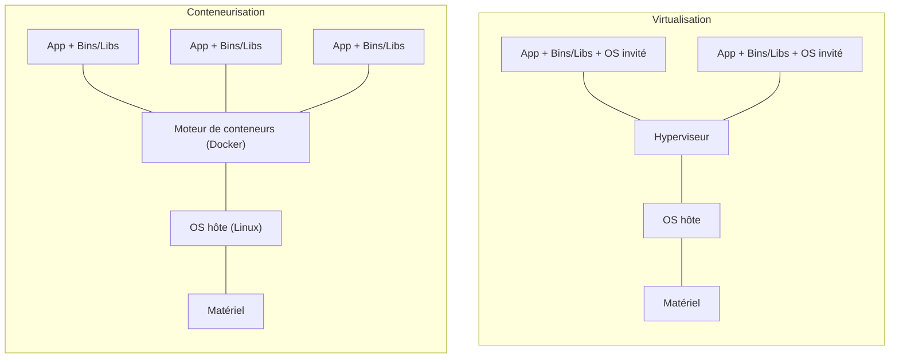
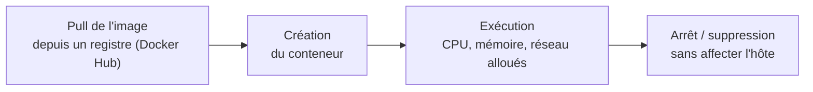

# Résumé — Chapitre 2 : principes de la virtualisation (suite)

Support : [[Chapitre 2 - Principes de la virtualisation (suite).pdf]] (30 diapositives) · Dr. Ing. Wided Ben Daoud · Université de Monastir, 2026-2027 · précédent : [[Résumé - Chapitre 1 - Principes de la virtualisation]] · TP liés : [[Correction TP 0 - Virtualisation avec VMware Workstation Pro|TP 0]] (snapshot, clone), [[Correction TP 1 - Virtualisation légère - Containers Docker|TP 1]] (Docker), [[Correction TP 2 - Orchestration et Kubernetes|TP 2]] (Kubernetes)

Une fois les VM créées, il faut les **déplacer** (migration à froid ou à chaud), **décider où les placer** (gestionnaires comme Sandpiper), les **sauvegarder et dupliquer** (snapshot, clone, template). Le chapitre compare ensuite les VM aux **conteneurs**, qui partagent le noyau de l'hôte grâce aux **namespaces** et aux **cgroups**, et termine par le **stockage** des VM : **DAS, SAN, NAS**.

## Le chapitre en un coup d'œil

| Diapositives | Thème |
|---|---|
| 3 à 8 | migration des VM : avantages, problèmes, à froid / à chaud, pre-copy / post-copy |
| 9 à 11 | systèmes de gestion de VM : l'exemple Sandpiper |
| 12 à 15 | snapshot, clone, template |
| 16 à 25 | conteneurs et VM : architecture, namespaces, cgroups, orchestration, cycle de vie |
| 26 à 29 | virtualisation du stockage : DAS, SAN, NAS |

## 1. La migration des machines virtuelles

*Diapositives 3 à 5*

> [!definition] Migration
> Déplacer une VM **d'un serveur physique vers un autre**, éventuellement dans un autre centre de données, par exemple pour **éviter la surcharge** d'un serveur. À grande échelle, un **gestionnaire de VM** décide automatiquement de l'emplacement et des migrations.

| Avantages | Problèmes |
|---|---|
| adapter l'emplacement des VM aux besoins | **interruption de service** |
| **consolider** les serveurs | **temps de copie** de la VM |
| **équilibrer la charge** | **adressage** : IP, MAC, VLAN |
| améliorer la **localité** des données et du réseau | **consommation de ressources** : bande passante, CPU, mémoire |
| réduire la **consommation d'énergie** et les **coûts d'hébergement** | **sécurité** : copie de la mémoire, vulnérabilité du module de migration |
| faciliter la **maintenance** et la **gestion des pannes** | |

| | Migration **à froid** | Migration **à chaud** (en direct, *live*, **vMotion** chez VMware) |
|---|---|---|
| État de la VM | **éteinte** ou **suspendue** | **allumée**, en fonctionnement |
| Ce qu'on déplace | les **fichiers de configuration et de disque** vers un nouveau stockage | l'**état en cours d'exécution** (mémoire, CPU) |
| Disponibilité | service interrompu pendant le déplacement | **pas d'interruption** visible |

## 2. Pre-copy et post-copy

*Diapositives 6 à 8*

Deux stratégies pour la migration à chaud :

- **Pre-copy** : la VM source **continue de tourner** pendant qu'on copie la mémoire ; à chaque itération on recopie les **pages modifiées** (*dirty pages*) ; quand il en reste peu (ou qu'un seuil de temps est atteint), on **suspend** la source, on copie les dernières pages, et la destination prend la relève.
- **Post-copy** : on **suspend d'abord** la source, on copie son **état d'exécution** (CPU, registres, mémoire), la destination **démarre aussitôt**, puis récupère la mémoire **progressivement** depuis la source. Le **pre-paging** améliore ce schéma en rapatriant d'avance les pages les plus susceptibles d'être demandées.

| | Pre-copy | Post-copy |
|---|---|---|
| Durée de la migration | **peut être longue** | **moins élevée** |
| Transfert des pages | une page peut être **transférée plusieurs fois** | chaque page **une seule fois** |
| En cas de problème | la source garde le **dernier état** : on peut revenir dessus | l'état est **réparti sur les deux machines** pendant un moment |
| Dépend de | le **modèle d'accès à la mémoire** (une VM qui modifie beaucoup sa mémoire migre mal) | le modèle d'accès à la mémoire (une page absente provoque une attente) |

## 3. Systèmes de gestion de VM : Sandpiper

*Diapositives 9 à 11*

**Fonction** : décider automatiquement de l'**emplacement** et de la **migration** des VM dans une infrastructure à large échelle. **Objectifs** : les mêmes que la migration (consolider, équilibrer, localité, énergie, coûts, maintenance), et surtout **éviter la surcharge** des serveurs en CPU, mémoire et disque.

> [!definition] Sandpiper
> Gestionnaire qui **détecte les nœuds surchargés** (*hotspots*) et **migre les VM responsables** vers des machines moins chargées. Son plan de contrôle a trois modules : **Profiling Engine** (mesure l'usage de chaque VM), **Hotspot Detector** (repère les surcharges), **Migration Manager** (décide et lance les migrations) ; chaque machine physique (PM) exécute un **Nucleus** qui collecte les mesures de ses VM.

Résultat cité (centre de données de **16 serveurs et 35 VM**) : Sandpiper **élimine tous les hotspots** par une série de migrations et **réduit de 61 %** le nombre d'intervalles en surcharge continue.

## 4. Snapshot, clone et template

*Diapositives 12 à 15*

> [!definition] Snapshot (instantané)
> **Capture de l'état d'une VM à un instant donné**, pour pouvoir **revenir en arrière**. Il contient l'état du **disque virtuel** (différences par rapport au disque parent), éventuellement l'état de la **mémoire**, et la **configuration** de la VM.

Fonctionnement : le **disque parent passe en lecture seule** et un **fichier différentiel (delta)** enregistre toutes les modifications suivantes.

- avantages : retour rapide à un état stable ; idéal pour les **tests**, les **mises à jour**, les environnements de développement ;
- limites : **ne remplace pas une sauvegarde** (il dépend du disque parent) ; plusieurs snapshots peuvent **dégrader les performances** ; le delta **grossit** avec le temps.

> [!definition] Clone
> **Copie d'une VM existante** qui devient une **VM indépendante**.

| Type de clone | Description |
|---|---|
| **Full clone** | copie **complète et indépendante** du disque et de la configuration ; fonctionne **sans la VM source** |
| **Linked clone** | copie **dépendante** du disque parent (snapshot + delta) ; **plus légère**, mais liée à la VM d'origine |

Usages : créer vite des machines de **laboratoire**, des environnements de **test multi-instances**, dupliquer une infrastructure (**Dev / Test / Prod**).

> [!definition] Template (modèle)
> VM **préconfigurée** (OS + configuration + logiciels), convertie en **lecture seule** et **non destinée à être exécutée**, qui sert à **déployer rapidement** des VM standardisées. Exemple : `Template_Ubuntu_Server_22.04` pour créer 50 VM identiques. Avantages : **standardisation**, **gain de temps**, **moins d'erreurs humaines**.

| | Snapshot | Clone | Template |
|---|---|---|---|
| Objectif | **point de restauration** | **copier** une VM | **créer plusieurs** VM identiques |
| Indépendance | ❌ dépend du disque parent | ✔️ full clone / ❌ linked clone | ✔️ sert de base |
| Exécution | ✔️ la VM continue de fonctionner | ✔️ exécutable | ❌ non exécutable |
| Usage principal | tests, mises à jour | duplication | déploiement rapide |

## 5. Conteneurs et machines virtuelles

*Diapositives 16 à 18*

- les conteneurs **n'ont pas besoin de VM** pour isoler des processus : les processus de l'espace utilisateur tournent **sur le même système d'exploitation** (OS partagé) mais **isolés** les uns des autres ;
- chaque espace utilisateur (une application et ses dépendances) reçoit les ressources nécessaires (vCPU, mémoire, système de fichiers) ;
- **meilleures performances** et attribution **plus flexible** des ressources que l'hyperviseur ; un conteneur **mobilise moins de ressources** qu'une VM, les applications restent **légères** et se déploient de manière **dense**.

| | Machine virtuelle | Conteneur |
|---|---|---|
| Contient | un **OS invité complet** + l'application | l'application + ses **dépendances**, pas de noyau |
| Noyau | propre à chaque VM | **partagé** avec l'hôte |
| Couche de virtualisation | **hyperviseur** | **moteur de conteneurs** (Docker, Podman) |
| Démarrage, taille | minutes, gigaoctets | secondes, mégaoctets |
| Isolation | **forte** (matériel virtuel) | par le **noyau** (namespaces, cgroups) |

## 6. Architecture et mécanismes d'un conteneur

*Diapositives 19 à 23*

| Couche | Rôle |
|---|---|
| **Noyau de l'hôte** (*host kernel*) | gère le matériel, fournit CPU, mémoire, E/S |
| **Moteur de conteneurs** (Docker, Podman) | **crée, exécute et gère** les conteneurs |
| **Conteneur** | l'application + ses dépendances, **isolée** par les namespaces et **limitée** par les cgroups |
| **Image** | **modèle figé** à partir duquel on crée les conteneurs ; garantit la **reproductibilité** (la même image fonctionne partout) |

Deux fonctionnalités du noyau Linux répondent aux deux questions de la diapositive 19 :

> [!definition] Namespaces : l'isolation (*resource isolation*)
> Partitionnent les ressources du noyau pour que **chaque groupe de processus ne voie qu'un sous-ensemble** des ressources : **identifiants de processus** (PID), **nom d'hôte**, **identifiants utilisateurs**, **noms de fichiers** (points de montage), **réseau**, communication interprocessus. Un processus **ne voit et n'utilise que** les ressources de ses namespaces.

> [!definition] Cgroups : la gestion (*resource management*)
> Les **groupes de contrôle** permettent de :
> - **limiter** un groupe de processus à une partie des ressources (par exemple la mémoire) ;
> - **prioriser** un groupe pour une ressource (CPU, débit disque) ;
> - **mesurer** l'utilisation d'une ressource ;
> - **contrôler** un groupe de processus (le geler, le sauvegarder, le redémarrer).
>
> Ainsi **un conteneur ne peut pas monopoliser** les ressources et perturber les autres.

> [!tip] Moyen mnémotechnique
> **Namespaces = ce que le conteneur voit**, **cgroups = ce qu'il consomme**. Docker utilise aussi des modules de sécurité comme **SELinux** (diapositive 19).

## 7. Orchestration et cycle de vie

*Diapositives 24 et 25*

| Outil | Portée |
|---|---|
| **Docker Compose** | orchestration **simple** de plusieurs conteneurs **sur une seule machine** (TP 1) |
| **Kubernetes** | gestion **à grande échelle** : déploiement, **montée en charge**, **auto-réparation**, **mise à jour sans interruption** (TP 2) |

Cycle de vie d'un conteneur :

## 8. Virtualisation du stockage

*Diapositives 26 à 29*

Une VM se compose toujours de deux éléments : des **ressources** (CPU, mémoire) et des **données** (ses disques). La question est **où stocker les données**.

| | **DAS** (*Direct Attached Storage*) | **SAN** (*Storage Area Network*) | **NAS** (*Network-Attached Storage*) |
|---|---|---|---|
| Principe | stockage **directement connecté** au serveur, sans réseau | **réseau dédié** qui mutualise le stockage | un **serveur de fichiers** qui partage ses fichiers sur le réseau |
| Accès | local | **par blocs** | **par fichiers** (protocole **NFS**, le plus utilisé) |
| VM accessibles par | **seulement** le serveur qui les héberge | **plusieurs serveurs** | plusieurs serveurs |
| Si le serveur tombe | **aucun autre serveur** n'accède aux VM : il faut attendre sa réparation | un autre serveur **reprend les VM** rapidement et automatiquement | un autre serveur peut relancer les VM |
| Limites | espace **non dynamique**, utilisation **non optimale** | coût, infrastructure dédiée | performances liées au réseau |

Un stockage **partagé** (SAN ou NAS) est ce qui rend possibles la **migration à chaud** et la **reprise automatique** du chapitre 1 : la VM change de serveur, ses disques restent au même endroit.

## À retenir

> [!abstract] Résumé
> - **Migration** : à **froid** (VM éteinte, on déplace les fichiers) ou à **chaud** (VM allumée, vMotion). **Pre-copy** : copier la mémoire pendant que la VM tourne puis les *dirty pages* ; source toujours valide, durée plus longue. **Post-copy** : basculer d'abord, rapatrier la mémoire ensuite ; chaque page une fois, état réparti.
> - **Sandpiper** détecte les **hotspots** et migre les VM fautives (Profiling Engine, Hotspot Detector, Migration Manager).
> - **Snapshot** = point de restauration (disque parent en lecture seule + delta), pas une sauvegarde ; **clone** = nouvelle VM (full indépendant, linked dépendant) ; **template** = modèle non exécutable pour déployer en série.
> - **Conteneur** = application + dépendances sur le **noyau partagé** de l'hôte ; plus léger et rapide qu'une VM, isolation plus faible.
> - **Namespaces** : ce que le conteneur **voit** ; **cgroups** : ce qu'il **consomme**. Orchestration : **Compose** (une machine), **Kubernetes** (cluster).
> - Stockage : **DAS** local (VM bloquées si le serveur tombe), **SAN** réseau dédié par blocs, **NAS** fichiers par NFS.
